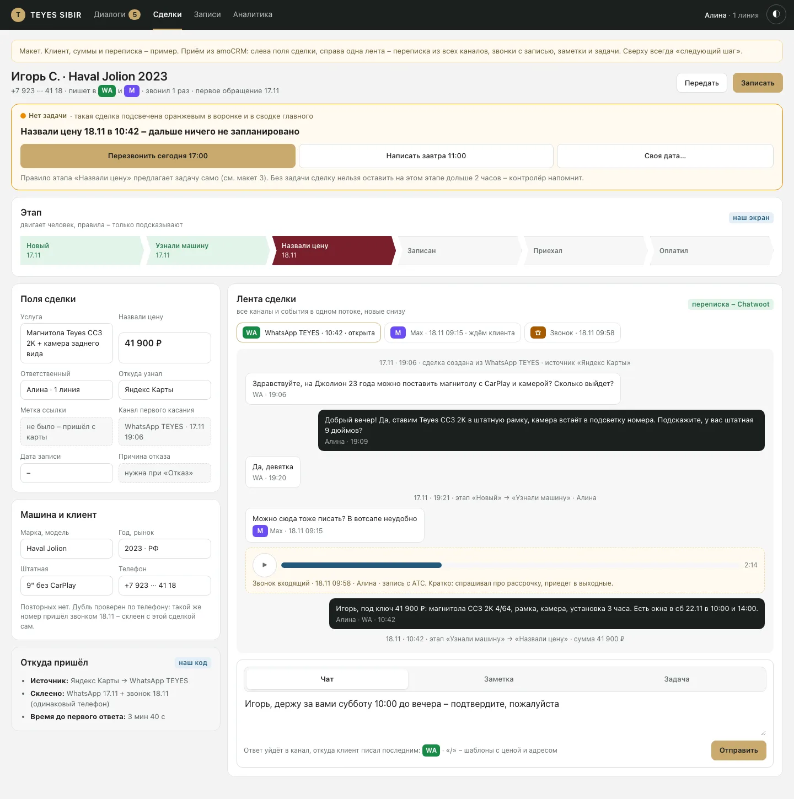
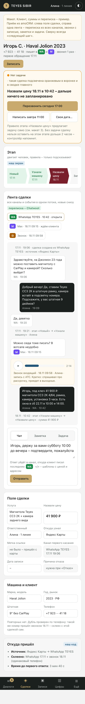
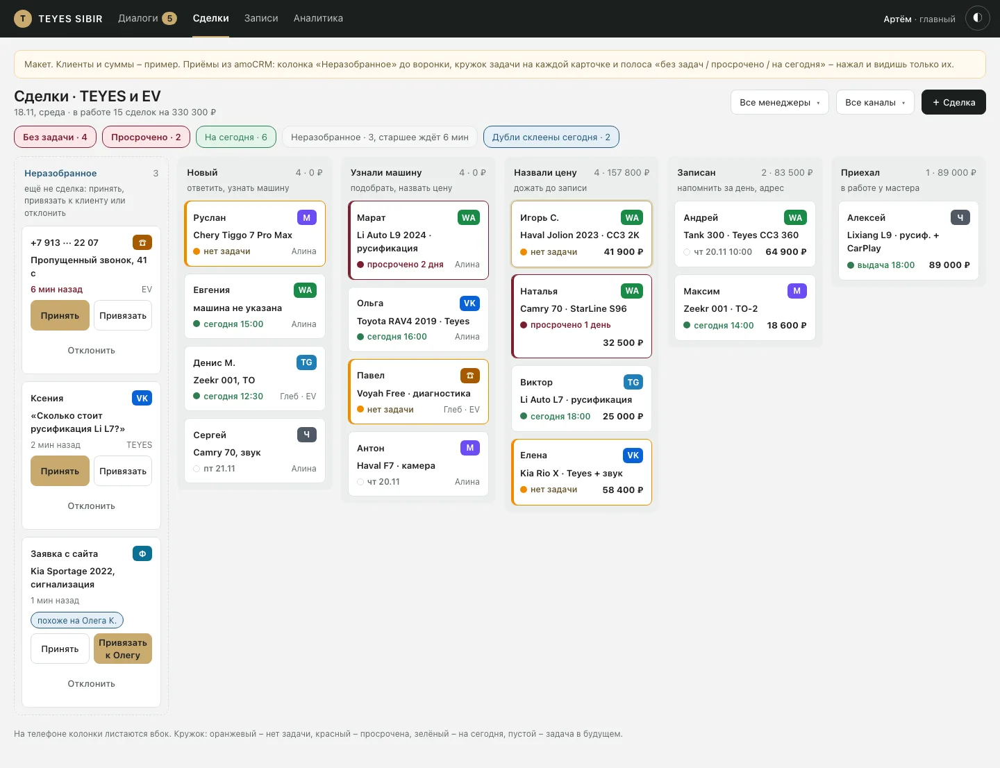
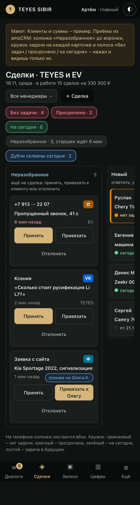
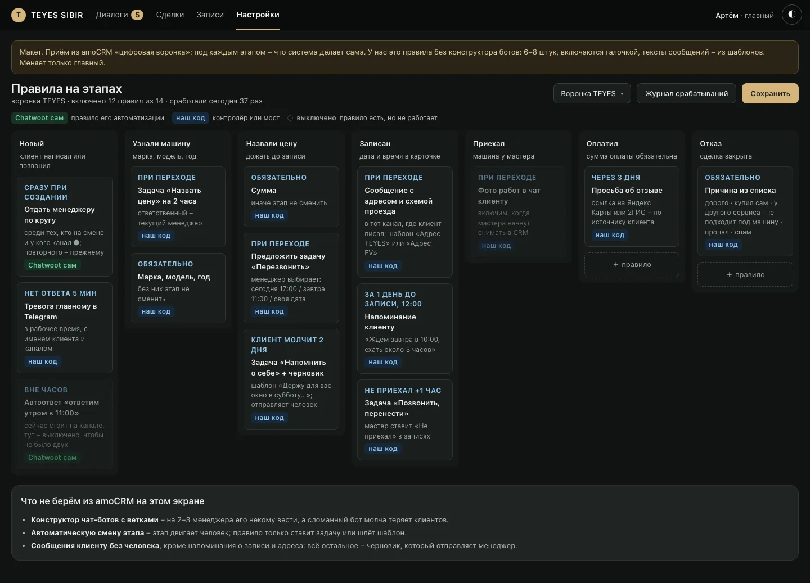
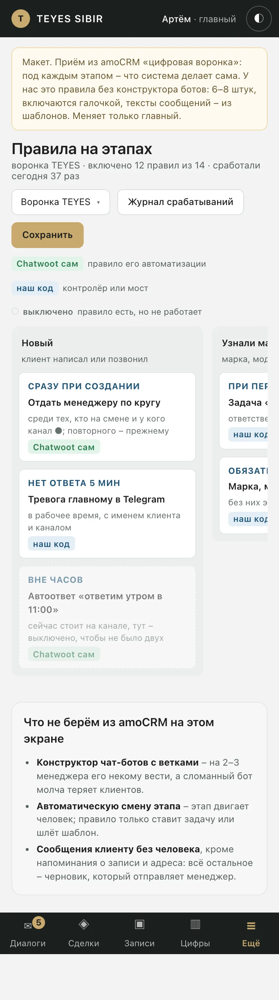

# amoCRM: берём 8 приёмов обработки лидов, копию не делаем – своя CRM за первый год стоит столько же, дальше в 15 раз дешевле

**Вывод.** Удобство amoCRM держится не на дизайне, а на трёх привычках, которые она навязывает менеджеру: у каждой сделки есть следующий шаг (нет задачи – карточка горит оранжевым), всё про клиента лежит в одной ленте справа от полей, а новые обращения сначала падают в «Неразобранное», где их принимают, склеивают с прежним клиентом или выкидывают. Эти приёмы и ещё пять переносим в нашу CRM на Chatwoot: 4 – в этап 1 (+ ≈ 22 000 ₽, ≈ 3 дня), остальные – в свой экран этапа 2 (+ ≈ 44 000 ₽, ≈ 5,5 дня). Копию amoCRM с их видом и названиями не делаем. Перейти на саму amoCRM с Wazzup для WhatsApp и Max – около 16 000 ₽ в месяц на 3 менеджеров плюс внедрение, своя – около 900 ₽ в месяц за сервер после разработки (все суммы – оценка, час = 1000 ₽, цены сняты 18.11.2026).

Что сделал: прочитал тарифы и 40 статей справки amoCRM, тарифы Wazzup, отзывы и разборы 2024–2026 годов, сверил с нашими 6 вариантами экрана и логикой ролей. В кабинет не входил, пробный аккаунт не заводил. Видео-обзоры не смотрел – справка закрыла все вопросы, видео только повторило бы её.

**Нужно от тебя**

- Буквы по 3 вопросам внизу. Совет: 1А 2Б 3А.
- Если хочешь сам «пощупать» amoCRM – скажи, заведу пробный аккаунт на 14 дней (вопрос 3В).

## 1. Удобство amoCRM – это следующий шаг, одна лента и разбор входящих, а не набор функций

### Что делает её удобной для обработки лидов

| Приём | Как устроен у amoCRM | Источник |
|---|---|---|
| **Следующий шаг у каждой сделки** | На карточке в воронке кружок: оранжевый – в сделке нет задач, красный с числом – задача просрочена на столько дней, зелёный – задача на сегодня. Сверху полоса «без задач / просрочено / на сегодня», нажатие фильтрует сделки. Кнопка активности в карточке сама пишет, что задач нет | [задачи в сделках](https://www.amocrm.ru/support/tasks/tasks_in_leads/), [кнопка активности](https://www.amocrm.ru/support/leads/button_activity/) |
| **Карточка сделки: поля слева, лента справа** | Слева поля сделки, контакта и компании, справа «фид событий» – переписка, звонки, примечания, задачи, смены этапов. Ширину частей можно тянуть | [карточка и поля](https://www.amocrm.ru/support/starting_work/cards/) |
| **Несколько бесед в одной карточке** | Если клиент пишет в разные мессенджеры, сверху «плашки бесед»: канал, время, превью, переход к нужному диалогу | [множественные беседы](https://www.amocrm.ru/support/leads/multichats/) |
| **Неразобранное** | Новое обращение из чата, формы или звонка с незнакомого номера – ещё не сделка. Кнопки «Принять» (создать сделку), «Привязать» (к существующей), «Отклонить». В анализе продаж – среднее время разбора и сколько заявок стали сделками | [чаты](https://www.amocrm.ru/support/starting_work/chats/), [звонки в неразобранном](https://www.amocrm.ru/support/incoming_leads/caller_in_unsorted/), [аналитика неразобранного](https://www.amocrm.ru/support/incoming_leads/analysis_of_unsorted/) |
| **Контроль дублей** | Ищет повтор по телефону, почте, пикселю сайта; для чатов – сразу. До 3 дублей – обновить сделку или создать новую, после склейки может поставить задачу. Отдельно – «Поиск дублей» с кнопками «Объединить / Не дубль» | [контроль дублей](https://www.amocrm.ru/support/incoming_leads/kontrol-dublej/), [объединение сделок](https://www.amocrm.ru/support/leads/merge_duplicate_leads/) |
| **Цифровая воронка** | Под каждым этапом – действия без менеджера: поставить задачу, отправить письмо или сообщение, запустить бота, сменить этап, поставить метку. Запуск – при входе в этап, по времени, по сообщению или звонку клиента, с задержкой от 1 минуты до 999 дней | [цифровая воронка](https://www.amocrm.ru/support/starting_work/digital_pipeline/), [условия запуска](https://www.amocrm.ru/support/digitalpipeline/trigger_conditions/), [задача по этапу](https://www.amocrm.ru/support/digitalpipeline/task_creation_trigger/) |
| **Salesbot** | Конструктор сценариев: сообщение, условие, проверка ответа, ожидание, действие в сделке, webhook. Есть распределение по кругу – 2–100 шагов | [Salesbot](https://www.amocrm.ru/support/digitalpipeline/salesbot/), [распределение](https://www.amocrm.ru/support/digitalpipeline/round-robin/) |
| **Единое окно чатов (imBox)** | Все беседы в одном разделе, статусы «Требует ответа / Не требует ответа / Закрытые», из чата меняется этап и метки | [imBox](https://www.amocrm.ru/support/communications/imbox/) |
| **Шаблоны ответов** | «/» в чате – шаблон с подстановкой полей сделки, до 13 кнопок для клиента | [шаблоны](https://www.amocrm.ru/support/communications/templates_chats/) |
| **Обязательные поля по этапу и причина отказа** | Поле обязательно на нужном этапе (тариф «Расширенный» и выше), у закрытой неуспешной сделки – причина отказа из списка | [тарифы](https://www.amocrm.ru/buy/), [API: причина отказа](https://www.amocrm.ru/developers/content/crm_platform/leads-api) |
| **Источник и метки ссылки** | В карточке вкладка «Статистика»: источник, UTM, данные с сайта, по ним фильтр и отчёты | [источники](https://www.amocrm.ru/support/leads/istochniki-sdelok/), [статистика](https://www.amocrm.ru/support/leads/section-statistics/) |
| **Телефония** | 200+ провайдеров через виджеты: всплывающая карточка, запись в карточке (хранит провайдер), пропущенный – в «Неразобранное» | [телефония](https://www.amocrm.ru/support/starting_work/phones/) |
| **Аналитика** | Анализ продаж – переходы и конверсия между этапами, время на этапе, прогноз; сводный отчёт; отчёт по сотрудникам (успешность = успешные / в работе); звонки; цели и план продаж | [анализ продаж](https://www.amocrm.ru/support/analytics/sales_analysis/), [по сотрудникам](https://www.amocrm.ru/support/analytics/employee_report/), [сводный](https://www.amocrm.ru/support/analytics/consolidated_report/), [цели](https://www.amocrm.ru/support/analytics/objectives/) |
| **Права** | По каждому действию: «Разрешено / Для группы / Если ответственный / Запрещено», отдельно права на «Неразобранное» и на этапы, роли | [права](https://www.amocrm.ru/support/user/setting_right_users/), [пользователи](https://www.amocrm.ru/support/starting_work/users/) |
| **Мобильное приложение** | Нижняя панель с вкладкой «Входящие», запуск и остановка ботов из карточки. Нет офлайна и приложения для планшета | [приложение](https://www.amocrm.ru/support/mobile_apps/mobile_app/) |
| **ИИ** | «Сделки, требующие внимания» – модель сама находит выпавшие из процесса; ИИ-агент отвечает в чатах, только на «Профессиональном», ключ OpenAI или YandexGPT свой | [требующие внимания](https://www.amocrm.ru/support/amma-ai/require-attention/), [ИИ-агент](https://www.amocrm.ru/support/amoai/ai_agent/) |

### Тарифы на 18.11.2026 (за пользователя в месяц, [amocrm.ru/buy](https://www.amocrm.ru/buy/))

| Тариф | Цена | Что важно для нас |
|---|---|---|
| Базовый | 599 ₽ | воронка, задачи, чаты, imBox, шаблоны, контроль дублей. **Нет** Salesbot, обязательных полей по этапу, правил на этапах, статистики звонков |
| Расширенный | 1 299 ₽ | всё нужное для обработки лидов: Salesbot, правила на этапах, обязательные поля, автосклейка неразобранного, статистика звонков, цели |
| Профессиональный | 1 799 ₽ | плюс скоринг, поиск по беседам, ИИ-ответы и ИИ-агент (токены – пакетами, 999 ₽ за 100 000) |
| «Микро-бизнес» | 8 999 ₽ в год на 2 пользователей | функции Базового |

Цены растут: в разборе на vc.ru «Расширенный» после повышения в сентябре 2025 стоил 1 199 ₽ ([vc.ru, 2026](https://vc.ru/services/2762746-amocrm-2026-vysokaya-tsena-voronki-prodazh)), сейчас на сайте 1 299 ₽. Серверы amoCRM – в России ([amocrm.ru/security](https://www.amocrm.ru/security/)), так что «данные в РФ» – не наш довод против неё.

## 2. Берём 8 приёмов: 4 в этап 1 на Chatwoot как есть, 4 в свой экран этапа 2

### Макет 1. Карточка сделки: поля слева, лента справа, следующий шаг сверху

[Открыть живой макет](a1-sdelka.html)

- **Сверху – следующий шаг.** Нет задачи – оранжевая плашка и три готовые кнопки: «Перезвонить сегодня 17:00», «Написать завтра 11:00», «Своя дата». Одним нажатием, без формы задачи.
- **Лента одна на все каналы:** WhatsApp, Max, звонок с записью и кратким итогом, смены этапа. Сверху плашки бесед. Ответ уходит в канал, где клиент писал последним.
- **Внизу – переключатель «Чат / Заметка / Задача»**, как кнопка активности у amoCRM.
- **На телефоне** лента идёт первой, поля – ниже.

### Макет 2. Воронка с «Неразобранным» и кружком задачи

[Открыть живой макет](a2-voronka.html)

- **Первая колонка – ещё не сделки:** пропущенный звонок, вопрос из ВК, заявка с сайта. «Принять», «Привязать» (если похоже на прежнего клиента – кнопка подсказывает к кому), «Отклонить» – спам и дубли не попадают в аналитику.
- **Кружок на каждой карточке:** оранжевый – нет задачи, красный – просрочена, зелёный – на сегодня.
- **Полоса сверху** – «без задачи 4 · просрочено 2 · на сегодня 6»: нажал – видишь только их.

### Макет 3. Правила на этапах вместо конструктора ботов

[Открыть живой макет](a3-pravila.html)

- **Под каждым этапом – что система делает сама:** задача «Назвать цену» на 2 часа, адрес и схема проезда при записи, напоминание за день, просьба об отзыве через 3 дня после оплаты.
- **Без конструктора с ветками:** 6–8 правил, включаются галочкой. Этап двигает только человек, клиенту без человека уходят только адрес и напоминание.

### Таблица: что берём

Решения: «этап 1» – на Chatwoot как есть, без своего экрана; «этап 2» – в своём экране оператора. Номера этапов – из [логики ролей](https://tema-mail.github.io/razbory/teyes-crm-logika-8e921a01/).

| Приём amoCRM | Зачем нам | Есть у нас | Решение |
|---|---|---|---|
| Следующий шаг у каждой сделки, «нет задачи» | ни один клиент с названной ценой не висит без звонка | нет: в логике только «Отложен до даты» | **Этап 1:** контролёр «назвали цену, нет отложенного касания» + строка в сводке 9:00 (4 ч). **Этап 2:** плашка и кнопки, макет 1 |
| Полоса «без задачи / просрочено / на сегодня» | главный за 5 секунд видит дыры | частично: пульт v5 «ждёт > 5 мин» | **Этап 2**, макет 2 |
| Склейка дублей по телефону между каналами | написал в WhatsApp, потом позвонил – одна сделка, а не две | нет | **Этап 1:** склейка контактов Chatwoot по телефону (8 ч) |
| Обязательные поля по этапу | аналитика без дыр | есть: поля перед закрытием и по стадиям в логике | **Этап 1:** проверять при смене стадии, а не только при закрытии (2 ч) |
| Анализ продаж: конверсия, время на этапе, время разбора входящих | видно, где застревают | частично: `analitika.py`, макет m4 | **Этап 1:** добавить время на этапе и время до первого ответа по менеджерам (8 ч) |
| Неразобранное: принять / привязать / отклонить | спам и повторы не считаются лидами | частично: очередь «Без ответственного», метки `не_лид`, `дубль` | **Этап 2**, макет 2 |
| Карточка «поля слева – лента справа», плашки бесед, звонок в ленте | вся история клиента на одном экране | частично: v1 три колонки, m3 карточка | **Этап 2**, макет 1 – донастройка экрана v6+v1 |
| Правила на этапах (цифровая воронка) | рутина без людей | нет | **Этап 2**, макет 3, правила кодом без экрана настройки (вопрос 2) |
| Причина отказа из списка | видно, почему теряем | есть в логике | уже есть |
| Раздача по кругу | ровная нагрузка | есть: Chatwoot сам | уже есть |
| Шаблоны с «/» и подстановкой | быстрый ответ | есть: быстрые ответы Chatwoot, черновик из прайса в v3 | уже есть |
| Права по этапам, роли | закрыть деньги от первой линии | частично: роли в логике, в Chatwoot только админ и агент | **Потом**, когда людей станет больше 3 |
| Цели и план продаж менеджера | премия по факту | нет | **Потом** |
| Автозакрытие беседы и опрос NPS | порядок в чатах, оценка | частично: статусы Chatwoot | **Потом**: сначала просьба об отзыве (в правилах) |
| Мобильное приложение «Входящие» | ответить с телефона | есть: вариант 4 | этап 3 экрана, как было |
| Salesbot – конструктор ботов | – | – | **Не берём**: на 2–3 менеджера его некому вести, сломанный бот молча теряет клиентов |
| ИИ-агент, «требующие внимания», скоринг | – | ИИ – опция этапа 4 в логике | **Не берём сейчас**: нужно 4–6 недель живых переписок |
| Покупатели, ретаргетинг, карта лояльности | – | – | **Не берём**: это розница, не наш процесс |

### Что у amoCRM неудобно – не повторяем

| Минус | Откуда | Что делаем мы |
|---|---|---|
| Задача, привязанная к контакту, не считается в сделке – кружок «нет задачи» врёт | [справка amoCRM](https://www.amocrm.ru/support/tasks/tasks_in_leads/) | задача только у сделки |
| У задачи один ответственный, нельзя приложить файл | [частые вопросы](https://www.amocrm.ru/support/tasks/questions_about_tasks/) | при передаче – заметка из трёх строк, как в логике |
| Сообщения из мессенджеров приходят с задержкой 30–40 минут, иногда двоятся | отзывы на [startpack](https://startpack.ru/application/amocrm-online/reviews), 28.03.2024 и 26.01.2026 | мосты свои: тревога, если сообщение не дошло за 5 минут, защита от двойной доставки |
| ИИ-помощник висит на всех экранах, отключить нельзя | там же, 06.11.2026 | ИИ – только по твоему «да» и выключаемый |
| Каждая доработка – отдельный виджет и подписка, ломается при обновлении | [sostav.ru, 26.02.2026](https://www.sostav.ru/blogs/229911/78286), [vc.ru, 2026](https://vc.ru/services/2762746-amocrm-2026-vysokaya-tsena-voronki-prodazh) | всё в одном коде, тесты на каждый мост |
| Отчёты фиксированные, нужное выгружают в таблицы | startpack, 15.01.2021; vc.ru, 2026 | отчёты пишем под наши вопросы |
| Десятки обязательных полей – менеджеры начинают их обманывать | [dtf.ru](https://dtf.ru/id3509608/5301673-nedostatki-amocrm) | 3–4 обязательных поля на этап, не больше |

## 3. «Сделать такую же»: копию не делаем, своё с их приёмами окупается за первый год

### Почему не копия

- **Их вид и названия – их бренд.** Скопированный экран amoCRM с их словами («Неразобранное», Salesbot, imBox) – чужой дизайн. Берём приёмы, слова и вид – наши, в стиле кабинетов Elite Rose и EV.
- **Копировать всю amoCRM незачем:** половина её функций – розница, рассылки, ретаргетинг, конструктор ботов. Нам нужна обработка обращений установочного центра.
- **Основа у нас уже есть:** Chatwoot даёт окно чатов, раздачу, статусы, быстрые ответы. Сверху пишем то, чего у него нет: сделку со стадиями, следующий шаг, склейку, правила, аналитику с деньгами.

### Деньги: amoCRM + Wazzup против своей (3 менеджера, оценка)

| | amoCRM + Wazzup | Своя на Chatwoot |
|---|---|---|
| Лицензия CRM | «Расширенный» 1 299 ₽ × 3 = **3 897 ₽/мес** | 0 ₽ – Chatwoot бесплатный |
| WhatsApp TEYES, WhatsApp EV, Max-аккаунт | Wazzup PRO 4 000 ₽ за канал × 3 = **12 000 ₽/мес** (при оплате за год 9 600 ₽), до 500 диалогов на канал в месяц ([wazzup24.ru/pricing](https://wazzup24.ru/pricing/), 18.11.2026) | 0 ₽: свои шлюзы, WhatsApp через наш туннель |
| ВКонтакте, Telegram-бот | встроены | встроены (мост ВК уже работает) |
| Сервер | у amoCRM | FirstVDS Москва, **874 ₽/мес**, уже оплачен |
| Разработка и внедрение | интегратор: 30 000–120 000 ₽ ([vc.ru, июнь 2026](https://vc.ru/marketing/2949862-stoimost-vnedreniya-amocrm)) | этапы 1 и 2 из логики 149 000 ₽ + приёмы amoCRM 66 000 ₽ = **≈ 215 000 ₽** |
| **Первый год** | ≈ 162 000–191 000 ₽ подписок + внедрение = **≈ 190 000–310 000 ₽** | **≈ 225 000 ₽** |
| **Каждый следующий год** | **≈ 162 000–191 000 ₽**, растёт с ценами и числом менеджеров | **≈ 10 500 ₽** + доработки по желанию |
| Срок до работы | 1–3 недели | ≈ 3 недели (этап 1 – 3–4 дня) |

Важное про amoCRM для нас:

- **Max-аккаунт и WhatsApp сама она не подключает.** Встроены ВКонтакте, Telegram-боты и Max-бот, а Max-бот не может написать клиенту первым ([справка Max](https://www.amocrm.ru/support/incoming_leads/max/)). Наш Max-аккаунт и оба WhatsApp – только через Wazzup или похожий сервис, это ещё одна подписка и ещё одна компания, через которую идёт переписка.
- **Внутри amoCRM нет «привёл / записал», денег из «АвтоДилер Онлайн» и нашей тревоги в Telegram** – это снова виджеты или интегратор.
- **Зато amoCRM готова сегодня** и не требует нашего сопровождения. Если CRM нужна завтра и надолго не больше 2–3 человек – это честная альтернатива.

## Вопросы

1. **Что из приёмов amoCRM в этап 1.** А – четыре: следующий шаг (контролёр и сводка), склейка дублей по телефону, обязательные поля по стадии, время на этапе в аналитике (+ ≈ 22 000 ₽, + ≈ 3 дня к 27 часам этапа 1). Б – только склейка дублей и следующий шаг (+ ≈ 12 000 ₽, + 1,5 дня). В – ничего, этап 1 как в логике (0 ₽). **Совет – А.**
2. **Что в этап 2.** А – всё: карточка из макета 1, воронка с неразобранным из макета 2, правила на этапах с экраном настройки из макета 3 (+ ≈ 60 000 ₽, + ≈ 8 дней к 122 часам этапа 2). Б – то же, но правила зашиты кодом без экрана настройки, меняешь через меня (+ ≈ 44 000 ₽, + ≈ 5,5 дня). В – этап 2 как в логике, без приёмов amoCRM (0 ₽). **Совет – Б:** на 2–3 менеджера правила меняются редко.
3. **Своя или amoCRM.** А – своя на Chatwoot с приёмами amoCRM, как выше. Б – переходим на amoCRM «Расширенный» + Wazzup (≈ 16 000 ₽/мес на 3 менеджеров + внедрение 30 000–120 000 ₽, 1–3 недели). В – своя, но 14 дней бесплатной amoCRM параллельно, чтобы ты сам посмотрел интерфейс (0 ₽ за amoCRM, ≈ 8 000 ₽ моей настройки, 1 день). **Совет – А.**

## Что раскрыть

1. Как «следующий шаг» ложится на «Отложен до даты» в Chatwoot без своего экрана.
2. Склейка дублей: по каким полям и что делать, если номер один, а люди разные (муж и жена).
3. Wazzup против наших шлюзов: что будет, если WhatsApp заблокирует номер.
