# Экран оператора CRM: 6 вариантов, советую наш стиль с перепиской в три колонки

**Вывод.** Нарисовал 6 живых макетов экрана менеджера первой линии поверх Chatwoot. Основой советую вариант 6 «в нашем стиле» (как кабинеты Elite Rose и EV), а внутрь взять переписку из варианта 1, таймер и горячие клавиши из 3, пульт из 5 и телефонную шторку записи из 4. Первый рабочий шаг – около 11 дней, весь набор – около 18 дней (оценка, час = 1000 ₽, день = 8 часов).

Все макеты статичные, данные в них – пример. Каждый открывается по ссылке, работает на 1440 и 390 px, есть светлая и тёмная тема (кнопка ◐).

## Нужно от тебя

- **Выбрать букву** в вопросе внизу страницы.
- **Подтвердить этапы воронки:** Новый → Узнали машину → Назвали цену → Записан → Приехал. Если этапы другие – назови.
- **Прайс для черновиков ответа:** откуда брать цены (таблица, сайт, 1С), чтобы менеджеру не набирать цену руками.

## 1. Пять вариантов по известным приёмам – у каждого свой сильный ход

### Вариант 1. Три колонки: список · переписка · карточка клиента

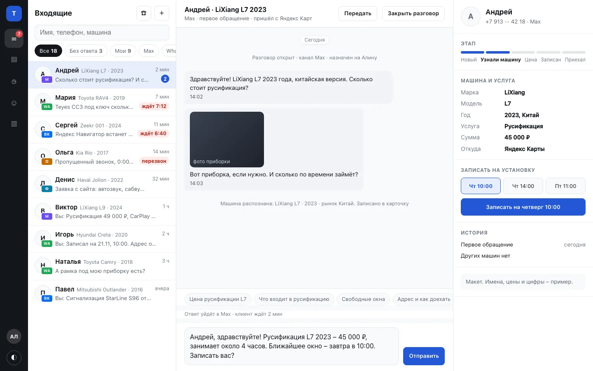

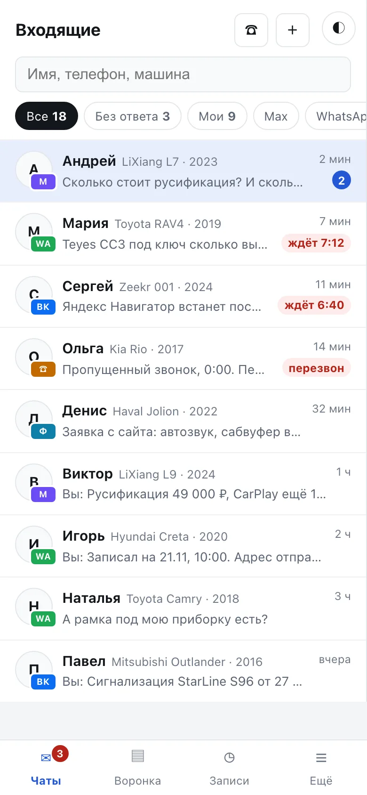

[Открыть живой макет](v1.html)

- **Идея:** привычный мессенджер. Слева все каналы в одном списке с фильтрами и «ждёт 7:12», в центре переписка с готовыми ответами, справа машина, этап, сумма, откуда узнал и кнопка записи на свободное окно.
- **Кому удобно:** менеджеру, который весь день в чатах. Не теряется контекст клиента.
- **Минус:** не видно воронку целиком, владельцу нужен отдельный экран цифр.
- **Срок:** около 8 дней (≈ 64 000 ₽).

### Вариант 2. Воронка-канбан, переписка боковой панелью

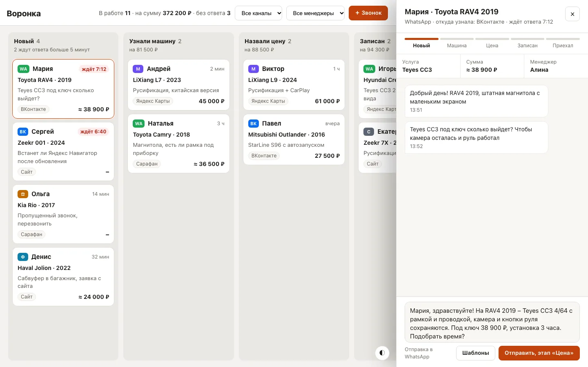

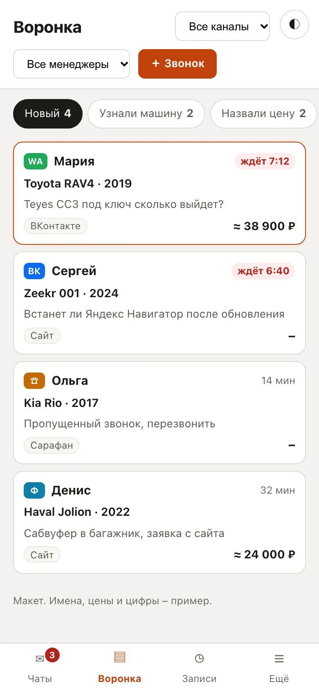

[Открыть живой макет](v2.html)

- **Идея:** лиды карточками по этапам с суммой в каждом столбце. Нажал на карточку – справа переписка, ответ сразу двигает лида на следующий этап.
- **Кому удобно:** тому, кто ведёт лида до записи и следит за деньгами в работе.
- **Минус:** при 20+ новых в час доска захламляется, отвечать удобнее из списка.
- **Срок:** около 9 дней (≈ 72 000 ₽), перетаскивание карточек – основная работа.

### Вариант 3. Одна очередь: один разговор на весь экран

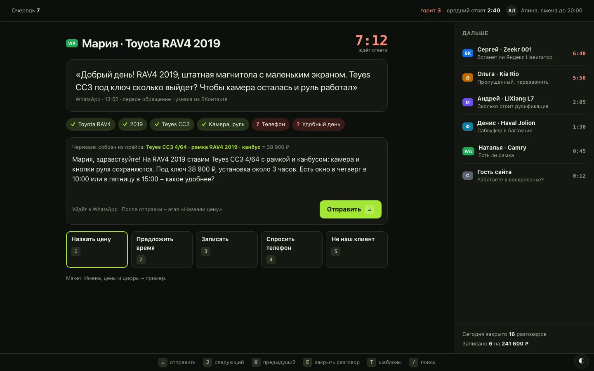

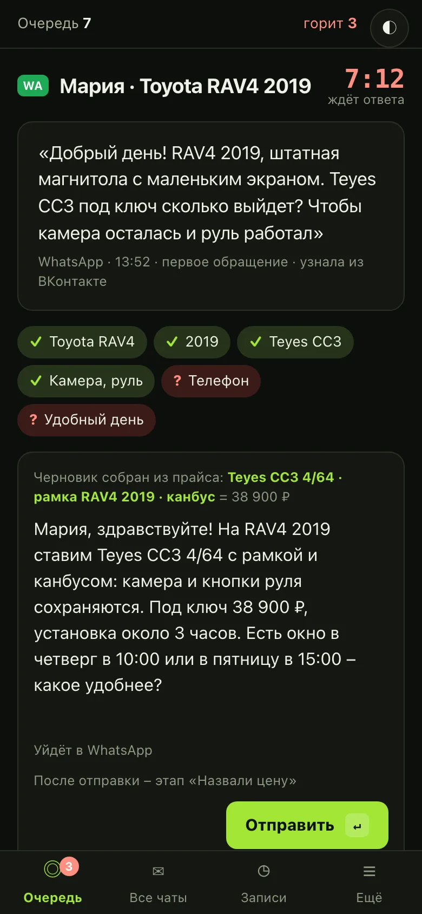

[Открыть живой макет](v3.html)

- **Идея:** менеджер видит только следующий разговор: крупно вопрос клиента, таймер ожидания, что уже известно (машина, год, телефон), черновик ответа с ценой из прайса и 5 кнопок шага с цифрами 1–5 на клавиатуре. Справа – кто следующий.
- **Кому удобно:** при потоке обращений, когда важна скорость первого ответа.
- **Минус:** нужен прайс в таблице, иначе черновик пустой. Не видно общей картины.
- **Срок:** около 9 дней (≈ 72 000 ₽) с черновиком из прайса.

### Вариант 4. Телефон как основной инструмент

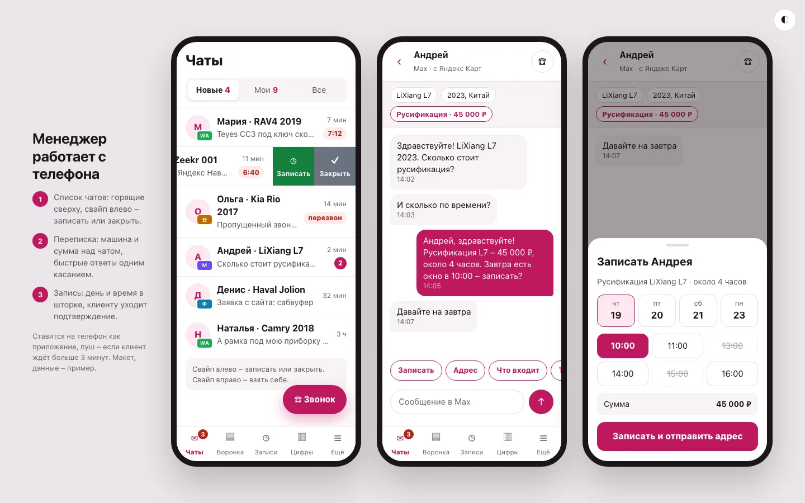

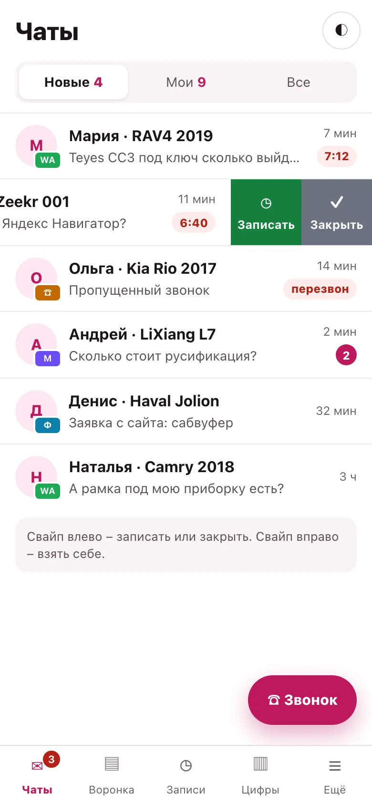

[Открыть живой макет](v4.html)

- **Идея:** приложение на телефон (ставится с сайта, без магазина приложений). Таб-бар внизу, свайп влево по чату – «Записать» или «Закрыть», кнопка «＋ Звонок», запись в шторке: день, время, сумма, клиенту уходит адрес. Пуш, если клиент ждёт больше 3 минут.
- **Кому удобно:** менеджеру не за столом и тебе – ответить с телефона.
- **Минус:** длинную переписку и цифры на телефоне читать хуже, компьютерный экран всё равно нужен.
- **Срок:** около 10 дней (≈ 80 000 ₽), пуши и свайпы – основная работа.

### Вариант 5. Пульт владельца

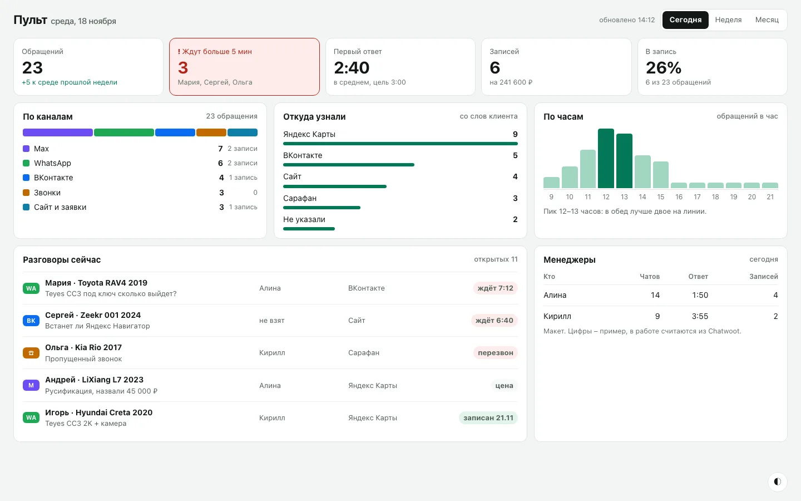

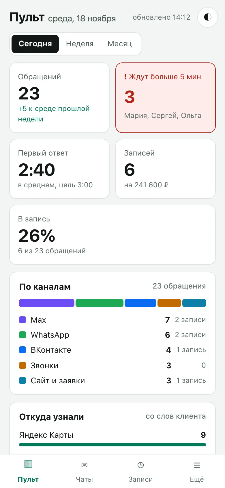

[Открыть живой макет](v5.html)

- **Идея:** сверху цифры дня: обращения, кто ждёт больше 5 минут (красным, с именами), средний первый ответ, записи и сумма, доля в запись. Ниже – каналы, «откуда узнали», нагрузка по часам, живые разговоры и менеджеры.
- **Кому удобно:** тебе – за 10 секунд понять, как работает линия.
- **Минус:** это не рабочий экран менеджера, а дополнение к любому из вариантов.
- **Срок:** около 6 дней отдельно (≈ 48 000 ₽) или +3 дня вкладкой к другому варианту.

## 2. Шестой вариант – в нашем стиле, его быстрее всего довести

### Вариант 6. Кабинет как Elite Rose и EV: шапка-вкладки, плитки, доска

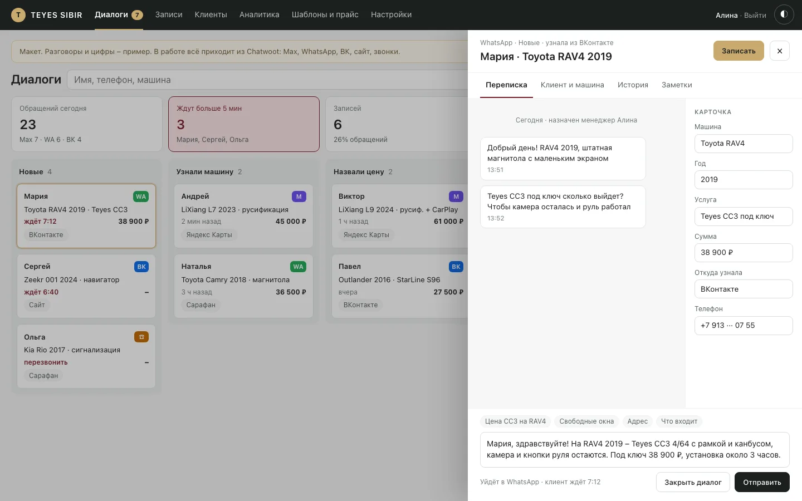

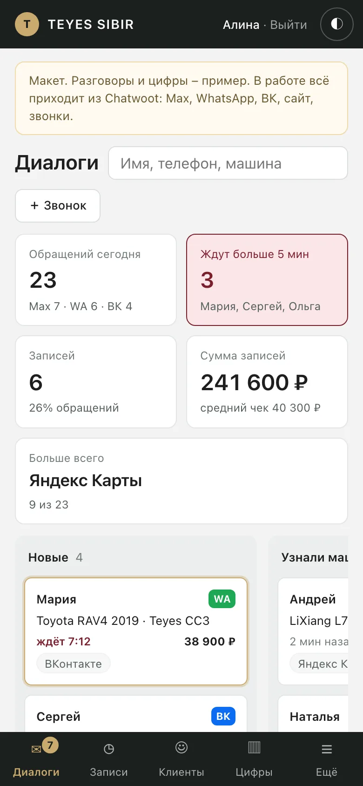

[Открыть живой макет](v6.html)

- **Идея:** тёмная шапка с вкладками и золотом, плитки цифр дня, доска диалогов по этапам и правая панель как карточка товара в эталоне: переписка, карточка клиента с машиной и источником, шаблоны ответов, «Записать».
- **Кому удобно:** всем, кто уже видел наши кабинеты, – учить заново нечего. Шапка, плитки и доска переносятся с готового кода Elite Rose, вход – как у EV, с СВЕРХ админом.
- **Минус:** панель переписки узкая, при долгой переписке тесно. Лечится перепиской из варианта 1.
- **Срок:** около 9 дней (≈ 72 000 ₽).

## 3. Лучше совместить: оболочка 6, переписка 1, куски 3–5

| Шаг | Что делаем | Срок | Деньги |
|---|---|---|---|
| 1 | Оболочка 6 + переписка в три колонки из 1 при открытии диалога + таймер «ждёт» и клавиши из 3 | ≈ 11 дней | ≈ 88 000 ₽ |
| 2 | Вкладка «Аналитика» – пульт из 5 | ≈ 3 дня | ≈ 24 000 ₽ |
| 3 | Телефон: таб-бар, свайпы, шторка записи и пуши из 4 | ≈ 4 дня | ≈ 32 000 ₽ |
| | Итого | ≈ 18 дней | ≈ 144 000 ₽ |

Это оценка, не смета: точнее скажу после проверки API Chatwoot на наших каналах (Max и звонки). Во всех сроках уже заложена общая основа: вход, связь с Chatwoot, отправка в каналы, поля «машина, источник, сумма, этап».

**Вопрос: какой берём?**

- **А** – совмещаем, как советую: оболочка 6, переписка 1, дальше шаги 2 и 3.
- **Б** – только вариант 6 как есть.
- **В** – другой вариант основой (назови номер).
- **Г** – ни один не зашёл, рисую заново (скажи, что мимо).

## Что раскрыть

- Как каждый экран ходит в Chatwoot по API и что придётся хранить у себя (этап, сумма, источник).
- Черновик ответа с ценой из прайса: просто подстановка или ИИ, и сколько стоит ИИ на обращение.
- Как считать «ждёт больше 5 минут» ночью и в выходные.
