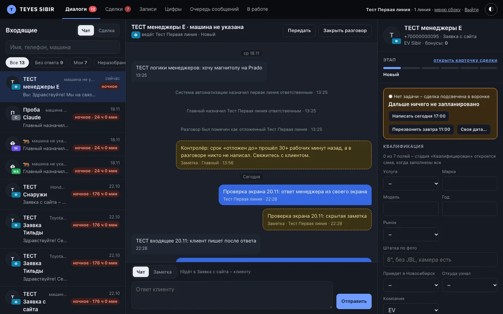
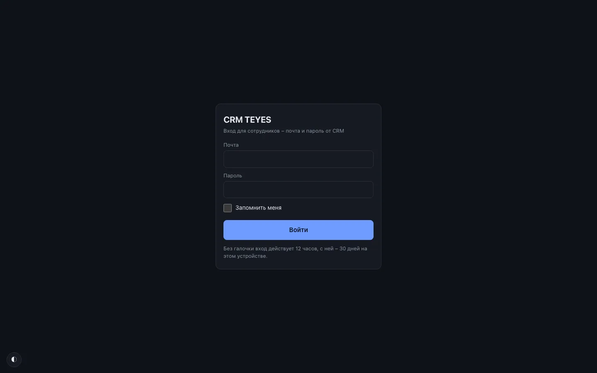
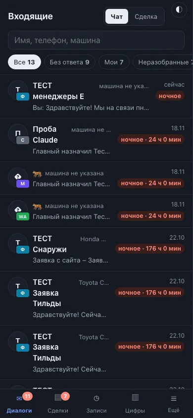

# Свой экран CRM работает на живых каналах EV

**Твой экран вместо Chatwoot уже открыт на адресе разработки и работает на живой CRM: менеджер входит своей почтой и паролем, видит переписку из шести каналов и отвечает клиенту от своего имени. Блок 0 (доделки стенда) закрыт полностью, ядро сделано на 8 шагов из 16.**

Адрес: [ekran.stend.deford.ru](https://ekran.stend.deford.ru). Сначала общий вход СВЕРХ админа, потом твоя почта и пароль от CRM (те же, что в Chatwoot) – войдёшь главным.

## 1. Что проверено на живой CRM

- **Вход.** Тестовый менеджер первой линии вошёл своей почтой и паролем, получил роль «1 линия». Неверный пароль, запрос без входа, запрос без общего пароля – отказ.
- **Переписка.** Экран загрузил из Chatwoot 16 разговоров и 79 сообщений из шести каналов: Max, WhatsApp, ВКонтакте, чат на сайте, заявки с сайта, звонки.
- **Ответ клиенту.** Ответ из экрана лёг в Chatwoot от имени самого менеджера, а не робота и не главного. Скрытая заметка – скрытой.
- **Входящее.** Тестовое сообщение клиента появилось в экране через 2 секунды.
- **Автосообщение.** На входящее вне рабочих часов отдельный пользователь-робот отправил ночной автоответ.
- **Соседи.** Коды ответа 37 сайтов на сервере до и после выкладки совпали. Экран занимает 22 МБ памяти из 128.

Ответ, заметку и входящее пробовал на тестовом разговоре канала «Заявки с сайта» – оттуда наружу ничего не уходит. В Max, WhatsApp и ВК из экрана я ещё не писал: проверю вместе с тобой, это твои же тестовые переписки.

## 2. Что стоит на предохранителе

Каналы EV живые, поэтому **автосообщения клиентам выключены для всех разговоров, кроме девяти тестовых**. Ночной автоответ, напоминания, «ждём вас», бонусы и отзывы настоящему клиенту EV сейчас не уйдут. Ручной ответ менеджера работает всегда.

Включу после твоего «да» и после того, как дашь адрес и тексты EV: сейчас в шаблонах вместо адреса стоит заглушка.

## 3. Что сделано в коде

| Что | Состояние |
|---|---|
| Блок 0: неявка, ночной автоответ, «Неделя», лист ожидания, напоминания о бонусах, мастер по посту, WhatsApp цифрами, страница гарантии | Сделано, на [стенде](https://crm.stend.deford.ru) |
| Клиент Chatwoot, вход и права менеджеров, база | Сделано, прошло независимую ревизию, 8 дефектов исправлены |
| Зеркало переписки и приём событий | Сделано, проверено вживую |
| Экран входа, отправка ответа и заметки | Сделано, проверено вживую |
| Статус «в сети», передача между менеджерами, стадии и поля насквозь | Пишется сейчас |
| Вложения, шаблоны ответов, пульт на живых цифрах, воронка, каналы на менеджера | Дальше |

Тестов в коде экрана – 175, все проходят. Независимая проверка плана дала 12 замечаний, независимая ревизия кода – 8 дефектов; всё внесено до выкладки.

## 4. Чего пока нет в экране

- **Менеджер не становится «в сети» для раздачи.** Пока шаг не выложен, новые разговоры мосты ему не раздают.
- **Передача и стадии не доходят до Chatwoot.** Кнопки есть, но аналитика и контролёр мостов их пока не видят.
- **Вложения только читаются.** Отправить фото из экрана нельзя.
- **Пульт, воронка, записи и акты** открываются, но на живых данных не проверены.
- **Вход главным не пробовал:** твой пароль я не использую. Если не пустит – напиши, что показал экран.

## Нужно от тебя

1. **Зайди и посмотри.** Скажи, что не так на глаз.
2. **Адрес и часы EV и TEYES, суббота** – без них автосообщения остаются выключенными.
3. **Мастер-приёмщик пишет клиенту или нет.** Сейчас может – как было на стенде.
4. **Менеджеры: имя, почта, линия.** Заведу их, и экран можно показывать людям.
5. **«По советам – да»** по разборам логики и пути клиента или буквы, которые меняешь.

## Что раскрыть

1. Как устроено ядро: что хранит Chatwoot, что – экран.
2. Что нашли проверка плана и ревизия кода и как это закрыто.
3. Блок 0 на стенде по пунктам.
4. Что осталось до переключения crm.teyes-sibir.ru на экран.
