# CRM первой линии: линии, каналы на менеджера, передача и сквозная аналитика встают на Chatwoot за 3–4 дня, автодилер – на той же основе

**Вывод.** Почти всё, что ты хочешь, Chatwoot уже умеет: линии – это его команды, «каналы на менеджера» – участники канала, передача – смена ответственного с заметкой, статусы и метки – свои. Нашего кода нужно немного: обязательная заметка при передаче, обязательные поля перед закрытием, «повторный клиент – к прежнему менеджеру» и разрез аналитики по менеджерам с деньгами. Минимум для 2–3 менеджеров – около 27 часов (≈ 27 000 ₽, 3–4 рабочих дня, оценка). Автодилер – та же основа плюс своя «сделка» с машиной, трейд-ином и оплатой, около 22 рабочих дней (оценка).

> **Как понял «автодилер»:** версия этой CRM для продажи машин (пример – Community Dealer). Если ты имел в виду программу «АвтоДилер Онлайн», где у TEYES запись и деньги, – это другая задача, она в вопросе 5.

Всё ниже – предложение, ждёт твоего «да». Цифры в макетах – пример, не факт. Зелёная пометка на макетах – Chatwoot умеет сам, синяя – наш код поверх него.

**Нужно от тебя**

- Буквы по 7 вопросам внизу. Совет: 1А 2Б 3А 4А 5А 6А 7А.
- Имена и почты менеджеров: кто на первой линии, кто на второй (мастер, подбор).
- Часы работы TEYES и EV, работает ли суббота.

**Путь клиента одной картинкой**

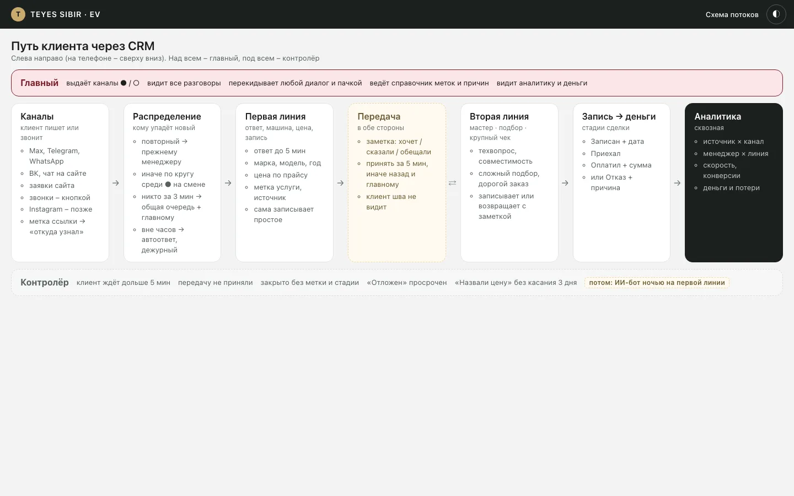

[Открыть схему](shema.html) · на телефоне она идёт сверху вниз.

## 1. Роли и каналы: главный раздаёт, первая линия отвечает, вторая решает сложное

### Кто что видит и может

| Роль | В Chatwoot | Видит | Может | Не может |
|---|---|---|---|---|
| **Главный** (ты) | администратор | все разговоры и каналы, аналитику и деньги | выдать каналы, передать любой диалог и пачкой, править метки, причины отказа, часы | – |
| **Первая линия** | агент, команда «Первая линия» | новые из своих каналов ●, свои разговоры | ответить, узнать машину, назвать цену по прайсу, записать, поставить метки и стадию, передать | менять справочники, видеть чужие каналы ○/– |
| **Вторая линия** (мастер, подбор, крупный чек) | агент, команда «Вторая линия» | только переданное ему и своё | ответить, записать, вернуть на первую линию с заметкой | получать новые (их раздаёт только первой линии) |
| **Наблюдатель** (партнёр, маркетолог) | **нет входа в Chatwoot** | только страницу аналитики, без имён и телефонов | смотреть цифры | писать клиентам |

Наблюдателя в Chatwoot не заводим: своих ролей в бесплатной версии нет, есть только «администратор» и «агент» (проверено 21.10, в `РЕШЕНИЯ.md`). Поэтому наблюдатель – это вход на нашу страницу аналитики, как сейчас у тебя на `/hooks/analitika`.

### Каналы на менеджера: три состояния клетки

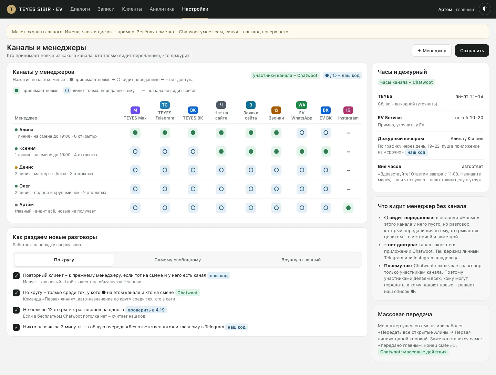

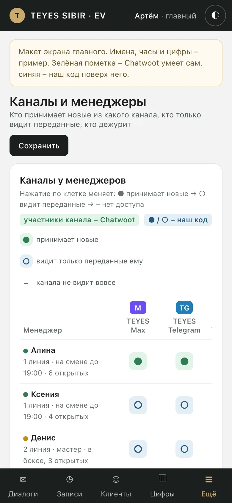

[Открыть макет «Каналы и менеджеры»](m1-kanaly.html)

- **● принимает новые** – новые разговоры из этого канала падают ему.
- **○ видит переданные** – в очереди «Новые» этого канала у него пусто, но разговор, переданный лично ему, открывается целиком.
- **– нет доступа** – канала не видно и в приложении Chatwoot (так держим личный Telegram или Instagram).

Почему три, а не «есть / нет»: Chatwoot показывает разговор только участникам канала. Если мастер не участник WhatsApp, ему нельзя передать клиента из WhatsApp. Поэтому участниками канала делаем всех, кому могут передать, а кому падают новые – решает наш список ●. Это главное место, где нужен свой код (≈ 12 ч в этапе 2; в этапе 1 – так же, но настройкой руками).

### Как раздаём новые

1. **Повторный клиент – к прежнему менеджеру**, если тот на смене и у него ● на этом канале. Клиент не объясняет всё заново. Свой код (≈ 8 ч).
2. **Иначе по кругу** среди тех, у кого ●, и кто в сети. Из коробки: правило автоматизации «новый разговор → команда Первая линия» + авто-назначение по кругу.
3. **Потолок открытых** на менеджера (например, 12). В бесплатной версии может не быть – проверить на 4.19; если нет, считает наш код.
4. **Никто не взял за 3 минуты** – разговор в общей очереди «Без ответственного» и тебе в Telegram (бот оповещений уже есть, `bridges/opoveshcheniya.py`).
5. **Вне часов** – автоответ канала (уже настроен, пн–пт 11–19 НСК) и, если решишь, дежурный вечером с пушем на слово «срочно».

Ушёл со смены или заболел – «Передать все открытые Алины → Первая линия» одной кнопкой (массовые действия Chatwoot), заметка ставится сама.

## 2. Передача, статусы и метки: шов не виден клиенту, «чей ход» не путается с «где деньги»

### Передача диалога

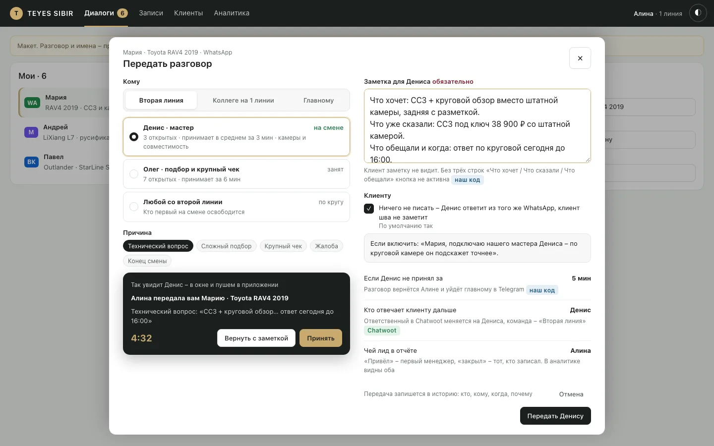

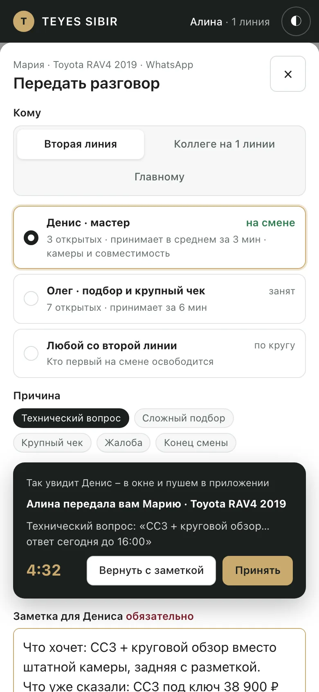

[Открыть макет «Передача диалога»](m2-peredacha.html)

- **Куда:** на вторую линию (конкретному человеку или «любому на смене»), коллеге на первой линии, главному. Обратно – кнопкой «Вернуть с заметкой».
- **Заметка обязательна, три строки:** что хочет, что уже сказали (цена, сроки), что обещали и когда. Клиент её не видит. Без трёх строк кнопка серая – свой код; в этапе 1 – быстрый ответ-шаблон `/передача` и правило в регламенте.
- **Клиент шва не замечает:** второй менеджер пишет из того же WhatsApp или Max, по умолчанию клиенту ничего не сообщаем. Можно включить фразу «подключаю мастера Дениса».
- **Таймер принятия:** не принял за 5 минут в рабочее время – разговор возвращается отправителю, тебе уходит тревога. Свой код.
- **Кто отвечает за клиента:** ответить – тот, кто сейчас ответственный в Chatwoot. В отчётах видны двое: «привёл» – первый менеджер (поле ставится само при первом назначении), «записал» – тот, кто поставил «Записан». Так первая линия не теряет бонус, а вторая видит свою конверсию.
- **История:** каждая передача – строка в истории клиента: кто, кому, когда, почему. Chatwoot сам пишет «назначен такой-то»; причину и заметку пишем рядом.

### Статусы: две разные оси

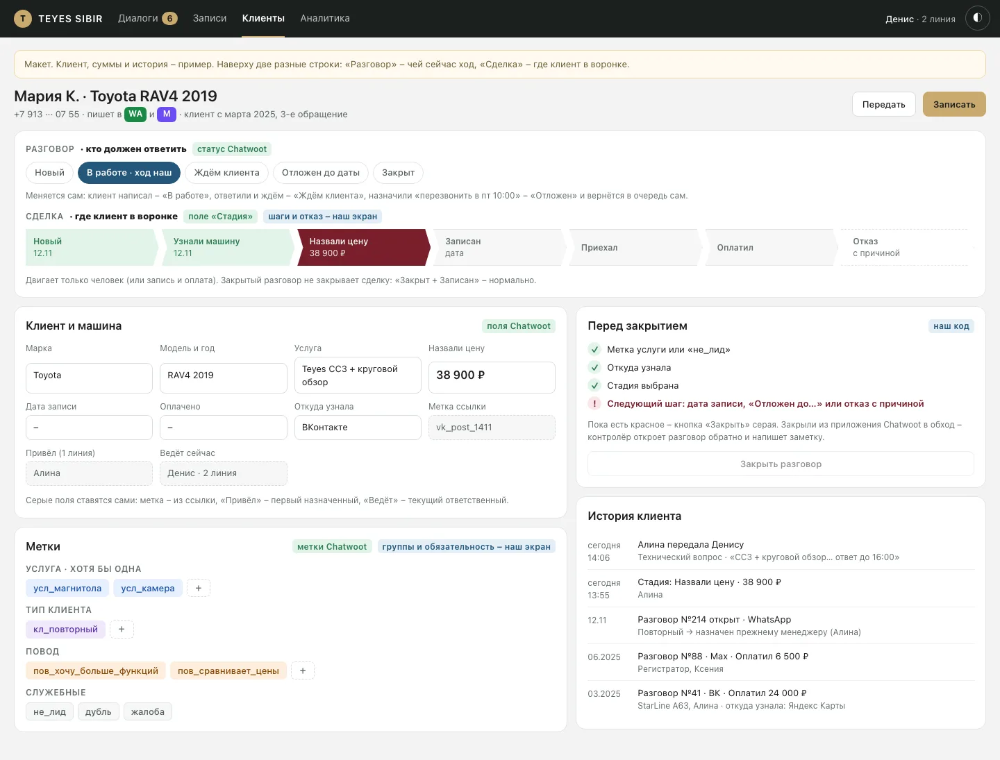

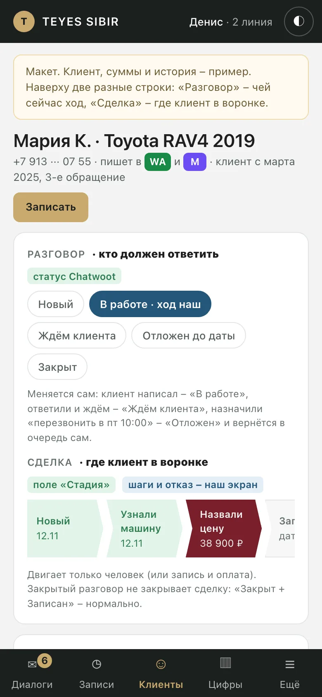

[Открыть макет «Карточка клиента»](m3-kartochka.html)

Путаница уходит, если развести вопросы: **«Разговор» отвечает, чей сейчас ход, «Сделка» – где клиент в воронке и деньгах.** На экране это две отдельные строки разного вида: кнопки-таблетки и шаги-стрелки.

| Разговор (статус Chatwoot) | Что значит | Как меняется |
|---|---|---|
| Новый | открыт, ответственного нет | сам, при первом сообщении |
| В работе | открыт, ход за нами | сам, когда клиент написал |
| Ждём клиента | ход за клиентом | «отложить до ответа» – вернётся сам, когда клиент напишет |
| Отложен до даты | «перезвонить в пт 10:00» | «отложить до даты» – вернётся сам в это время |
| Закрыт | разговор окончен | человек, только после обязательных полей |
| (Бот отвечает) | разговор у ИИ-бота | занят под бота, если будет – см. раздел 5 |

| Сделка (поле «Стадия») | Обязательно при этой стадии |
|---|---|
| Новый → Узнали машину | марка, модель, год |
| Назвали цену | сумма |
| Записан | дата записи |
| Приехал | – |
| Оплатил | сумма оплаты |
| Отказ | причина из списка |

Правила связи: стадию двигает только человек (или запись и оплата); закрытый разговор не закрывает сделку – «Закрыт + Записан» нормально. «Думает» из нынешнего списка стадий убираем: это «Назвали цену» + «Отложен до даты». Нынешние значения стадий переносим скриптом, аналитику правим вместе с ними.

### Метки: справочник

Метки в Chatwoot плоские, поэтому группу задаём приставкой и цветом. Заводит и правит только главный.

| Группа | Примеры | Кто ставит | Обязательна |
|---|---|---|---|
| Услуга `усл_` | магнитола, русификация, сигнализация, автозвук, камера, шумка; для EV – ТО, диагностика, ремонт электро | первая линия, при первом ответе | да, хотя бы одна (или `не_лид`) |
| Тип клиента `кл_` | новый, повторный, по гарантии, юрлицо, партнёр | `кл_повторный` – сам, по прошлым разговорам; остальное – менеджер | нет |
| Повод `пов_` | не работает штатная, хочу больше функций, после другого сервиса, сравнивает цены, срочно | менеджер | нет |
| Служебные | `не_лид`, `дубль`, `спам`, `жалоба` | любой | – |

Марку и модель держим полем, а не меткой: у машины она одна, и для отчётов нужен ровный список. «Откуда узнал» – тоже поле со списком.

**Перед закрытием** обязательны: метка услуги (или `не_лид`), «откуда узнал», стадия и следующий шаг – дата записи, «отложен до…» или отказ с причиной. В бесплатном Chatwoot обязательных полей нет (проверено 21.10), поэтому: наш экран не даёт закрыть, а если закрыли из приложения в обход – контролёр откроет разговор обратно и напишет заметку.

## 3. Сквозная аналитика: источник → канал → менеджер → запись → деньги

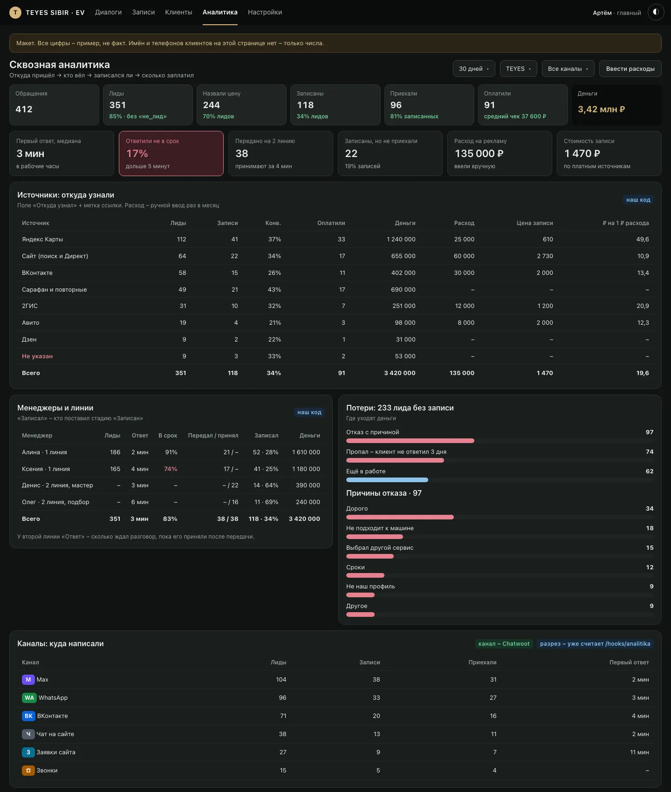

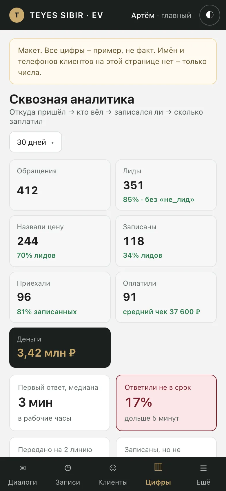

[Открыть макет «Сквозная аналитика»](m4-analitika.html)

### Цепочка и откуда берётся каждое звено

| Звено | Откуда | Есть сейчас |
|---|---|---|
| Источник («откуда узнал») | метка в ссылке (сайт, ВК) ставится сама; иначе менеджер выбирает из списка | поле `istochnik` считается, но ещё не заведено |
| Канал | канал Chatwoot | да |
| Обращение и лид | разговор; лид – без метки `не_лид` | да |
| Менеджер и линия | ответственный и команда Chatwoot, «привёл» – первый назначенный | нет, добавить |
| Скорость ответа | время первого ответа | да, по каналам; Chatwoot ещё и сам считает по менеджерам и командам |
| Запись, приезд | стадия + дата записи | стадии да, даты записи нет |
| Деньги | сумма при «Оплатил» | нет, добавить |
| Расход на рекламу | ручной ввод по источнику раз в месяц | нет |

`bridges/analitika.py` уже считает воронку, каналы с конверсией и медианой ответа, услуги, причины отказа, источники, заявки по дням и незаполненные карточки. Добавить: менеджеры и линии, передачи, деньги, расходы и стоимость записи, потери.

### Что видит главный (сверху вниз, как ты выбрал 17.11: В, А, Б)

1. **Экран дня:** кто ждёт ответа, кому не перезвонили, кто записан на завтра.
2. **Воронка и потери:** обращения → лиды → назвали цену → записаны → приехали → оплатили → деньги; отказы по причинам, «пропал» (клиент молчит 3 дня), «записан, но не приехал».
3. **Источники и каналы:** лиды, записи, деньги, расход, цена записи, сколько рублей выручки на рубль рекламы.
4. **Менеджеры и линии:** ответ, доля «в срок» (до 5 минут), передал / принял, сколько записал, деньги.

### Откуда брать деньги – предложение

- **Сейчас:** менеджер вводит сумму, когда ставит «Оплатил». Ноль интеграций, риск – ошибки руками; ты видишь незаполненные.
- **Следом:** ночная сверка с «АвтоДилер Онлайн» по телефону клиента – так было задумано в ТЗ 21.10. Нужно узнать, есть ли телефон в их выгрузке.
- **Не советую:** чеки кассы через ОФД – в чеке обычно нет телефона, сопоставление с клиентом неточное.

## 4. Автодилер: та же основа, своя сделка с машиной, трейд-ином и оплатой

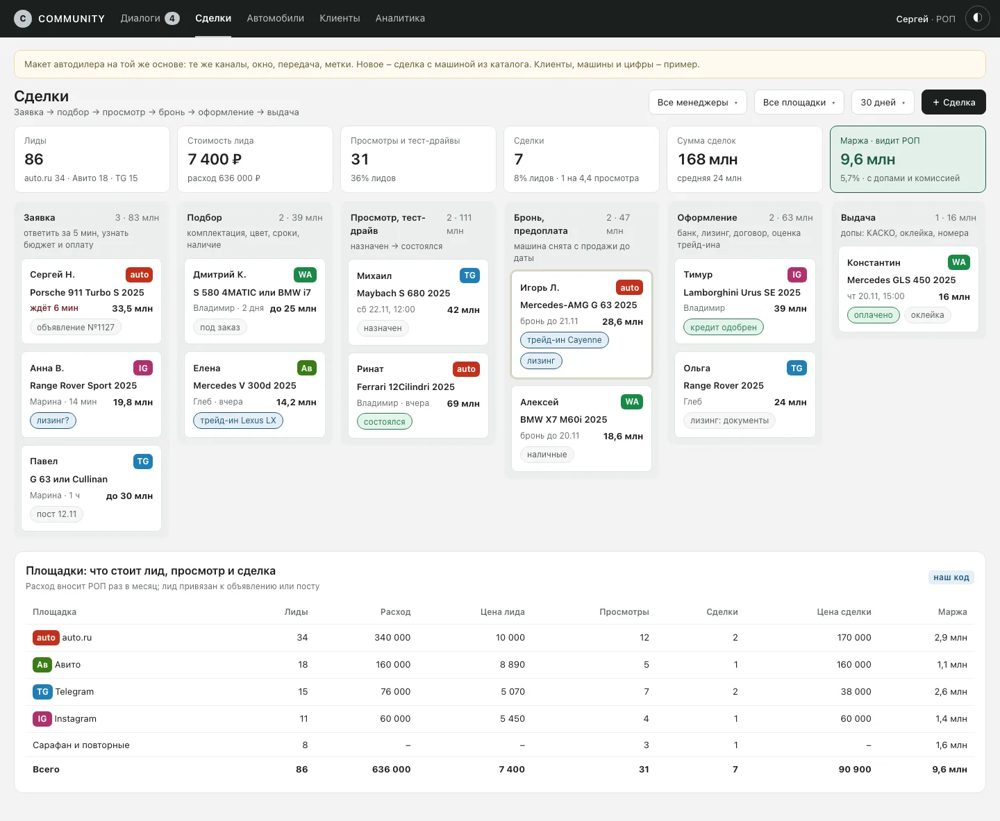

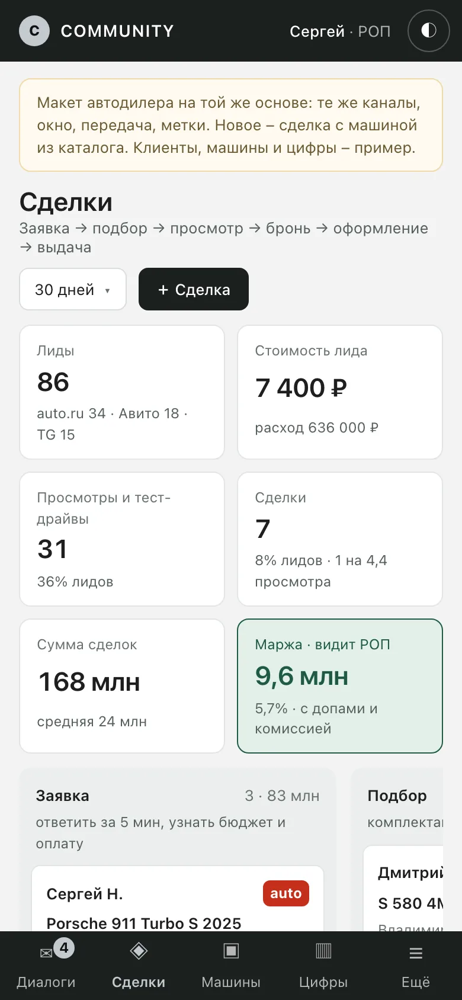

[Открыть макет «Воронка продаж машин»](m5-dealer-voronka.html)

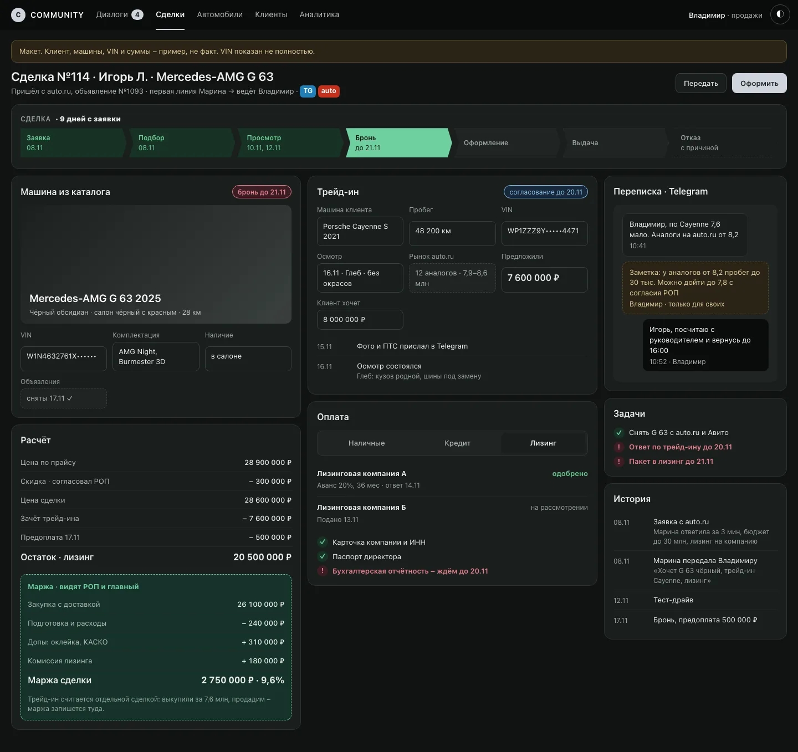

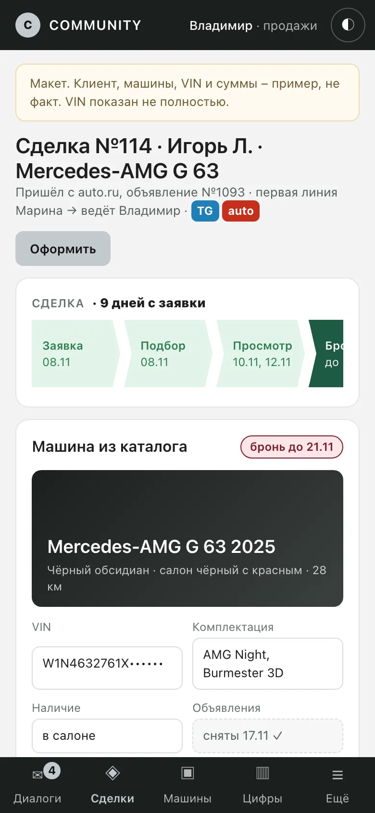

[Открыть макет «Карточка сделки»](m6-dealer-sdelka.html)

### Воронка и карточка

- **Воронка:** Заявка → Подбор (бюджет, оплата, сроки) → Просмотр / тест-драйв (назначен → состоялся) → Бронь и предоплата (машина снята с продажи до даты) → Оформление (наличные, кредит, лизинг, трейд-ин) → Выдача (КАСКО, оклейка, номера). Отказ с причиной: купил у другого, не одобрили кредит, мало дали за трейд-ин, машина ушла, пропал.
- **Карточка сделки:** машина из каталога (VIN, комплектация, цвет, пробег, цена, бронь), расчёт (прайс, скидка, зачёт трейд-ина, предоплата, остаток), трейд-ин (машина клиента, осмотр, рынок по аналогам, предложили / хочет), оплата (банки или лизинговые компании, одобрение, документы), допы, задачи, переписка и история.
- **Маржа** – блок, который видят только руководитель отдела продаж и главный: закупка, расходы, допы, комиссия банка. Трейд-ин – отдельная сделка, его маржа пишется туда.
- **Лид привязан к объявлению:** видно, какие машины и посты дают заявки.

### Роли автодилера

| Роль | Что делает |
|---|---|
| Первая линия (лидогенерация) | отвечает на площадках и в мессенджерах за 5 минут, узнаёт бюджет и способ оплаты, назначает просмотр, передаёт менеджеру |
| Менеджер продаж | ведёт сделку от подбора до выдачи, трейд-ин и банк |
| Руководитель отдела продаж (РОП) | раздаёт каналы, согласует скидки сверх лимита, видит маржу, вносит расходы площадок |
| Оценщик трейд-ина | осмотр и цена; часто это тот же менеджер |
| Наблюдатель (собственник) | только цифры |

### Аналитика автодилера

Стоимость лида, просмотра и сделки по площадкам (auto.ru, Авито, Telegram, Instagram, сарафан), конверсия лид → просмотр → бронь → сделка, срок сделки в днях, маржа по менеджеру и площадке, сколько дней машина висит в продаже.

### Что общее, что своё

| | CRM TEYES / EV | Автодилер |
|---|---|---|
| Движок, окно, каналы, мосты | Chatwoot + наши мосты | то же |
| Линии, каналы на менеджера, передача, метки | так, как в разделах 1–2 | то же, линии – «лидогенерация» и «продажи» |
| Главная единица | разговор + поле «Стадия» | **сделка** – своя запись рядом с разговором (Chatwoot сделок не знает) |
| Воронка | Новый → … → Оплатил | Заявка → … → Выдача |
| Карточка | машина клиента, услуга, сумма | машина из каталога, VIN, трейд-ин, кредит или лизинг, допы |
| Каталог | прайс услуг | каталог машин; у Community уже есть сборщик с auto.ru (41 машина, 13.10) |
| Деньги | сумма оплаты | цена, скидка, предоплата, маржа |
| Площадки | Max, Telegram, WhatsApp, ВК, сайт, звонки | плюс чаты auto.ru и Авито – **проверить**, есть ли у площадок доступ к переписке для дилера; если нет – звонки и ручной ввод |

## 5. Этапы, сроки и вопросы: начать с Chatwoot как есть, свой экран и ИИ – потом

### Что даёт Chatwoot, что пишем сами

| Нужно | Chatwoot сам | Наш код |
|---|---|---|
| Линии | команды «Первая линия», «Вторая линия» (уже заведены) | – |
| Каналы на менеджера | участники канала | состояние ● / ○ / – и кому падают новые |
| Раздача | по кругу среди тех, кто в сети | повторный – к прежнему; потолок открытых – проверить на 4.19 |
| Передача | смена ответственного и команды, заметки, массовые действия | обязательная заметка, таймер принятия, «привёл» |
| Статусы | открыт, отложен до ответа или до даты, закрыт | – |
| Стадии, метки, поля | поля со списком, метки | обязательность перед закрытием, перенос стадий |
| Скорость | отчёты по менеджерам и командам | доля «в срок» в нашей аналитике |
| Деньги, источники, потери | – | `analitika.py` |
| ИИ-бот | подключение бота к каналу | сам бот и база знаний |

### Этапы

| Этап | Что входит | Часы (оценка) | Деньги | Срок |
|---|---|---|---|---|
| **1. Запуск на 2–3 менеджера** | операторы, команды, участники каналов, часы (3 ч); метки с приставками, новые поля, новая воронка и перенос (4 ч); правило «новый → первая линия» и раздача по кругу (3 ч); передача шаблоном и регламент на страницу (2 ч); контролёр-минимум: закрыто без полей, передачу не взяли, «отложен» просрочен (6 ч); аналитика по менеджерам, линиям, деньгам (6 ч); тесты и выкладка (3 ч) | 27 | ≈ 27 000 ₽ | 3–4 дня |
| **2. Свой экран менеджера и главного** | экран оператора, как советовал 18.11 (≈ 88 ч); окно передачи с обязательной заметкой и таймером (10 ч); настройки «каналы и менеджеры» (12 ч); раздача «повторный – к прежнему», потолок, дежурный (8 ч); запрет закрытия без полей (4 ч) | ≈ 122 | ≈ 122 000 ₽ | ≈ 15 дней |
| **3. Деньги и расходы** | расходы по источникам, цена записи, отчёт потерь (16 ч); сверка с «АвтоДилер Онлайн» по телефону (16 ч) | 32 | ≈ 32 000 ₽ | 4 дня |
| **4. ИИ (опция)** | см. ниже | 16 + 72 | ≈ 88 000 ₽ + расход модели | после 4–6 недель живых данных |
| **Автодилер** | сделка как своя запись (40 ч), каталог с импортом auto.ru (24 ч), карточка: трейд-ин, оплата, допы (40 ч), доска-воронка (16 ч), аналитика площадок и маржи (24 ч), разведка и мосты auto.ru и Авито (32 ч) | ≈ 176 | ≈ 176 000 ₽ | ≈ 22 дня после этапа 2 |

Час = 1000 ₽, день = 8 часов. Все сроки и суммы – оценка.

### ИИ-агенты – опция, без обещаний

- **Контролёр** (сначала без ИИ, на правилах): клиент ждёт дольше 5 минут, передачу не приняли, закрыли без метки и стадии, «отложен» просрочен, «назвали цену» без касания 3 дня. Пишет менеджеру заметку, тебе – сводку. Часть уже есть в оповещениях (клиент ждёт > 10 мин, незаполненные карточки в сводке 9:00). Потом ИИ может проверять сам ответ: спросил ли машину, назвал ли цену (≈ 16 ч).
- **Бот первой линии с базой знаний:** отвечает на простое (адрес, часы, что входит, совместимость по базе «Подбора»), собирает марку, год и телефон и передаёт человеку с той же заметкой из трёх строк. Начинать с ночи и выходных, когда людей нет. Chatwoot умеет подключать такого бота к каналу; сам бот и база – наш код (≈ 72 ч). Только после 4–6 недель живых переписок – на них проверяем.
- **Заполнитель:** вытаскивает из переписки машину, год, телефон и предлагает поля, менеджер подтверждает. Позже.

### Вопросы

1. **С чего начинаем.** А – этап 1 на Chatwoot как есть, экран потом (≈ 27 000 ₽, 3–4 дня). Б – сразу этапы 1 и 2 (≈ 149 000 ₽, ≈ 19 дней). В – только настройка без кода: команды, каналы, метки, регламент (≈ 8 000 ₽, 1 день; передача без обязательной заметки, деньги не считаем). Совет – А.
2. **Как раздаём новые.** А – по кругу среди тех, у кого канал и кто на смене (входит в этап 1). Б – плюс повторный клиент к прежнему менеджеру (+ ≈ 8 000 ₽, 1 день). В – вручную раздаёшь ты (0 ₽, но ты становишься узким местом). Совет – Б.
3. **Деньги в аналитике.** А – сумму вводит менеджер при «Оплатил» (входит в этап 1). Б – ночная сверка с «АвтоДилер Онлайн» по телефону (≈ 16 000 ₽, 2 дня, если в их выгрузке есть телефон). В – чеки кассы через ОФД (≈ 24 000 ₽, 3 дня, сопоставление неточное). Совет – А сейчас, Б следом.
4. **TEYES и EV.** А – один кабинет, бренд в названии канала, фильтр в аналитике (0 ₽). Б – два кабинета Chatwoot (≈ 6 000 ₽, полдня; у тебя два входа, отчёты раздельно). Совет – А.
5. **Что значит «автодилер».** А – CRM для продажи машин, как в разделе 4 (≈ 176 000 ₽, ≈ 22 дня после этапа 2). Б – переписать «АвтоДилер Онлайн» (запись, заказ-наряды, касса) внутрь нашей CRM: оценка после разбора их программы, грубо 30–45 дней. В – оба, сначала А. Совет – скажи, что имел в виду; рисовал А.
6. **Часы и дежурный.** А – пн–пт 11–19, как на сайте, вне часов автоответ (0 ₽). Б – плюс суббота (0 ₽, настройка). В – плюс дежурный вечером по графику с пушем на «срочно» (≈ 4 000 ₽, полдня). Совет – А, пока не скажешь про субботу.
7. **ИИ.** А – контролёр на правилах в этапе 1, ИИ потом (входит). Б – плюс ИИ-бот ночью на первой линии после 4–6 недель живых данных (≈ 72 000 ₽, ≈ 9 дней + расход модели). В – ИИ пока не обсуждаем. Совет – А.

### Что раскрыть

1. Каналы на менеджера: как ● / ○ / – ложится на участников каналов Chatwoot.
2. Передача: что именно видит второй менеджер и как работает таймер.
3. Аналитика: какие поля завести первыми и как считать «привёл» и «записал».
4. Автодилер: где хранить сделку и что с чатами auto.ru и Авито.
