# CRM TEYES: 26 нестыковок в макетах и документах, 3 критичных – просьба об отзыве «если всё хорошо», нет отмены отзыва и ссылки клиенту на Тильду, для стенда выбрано решение по каждой

**Вывод.** Макеты делались в разные дни под разные вопросы, поэтому один и тот же экран нарисован 2–3 раза, а стадии, меню, сроки и нормы называются и считаются по-разному. Критичных мест три: текст просьбы об отзыве просит отзыв только у довольных (Google это прямо запрещает), отменить автоотзыв нельзя (твоё требование), а ссылки на акт ведут на teyes-sibir.ru, который на Тильде такие страницы не поднимет. Остальное – 16 важных расхождений и 7 мелочей. По каждому пункту ниже: скрин, что не так, почему плохо, как исправить и что выбрано для стенда. Сквозной сценарий, по которому собирается стенд: [teyes-crm-scenariy](https://tema-mail.github.io/razbory/teyes-crm-scenariy-7575b9cf/).

Как собрано: прошёл макеты v1, v5, v6, p2, p3, p5, p6, p7, p8, p9, a1, a2, a3 и документы `PUT-KLIENTA.md`, `ЛОГИКА-РОЛИ-И-АВТОДИЛЕР.md`, `REGLAMENT-MENEDZHEROV.md`, `АВТОДИЛЕР-ИНТЕГРАЦИЯ.md`, `sostoyanie.md`, базу `crm-avtoservis` – 18.11.2026. Скрины – фрагменты макетов (Playwright, 1440 px и 390 px) и цитаты документов.

**Нужно от тебя**

- Да или нет на решения для стенда (они уже заложены в сценарий). Если нет – буква по вопросам внизу.
- Буквы по 6 вопросам. Совет: 1Б 2А 3А 4А 5А 6А.

| № | Что | Важность | Решение для стенда |
|---|---|---|---|
| К1 | Отзыв просим «если всё работает как надо» | критично | один текст всем: «будем благодарны за честный отзыв» |
| К2 | Автоотзыв нельзя отменить | критично | очередь сообщений: отменить с причиной / изменить / отправить сейчас |
| К3 | Ссылки клиенту на teyes-sibir.ru/a/… (Тильда) | критично | ссылки на открытый путь стенда `/a/`, `/b/` по токену |
| В1 | «Квалифицирован» против «Узнали машину» | важно | «Квалифицирован (узнали машину)», 5 полей |
| В2 | Нет Telegram в v1 и v5 | важно | добавить канал во все фильтры и пульт |
| В3 | Воронка нарисована дважды: v6 и a2 | важно | логика a2 в стиле v6, вид «Колонки / Список» |
| В4 | Карточка клиента трижды: v1, p2, a1 – разные поля | важно | одна карточка, вид «Чат / Сделка» |
| В5 | В v1 и a1 нет «Отказ», в v1 нет «Оплатил» | важно | все стадии + кнопка «Отказ» с причиной |
| В6 | Меню называется по-разному | важно | Диалоги · Сделки · Записи · Цифры · Ещё |
| В7 | Записи и задачи вне часов работы | важно | задачи людям – только 11–19 пн–пт |
| В8 | На дозвон после напоминаний 15 минут | важно | 18:00 как решено, время – в настройке; совет 17:00 |
| В9 | Цель ответа 3:00 на пульте, норма 5 минут в регламенте | важно | «в срок» – 5 мин, 3 мин – жёлтый сигнал |
| В10 | «Неразобранное» против живой раздачи | важно | только звонки и заявки «похоже на клиента» |
| В11 | Оплата на телефоне мастера | важно | оплату отмечает менеджер, «Выдать» ждёт отметку |
| В12 | Остатки и прайс без источника | важно | своя таблица прайса и остатков стенда |
| В13 | Одна ось статусов в a2 и в живой CRM, две в PUT | важно | сделка и визит раздельно |
| В14 | Пульт не видит ничего после записи | важно | блоки «Завтра», «После выдачи», «Бонусы» |
| В15 | Бонусы: «не дублировать АвтоДилер» против твоей просьбы | важно | свой счёт бонусов, списание в АД руками |
| В16 | Согласия на данные и рекламу | важно | две пустые галочки, реклама – отдельно |
| М1 | Таймеры «без задачи»: 2 часа, 3 дня | мелочь | одна таблица таймеров |
| М2 | Разные цены одной услуги, LiXiang / Li Auto | мелочь | один прайс и справочник марок |
| М3 | Лишняя «Скопировать для АвтоДилера» | мелочь | только при варианте 2А |
| М4 | Подпись кодом активна раньше времени | мелочь | скрыта до фазы 3 |
| М5 | ЗН и время приёмки в шапке и в сообщении | мелочь | номер ЗН не нужен для подписи; время – по подписи |
| М6 | Отзыв через 3 дня (a3) и через 5 (p9) | мелочь | 5 дней |
| М7 | Одни имена у разных клиентов, «Артём» – и клиент, и главный | мелочь | уникальные имена, «Артём К.» и «Артём Г.» |

## 1. Критично: три места нарушают правила площадок, твоё требование и не откроются у клиента

### К1. Просьба об отзыве – только «если всё работает как надо»

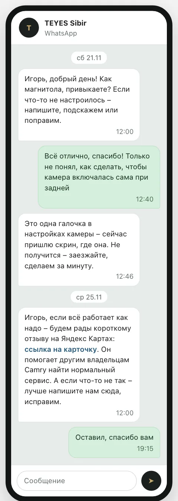

- **Что не так.** В p9 текст: «если всё работает как надо – будем рады короткому отзыву … А если что-то не так – лучше напишите нам сюда». Это та самая развилка «довольным – на карты, недовольным – в личку».
- **Почему плохо.** Google прямо запрещает «выборочно просить клиентов оставить положительный отзыв» ([правила Google](https://support.google.com/contributionpolicy/answer/7400114?hl=ru)) – за это снимают отзывы и ставят предупреждение на карточку. В самом же p9 рядом написано «просим всех» – текст противоречит своей подписи.
- **Как исправить.** Один текст всем, без условия: «Будем благодарны за честный отзыв о нашей работе на Яндекс Картах … Если что-то пошло не так – напишите и сюда, разберёмся». Бонусы в этом сообщении не упоминаем: награда за отзыв у Google запрещена вовсе, у Яндекса – за положительный.
- **На стенде:** текст из сценария, шаг 15.

### К2. Автоматическую просьбу об отзыве нельзя отменить

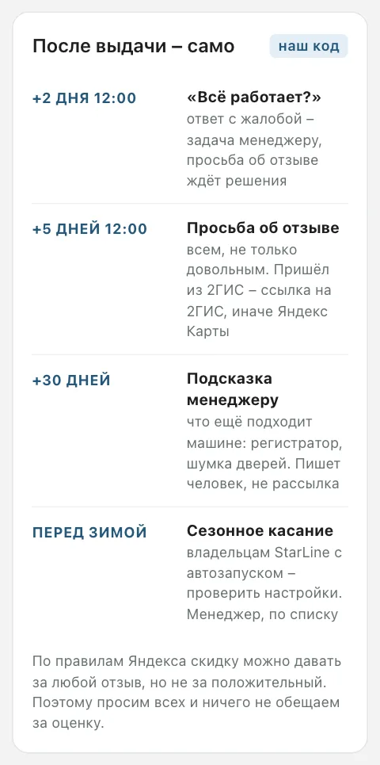

- **Что не так.** В p9 и p8 отзыв уходит «само» на 5-й день. Единственная защита – «ответ с жалобой на касание – просьба ждёт решения». Ручной отмены по конкретному клиенту, очереди «что уйдёт завтра» и причины отмены нет.
- **Почему плохо.** Ты просил прямо: иметь возможность отменить, чтобы не ловить негатив. Без очереди менеджер узнаёт об отправке, когда отзыв уже пришёл. А автофильтр «жалоба – не шлём» – это тот же выборочный сбор из К1.
- **Как исправить.** Экран «Очередь сообщений»: за сутки строка «уйдёт завтра в 12:00» с кнопками «Отменить / Изменить текст / Отправить сейчас». Отмена – только с причиной из списка (конфликт в работе, просил не писать, гарантийный визит не закрыт, уже просили за 90 дней, сотрудник или знакомый, другое). Система подсказывает («есть жалоба», «открыт гарантийный визит»), но сама не отменяет. На пульте – доля отменённых, больше 15% за месяц – тревога главному, чтобы отмена не стала фильтром.
- **На стенде:** так и сделано, сценарий – раздел 3. В той же очереди – сообщение о бонусах и касание 2-го дня.

### К3. Ссылки клиенту ведут на teyes-sibir.ru, а сайт на Тильде

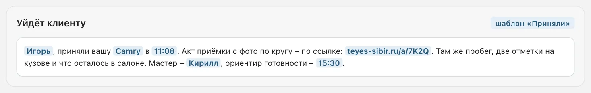

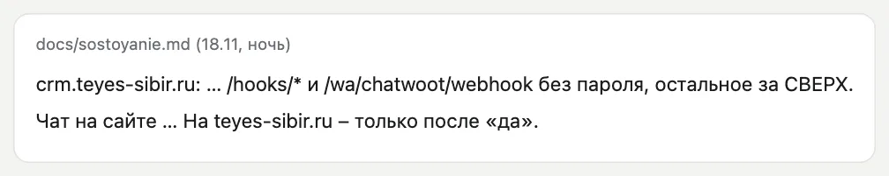

- **Что не так.** Акт приёмки и выдачи в p6, p8 – по ссылкам `teyes-sibir.ru/a/7K2Q`, `/a/7K2R`. Сайт teyes-sibir.ru – на Тильде: страницу с данными конкретного клиента по токену Тильда не отдаст. А crm.teyes-sibir.ru весь закрыт входом СВЕРХ, открыты только `/hooks/*`.
- **Почему плохо.** Клиент нажмёт ссылку и увидит 404 или окно пароля. Это первое, что он видит от нас после приёмки машины. То же будет со ссылкой на регистрацию бонусов.
- **Как исправить.** Отдельный открытый путь для клиента без пароля, только по длинному токену: `crm.teyes-sibir.ru/a/<токен>` (акты) и `/b/<токен>` (бонусы) с `noindex`, или свой поддомен (например, `lk.teyes-sibir.ru`). На Тильде – только кнопка «Мои бонусы», ведущая туда.
- **На стенде:** страницы `/a/` и `/b/` на адресе стенда, открыты по токену.

## 2. Важно: одно и то же нарисовано по 2–3 раза и называется по-разному

### В1. «Квалифицирован» в пути клиента, «Узнали машину» везде остальное

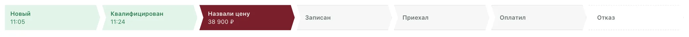

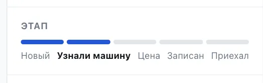 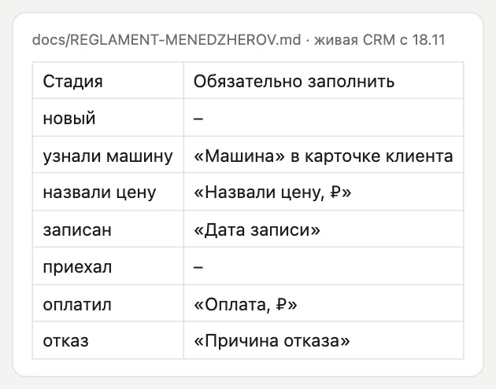

- **Что не так.** PUT и p2: «Квалифицирован», 5 обязательных полей (услуга, марка и модель, год и рынок, штатка по фото, приедет). Живая CRM с 18.11, регламент, v1, v6, a1, a2: «узнали машину», обязательно одно поле «Машина». В v1 ещё и «Цена» вместо «Назвали цену».
- **Почему плохо.** Воронка в аналитике считает одно, а менеджер нажимает другое. Без «штатки по фото» и «приедет» цена считается не по той рамке, а лиды из другого города попадают в конверсию.
- **Как исправить.** Одно имя, одни поля. Перенос живых значений одним скриптом, когда скажешь «да».
- **На стенде:** «Квалифицирован (узнали машину)» с 5 полями – вопрос 1.

### В2. В переписке v1 и на пульте v5 нет Telegram

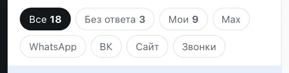 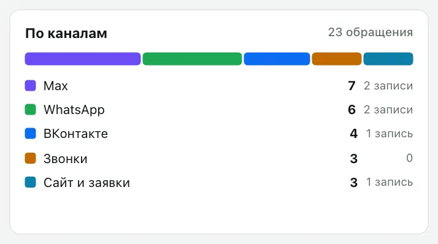

- **Что не так.** Фильтры v1: Max, WhatsApp, ВК, Сайт, Звонки. Пульт v5 – те же пять. В a2 и p5 Telegram (TG) есть, клиенты там пишут.
- **Почему плохо.** Наш тестовый клиент пишет в Telegram – в v1 его не отфильтровать, на пульте его обращение и запись пропадут из разреза каналов.
- **Как исправить и на стенде:** Telegram – отдельным каналом во всех фильтрах, на пульте и в аналитике.

### В3. Воронка сделок нарисована дважды: v6 и a2

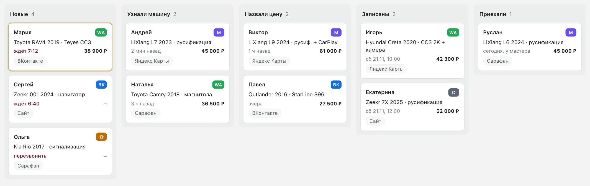

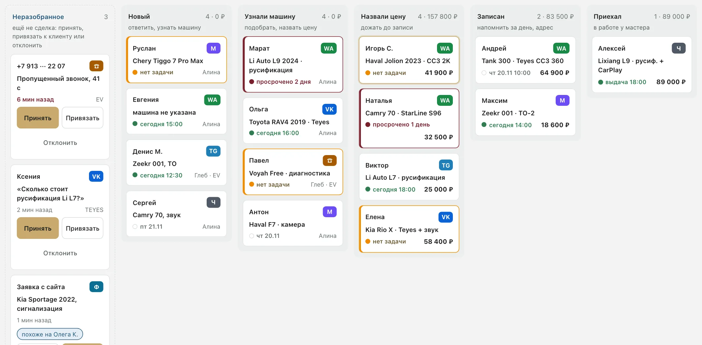

- **Что не так.** v6 – колонки во множественном числе, без «Неразобранного», без задач, без «Оплатил» и «Отказ». a2 – с «Неразобранным», кружками «нет задачи / просрочено / сегодня», подписями «что делать на этапе».
- **Почему плохо.** Два экрана под одну работу – менеджер не поймёт, где правда, а разработка удваивается.
- **Как исправить и на стенде:** экран «Сделки» = логика a2 в оформлении v6. Переключатель вида «Колонки / Список». Названия колонок – как стадии в единственном числе.

### В4. Карточка клиента трижды – и в каждой свои поля

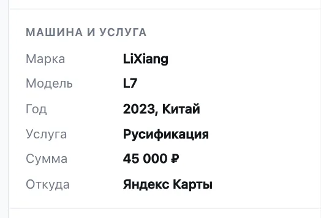 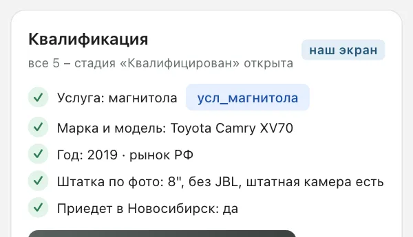 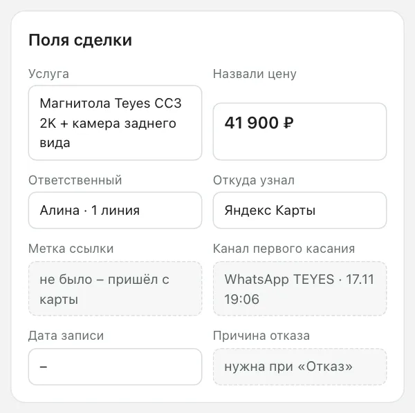

- **Что не так.** v1: марка, модель, год и рынок, услуга, «Сумма», «Откуда». p2: 5 полей квалификации, без источника. a1: услуга, «Назвали цену», ответственный, «Откуда узнал», метка ссылки, канал первого касания, дата записи, причина отказа. v6: «Откуда узнала». В v1 шапка «Передать / Закрыть разговор», в p2 и a1 – «Передать / Записать».
- **Почему плохо.** Поле, которое обязательно для стадии в одном экране, отсутствует в другом: из v1 не поставить «Квалифицирован» (нет штатки и «приедет») и не закрыть отказом (нет причины). Одно поле под четырьмя именами – в аналитике четыре колонки.
- **Как исправить и на стенде:** основа – v1, правая колонка = блоки «Квалификация» и «Подбор и цена» из p2 + поля a1. Переключатель «Чат / Сделка» (вид a1). Имена: «Назвали цену, ₽», «Откуда узнал», «Канал первого касания». Шапка: «Передать · Записать · Закрыть».

### В5. Из переписки v1 нельзя поставить «Отказ» и «Оплатил»

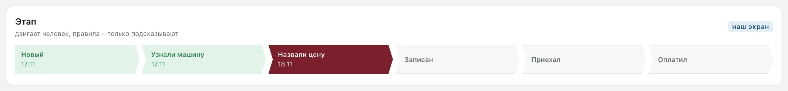

- **Что не так.** В v1 этапы кончаются на «Приехал», в a1 – на «Оплатил», «Отказа» нет нигде, кроме p2.
- **Почему плохо.** Тупик: клиент отказался, а закрыть сделку с причиной из переписки нельзя. Контролёр живой CRM откроет разговор обратно, а причина отказа не попадёт в «где теряем после цены».
- **Как исправить и на стенде:** все стадии до «Оплатил» + отдельная кнопка «Отказ» с обязательной причиной.

### В6. Меню называется по-разному в каждом макете

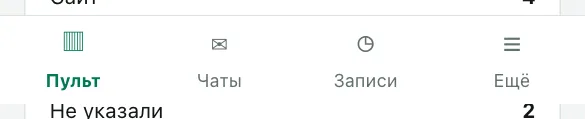 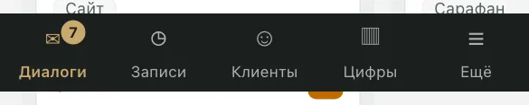 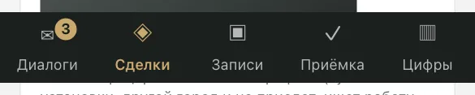

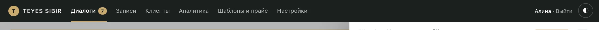

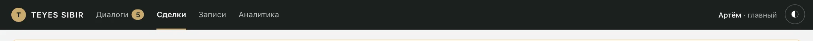

- **Что не так.** Входящие (v1) / Чаты (v1, v5, p6) / Диалоги (v6, p2, a1, a2). Цифры / Аналитика / Пульт. «Сделки» есть в p2, a1, a2 и нет в v6; «Клиенты», «Шаблоны и прайс», «Настройки» – только в v6.
- **Почему плохо.** Менеджер учит одно слово, в регламенте другое; при переключении вида раздел «исчезает».
- **Как исправить и на стенде:** менеджер – «Диалоги · Сделки · Записи · Цифры · Ещё» (в «Ещё»: Клиенты, Шаблоны и прайс, Очередь сообщений, Настройки). Мастер – «Записи · Приёмка · В работе · Выдача · Диалоги». У главного в «Цифрах» первым – пульт v5.

## 3. Важно: правила и время расходятся между макетами и документами

### В7. Записи и задачи вне часов работы

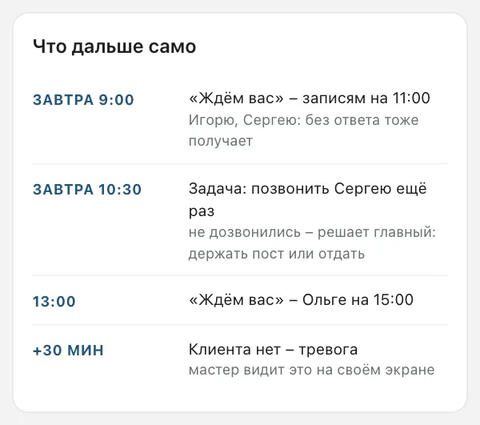 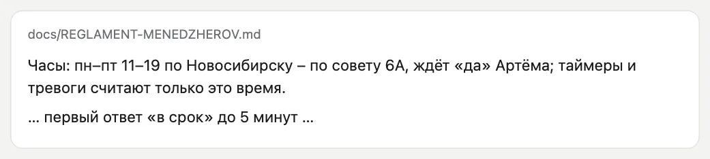

- **Что не так.** Регламент: пн–пт 11–19. В v6 и v1 записи на субботу 21.11 в 10:00; в p5 задача «позвонить завтра в 10:30»; в p9 касание «всё работает?» в субботу 21.11 (видно на скрине К1).
- **Почему плохо.** Задача в 10:30 горит, пока никого нет; запись на 10:00 в субботу – на закрытый сервис; жалобу в субботу некому разобрать до понедельника.
- **Как исправить и на стенде:** задачи людям – только в часы работы; автосообщения – 9:00–21:00; касание – на 2-й рабочий день; запись не встаёт вне часов. Работает ли суббота – вопрос 5.

### В8. На дозвон после напоминаний – 15 минут

- **Что не так.** Напоминания в 18:00 (WhatsApp с паузами – до 18:40), задача «позвонить» в 18:45, смена до 19:00.
- **Почему плохо.** На 3–5 молчащих клиентов остаётся 10–15 минут. Не дозвонились – утром решать поздно: запись на 11:00, а смена с 11:00.
- **Как исправить.** Напоминание в 17:00, звонки с 17:45 – час на дозвон. Или 18:00 и дежурный до 20:00.
- **На стенде:** 18:00, как решено в PUT, но время – в настройке. Вопрос 2.

### В9. Норма первого ответа: 3 минуты на пульте, 5 – в регламенте

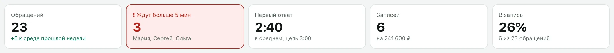

- **Что не так.** v5: «цель 3:00». Регламент и аналитика: «в срок» – до 5 минут; таймер 3 мин – жёлтый, 5 – тревога.
- **Почему плохо.** Менеджер «в срок» по отчёту и «не в цели» на пульте одновременно.
- **Как исправить и на стенде:** «в срок» – 5 минут, на пульте «цель 5:00» и доля в срок; 3 минуты – только жёлтая подсветка карточки.

### В10. «Неразобранное» в a2 спорит с живой раздачей

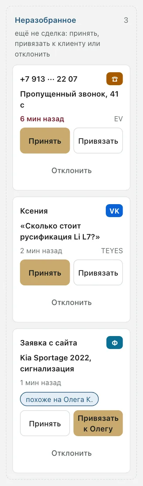

- **Что не так.** В a2 чат «Ксения VK» ждёт в «Неразобранном» кнопки «Принять». А в живой CRM с 18.11 мосты сразу отдают новый разговор менеджеру с ● в сети.
- **Почему плохо.** Либо раздача, либо ручной приём – двумя путями сразу один и тот же чат окажется и «у Алины», и «ничей».
- **Как исправить и на стенде:** чаты – сразу «Новый» у менеджера по раздаче. «Неразобранное» – только то, что система не может решить сама: пропущенный звонок без клиента и заявка «похоже на Олега К.» (склеить или нет).

### М1. Таймеры «без задачи» и «тишины» – разные в трёх местах

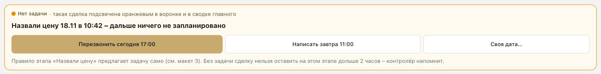

- **Что не так.** a1 – «нет задачи дольше 2 часов – контролёр напомнит». Логика ролей – «назвали цену» без касания 3 дня. PUT – «3 дня тишины после записи – отказ».
- **Как исправить и на стенде:** одна таблица таймеров: нет задачи – 2 рабочих часа (подсветка), нет касания после цены – 3 рабочих дня (контролёр), тишина после записи – 3 рабочих дня (отказ «пропал», бронь снята).

### М6. Когда просить отзыв: через 3 дня или через 5

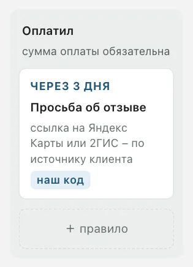

- **Что не так.** a3 (правила amo) – через 3 дня после «Оплатил». PUT и p9 – на 5-й день после выдачи, после касания на 2-й.
- **На стенде:** 5 дней. Вопрос 5 в сценарии.

## 4. Важно: стыки с АвтоДилером, МойСкладом, законом и пультом

### В11. Оплата нарисована на телефоне мастера

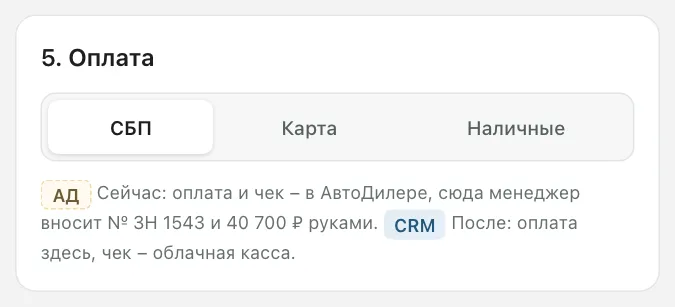

- **Что не так.** В p8 у мастера выбор способа оплаты. В регламенте сумму из кассы вносит менеджер, касса в переходный период – в АвтоДилере.
- **Почему плохо.** Мастер нажмёт «СБП», а денег в АД нет – выдача без оплаты (ПП № 780, п. 23).
- **Как исправить и на стенде:** у мастера блок «Оплата» только показывает «ждём оплату» или «оплачено, ЗН № …, 38 900 ₽». «Выдать» серая, пока менеджер не отметил оплату.

### В12. Остатки и прайс «из ниоткуда»

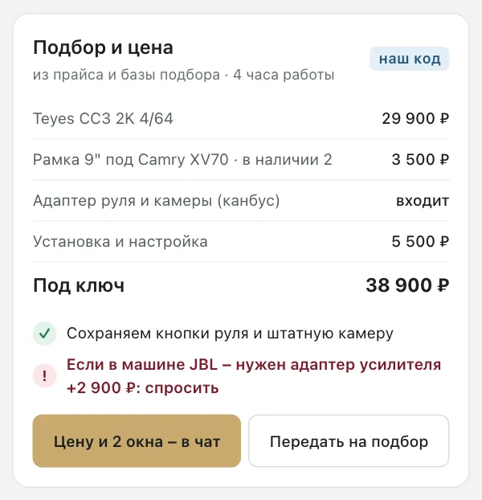 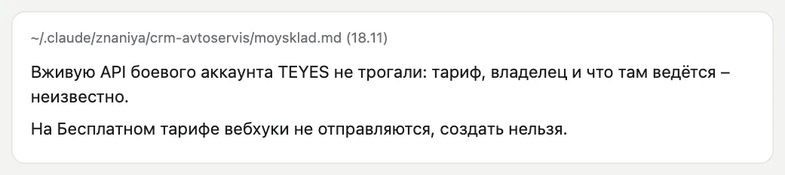

- **Что не так.** p2 показывает «в наличии 2» и цену «из прайса», p3 бронирует рамку. Источника нет: МойСклад не подключён, тариф и владелец неизвестны, на бесплатном тарифе нет вебхуков; где живёт прайс – не решено.
- **Почему плохо.** Цена и бронь, которые клиент получает в сообщении, расходятся со складом – бронь рамки, которой нет.
- **Как исправить.** В бою – МойСклад (20 ч только чтение или 38 ч с бронью и списанием, разбор moysklad.md).
- **На стенде:** своя таблица прайса и остатков, бронь уменьшает «доступно».

### В13. Сделка и визит: в PUT две оси, в a2 и живой CRM – одна

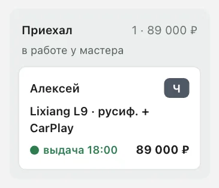

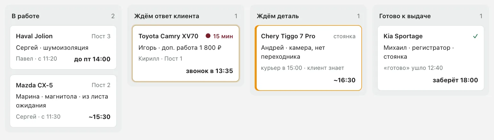

- **Что не так.** a2 и живая CRM – одна лестница стадий. PUT – две: сделка (деньги) и визит (машина). p7 живёт только по визиту, a2 в «Приехал» дублирует её одной карточкой.
- **Почему плохо.** Перенос, гарантия и доустановка ломают одну лестницу: сделку некуда вернуть, второй визит некуда записать.
- **Как исправить и на стенде:** визит – отдельная запись со своими статусами; карточка в колонке «Приехал» a2 показывает статус визита и ведёт в p7.

### В14. Пульт не видит ничего после записи

- **Что не так.** На v5 обращения, ответ, записи, каналы, менеджеры. Нет подтверждений на завтра, неявок, выдач, очереди после выдачи, отзывов и бонусов.
- **Как исправить и на стенде:** блоки «Завтра», «После выдачи» (в очереди, отменено с причинами и долей, попросили / оставили) и «Бонусы» (начислено, ждут регистрации, зарегистрировались, списано, сгорает).

### В15. Бонусы: в базе решено «не дублировать АвтоДилер», а ты просишь свои

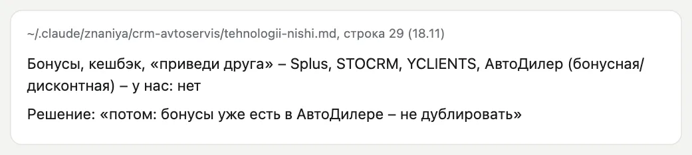 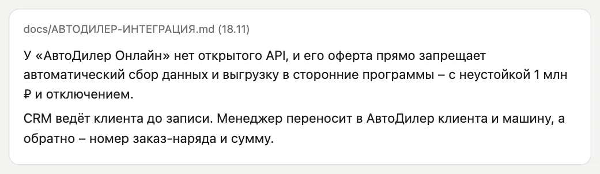

- **Что не так.** 18.11 в базе ниши записано: бонусная программа есть в АвтоДилере (и приложение АвтоМоби), не дублировать. Сегодня ты просишь бонусы на сайте с регистрацией по ссылке. Оферта АД запрещает выгружать данные скриптами – свой счёт с АД автоматически не сверить.
- **Почему плохо.** Два счёта бонусов разойдутся: клиент спишет у нас, а в заказ-наряде скидки нет – или наоборот.
- **Как исправить.** Источник правды – одна система. Если наша: в переходный период списание бонусов = скидка в ЗН АД руками с номером ЗН в нашей операции, раз в неделю сверка по Excel-реестру ЗН (его выгружает «Владелец» руками).
- **На стенде:** свой счёт бонусов и своя страница регистрации. Вопрос 4 в сценарии.

### В16. Согласия на данные и рекламу не нарисованы нигде

- **Что не так.** Регистрация по телефону на сайте, сообщения о бонусах, касания «+30 дней» и «перед зимой» с предложением допов. Галочек согласия на обработку данных и на рекламу нет ни на одном макете.
- **Почему плохо.** Обработка телефона на странице – по 152-ФЗ с согласием; реклама по сетям связи – только с предварительного согласия (38-ФЗ, ст. 18). Штрафы – на ИП.
- **Как исправить и на стенде:** на странице регистрации две пустые галочки: данные (обязательна) и новости и акции (по желанию). Сообщения про конкретный заказ (акт, гарантия, начисленные бонусы) – сервисные; предложения допов – только тем, кто дал второе согласие, или руками в ответ на вопрос клиента. Текст согласия пишет юрист.

## 5. Мелочи и вопросы

### М2. Разные цены одной услуги и разные имена марки

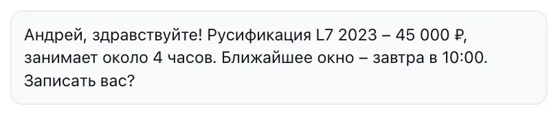 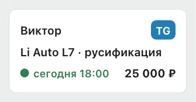

- Русификация L7: 45 000 ₽ (v1, v6) и 25 000 ₽ (a2). L9 «русификация + CarPlay»: 61 000 ₽ (v6), 49 000 + 12 000 ₽ (v1), 89 000 ₽ (a2). Марка: LiXiang, Li Auto, Lixiang.
- **На стенде:** один прайс и один справочник марок; LiXiang – основное имя, Li Auto – синоним для поиска.

### М3. «Скопировать для АвтоДилера» при записи в CRM лишняя

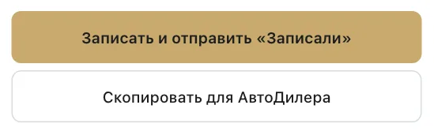

- При варианте 2Б (сетка в CRM, совет) в АД вводят только заказ-наряд при приезде – копировать запись туда не нужно.
- **На стенде:** кнопка видна, только если включён вариант 2А.

### М4. Подпись кодом в мессенджер активна раньше времени

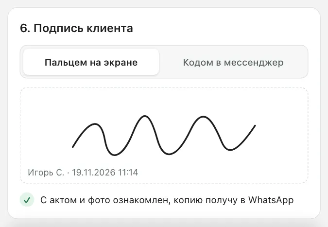

- Подпись кодом – фаза 3 и пункт о простой электронной подписи в оферте (63-ФЗ). В p6 переключатель уже есть.
- **На стенде:** только «Пальцем на экране», код – скрыт.

### М5. Номер ЗН в шапке приёмки и время «приняли»

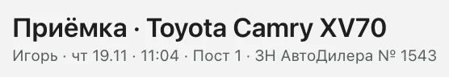

- В 11:04 у мастера уже есть номер ЗН – значит, менеджер успел открыть заказ-наряд в АД до приёмки. На практике мастер начнёт раньше. В шаблоне «Приняли» время 11:08, а подпись в акте – 11:14.
- **На стенде:** номер ЗН не нужен для подписи, вносится потом; «приняли в …» – время подписи акта.

### М7. Одни и те же имена у разных клиентов

- Игорь – Camry (p2, p6–p9), Haval Jolion (a1, a2) и Hyundai Creta (v1, v6). RAV4 2019 – у Марии (v1, v6) и у Ольги (a2). Тестовый клиент «Артём» совпадает с главным «Артёмом».
- **На стенде:** уникальные имена; клиент – «Артём К.», главный – «Артём Г.».

### Вопросы

1. **Стадия после «Новый».** А – «Узнали машину», 1 поле, как в живой CRM. Б – «Квалифицирован», 5 полей. Совет – Б.
2. **Время напоминания.** А – 18:00, как решено. Б – 17:00, час на дозвон. В – 18:00 и дежурный до 20:00. Совет – Б.
3. **Ссылки для клиента.** А – открытый путь crm.teyes-sibir.ru/a/ и /b/ по токену. Б – отдельный поддомен lk.teyes-sibir.ru. Совет – А сейчас, Б при личном кабинете.
4. **Отмена отзыва.** А – любой сотрудник клиента с причиной, видно главному. Б – только главный. Совет – А.
5. **Суббота.** А – выходной: записи и касания только пн–пт. Б – рабочий день: сетка и задачи и в субботу. Совет – скажи, как сейчас работаете.
6. **Бонусы и АвтоДилер.** А – свои бонусы, в АД – скидка руками с номером ЗН. Б – бонусы АвтоДилера, наш сайт их не показывает. Совет – А.

### Что раскрыть

1. Очередь сообщений: права, кто видит и отменяет чужое.
2. Склейка «Неразобранного» и раздачи – по шагам.
3. Таблица всех таймеров и норм в одном месте.
4. Что сказать юристу: согласия, простая электронная подпись, бонусы.
