# Путь клиента в CRM: 10 шагов в одном окне, подтверждение записи уходит само, акты с фото – у нас уже сейчас

**Вывод.** Весь путь клиента от первого сообщения до отзыва ложится в нашу CRM за 10 шагов. Главная автоматика – та, что ты просил: накануне в 18:00 клиенту само уходит напоминание в тот мессенджер, где он писал, с кнопками «Да, приеду / Перенести / Не смогу» или цифрами в WhatsApp. Кто не ответил – тому менеджер звонит до 19:00. Акт приёмки с фото по кругу и закрывающий акт делаем в CRM уже в переходный период: это наш документ, из АвтоДилера ничего не выгружаем. В АвтоДилере пока остаются заказ-наряд и касса. Начать советую с подтверждения записей: ≈ 42 000 ₽, 5–6 дней. Весь путь – ≈ 184 000 ₽, ≈ 23 рабочих дня. Это оценка, час = 1000 ₽.

Как собрано: перечитал логику ролей, разбор amoCRM и разбор АвтоДилера, нормы ПП РФ № 780 и ст. 16 ЗоЗПП – сам, по тексту 18.11.2026. Бенчмарки собраны по открытым источникам (таблица внизу). Где цифра – реклама вендора, так и помечено. Все люди, машины и цифры на макетах – пример.

**Нужно от тебя**

- Буквы по 10 вопросам внизу. Совет: 1А 2Б 3А 4А 5Б 6А 7А 8А 9Б 10А.
- Сколько постов и мастеров у TEYES и EV и что каждый делает – чтобы сетка была настоящей.
- Гарантия на работы: какой срок даёте сейчас.

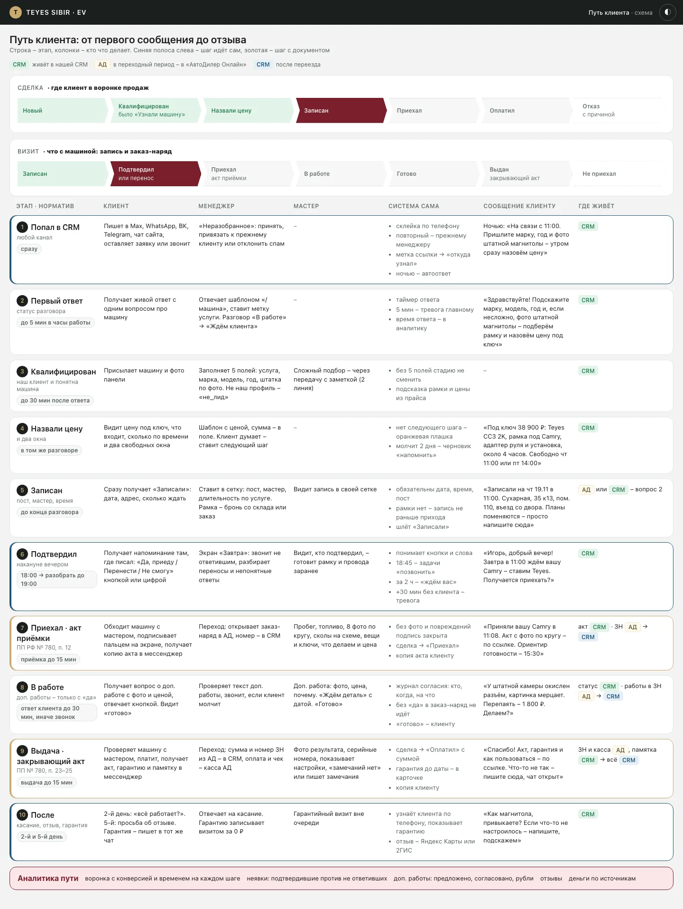

[Открыть схему](p0-shema.html) · на телефоне – карточками:

**Две оси вместо одной лестницы.** «Сделка» – где клиент в воронке продаж: Новый → Квалифицирован → Назвали цену → Записан → Приехал → Оплатил или Отказ. «Визит» – что с машиной: Записан → Подтвердил → Приехал → В работе → Готово → Выдан. У одной сделки бывает два визита: перенос, гарантия, доустановка. «Квалифицирован» заменяет «Узнали машину» из логики ролей.

## 1. До записи: ответ за 5 минут, «квалифицирован» – это 5 полей, цена и два окна одним сообщением

### Шаг 1–2. Попал в CRM и первый ответ

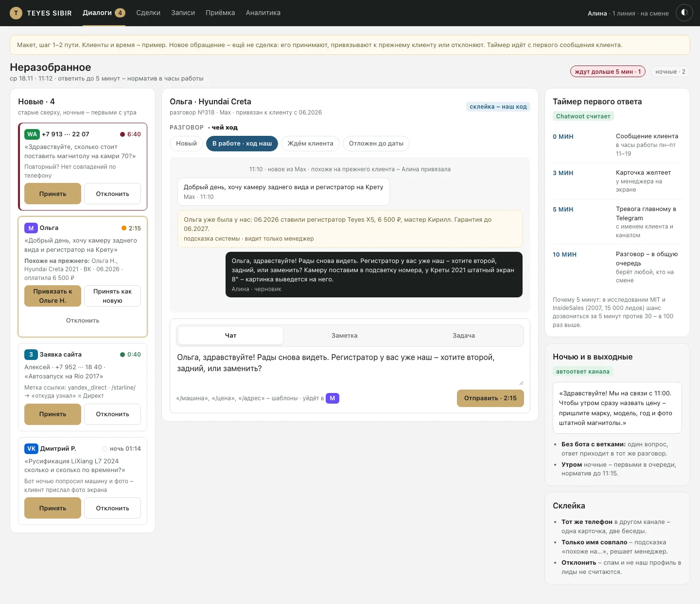

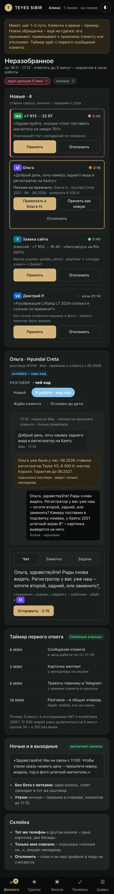

[Открыть живой макет](p1-vhodyashchie.html)

- **Новое обращение – ещё не сделка.** «Принять», «Привязать к прежнему», «Отклонить». Тот же телефон в другом канале склеивается сам, повторный клиент идёт к прежнему менеджеру, а менеджер сразу видит прошлую покупку и гарантию.
- **«Откуда узнал»** ставится сам из метки ссылки (сайт, Директ, ВК), иначе менеджер выбирает из списка.
- **Таймер:** 3 минуты – карточка желтеет, 5 – тревога тебе в Telegram, 10 – разговор в общую очередь. Почему 5: в исследовании MIT и InsideSales (15 000 лидов) шанс дозвониться за 5 минут против 30 минут – в 100 раз выше.
- **Ночью** автоответ с одним вопросом: «Пришлите марку, год и фото штатной магнитолы – утром сразу назовём цену». Без бота с ветками. Утром ночные первые, норматив до 11:15.

### Шаг 3–4. Квалифицирован и назвали цену

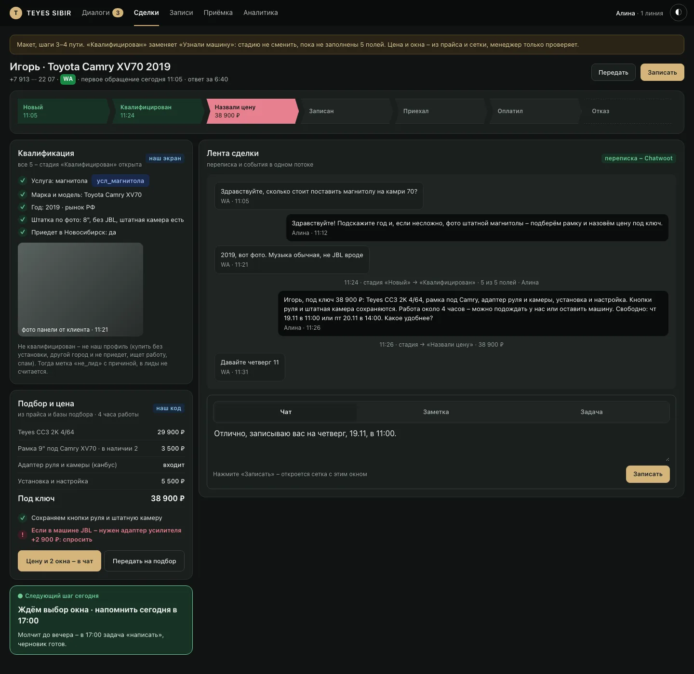

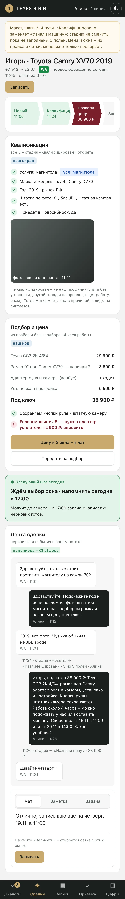

[Открыть живой макет](p2-kvalifikaciya.html)

**Квалифицированный лид у нас** – это 5 полей, без них стадию не сменить:

| Поле | Зачем | Пример |
|---|---|---|
| Услуга | наш профиль или нет | магнитола |
| Марка и модель | рамка, канбус, цена | Toyota Camry XV70 |
| Год, рынок | разные панели в одном поколении | 2019, РФ |
| Штатка по фото | экран, JBL, камера – что сохраняем | 8", без JBL, камера есть |
| Приедет | Новосибирск или готов ехать | да |

Цена в квалификацию не входит: это следующий шаг. «Не квалифицирован» – купить без установки, другой город и не приедет, ищет работу, спам. Тогда метка `не_лид` с причиной, в лиды не считается.

- **Цена считается сама** из прайса и базы подбора: магнитола, рамка с остатком на складе, адаптер, установка, длительность. Подсказка красным – «есть JBL? нужен адаптер +2 900 ₽». Так доп. работа ловится до записи, а не на посту.
- **Одно сообщение:** цена под ключ, что входит, что сохраняется, сколько по времени и два свободных окна из сетки. Клиент выбирает окно, а не думает «перезвоню».
- **Следующий шаг обязателен** (приём из amoCRM): клиент молчит – задача «написать в 17:00» с готовым черновиком.

### Шаг 5. Записан

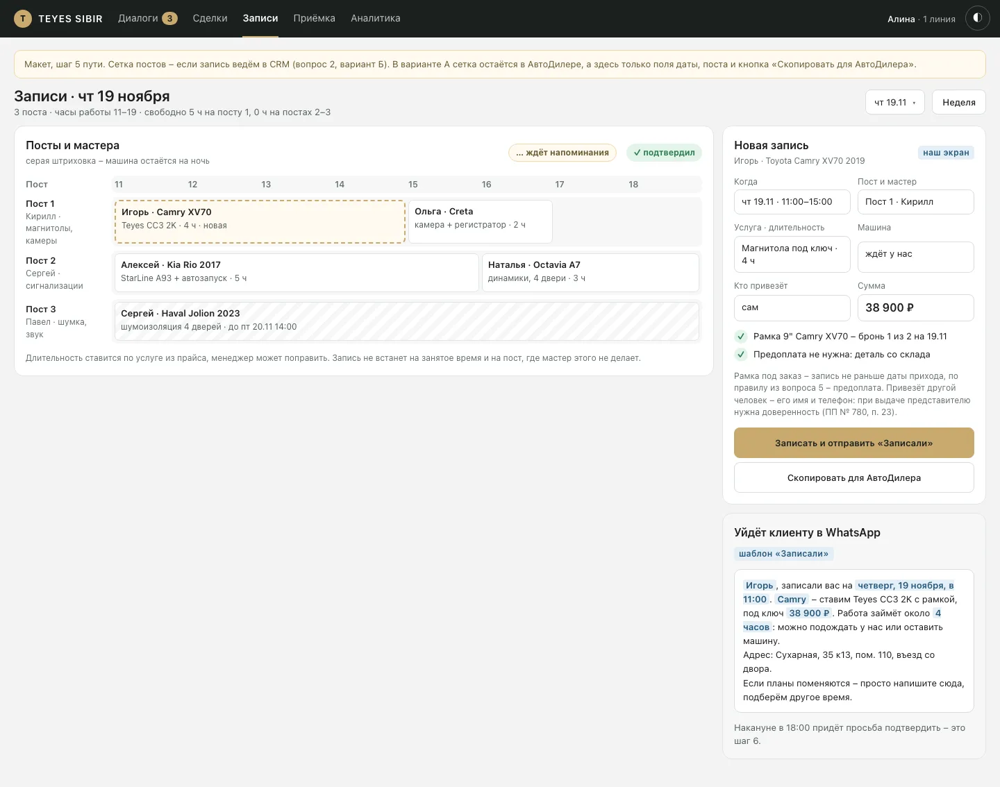

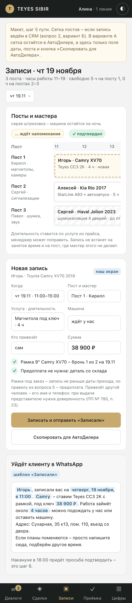

[Открыть живой макет](p3-zapis.html)

- **Сетка:** посты × часы, мастер на посту, длительность по услуге. Запись не встанет на занятое время и на пост, где мастер этого не делает. Штриховка – машина остаётся на ночь.
- **Бронь детали:** рамка со склада бронируется на дату. Рамка под заказ – запись не раньше даты прихода, по вопросу 5 – предоплата.
- **Привезёт другой человек** – его имя и телефон. При выдаче представителю нужна доверенность (ПП № 780, п. 23).
- **«Записали» уходит сразу:** дата, адрес с въездом, сколько ждать, «планы поменяются – просто напишите сюда».
- **Где живёт запись** – вопрос 2. Совет – сетка в CRM сразу, а в АвтоДилере – только заказ-наряд при приезде. Напоминание без верной даты не работает, а двойной ввод в две сетки рано или поздно разойдётся. Эти 32 часа потом не тратим при переезде.

## 2. Подтверждение идёт само: накануне в 18:00, в тот мессенджер, где клиент писал, молчание – звонок

### Шаг 6. Как устроено напоминание

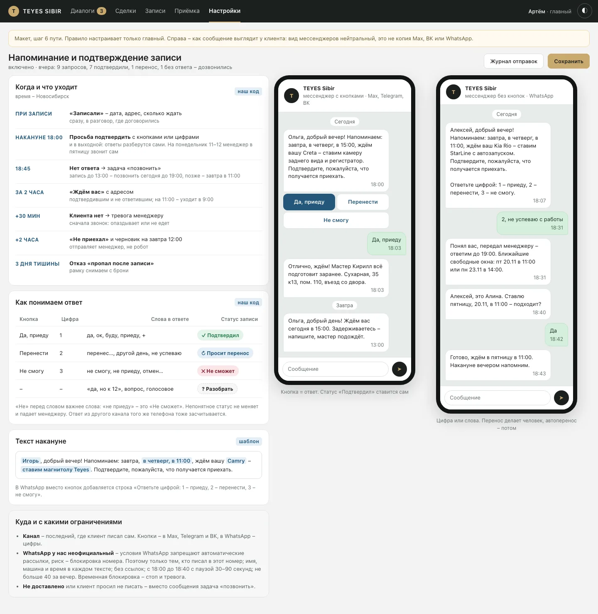

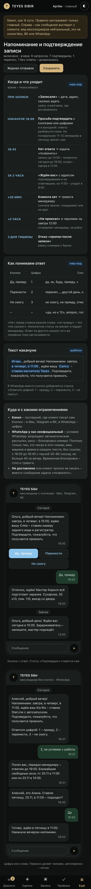

[Открыть живой макет](p4-napominanie.html)

| Когда | Что | Кто |
|---|---|---|
| при записи | «Записали» – дата, адрес, сколько ждать | система |
| накануне 18:00 | просьба подтвердить: кнопки в Max, Telegram, ВК; цифры 1–2–3 в WhatsApp | система |
| 18:45 | нет ответа → задача «позвонить»: запись до 13:00 – сегодня до 19:00, позже – завтра в 11:00 | менеджер |
| за 2 часа | «Ждём вас» с адресом; на 11:00 – в 9:00 | система |
| +30 минут | клиента нет → тревога менеджеру, звонок | менеджер |
| +2 часа | «Не приехал», черновик «перенесём?» на завтра 12:00 | менеджер отправляет |
| 3 дня тишины | Отказ «пропал после записи», бронь детали снимаем | система |

**Почему 18:00:** рабочий день до 19:00, менеджер успевает разобрать ответы и дозвониться тем, кто записан на утро. В выходной сообщение уходит тоже, ответы разбираются сами, непонятное ложится менеджеру на открытие. На понедельник 11–12 менеджер в пятницу звонит сам.

**Как CRM понимает ответ:**

- Кнопка – однозначно. Цифра 1/2/3 – однозначно.
- Слова: «да, ок, буду, приеду, +» → Подтвердил; «перенес…, другой день, не успеваю» → Просит перенос; «не смогу, не приеду, отмен…» → Не сможет. «Не» перед словом важнее слова.
- Всё остальное – «да, но к 12», вопрос, голосовое – статус не меняет и падает менеджеру «Разобрать».
- Ответ из другого канала того же телефона засчитывается.
- Перенос делает человек: бот сразу отвечает «передал менеджеру» и показывает два свободных окна. Автоперенос по кнопке – фаза 3.

**WhatsApp – осторожно.** У нас он неофициальный (GOWA), а условия WhatsApp запрещают автоматические рассылки – риск блокировки номера. Поэтому: только тем, кто сам писал в этот номер; имя, машина и время в каждом тексте; без ссылок; с 18:00 до 18:40 с паузой 30–90 секунд; не больше 40 за вечер; временная блокировка – стоп и тревога. Не доставлено или клиент просил не писать – вместо сообщения задача «позвонить». Max и ВК пишем только тем, кто писал нам сам.

### Экран «Завтра»

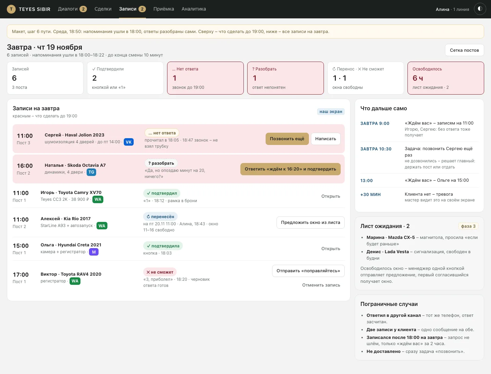

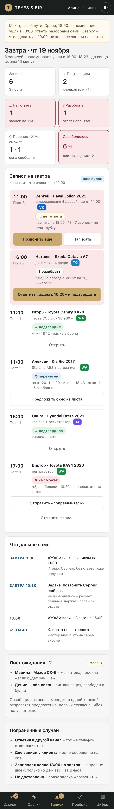

[Открыть живой макет](p5-zavtra.html)

- **Сверху – что сделать до 19:00:** нет ответа, непонятный ответ. На каждой строке одна главная кнопка: «Позвонить», «Ответить "ждём к 16:20" и подтвердить».
- **Освободилось окно** после переноса или отказа – «Предложить окно из листа ожидания» (фаза 3).
- **Пограничные случаи:** две записи – одно сообщение; записался после 18:00 на завтра – запрос не шлём, только «ждём вас»; не доставлено – сразу звонок.

**Чего ждать в цифрах:** по обзору Cochrane (7 исследований, 5 841 человек) SMS-напоминание поднимает явку с 67,8% до 78,6%. Это примерно +11 пунктов, не «в разы». Обещания вендоров «неявки в 2 раза меньше» не проверены. Свою цифру меряем «до и после» на экране аналитики.

## 3. Машина у нас: акт приёмки с фото, доп. работы только с «да», закрывающий акт с гарантией

### Шаг 7. Приехал – акт приёмки на телефоне мастера

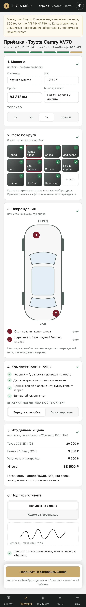

[Открыть живой макет](p6-priemka.html) · вид на 1440 с пояснениями:

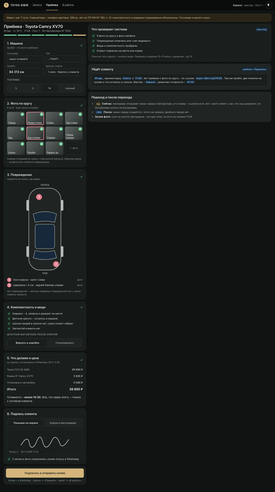

- **Что обязательно по закону:** приёмо-сдаточный акт с комплектностью и видимыми повреждениями, выдаётся клиенту (ПП РФ № 780, п. 12, действует с 01.09.2025). Пробег закон не требует – пишем, потому что он защищает нас.
- **6 блоков:** машина (пробег по фото приборки, топливо, ключи); 8 фото по кругу плюс салон и пробег; повреждения тапом по схеме кузова; комплектность и вещи (что оставили, штатную магнитолу вернуть или утилизировать); что делаем и цена из сделки; подпись.
- **Без 8 фото и без отметок «повреждения / нет видимых» подпись закрыта.** Норматив приёмки – до 15 минут.
- **После подписи:** копия акта клиенту в мессенджер ссылкой, сделка → «Приехал», визит → «В работе».
- **Переход:** менеджер открывает заказ-наряд в АвтоДилере, его номер – в шапке акта. Акт с фото – наш, в CRM. **После переезда** заказ-наряд создаётся с этого же экрана.

### Шаг 8. В работе и доп. работы

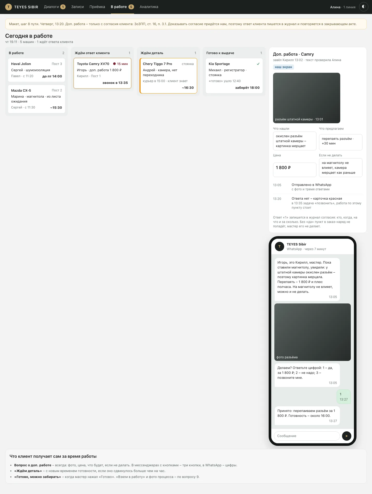

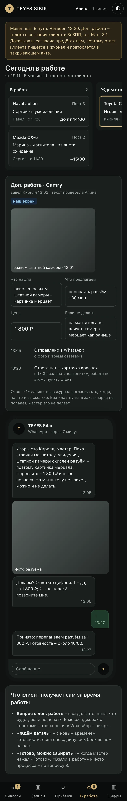

[Открыть живой макет](p7-v-rabote.html)

- **Доска дня:** В работе · Ждём ответ клиента · Ждём деталь · Готово к выдаче.
- **Доп. работа:** мастер снимает фото и пишет «что нашли, что предлагаем, цена, что будет, если не делать». Менеджер проверяет текст. Клиенту – три ответа: «да за 1 800 ₽ / не надо / позвоните мне».
- **Закон:** доп. работы за плату – только с согласия клиента, доказывать согласие обязан сервис, заранее нажатые галочки запрещены (ЗоЗПП, ст. 16, п. 3.1). Поэтому ответ клиента пишется в журнал согласий – кто, когда, на что, за сколько – и повторяется в закрывающем акте. Без «да» пункт в заказ-наряд не идёт.
- **Молчит 30 минут** – задача позвонить, работа по этому пункту стоит.
- **Отказался от ремонта, который влияет на безопасность,** – запись в акте и подпись обеих сторон (ПП № 780, п. 21).
- **Клиенту сами уходят:** вопрос о доп. работе, «ждём деталь» с новым временем, «готово, можно забирать». «Взяли в работу» и фото процесса – вопрос 9.

### Шаг 9. Выдача и закрывающий акт

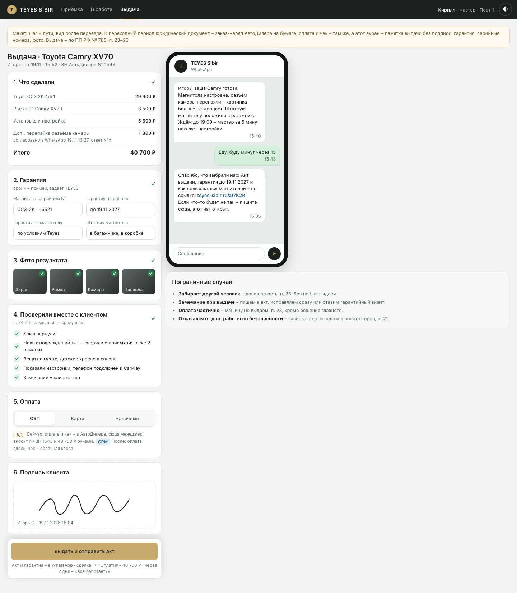

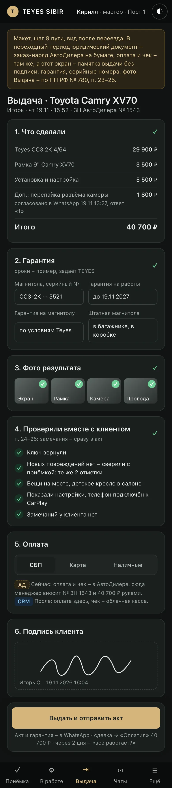

[Открыть живой макет](p8-vydacha.html)

- **Что в акте:** что сделали с суммами, согласованные доп. работы с временем ответа, серийные номера оборудования, гарантия до даты, фото результата.
- **Проверка вместе с клиентом** (ПП № 780, п. 24–25): ключ, новых повреждений нет – сверка с приёмкой, вещи, показали настройки. Замечание – сразу в акт.
- **Выдача после полной оплаты** (п. 23). Забирает другой человек – по доверенности.
- **Клиенту:** «готово» с тем, что сделали, потом ссылка на акт, гарантию и памятку. «Пишите сюда, чат открыт».

### Что видит клиент по ссылке

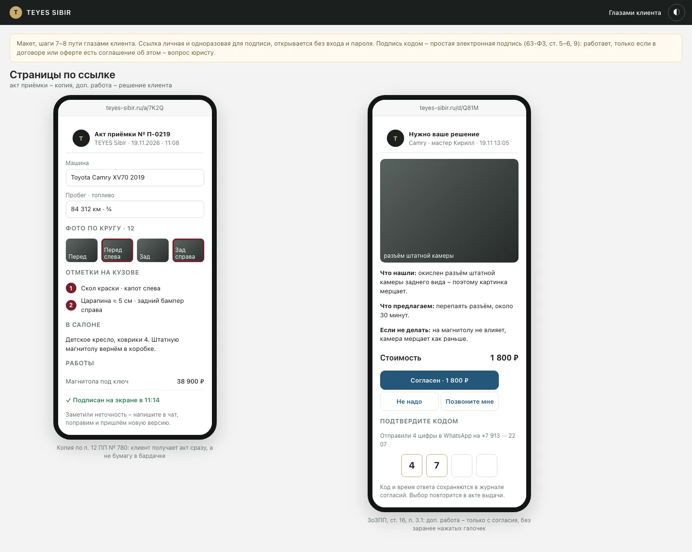

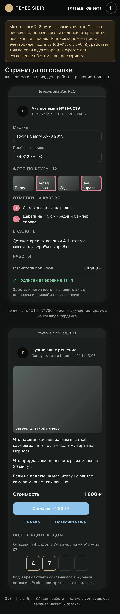

[Открыть живой макет](p11-klient.html)

**Подпись.** Пальцем на экране – когда клиент рядом. Кодом из мессенджера по личной ссылке – когда его нет: доп. работа, выдача без него. Код – это простая электронная подпись (63-ФЗ, ст. 5–6, 9). Она приравнивается к собственноручной, только если в договоре или оферте есть соглашение об электронной подписи. Подпись пальцем – тоже по соглашению (ГК, ст. 160). Пункт в оферту пишет юрист, не я.

### Что где живёт: переходный период и после переезда

| Шаг | Переходный период | После переезда |
|---|---|---|
| 1–4. Обращение, ответ, квалификация, цена | CRM | CRM |
| 5. Запись | АвтоДилер + поля в CRM (2А) или сетка в CRM (2Б, совет) | CRM |
| 6. Подтверждение | CRM | CRM |
| 7. Приёмка | акт с фото – CRM, заказ-наряд – АвтоДилер, номер руками | всё CRM |
| 8. В работе | статусы и согласия – CRM, работы в заказ-наряде – АвтоДилер руками | всё CRM |
| 9. Выдача | заказ-наряд на бумаге, оплата и чек – АвтоДилер; в CRM – памятка выдачи с гарантией, номер ЗН и сумма руками | акт и оплата в CRM, чек – облачная касса |
| 10. После | CRM | CRM |

Это сходится с разбором АвтоДилера: CRM главная до записи, АвтоДилер – по заказ-нарядам и деньгам, мост руками, из АвтоДилера ничего не выгружаем (оферта, п. 5.2.12–5.2.13). В переходный период юридический документ выдачи – заказ-наряд АвтоДилера, поэтому наша памятка выдачи без подписи: две подписи на одно и то же клиенту ни к чему.

## 4. После выдачи и цифры: касание на 2-й день, отзыв на 5-й, гарантия по телефону, аналитика всего пути

### Шаг 10. После

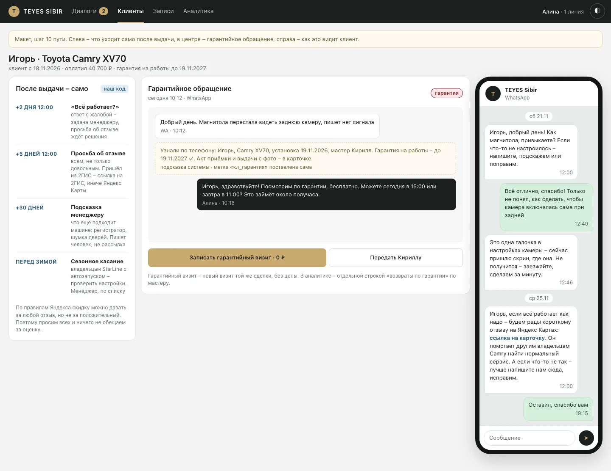

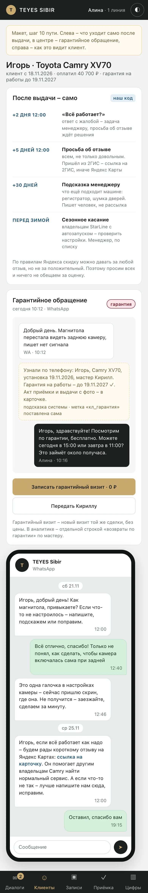

[Открыть живой макет](p9-posle.html)

- **2-й день, 12:00 – «Всё работает?»** Ловит проблемы до плохого отзыва. Жалоба – задача менеджеру, просьба об отзыве ждёт, пока решим.
- **5-й день – просьба об отзыве всем, не только довольным.** Пришёл из 2ГИС – ссылка на 2ГИС, иначе Яндекс Карты. По правилам Яндекса скидку можно дать за любой отзыв, но не за положительный – ничего не обещаем за оценку.
- **Гарантия:** клиент пишет в тот же чат, CRM узнаёт его по телефону, показывает установку, мастера и срок гарантии, ставит метку «кл_гарантия». Гарантийный визит – новый визит той же сделки за 0 ₽.
- **+30 дней и перед зимой** – подсказки менеджеру (регистратор, проверка автозапуска). Пишет человек, не рассылка.

### Аналитика пути

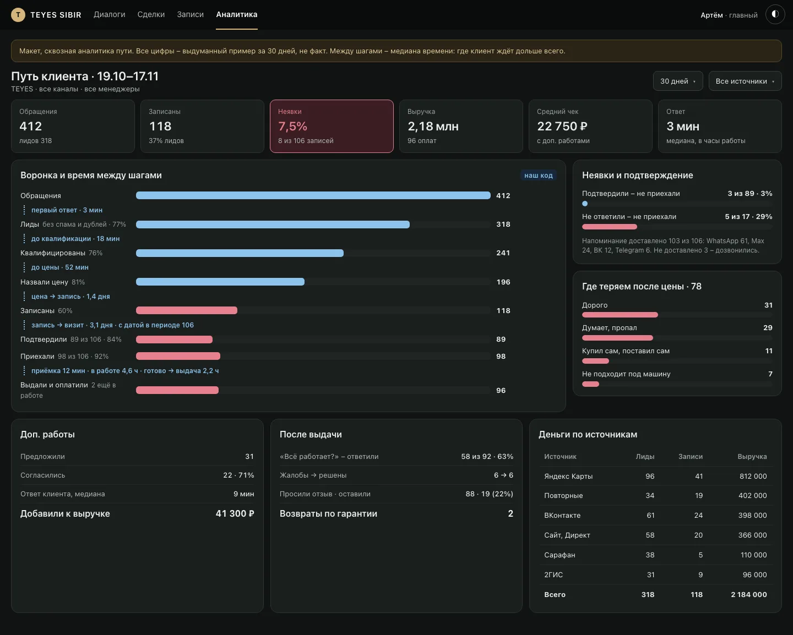

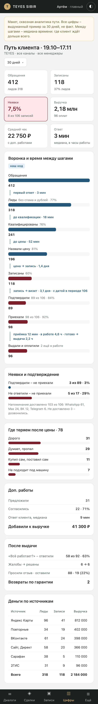

[Открыть живой макет](p10-analitika.html)

- **Воронка с временем между шагами:** обращения → лиды → квалифицированы → цена → записаны → подтвердили → приехали → выдали и оплатили. Между шагами – медиана: где клиент ждёт дольше всего.
- **Неявки по подтверждению:** подтвердившие против не ответивших. Так видно, работает ли напоминание.
- **Где теряем после цены** – причины отказа. **Доп. работы** – предложили, согласились, рубли. **После выдачи** – касание, жалобы, отзывы, гарантийные возвраты по мастеру.
- **Деньги по источникам:** лиды, записи, выручка.

## 5. Этапы, цена и вопросы: начать с подтверждения записей – 42 000 ₽, всё вместе – 184 000 ₽

### Что уже посчитано раньше и что здесь новое

Сумма ниже – только дельта к прошлым оценкам, без двойного счёта:

| Уже посчитано | Где | Здесь |
|---|---|---|
| Этап 1 логики: линии, раздача, метки, аналитика по менеджерам | [логика ролей](https://tema-mail.github.io/razbory/teyes-crm-logika-8e921a01/), 27 ч | нужен до фазы 1 |
| Склейка дублей, следующий шаг, обязательные поля по стадии, время на этапе | [разбор amoCRM](https://tema-mail.github.io/razbory/teyes-crm-amo-bc064a14/), этап 1, 22 ч | 0 |
| Неразобранное, правило «отзыв через 3 дня» | amoCRM, этап 2 | 0. Правило «напоминание за день» из amo этапа 2 уходит в фазу 1: −3 ч там |
| Номер ЗН и сумма руками, кнопка «Скопировать для АвтоДилера» | [разбор АвтоДилера](https://tema-mail.github.io/razbory/teyes-autodealer-34f7e553/), 12 ч | 0 |
| Сетка постов при переезде | АвтоДилер, переезд, п. 2, 32 ч | переносим в фазу 3 или в фазу 1 при 2Б, при переезде уже не тратим |
| Печать акта в заказ-наряде при переезде | АвтоДилер, переезд, п. 3 | акты фазы 2 снимают с переезда ≈ 16 ч |

### Фазы

| Фаза | Что входит | Часы (оценка) | Деньги | Срок |
|---|---|---|---|---|
| **1. Подтверждение записей** (в запуск) | поля визита и статус записи (3); «Записали» с адресом (3); напоминание накануне: кнопки Max, Telegram, ВК, цифры и слова WhatsApp, статусы (12); звонок, «за 2 часа», неявка, черновик (6); экран «Завтра» (8); ограничитель WhatsApp (2); неявки и подтверждения в аналитике (4); тесты, регламент (4) | 42 | ≈ 42 000 ₽ | 5–6 дней |
| **2. Приёмка и выдача с фото** | акт приёмки на телефоне: фото, схема, вещи, подпись пальцем, ссылка клиенту (40); доп. работы с фото, ответ кнопкой, журнал согласий (16); статусы клиенту (4); акт выдачи: гарантия, серийники, проверка, памятка (14); касание 2-го дня, гарантия по телефону (4); тесты (6) | 84 | ≈ 84 000 ₽ | ≈ 11 дней |
| **3. Своя запись и подпись кодом** | сетка постов в CRM (32, из переезда); бронь деталей (2); подпись кодом и журнал (12); автоперенос по кнопке (4); лист ожидания (4); аналитика доп. работ, отзывов, времени в работе (4) | 58 | ≈ 58 000 ₽ | ≈ 7 дней |
| **Всего** | | **184** | **≈ 184 000 ₽** | **≈ 23 дня** |

Без сетки, которую всё равно писать при переезде, нового – 152 часа. Час = 1000 ₽, день = 8 часов. Все суммы и сроки – оценка. Фаза 1 – после этапа 1 логики ролей: ей нужны поля и стадии.

### Вопросы

1. **С чего начинаем.** А – фаза 1, подтверждение записей (≈ 42 000 ₽, 5–6 дней). Б – фазы 1 и 2 (≈ 126 000 ₽, ≈ 16 дней). В – всё сразу (≈ 184 000 ₽, ≈ 23 дня). **Совет – А:** неявки – самые дорогие потери, а мерить эффект проще на одном шаге.
2. **Где запись в переходный период.** А – сетка в АвтоДилере, в CRM дата и пост руками (0 ₽ сверх фазы 1, двойной ввод). Б – сетка в CRM сразу, в АвтоДилере только заказ-наряд при приезде (+32 000 ₽, +4 дня в фазе 1, при переезде уже не тратим). В – сетка в CRM только после переезда (0 ₽ сейчас). **Совет – Б:** напоминанию нужна одна верная дата.
3. **Когда напоминать.** А – накануне в 18:00 и за 2 часа (входит). Б – накануне в 12:00 и за 2 часа (0 ₽; больше времени дозвониться, но к утру клиент забывает). В – только накануне в 18:00 (−2 000 ₽). **Совет – А.**
4. **WhatsApp в напоминаниях.** А – автоматом тем, кто писал в WhatsApp, с ограничителем (входит; риск блокировки остаётся). Б – в WhatsApp не автоматом: менеджер отправляет готовый текст одной кнопкой (0 ₽, ≈ 10 минут его времени вечером). В – при записи предлагать клиенту Max или Telegram «чтобы подтвердить кнопкой» (+2 000 ₽). **Совет – А,** если номер WhatsApp не основной; иначе Б.
5. **Предоплата.** А – без предоплаты (0 ₽). Б – только за детали под заказ: рамка или адаптер под конкретную машину, принимает менеджер по QR СБП из кассы, в CRM отметка суммы (≈ 2 000 ₽). В – за любую запись (≈ 2 000 ₽ + эквайринг, часть клиентов уйдёт). **Совет – Б.**
6. **Акт приёмки в переходный период.** А – в CRM: фото, схема, копия клиенту (фаза 2). Б – «Акт осмотра» в приложении АвтоДилера (0 ₽, но копию в мессенджер из CRM не отправить, фото у них). В – бумага и фото в чат (0 ₽, искать потом трудно). **Совет – А.**
7. **Подпись акта.** А – пальцем на экране (входит в фазу 2; нужна строка в оферте). Б – кодом из мессенджера по ссылке (+12 000 ₽, фаза 3; нужен пункт о простой электронной подписи в оферте – юрист). В – бумага (−8 000 ₽ от фазы 2). **Совет – А сейчас, Б для доп. работ и выдачи без клиента в фазе 3.**
8. **Кто делает приёмку.** А – мастер, который будет ставить: знает, куда смотреть, 10–12 минут его времени. Б – менеджер или администратор: мастер не отвлекается, но хуже видит технику. В – кто свободен, по чек-листу. Всё – 0 ₽. **Совет – А,** пока людей 2–3.
9. **Сообщения о ходе работ.** А – только доп. работы и «готово» (входит). Б – плюс «взяли в работу» и фото процесса по кнопке мастера (+4 000 ₽). В – всё пишет менеджер руками (−4 000 ₽). **Совет – Б:** фото аккуратной проводки – лучший довод за нас.
10. **Отзыв и касание.** А – «всё работает?» на 2-й день, отзыв на 5-й (входит). Б – QR-код на стойке при выдаче и сообщение на 3-й день (+1 000 ₽ и печать). В – только отзыв на 3-й день, без касания (0 ₽). **Совет – А:** касание ловит проблему раньше плохого отзыва.

### Откуда приёмы и цифры: проверено и догадки

| Что | Цифра или приём | Источник | Статус |
|---|---|---|---|
| Скорость ответа на лид | 5 минут против 30 – шанс дозвониться в 100 раз выше, квалифицировать – в 21 раз | [MIT и InsideSales, 2007](https://www.leadresponsemanagement.com/mit_study.html) | исследование вендора с учёным, не рецензируемое |
| То же, HBR | кто ответил в первый час, квалифицирует почти в 7 раз чаще; 23% фирм не ответили вовсе | HBR, 2011, «The Short Life of Online Sales Leads» | по пересказу, статья платная |
| SMS-напоминание и явка | явка 67,8% → 78,6%, RR 1,14 | [Cochrane, 2013](https://www.cochrane.org/evidence/CD007458) | проверено |
| Неявки в среднем | ≈ 23% (медицина, 105 исследований) | Dantas, Health Policy, 2018 | по аннотации |
| Неявки в автосервисе | 15–25%, после напоминаний 8–12% | EZ Texting, Numa | реклама вендоров, не проверено |
| Подтверждение кнопкой без входа | время – за N часов или накануне в фиксированное время, статус «Подтвердил» сам | [YCLIENTS, справка](https://support.yclients.ru/5-27-28-649--zapros-podtverzhdeniya-zapisi/) | проверено |
| Цифровой осмотр с фото по ссылке | клиент одобряет с телефона; «+27% к среднему чеку», «+76% одобренных работ» | [Shopmonkey](https://www.shopmonkey.io/demo-digital-vehicle-inspections), [AutoVitals](https://www.autovitals.com/?p=8439) | приём проверен, цифры – реклама |
| Приёмо-сдаточный акт | комплектность и видимые повреждения, выдаётся клиенту | [ПП РФ № 780, п. 12](https://legalacts.ru/doc/postanovlenie-pravitelstva-rf-ot-29052025-n-780-ob-utverzhdenii/) | проверено сам |
| Выдача | после полной оплаты, проверка вместе с клиентом, замечания – в акт | ПП № 780, п. 23–25 | проверено сам |
| Доп. работы | только с согласия, доказывает сервис | [ЗоЗПП, ст. 16, п. 3.1](https://legalacts.ru/doc/ZZPP/glava-i/statja-16/) | проверено сам |
| Подпись кодом | простая ЭП равна собственноручной по соглашению сторон | 63-ФЗ, ст. 5–6, 9; ГК, ст. 160 | проверено |
| Отзывы | скидка за любой отзыв – можно, только за положительный – нельзя | [правила Яндекса](https://yandex.ru/support/reviews/ru/rules.md) | проверено |
| WhatsApp неофициальный | условия запрещают автоматические и массовые сообщения | [условия WhatsApp](https://www.whatsapp.com/legal/terms-of-service) | проверено |
| Кнопки в мессенджерах | Max – inline-кнопки до 210; Telegram – inline; ВК – клавиатура бота, пишет только разрешившим | [dev.max.ru](https://dev.max.ru/docs-api/use-cases/sending-messages/keyboard/), core.telegram.org | Max, Telegram – проверено; ВК – по вторичным |

Не нашёл открытых данных: RemOnline (сайт не открылся), 1С:Автосервис, «Рапид» – о них выводов не делаю. Чужие экраны не копировал: на макетах наш стиль, мессенджеры нейтральные.

### Что раскрыть

1. Подтверждение: полный словарь ответов и что делать с голосовыми.
2. Акт приёмки: какие ракурсы фото и как мастер снимает за 3 минуты.
3. Согласие на доп. работы: что писать в оферту – список вопросов юристу.
4. Переход: как менеджер ведёт заказ-наряд в АвтоДилере рядом с CRM, по минутам.
