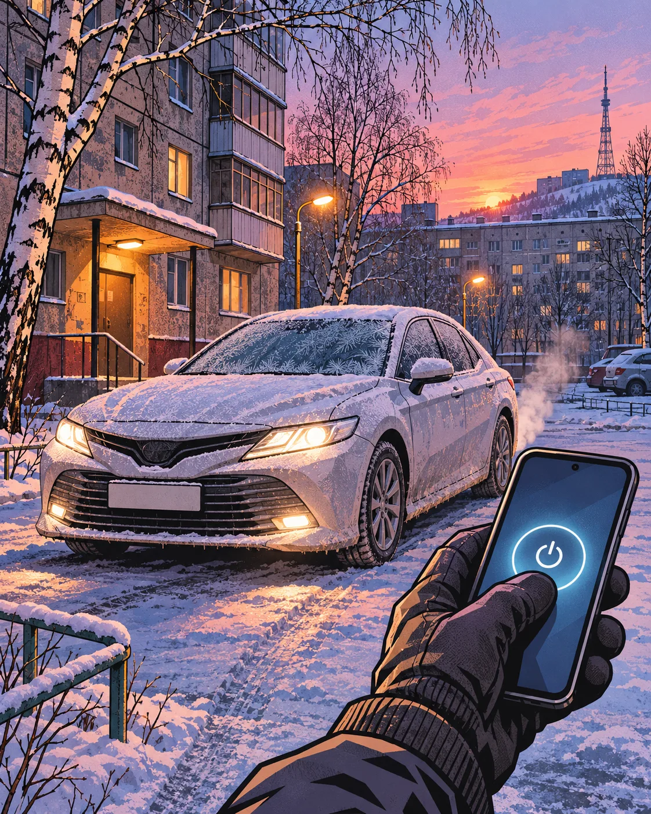
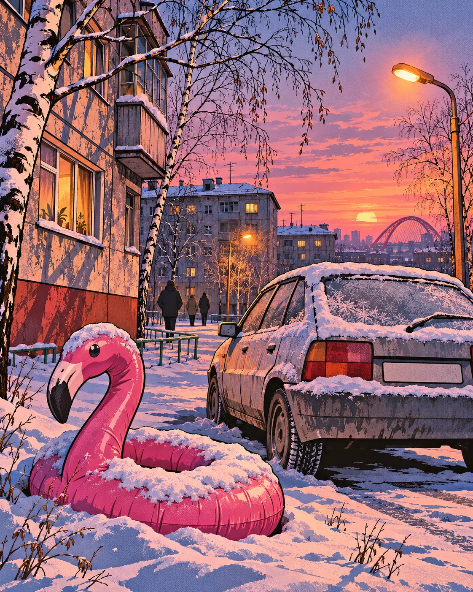
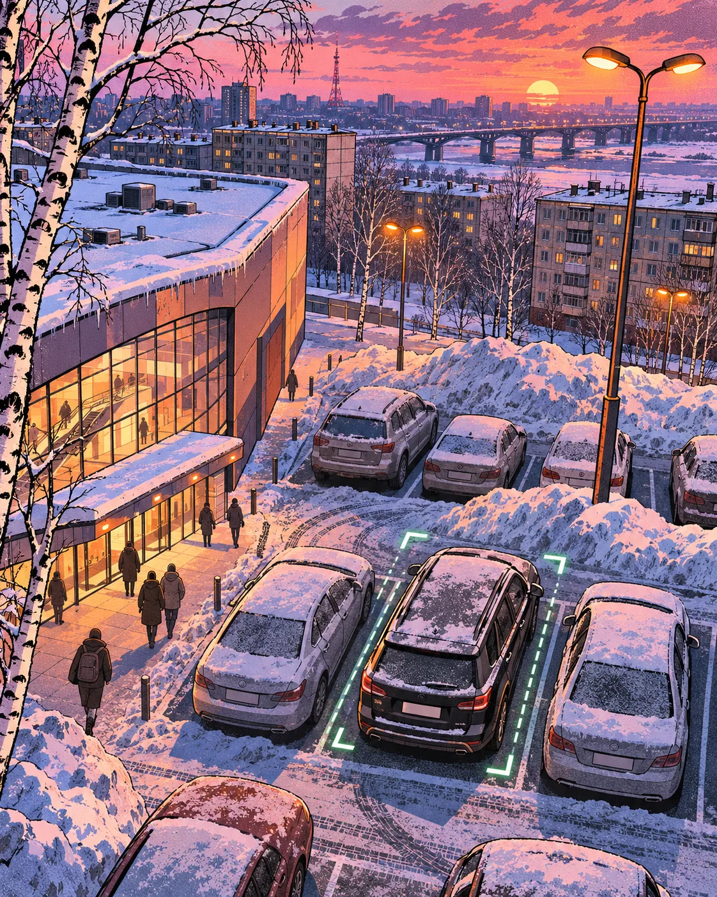

# TEYES Sibir × GTA 6: главные картинки, 8 из 50

**Вывод:** готово 8 из 50, рисуем бесплатно через Codex по одной, пачками по 8. Текста в кадре нет – надпись под картинкой ставим потом в Figma.

**Нужно от тебя:** номера, которые нравятся, и что поправить. Понравившееся направление дорисуем сериями.

**Что раскрыть:** 1 – промт любой картинки; 2 – как перерисовать с реальной машиной клиента; 3 – как ставить надписи.

## Что заметил при проверке

- Лучшие: **02** (Camry и кнопка запуска), **03** (фламинго в сугробе), **06** (вид сверху, камера 360).
- Машины на 03, 04, 07, 08 вышли старыми и потёртыми, а по нашему правилу нужны обычные массовые свежие. В следующих пачках пропишу «clean modern car 2015–2022».
- На 01 генератор сам добавил девушку: поза близка к официальному арту игры. Лучше перерисовать с машиной без людей.
- На 05 вместо одного кадра вышел коллаж, экран магнитолы мелкий.
- Текста, логотипов и номеров нет ни на одной. Новосибирск узнаётся: оперный театр, Бугринский мост.

## Картинки

### 01. Вайс-Сити против Сибири

**Надпись:** Там +32. Тут −27 · **Продаём:** автозапуск

### 02. Завёлся с первого раза

**Надпись:** В игре заводится всегда. Тут – если есть автозапуск · **Продаём:** автозапуск

### 03. Фламинго вмёрз

**Надпись:** Вайс-Сити к нам не приехал · **Продаём:** автозапуск

### 04. Персонаж не под регион

**Надпись:** Скин не под Сибирь · **Продаём:** автозапуск, подогрев

### 05. Неон над Обью

**Надпись:** Неон есть и у нас · **Продаём:** магнитола

### 06. Вид сверху как в игре

**Надпись:** Вид от третьего лица – в твоей машине · **Продаём:** камера 360

### 07. Главный герой двора

**Надпись:** Главный герой двора · **Продаём:** автозапуск

### 08. Отпуск отменяется

**Надпись:** Отпуск отменяется. Прогрев включён · **Продаём:** автозапуск

## Ещё в очереди

09. Потрачено, 10. Миссия выполнена, 11. Чит-код на новую машину, 12. Опять зима, 13. Звёзды на сигнализации, 14. Сохранение игры, 15. Загрузочный экран мастера, 16. Респект от семьи, 17. Мини-карта как в игре, 18. Игра без локализации, 19. Было и стало, 20. Экран как у героя, 21. Радиостанций больше, чем в игре, 22. Prado: вид от третьего лица, 23. Камера заднего вида, 24. Китайский кроссовер с иероглифами, 25. Машина помолодела, 26. Геймпад и экран, 27. Сабвуфер в багажнике, 28. Пробка как концерт, 29. Динамик в двери, 30. Брелок на кухне, 31. Точка на карте, 32. Минус тридцать, 33. Мама с ребёнком, 34. Не на синюю изоленту, 35. Утро у офиса, 36. Отопитель в мороз, 37. Тогда и теперь, 38. Ключ и диск, 39. Отец и сын в боксе, 40. Ты играешь – она под защитой, 41. Пока ты играешь – мы ставим, 42. Геймпад за рулём, 43. Бокс как гараж игры, 44. Обложка-сетка, 45. Стена магнитол, 46. LC200 у Оби, 47. Маленький герой, 48. Forester в лесу, 49. Массовый седан – супергерой, 50. Конец миссии

Промты и скрипт: `~/Sites/redakciya/temy/GTA6-OBLOZHKI-004/` (idei.py, risuy.sh). Разбор темы: https://tema-mail.github.io/razbory/teyes-gta6-razbor-kontent/
