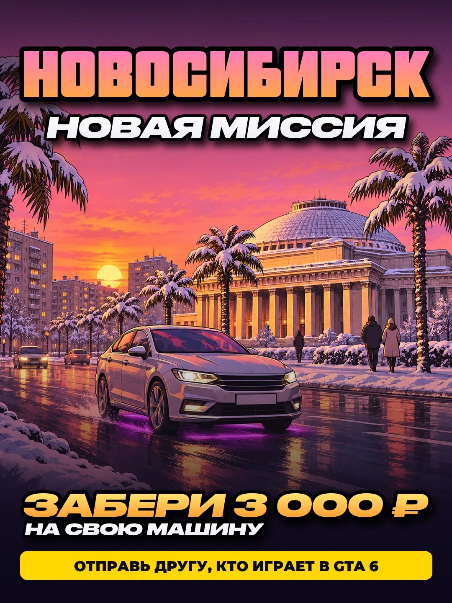
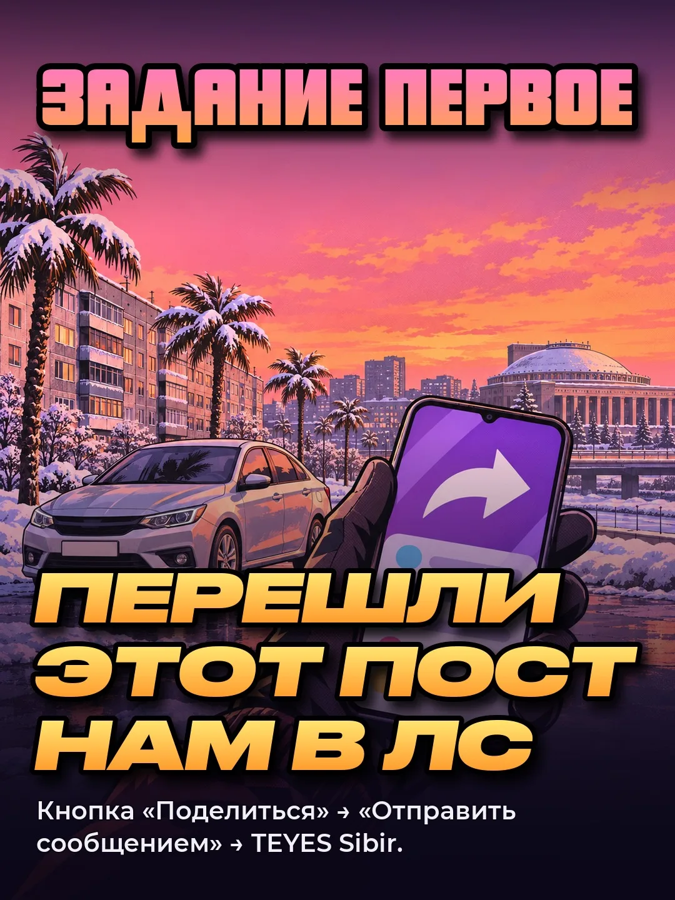
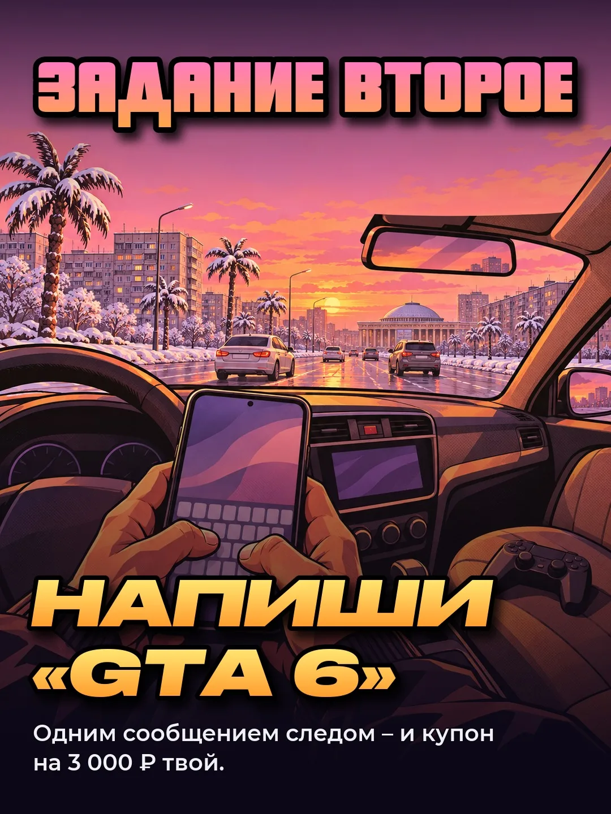
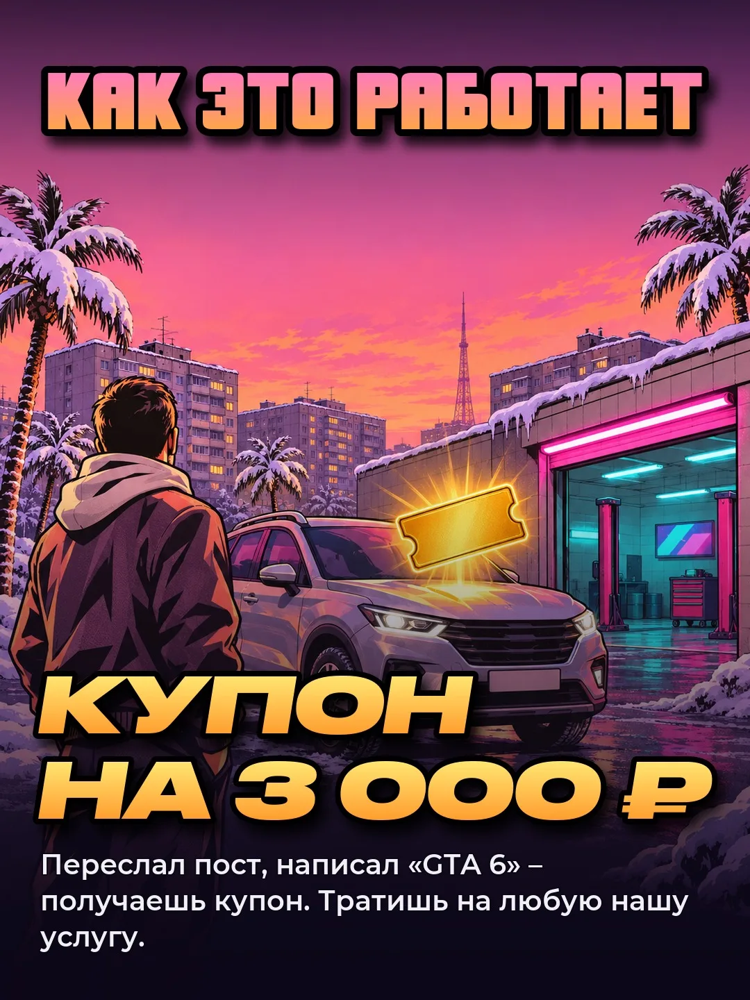
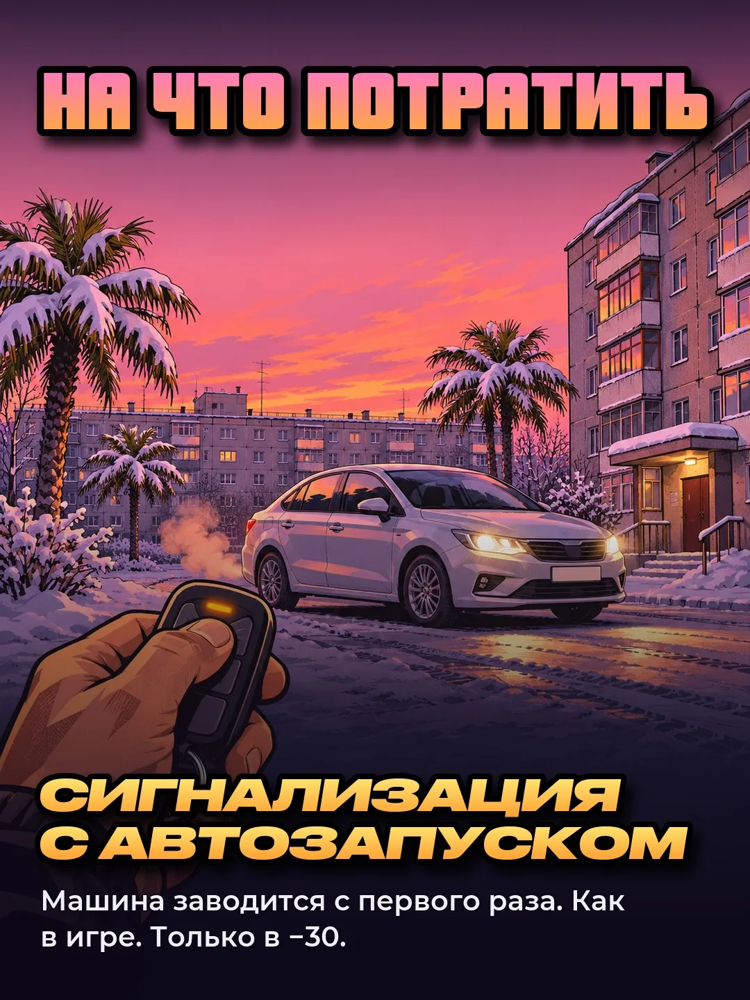
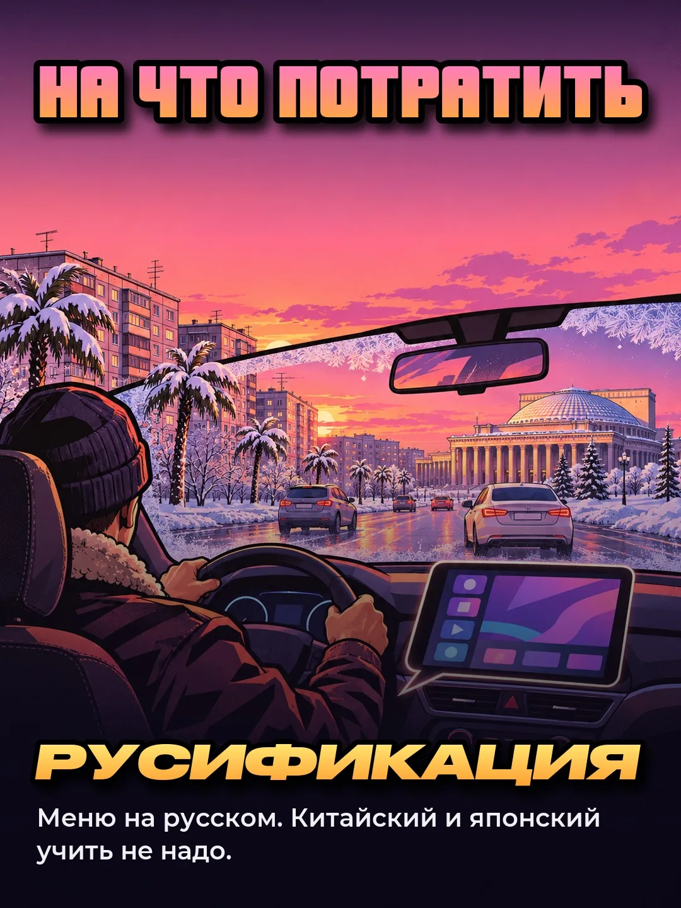
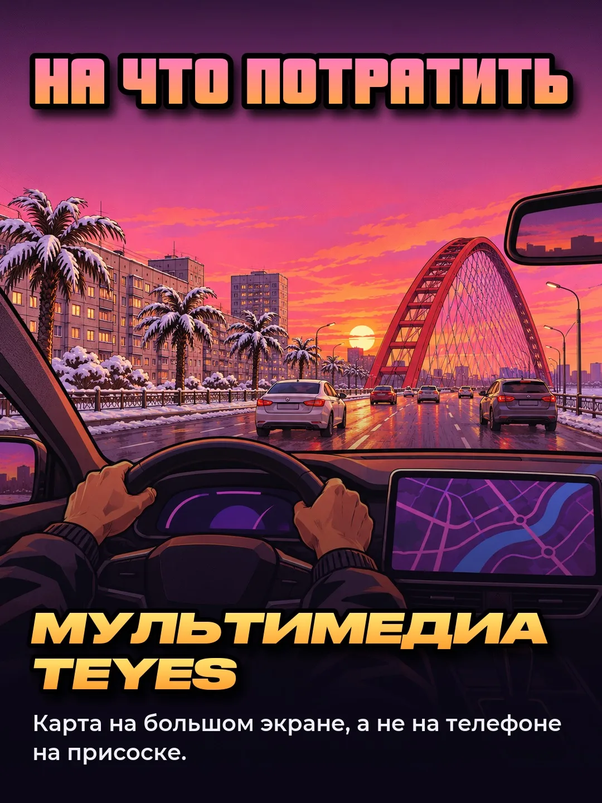
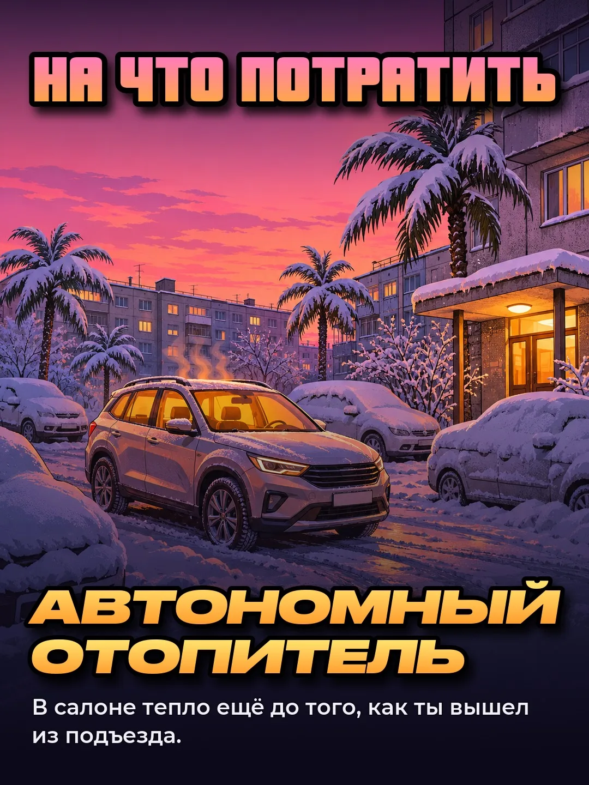
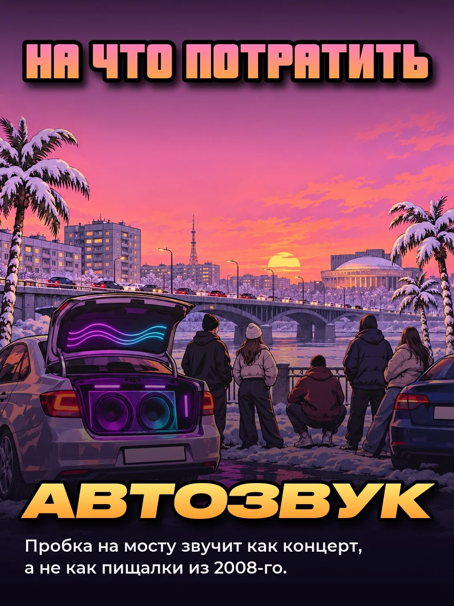
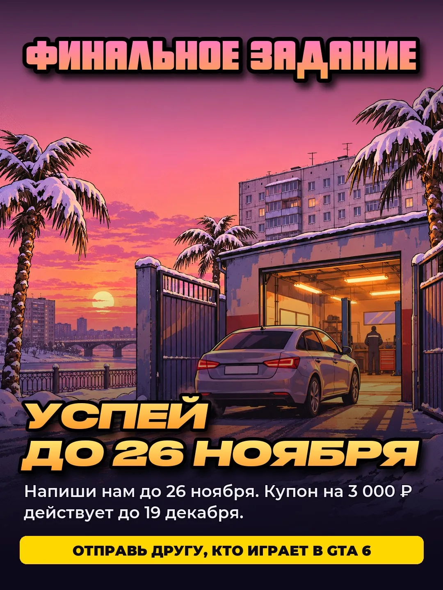

# Пост «Новая миссия»: 10 карточек

**Вывод:** пост с 3 000 ₽ собран как миссия из 10 карточек в стиле обложки: обложка, два задания, как работает купон, пять услуг, финальное задание со сроками. Бесплатно: 9 новых фонов нарисовал Codex, текст поставлен кодом.

**Нужно от тебя:**

- «Да» или правки по карточкам – номером.
- **Условия купона** – сейчас: «переслал пост + написал «GTA 6» → купон на 3 000 ₽ на любую услугу», написать до 26 ноября, использовать до 19 декабря. Нет ли минимальной суммы чека? Если есть – допишу на карточку 4.
- Пост только для ВК и Telegram: в Инстаграме реклама с деньгами запрещена.

[Скачать все 10 архивом](missiya.zip) · в Загрузках: teyes-gta6-karuseli/1-missiya

## 1. Обложка

## 2. Задание первое: Перешли этот пост нам в ЛС

Кнопка «Поделиться» → «Отправить сообщением» → TEYES Sibir.

## 3. Задание второе: Напиши «GTA 6»

Одним сообщением следом – и купон на 3 000 ₽ твой.

## 4. Как это работает: Купон на 3 000 ₽

Переслал пост, написал «GTA 6» – получаешь купон. Тратишь на любую нашу услугу.

## 5. На что потратить: Сигнализация с автозапуском

Машина заводится с первого раза. Как в игре. Только в −30.

## 6. На что потратить: Русификация

Меню на русском. Китайский и японский учить не надо.

## 7. На что потратить: Мультимедиа Teyes

Карта на большом экране, а не на телефоне на присоске.

## 8. На что потратить: Автономный отопитель

В салоне тепло ещё до того, как ты вышел из подъезда.

## 9. На что потратить: Автозвук

Пробка на мосту звучит как концерт, а не как пищалки из 2008-го.

## 10. Финальное задание: Успей до 26 ноября

Напиши нам до 26 ноября. Купон на 3 000 ₽ действует до 19 декабря.

Файлы: `~/Sites/redakciya/temy/GTA6-OBLOZHKI-004/` – missiya.py (тексты и сцены), risuy5.sh (рисование), mis_kart.py (текст на карточки), obl2.py (обложка).
