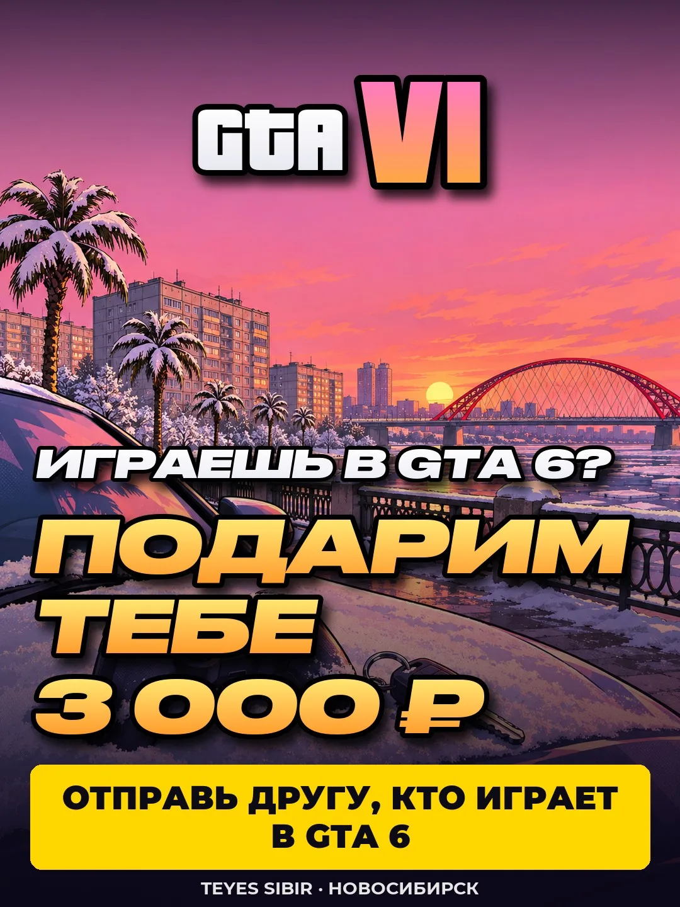
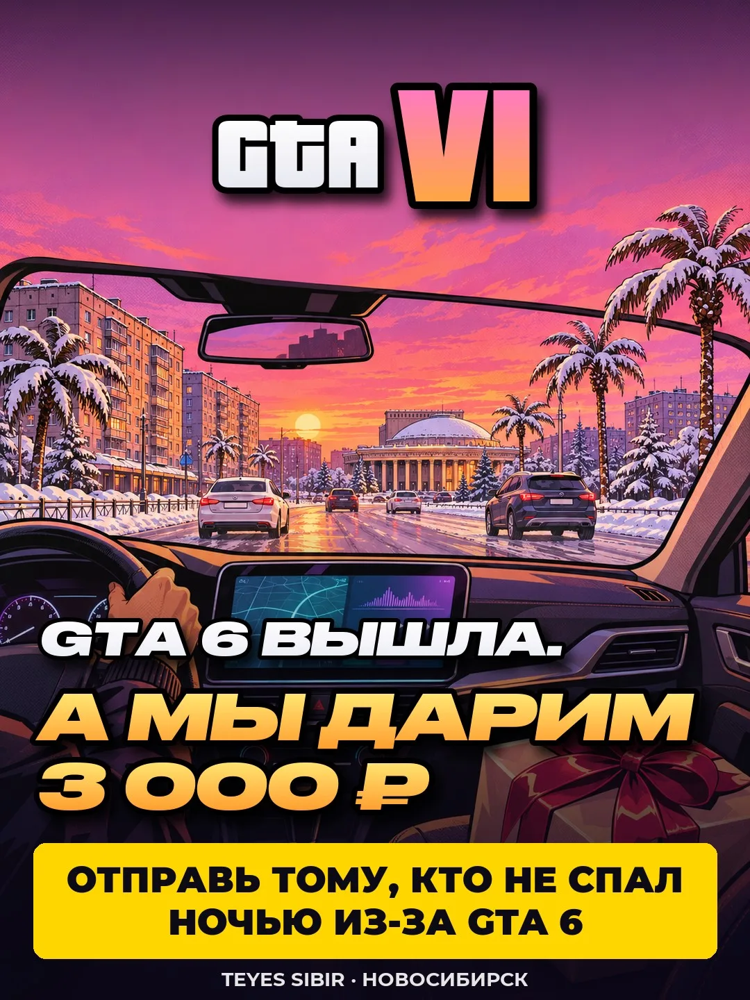
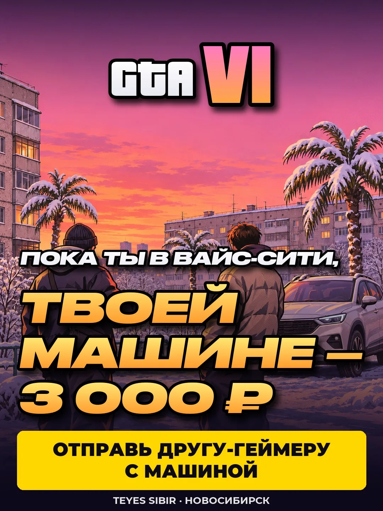
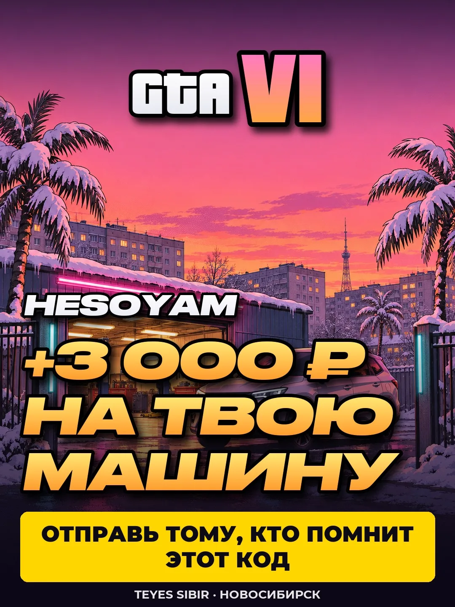
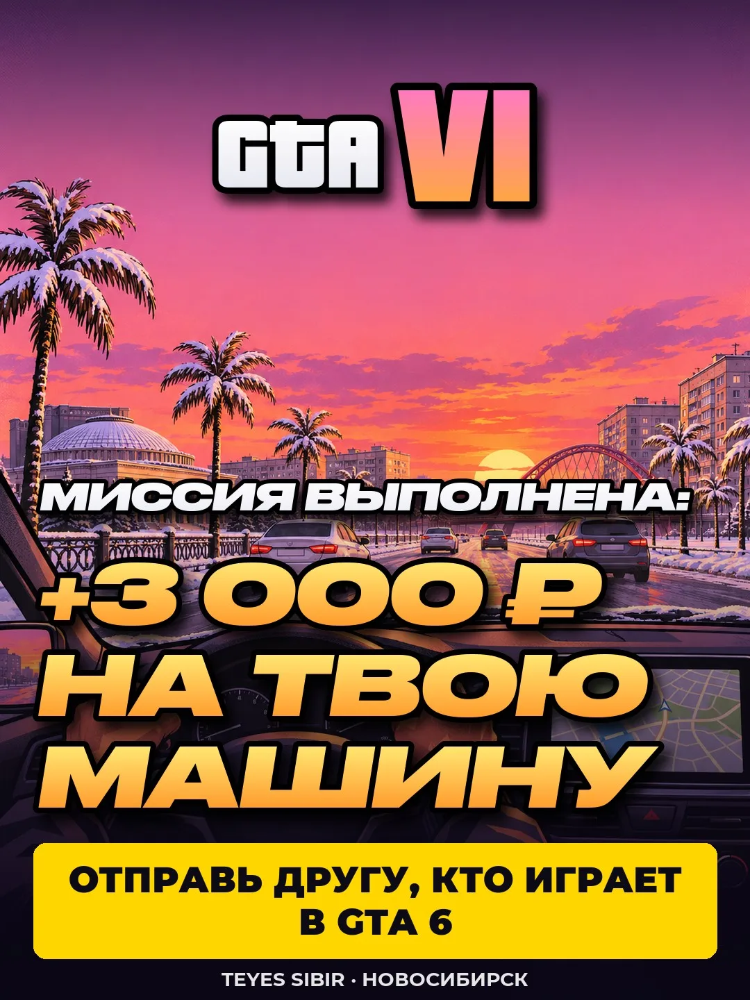
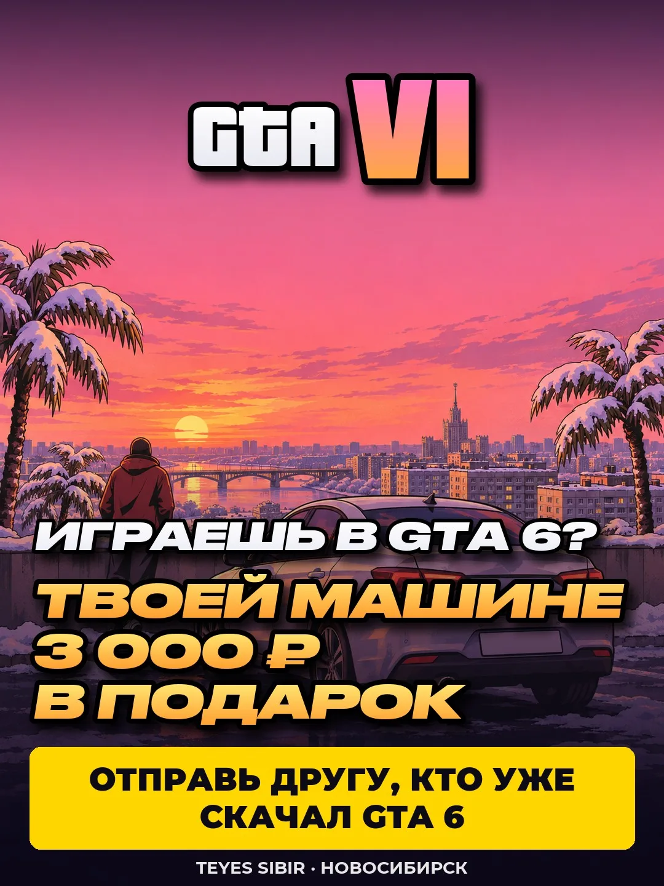

# Обложка поста «3 000 ₽ за GTA 6»: 8 вариантов

**Вывод:** 8 вариантов обложки готовы: новый шрифт, надпись GTA VI сверху, пальмы в снегу, внизу жёлтая плашка «Отправь другу». Всё бесплатно: фоны нарисовал Codex, текст поставлен кодом.

**Нужно от тебя:** номер варианта (или два – картинку от одного, текст от другого). Остальные карточки поста подгоню под этот шрифт.

**Риск:** надпись «GTA VI» – чужой товарный знак. Для обычного поста риск небольшой. Если пост будем продвигать за деньги – надпись лучше убрать.

[Скачать все 8 архивом](oblozhki-gta6.zip) · те же файлы в Загрузках: teyes-gta6-karuseli/oblozhki

## Вариант 1

**Играешь в GTA 6? Подарим тебе 3 000 ₽** – плашка: «Отправь другу, кто играет в GTA 6»

## Вариант 2

**Играешь в GTA 6? Держи 3 000 ₽ на свою машину** – плашка: «Отправь другу, который уже в Вайс-Сити»

## Вариант 3

**Новая миссия: забери 3 000 ₽ на машину** – плашка: «Отправь другу, кто играет в GTA 6»

## Вариант 4

**GTA 6 вышла. А мы дарим 3 000 ₽** – плашка: «Отправь тому, кто не спал ночью из-за GTA 6»

## Вариант 5

**Пока ты в Вайс-Сити, твоей машине – 3 000 ₽** – плашка: «Отправь другу-геймеру с машиной»

## Вариант 6

**HESOYAM +3 000 ₽ на твою машину** – плашка: «Отправь тому, кто помнит этот код»

## Вариант 7

**Миссия выполнена: +3 000 ₽ на твою машину** – плашка: «Отправь другу, кто играет в GTA 6»

## Вариант 8

**Играешь в GTA 6? Твоей машине 3 000 ₽ в подарок** – плашка: «Отправь другу, кто уже скачал GTA 6»

Шрифты: заголовок – Druk Wide Cyr Heavy Italic, надпись GTA VI – Pricedown (бесплатный, Typodermic), плашка – Montserrat Black. Файлы: `~/Sites/redakciya/temy/GTA6-OBLOZHKI-004/` – oblozhki.py (сцены), risuy4.sh (рисование), obl.py (текст), stranitsa3.py (эта страница).
