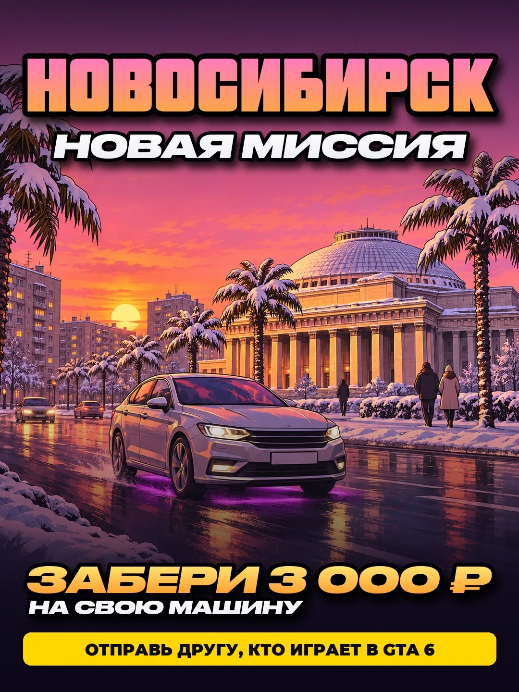
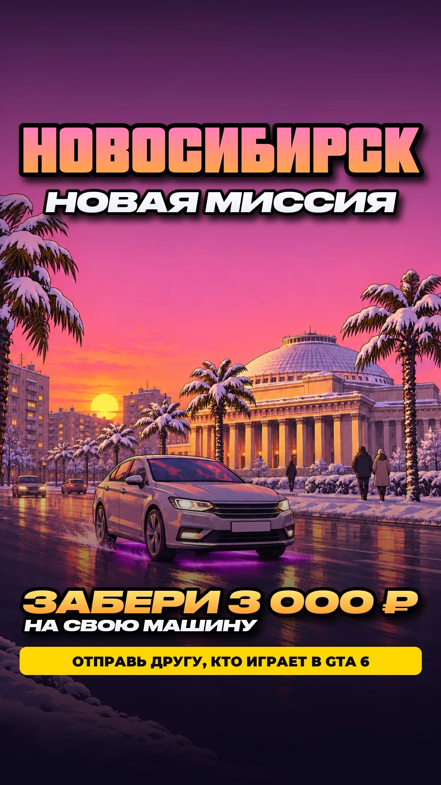

# Обложка «Новая миссия» – пост и сторис

**Вывод:** вариант 3 переделан по правкам и собран в двух форматах – пост 1080×1440 и сторис 1080×1920. Бесплатно: фон сторис Codex перерисовал под вертикаль, текст поставлен кодом.

**Что поменял:** сверху вместо GTA VI – «НОВОСИБИРСК» тем же шрифтом и переливом, что был у «VI», под ним «НОВАЯ МИССИЯ». Внизу «ЗАБЕРИ 3 000 ₽», под ним вдвое мельче «на свою машину». Плашка «Отправь другу, кто играет в GTA 6» – в одну строку, текст вдвое меньше. Строка «TEYES SIBIR · Новосибирск» убрана.

**Нужно от тебя:** «да» или правки. После «да» подгоню остальные 8 карточек поста под этот стиль.

[Скачать оба файла](v3.zip) · в Загрузках: teyes-gta6-karuseli/oblozhki

## Пост 1080×1440

## Сторис 1080×1920

Сверху и снизу оставлено по 250 px под кнопки ВК и Инстаграма.

Файлы: `~/Sites/redakciya/temy/GTA6-OBLOZHKI-004/obl2.py` – сборка обоих форматов.
