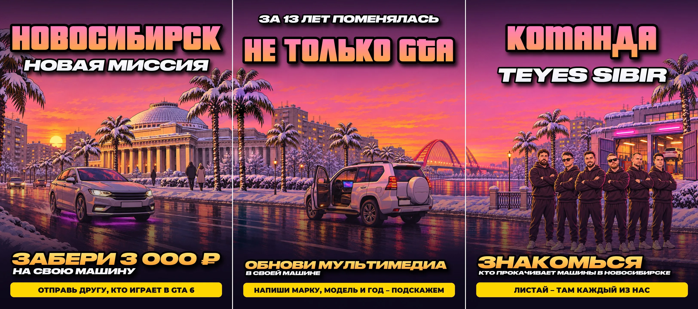
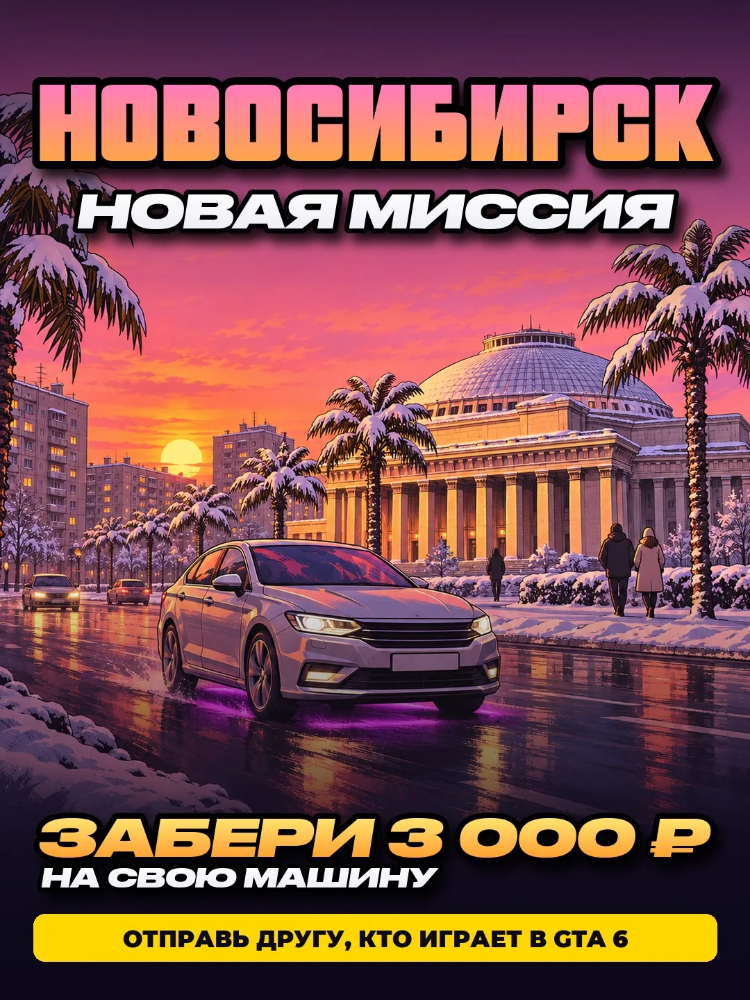
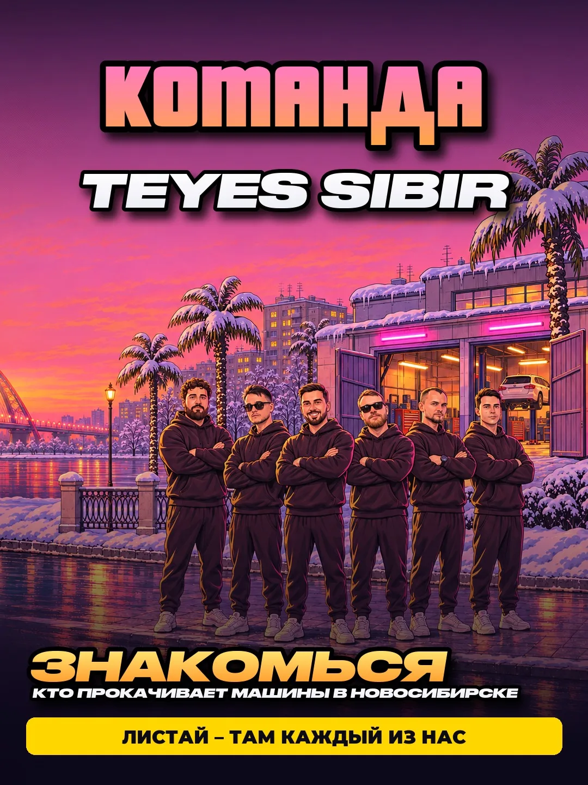
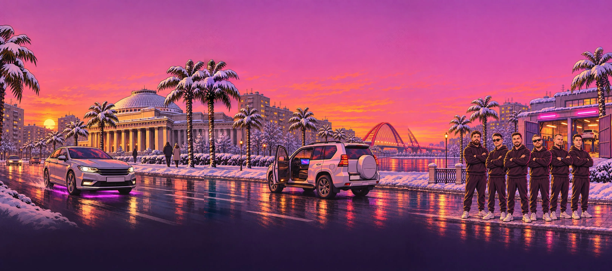

# Закреп: три обложки – одна картинка

**Вывод:** три обложки нарисованы одной панорамой: улица у Оперного, Prado с новым экраном, команда у ворот сервиса. Поставишь три поста в закреп рядом – сложится одна картинка. Бесплатно: две новые обложки Codex дорисовал продолжением первой, цвет на стыках подогнан кодом.

**Как закрепить, чтобы встали по порядку:** закрепляй в обратном порядке – сначала «Команду», потом «13 лет», последней «Новую миссию». Последний закреп встаёт первым слева. Встали не так – открепи и закрепи заново.

**Нужно от тебя:** «да» или правки. После «да» переведу внутренние карточки постов 2 и 3 в этот же стиль.

**Осторожно:** в Инстаграме пост с 3 000 ₽ – реклама с деньгами, там она запрещена. Для Инстаграма могу сделать обложку 1 без суммы, например «Забери подарок на свою машину».

[Скачать три обложки](zakrep.zip) · в Загрузках: TEYES-GTA6-zakrep

## Как будет в профиле

## Обложка 1 – Новая миссия

## Обложка 2 – За 13 лет поменялась не только GTA

Внизу: «А в твоей машине что-то поменялось за 13 лет?»

## Обложка 3 – Команда TEYES Sibir

Лица – с вашего GTA-кадра команды.

## Панорама без текста – проверка стыков

На стыке обложек 2 и 3 Бугринский мост сходится не идеально – в сетке это прикрывает зазор между постами.

Файлы: `~/Sites/redakciya/temy/GTA6-OBLOZHKI-004/` – risuy6.sh (рисование продолжением), tript.py (стыки и текст).
