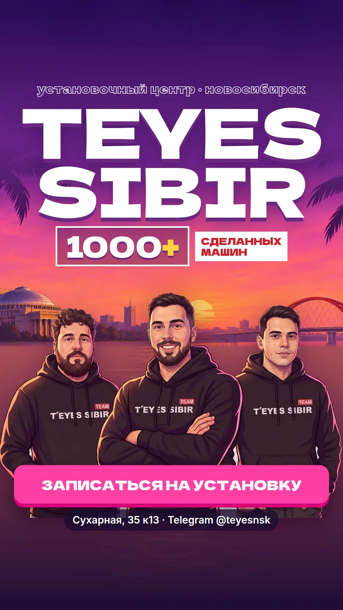
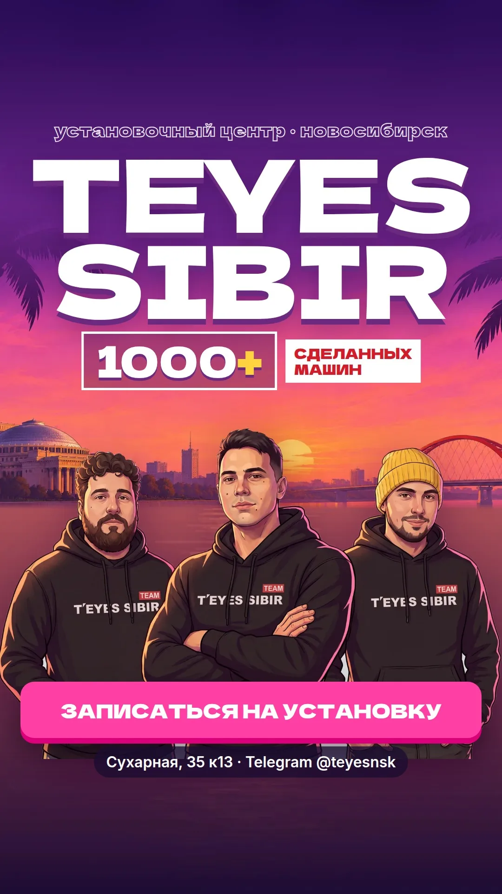
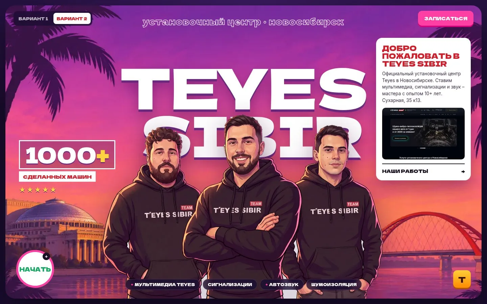
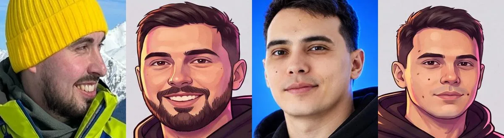
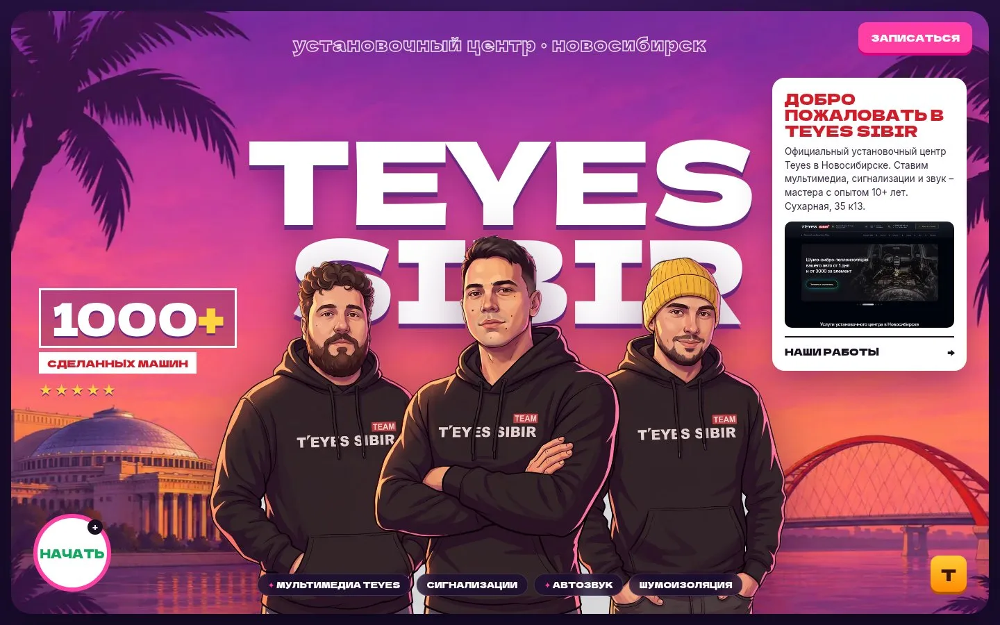
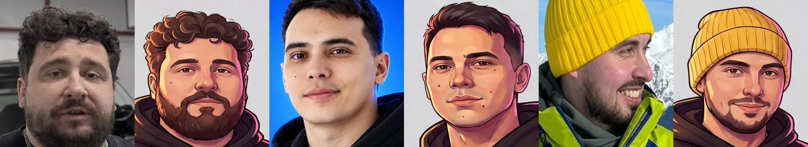

# Концепт TEYES Sibir: два варианта экрана и сторис

**Сторис 1080×1920 (новое):** две штуки – Кирилл в центре и ты в центре. Файлы в Загрузках, папка teyes-storis (PNG и JPG). Живая страница: [tema-mail.github.io/artem-portfolio/teyes/story](https://tema-mail.github.io/artem-portfolio/teyes/story/) (вариант 1 – с ?v=1).

| Кирилл в центре | Ты в центре |
|---|---|
|  |  |

Сделано бесплатно: картинка команды уже была, вертикальный фон собран кодом из готового фона Новосибирска (небо дорисовано, вода с солнечной дорожкой – кодом), текст и кнопка – вёрсткой, снимок 1080×1920 на claude-vps. Сверху и снизу по 250 px оставлены под интерфейс ВК и Инстаграма.

Codex (GPT image) на маке разлогинился – вход отозван, поэтому фон не через него. Чтобы Codex снова работал, в терминале: `codex login`. Аварию отправил.

---

**Вариант 2 (новый):** Кирилл в центре без шапки, Артём справа – [tema-mail.github.io/artem-portfolio/teyes/v2](https://tema-mail.github.io/artem-portfolio/teyes/v2/)

Причёску Кирилла дорисовал: фото без шапки нет, взял короткую тёмную стрижку под цвет бороды. Лицо в анфас – тоже по фото в профиль, поэтому сходство примерное. Есть фото Кирилла анфас без шапки – пришли, перерисую точнее.

Вариант 2 стоил ещё $0,28 ≈ 23 ₽ (баланс $4,73 → $4,46). Всего на концепт – около 46 ₽ из 100. Между вариантами – переключатель «Вариант 1 / Вариант 2» вверху страницы.

---

## Вариант 1

Взял первый экран портфолио и переделал под TEYES: вы втроём в толстовках «T'EYES SIBIR TEAM», за окном пальмы и Новосибирск, счётчик «1000+ сделанных машин».

**Открыть:** [tema-mail.github.io/artem-portfolio/teyes](https://tema-mail.github.io/artem-portfolio/teyes/)

## Что поменял по твоим словам

| Просил | Сделано |
|---|---|
| «Портфолио» → TEYES SIBIR | Крупно «TEYES SIBIR» за спинами |
| За окном что-то с Новосибирска | Оперный театр с куполом, красная арка Бугринского моста над Обью и пальмы |
| Кейсы → 1000+ машин | «1000+ сделанных машин» |
| Алексей и Кирилл рядом | Алексей слева, ты в центре, Кирилл справа (в своей жёлтой шапке) |
| Толстовки с надписью TEYES SIBIR Team | Чёрные толстовки, принт как на футболке Алексея: «T'EYES SIBIR» и красная плашка «TEAM» |

Справа карточка «Добро пожаловать в TEYES Sibir» со скрином сайта, кнопки «Записаться» и «Начать» ведут в Telegram @teyesnsk.

## Лица сверены с фото

Алексей – с фото у стенда с магнитолами, Кирилл – с фото из ВК (снял через твой Chrome, ВК без входа не отдаёт). Рядом исходник и рисунок:

Кирилл на фото в шапке и в профиль – поэтому оставил шапку, причёску не выдумывал.

Траты: Segmind один вызов, **$0,28 ≈ 23 ₽** (баланс $5,01 → $4,73), в лимите 100 ₽. Фон – Codex, бесплатно.

## Проверено на живом адресе

- Компьютер 1440 и телефон 390: всё влезает, горизонтальной прокрутки нет.
- На телефоне счётчик перенёс вниз, чтобы не закрывал Алексея.

## Нужно от тебя

1. Какой вариант берём – 1 или 2, и что поправить (в экране и сторис).
2. Войти в Codex заново: `codex login` в терминале.
3. Куда дальше: делаем на этом первом экране новую главную teyes-sibir.ru или это для соцсетей и рекламы.

## Что раскрыть

- На телефоне Новосибирск почти не виден – экран узкий, видно небо. Можно сделать отдельный кадр под телефон.
- Исходники и промт – в репо tema-mail/artem-portfolio, папка assets/raw/team.
