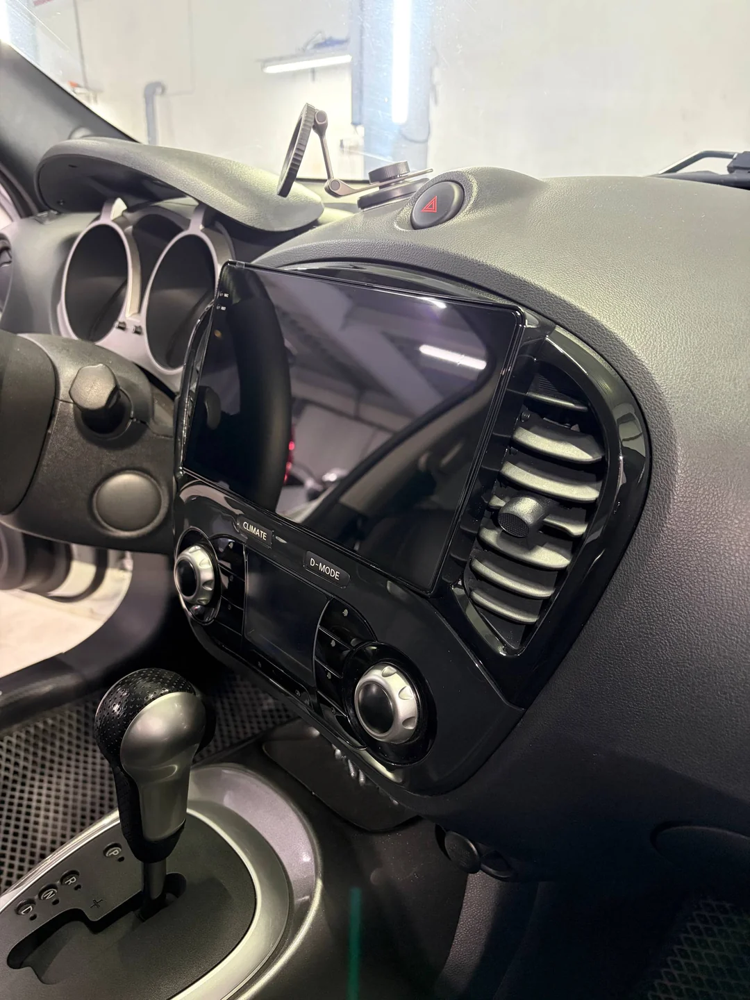

# Лучшая магнитола для Ниссан Жук: что ставить вместо штатной в 2026 году

Nissan Juke первого поколения снаружи не стареет, а магнитола в нём осталась в 2010 году.

Держатель телефона на торпедо, провод через консоль, навигатор в руке на светофоре. В простых версиях – CD-магнитола и четыре динамика, в дорогих – экран 5,8 дюйма, который меньше экрана вашего телефона.

*Nissan Juke после установки Teyes CC4: экран встал в рамку над блоком I-CON, климат и режимы езды остались на своих кнопках. Работа TEYES Sibir, август 2026. Экран на фото выключен.*

## Коротко: что ставить на Juke

Лучшее решение по мультимедиа для Juke сегодня – Android-магнитола Teyes в штатную рамку. Экран встаёт на место старой магнитолы, блок климата с переключателем режимов остаётся под ним и работает как раньше.

В каталоге TEYES Sibir под Juke 2010–2014 стоят Teyes CC3L за 28 100 ₽ и CC4 Pro за 56 770 ₽ – цены на сайте 18.11.2026, при оплате наличными, установка отдельно, от 4 500 ₽. Мы ставили на Juke CC4 – она на фото выше.

## Какой у вас Juke: Россия, Европа или Япония

Первый Juke выпускали с июня 2010 по 2019 год, в Японии продавали до июня 2020-го. Для Европы и России машины собирали в британском Сандерленде, для Японии – на заводе Оппама.

- **Российский Juke.** Официально продавался с апреля 2011 года, левый руль. Обновлённую версию привезли 20 ноября 2014 года: моторы 1.6 на 94 и 117 л. с. и турбо 1.6 DIG-T на 190 л. с.
- **Рестайлинг 2014 года** узнаете по фарам: в них появились светодиодные ходовые огни в форме буквы L, поменялись бамперы.
- **Японский Juke.** Правый руль, мотор 1.5 с передним приводом или турбо 1.6 в версиях 16GT и 16GT FOUR с полным приводом.

## Что стояло в машине с завода

**Российские машины до рестайлинга.** В базе – магнитола 2DIN с CD, радио, входом AUX и четырьмя динамиками. С комплектации SE прибавлялись MP3, Bluetooth, USB и кнопки на руле. В SE+ и SV2 стояла система Nissan Connect: сенсорный экран 5,8 дюйма, навигация, шесть динамиков и камера заднего вида.

**После рестайлинга.** В SE – магнитола 2DIN с Bluetooth, USB и объёмным звуком Arkamys. В SE+ – камера и Nissan Connect нового поколения с навигацией и тем же экраном 5,8 дюйма.

**Блок I-CON** под магнитолой – климат и режимы Normal, Sport, Eco на одном пульте. Его ставили во все версии, кроме базовой.

**Японские машины.** I-CON – начиная с 15RX. С сентября 2014 года за доплату ставили круговой обзор Around View, с 2016-го – пакет под фирменную навигацию Nissan с кнопками на руле.

В списках оснащения тех лет нет ни CarPlay, ни Android Auto.

## Что раздражает владельцев в 2026 году

**CD-магнитола.** Карт нет, приложений нет, а музыку вы давно слушаете с телефона.

**Маленький экран.** На 5,8 дюйма тяжело попасть пальцем в строку адреса на ходу.

**Японский Juke.** Меню и карты японские. Японский FM-диапазон до 2011 года заканчивался на 90 МГц, потом на 95 МГц, а наш эфир идёт до 108 МГц: часть новосибирских станций такой приёмник не ловит.

**Парковка задом.** Камеру завод ставил только в старшие версии.

## Три пути и какой выбрать

**Русифицировать штатный блок.** Подходит японскому Juke: меню станет русским, но карты останутся японскими, а диапазон радио – прежним.

**Ездить с телефоном.** Бесплатно, но держатель и провод остаются с вами.

**Поставить Android-магнитолу Teyes в штатную рамку.** Большой экран, Яндекс Навигатор, интернет по SIM-карте, CarPlay и Android Auto. Этот путь закрывает все пункты выше.

## Какую Teyes ставить на Juke

**Teyes CC3L** – память 4/32 ГБ, экран IPS 1280×720, 8 ядер, слот под SIM-карту с 4G, Wi-Fi, процессор звука DSP, CarPlay и Android Auto, GPS и ГЛОНАСС, вход камеры AHD 1080p. 28 100 ₽ на 18.11.2026.

**Teyes CC4 Pro** – память 8/128 ГБ, экран QLED 2000×1200. 56 770 ₽, рамка и проводка к машине в эту цену не входят.

Обе карточки в каталоге подписаны «2010–2014». Для рестайлинга 2014–2019 и праворульного японского Juke рамку подберём по фото центральной панели.

## Что останется от штатного

- **Климат и режимы езды.** Блок I-CON остаётся под экраном со своими кнопками CLIMATE и D-MODE – на фото выше.
- **Кнопки на руле.** Если они у вас есть, их подключают через CAN-шину или адаптер, и магнитола понимает короткое и долгое нажатие.
- **Камера.** Штатную подключают через преобразователь или ставят новую.
- **Круговой обзор.** Если у вашей машины штатный Around View, его можно вывести на экран Teyes – так мы сделали на одном из Juke.

## Наши работы по Juke

К 24 июля 2026 года Juke заезжал к нам пять раз. Две работы по мультимедиа:

**Nissan Juke, Teyes CC4 и камера заднего вида.** Экран встал в штатную рамку над блоком климата, аварийка и дефлекторы на своих местах – на фото в начале. Август 2026.

**Nissan Juke, Teyes CC3 2K со штатным круговым обзором.** Камеры Around View, которые поставил завод, показывают картинку на новом экране. Июнь 2026.

Все варианты для Juke – замена магнитолы, русификация, камеры – собраны на одной странице: [магнитола и мультимедиа Nissan Juke](https://teyes-sibir.ru/multimedia_teyes/nissan/juke?utm_source=dzen&utm_medium=article&utm_campaign=juke_f15_multimedia&utm_content=model_page). Комплект CC3L с ценой – [в каталоге](https://teyes-sibir.ru/store/catalog/nissan/tproduct/776683915592-shtatnaya-magnitola-teyes-cc3l-nissan-ju?utm_source=dzen&utm_medium=article&utm_campaign=juke_f15_multimedia&utm_content=catalog_cc3l), старшая [CC4 Pro – там же](https://teyes-sibir.ru/store/catalog/nissan/tproduct/806137870802-shtatnaya-magnitola-teyes-cc4-pro-nissan?utm_source=dzen&utm_medium=article&utm_campaign=juke_f15_multimedia&utm_content=catalog_cc4pro).

При покупке мультимедиа Teyes – камера заднего вида в подарок или скидка 1 000 ₽ на широкоугольную. Назовите менеджеру промокод САЙТ.

TEYES Sibir, официальный установочный центр Teyes в Новосибирске: Сухарная 35 корпус 13, пн–пт с 11:00 до 19:00.

<!--
ИСТОЧНИКИ ФАКТОВ (для Артёма, в статью не выводить)
1. Производство июнь 2010 – 2019, сборка Oppama (Япония) и Sunderland (Великобритания), рестайлинг: Женева 2014, продажи летом 2014, «new L-Shaped LED Daytime Running and Indicator clusters», новые бамперы; I-CON – климат и режимы Normal/Sport/Eco, «standard on all but base models»: https://en.wikipedia.org/wiki/Nissan_Juke (раздел First generation), прочитано 18.11.2026.
2. Россия – с апреля 2011 года, сборка Сандерленд и Япония, рестайлинг – LED-фары: https://ru.wikipedia.org/wiki/Nissan_Juke, 18.11.2026.
3. Рестайлинг в России: старт продаж 20.11.2014, моторы 1.6 94 и 117 л. с. и 190 л. с. DIG-T; SE – 2DIN CD/MP3, Bluetooth, AUX, USB, Arkamys; SE+ – камера заднего вида и Nissan Connect нового поколения с навигацией и экраном 5,8": https://www.kolesa.ru/news/nissan-nazval-cenu-i-datu-nachala-prodazh-obnovljonnogo-juke-v-rossii-2014-11-10, 18.11.2026.
4. Россия до рестайлинга (материал 25.10.2013): база – 2DIN AM/FM/CD, AUX, 4 динамика; SE – CD/MP3, Bluetooth hands-free, USB, AUX, кнопки на руле «появляются только в комплектации SE»; SE+, SE+ Спорт, SV2 – Nissan Connect, 5,8" сенсорный дисплей, навигация, 6 динамиков, камера заднего вида; камера – SE+, SE+ Спорт, SV2, LE: https://www.zr.ru/content/articles/586286-komplektaciya-nu-ty-i-zhuk/, 18.11.2026.
5. Япония: продажи 09.06.2010 – 30.06.2020; 1.5 HR15DE FF; 16GT и 16GT FOUR с 1.6 турбо MR16DDT, 4WD только с ним; 15RX – с I-CON; Around View – опция с сентября 2014; 07.2016 – «日産オリジナルナビ取付パッケージ» (ナビ連動ステアリングスイッチ, TV и GPS антенны) на все версии, кроме 15RX; типы F15/NF15/YF15: https://ja.wikipedia.org/wiki/日産・ジューク, 18.11.2026.
6. CarPlay и Android Auto – не упомянуты ни в одном списке оснащения из п. 3–5 (вывод по спискам, не прямое утверждение источника).
7. FM в Японии 76–90 МГц до 2011, после – 76–95 МГц; наш диапазон 87,5–108 МГц: https://en.wikipedia.org/wiki/FM_broadcast_band (Japanese bandplan), 18.11.2026 (тот же источник, что в статье Accord 7).
8. Teyes CC3L Nissan Juke 2010-2014: на странице в Chrome «Цена указана со скидкой за наличный расчет: 28 100 ₽» (версия 4+32Gb); в Tilda API поле price = 17 500, но вариант 4+32Gb = 28 100 – на сайте показывается 28 100; характеристики IPS 1280х720, 8 ядер, Wi-Fi + 4G, DSP AKM AK7604VQ, CarPlay и Android Auto, GPS + Бэйдоу + ГЛОНАСС, AHD 1920*1080, клавиши руля – короткое + длительное нажатие; в опциях «Установка (оплачивается отдельно, от 3500 руб.)»: https://teyes-sibir.ru/store/catalog/nissan/tproduct/776683915592-shtatnaya-magnitola-teyes-cc3l-nissan-ju (200, с меткой 200), 18.11.2026.
9. Teyes CC4 Pro Nissan Juke 2010-2014: 56 770 ₽ (8+128G), второй вариант 64 640 ₽; «Рамка и проводка для подключения к авто не входят в стоимость данной магнитолы»; «Оперативная память 8Gb, Внутренняя память 128Gb, 2000x1200, QLED»; установка от 4500 руб.: https://teyes-sibir.ru/store/catalog/nissan/tproduct/806137870802-shtatnaya-magnitola-teyes-cc4-pro-nissan (200/200), 18.11.2026. Других товаров под Juke в каталоге Nissan нет (116 товаров, Tilda API storepartuid=695041796932, recid=899096317, 18.11.2026).
10. Установка головного устройства «от 4500 руб»; акция «камера заднего вида в подарок, либо скидка -1000₽ на широкоугольную камеру», промокод САЙТ: https://teyes-sibir.ru/services/installation_teyes (200), 18.11.2026.
11. Кнопки руля «через CAN-шину или подходящий адаптер», камера «через преобразователь либо с заменой камеры»: https://teyes-sibir.ru/multimedia_teyes/nissan/juke (200/200), 18.11.2026.
12. Работа №265: запись мастера «Nissan Juke, 2015, CC4, камера заднего вида», 24.08.2026 (~/Sites/teyes-keysy/data/reestr.json); фото – ~/Sites/teyes-case-studio/data/disk/0107_Nissan_Juke_2015/оригиналы/001_telegram_2605_AQAD0yRrG_ytYEh8.jpg (левый руль, блок I-CON с кнопками CLIMATE и D-MODE, экран выключен). Страницы на сайте нет (/work/nissan/teyes-cc4-nissan-juke-2015-rear-camera – 404, 18.11.2026).
13. Работа №245: запись мастера «Nissan Juke, Реализация штатного кругового обзора на ГУ Teyes CC3 2K», 06.2026, года машины нет; фото не взяты (перепутаны). Страницы на сайте нет.
14. Пять заездов Juke – лист заездов TEYES Sibir на 24.07.2026 (данные из задания).
15. Адрес и часы: шапка teyes-sibir.ru, 18.11.2026.
16. Спрос: ~/Sites/razbory/teyes-materialy-336d9d32/dzen-2/syrye/spros-modeli.txt (XMLRiver, НСК=65, РФ=225, 17–18.11.2026).
-->
