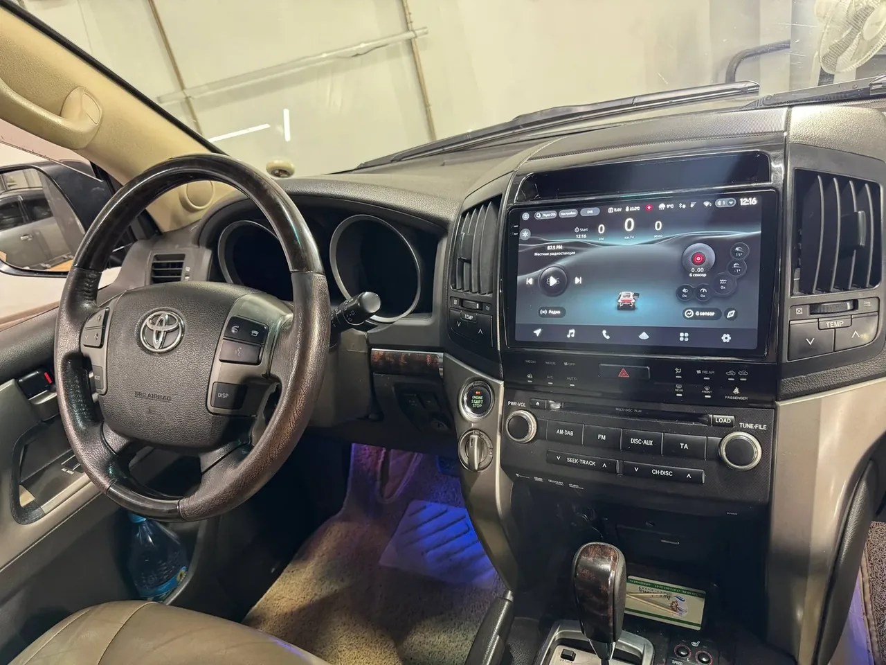
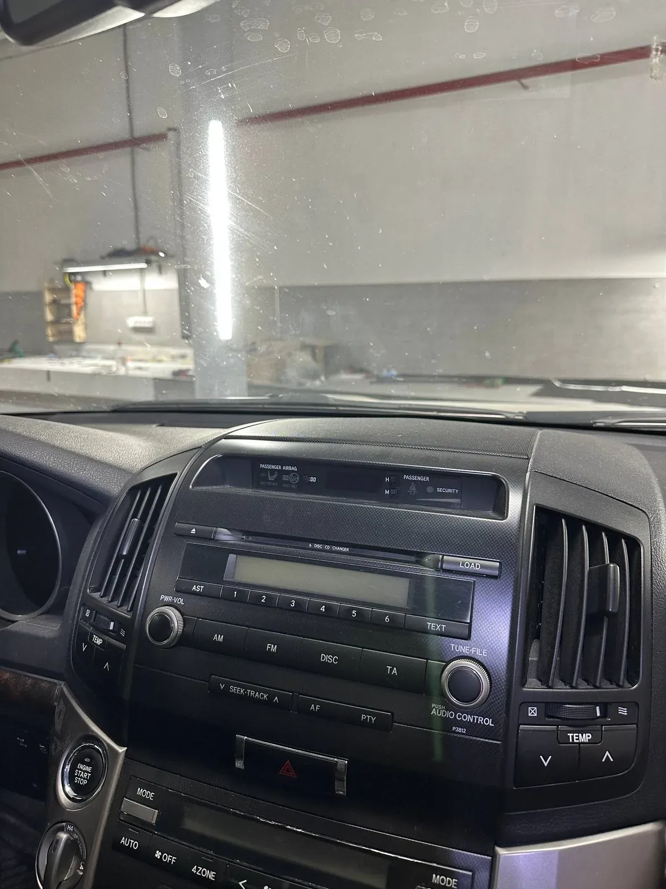
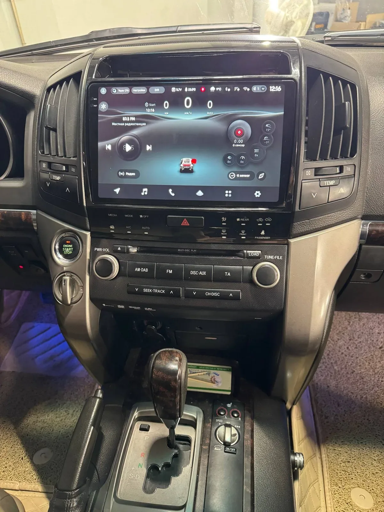
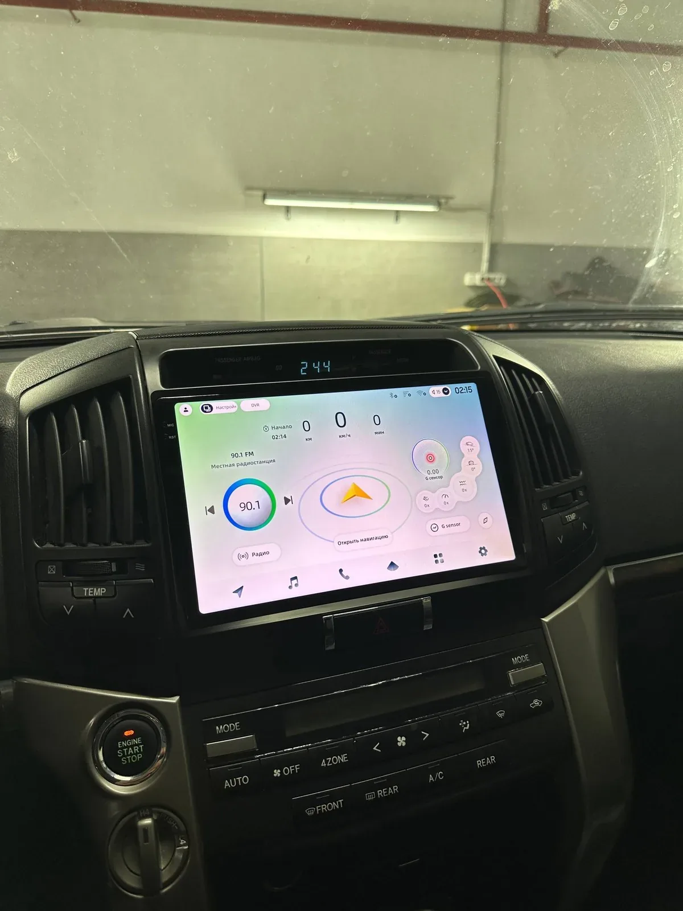

# Лучшая магнитола для Ленд Крузер 200: что ставить вместо штатной в 2026 году

Land Cruiser 200 переживёт ещё одного хозяина, а магнитола в нём осталась в 2007 году.

Почти 2,7 тонны машины, а навигатор – телефон на присоске. Во дворе паркуетесь по памяти: капот длинный, что за бампером, не видно.

*Land Cruiser 200 2012 года после установки Teyes CC4 Pro и кругового обзора 360. Работа TEYES Sibir, октябрь 2026.*

## Коротко: что ставить на Land Cruiser 200

Лучшее решение для мультимедиа «двухсотого» – Android-магнитола Teyes с экраном 12,3 дюйма в штатную рамку. Экран встаёт в верхний проём консоли, климат и аварийка остаются на своих кнопках, к магнитоле подключаются камеры, в том числе круговой обзор.

В каталоге TEYES Sibir под Land Cruiser 200 2007–2015 годов Teyes CC4 12.3" стоит от 50 950 ₽ – цена на сайте 18.11.2026, при оплате наличными. Установка головного устройства – от 4 500 ₽.

Мы ставили на «двухсотый» Teyes CC4 и CC4 Pro, работа с CC4 Pro – на фото выше.

## Какой у вас Land Cruiser 200: Россия, ОАЭ или Япония

Land Cruiser 200 выпускали с сентября 2007 по март 2021 года. За это время у него было два рестайлинга.

- **2007–2012.** В Россию на старте шли бензиновый V8 4.7 и дизельный V8 4.5.
- **2012.** Первый рестайлинг: вместо 4.7 поставили бензиновый V8 4.6, обновили салон.
- **2015.** Второй рестайлинг: светодиодные фары, другая решётка, новая центральная панель и новая мультимедиа.

Машины из ОАЭ собраны под рынок Ближнего Востока: там были ещё V6 4.0, а с 2011 года – V8 5.7. Машины для Японии сначала шли с V8 4.7, с апреля 2009 года – с V8 4.6.

Land Cruiser Prado – другая, меньшая машина, и рамка от него на «двухсотый» не встанет.

## Что стояло в машине с завода

**До рестайлинга 2015 года.** В Японии в базе стояла магнитола с чейнджером на 6 дисков DVD/CD, MD-плеером и 9 динамиками. За доплату – навигация на жёстком диске с экраном 8 дюймов. На Land Cruiser 200 2011 года, который приезжал к нам, стояла магнитола с CD-чейнджером на 6 дисков и строчкой текста вместо экрана.

*До установки: штатная магнитола Land Cruiser 200 2011 года с CD-чейнджером.*

**После рестайлинга 2015 года.** В российских комплектациях «Комфорт», «Элеганс», «Люкс» и «Люкс Safety» – мультимедиа с экраном 8 или 9 дюймов в зависимости от комплектации, аудиосистема JBL и панорамный обзор.

## Что раздражает владельцев в 2026 году

**CD-чейнджер вместо экрана.** Диски в машине возит мало кто, а навигатор и музыка живут в телефоне. Отсюда присоска на стекле и провод зарядки через салон.

**Японская навигация.** На машинах из Японии навигация ведёт по японским картам и говорит по-японски.

**Японское радио.** FM в Японии до 2011 года был 76–90 МГц, наш эфир – 87,5–108 МГц. Магнитола японской машины рассчитана на свой диапазон.

**Парковка большой машины.** Владельцы «двухсотых» приезжают к нам за камерами: передней, задней или круговым обзором из четырёх камер.

## Три пути и какой выбрать

**Оставить штатную и ездить с телефоном.** Бесплатно, присоска и провод остаются.

**Поставить отдельный навигатор и камеру.** Ещё один экран на панели, ещё два провода.

**Поставить Android-магнитолу Teyes в штатную рамку.** Большой экран вместо старого блока, Яндекс Навигатор и 2ГИС, интернет по SIM-карте, CarPlay и Android Auto, картинка с камер на том же экране. Этот путь закрывает все пункты из списка выше.

## Какую Teyes ставить на Land Cruiser 200

Цены каталога TEYES Sibir на 18.11.2026, со скидкой за наличный расчёт, для машин 2007–2015 годов:

- **Teyes CC4 12.3"** – от 50 950 ₽: экран QLED 1920×720, 6/64 ГБ, 4G, беспроводные CarPlay и Android Auto. Версия с круговым обзором 360 – от 61 130 ₽.
- **Teyes LUX ONE** – 52 500 ₽: экран 12,3 дюйма, 4/32 ГБ, 4G, CarPlay и Android Auto.
- **Teyes CC4 Pro 12.3"** – от 71 800 ₽: процессор Qualcomm, 8/128 ГБ.

Под CC4 в каталоге четыре варианта рамки, тип A–D. Какой нужен вашей машине, видно по фото центральной панели: у «двухсотого» есть варианты подключения F1 и F2, а ещё мастер смотрит, стоит ли у вас усилитель JBL, штатная камера или круговой обзор.

Если у вашей машины 2015 года и новее, пришлите фото панели – подберём комплект под неё.

Установка круговой системы 360 – от 25 000 ₽. При покупке мультимедиа Teyes камера заднего вида в подарок или скидка 1 000 ₽ на широкоугольную камеру, промокод САЙТ.

## Что останется от штатного

- **Климат и аварийка.** На нашей машине 2011 года блок климата 4ZONE под экраном работает со своих кнопок.
- **Кнопки на руле.** На нашей работе с Teyes CC3 2K и камерами 360 они сохранились.
- **Штатный блок кнопок.** На машине 2012 года блок с кнопками радио и диска под экраном остался на месте.
- **Отделка салона.** Экран встаёт в штатный проём, панель не пилят.

*Тот же Land Cruiser 200 2012 года: экран в штатном проёме, климат и кнопки под ним на своих местах.*

## Наши работы по Land Cruiser 200

**Land Cruiser 200 2011 года, Teyes CC4 и две камеры.** Экран встал на место магнитолы с CD-чейнджером, передняя камера – в решётку радиатора под эмблему, задняя выводит картинку на тот же экран.

*После установки: Teyes CC4 на месте магнитолы с CD-чейнджером. Работа TEYES Sibir, октябрь 2026.*

**Land Cruiser 200 2012 года, Teyes CC4 Pro и круговой обзор 360.** Экран в верхнем проёме консоли, передняя камера – в решётке под эмблемой, боковая – под зеркалом. Эта машина на первом фото.

**Teyes CC3 2K и четыре камеры кругового обзора.** Камеры встали в штатные места, работа заняла один день, кнопки на руле сохранились. [Смотреть работу на сайте](https://teyes-sibir.ru/teyes_cc3_2k_360_toyota_land_cruiser_200?utm_source=dzen&utm_medium=article&utm_campaign=lc200_multimedia&utm_content=work_cc3_2k_360)

**Teyes CC4 и AHD-камеры спереди и сзади в штатных местах.** [Смотреть работу на сайте](https://teyes-sibir.ru/toyota_land_cruiser_200_teyes_cc4?utm_source=dzen&utm_medium=article&utm_campaign=lc200_multimedia&utm_content=work_cc4)

Всё по мультимедиа для «двухсотого» – что проверить до заказа, камеры, звук – на одной странице: [магнитола и мультимедиа Toyota Land Cruiser 200](https://teyes-sibir.ru/multimedia_teyes/toyota/toyota_land_cruiser_200?utm_source=dzen&utm_medium=article&utm_campaign=lc200_multimedia&utm_content=model_page). Комплект CC4 12.3" под Land Cruiser 200 2007–2015 с ценой – [в каталоге](https://teyes-sibir.ru/store/catalog/toyota/tproduct/823410273193-shtatnaya-magnitola-teyes-cc4-123-toyota?utm_source=dzen&utm_medium=article&utm_campaign=lc200_multimedia&utm_content=catalog_cc4).

TEYES Sibir, официальный установочный центр Teyes в Новосибирске: Сухарная 35 корпус 13, пн–пт с 11:00 до 19:00.

<!--
ИСТОЧНИКИ ФАКТОВ (для Артёма, в статью не выводить)
1. Производство сентябрь 2007 – март 2021; Ближний Восток – с конца 2007 как 2008 МГ, моторы 4.0 1GR-FE, 4.7 2UZ-FE, 4.5 1VD-FTV, с 2011 – 5.7 3UR-FE; Япония – сначала 2UZ-FE 4.7, с апреля 2009 – 1UR-FE 4.6; второй рестайлинг 2015 – новая мультимедиа и интерфейс с большими экранами: https://en.wikipedia.org/wiki/Toyota_Land_Cruiser (раздел J200: Markets – Japan, Middle East; 2015 facelift), прочитано 18.11.2026.
2. Россия на старте – 2UZ-FE и 1VD-FTV; с 2012 после первого рестайлинга 2UZ-FE заменён на 1UR-FE 4.6, в том числе в России; «Салон был обновлён»; 2015 – второй рестайлинг, светодиодные фары, решётка, бампер: https://ru.wikipedia.org/wiki/Toyota_Land_Cruiser (раздел Land Cruiser 200), 18.11.2026.
3. Япония, 18.09.2007: стандартно AM/FM с 6-дисковым DVD/CD-чейнджером, MD и 9 динамиками; опция – навигация на HDD 30 ГБ с экраном 8 дюймов: https://global.toyota/en/newsroom/toyota/23429314.html, 18.11.2026.
4. Россия, 2015: комплектации «Комфорт», «Элеганс», «Люкс», «Люкс Safety»; «мультимедиа центром (диагональ экрана зависит от комплектации – восемь или девять дюймов)», аудиосистема JBL, панорамный видеообзор: https://www.kolesa.ru/news/novyj-toyota-land-cruiser-200-okazalsja-ne-dorozhe-predshestvennika-2015-10-05 (05.10.2015), прочитано 18.11.2026. Запуск рестайлинга в Японии 17.08.2015, «switches and displays have been gathered and grouped by function in the center cluster»: пресс-релиз Toyota в перепечатке https://acnnewswire.com/press-release/english/24450/ , 18.11.2026.
5. FM Япония 76–90 МГц до 2011: https://en.wikipedia.org/wiki/FM_broadcast_band (Japanese bandplan), 17.11.2026 (как в статье Accord 7). Японская HDD-навигация – система японского рынка (п. 3); «японские карты и речь» – вывод из рынка, не цитата.
6. Работа 2011, Teyes CC4 + камеры заднего и переднего вида, 09.10.2026, до – магнитола с CD-чейнджером на 6 дисков и текстовым дисплеем, климат 4ZONE без изменений: ~/Sites/teyes-keysy/out/325/keys.json, фото out/325/foto (номера закрыты). Страницы на сайте нет (/work/toyota/teyes-cc4-toyota-land-cruiser-200-2011-rear-camera-front-camera – 404, 18.11.2026).
7. Работа 2012, Teyes CC4 Pro + 360, 17.10.2026, экран в верхнем проёме, камера в решётке под эмблемой и под корпусом зеркала, штатный блок с кнопками AM-DAB, FM, DISC-AUX под экраном: ~/Sites/teyes-keysy/out/338/keys.json, фото out/338/foto. Страницы нет (404, 18.11.2026). В тексте «боковые – под зеркалами» – на фото видна одна боковая камера под зеркалом; система 360 из четырёх камер.
8. CC3 2K + 360: «4 камеры в штатные места», «Работа заняла 1 день», «Сохранились: – кнопки на руле»: https://teyes-sibir.ru/teyes_cc3_2k_360_toyota_land_cruiser_200 (200, 18.11.2026).
9. CC4 + AHD-камеры переднего и заднего вида в штатные места: https://teyes-sibir.ru/toyota_land_cruiser_200_teyes_cc4 (200, 18.11.2026).
10. Варианты рамок и подключения F1/F2, проверить усилитель JBL, штатную камеру, круговой обзор, кнопки руля: https://teyes-sibir.ru/work/toyota/pa4730g8h1-ustanovka-teyes-cc4-pro-v-toyota-land-cr (200, 18.11.2026).
11. Цены (Tilda Store API storepartuid=745189453562, recid=899142067, 18.11.2026; видимая цена карточки сверена в браузере для CC4 Тип-D и LUX ONE): CC4 12.3" LC200 (2007-2015) Тип-A 55 550, Тип-B 54 630, Тип-C 54 750, Тип-D 50 950 ₽ (6+64, «Обычная»), Тип-D «360» 61 130 ₽ – https://teyes-sibir.ru/store/catalog/toyota/tproduct/823410273193-shtatnaya-magnitola-teyes-cc4-123-toyota ; характеристики QLED 1920x720, 4G, беспроводные CarPlay/Android Auto – там же; LUX ONE LC200 2007-2015 – 52 500 ₽ (4+32), 12,3", 4G, CarPlay/AA – https://teyes-sibir.ru/store/catalog/toyota/tproduct/772272201702-shtatnaya-magnitola-teyes-lux-one-toyota ; CC4 Pro 12.3" Тип-D – 71 800 ₽ (8+128), QCM6490 (Qualcomm 6490). Пометка на карточках: «Цена указана со скидкой за наличный расчет». Комплектов под LC200 2015–2021 в каталоге нет (266 товаров раздела Toyota).
12. Установка головного устройства от 4500 руб, «Установка и настройка системы 360 от 25 000 руб», акция с промокодом САЙТ: https://teyes-sibir.ru/services/installation_teyes, 18.11.2026.
13. Масса 2405–2740 кг: https://en.wikipedia.org/wiki/Toyota_Land_Cruiser (J200, infobox), 18.11.2026 – «почти 2,7 тонны» по верхней границе.
14. Адрес и часы: шапка teyes-sibir.ru, 18.11.2026.
15. Спрос: ~/Sites/razbory/teyes-materialy-336d9d32/dzen-2/syrye/spros-modeli.txt (XMLRiver, НСК=65, РФ=225, 17–18.11.2026).
-->
