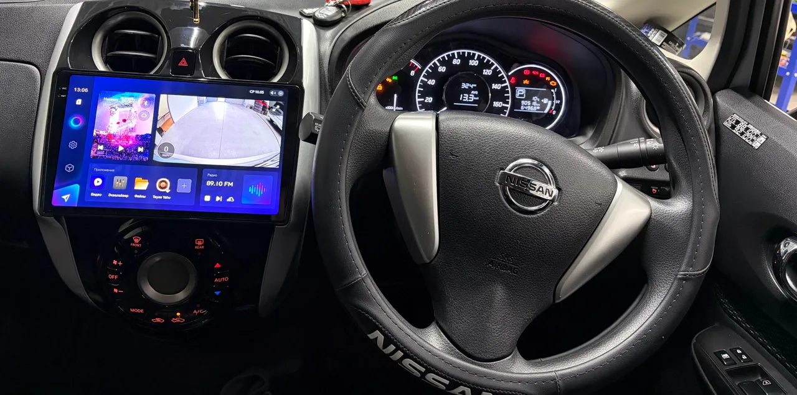
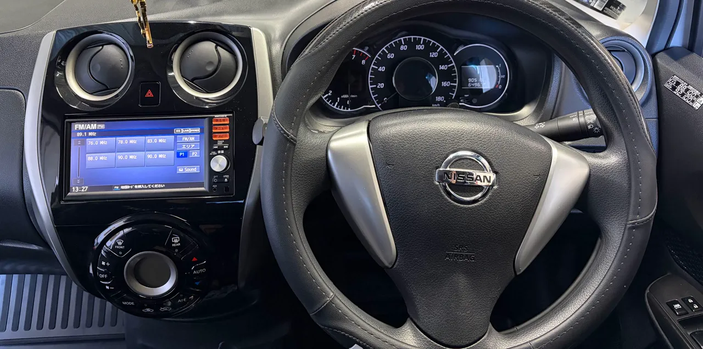
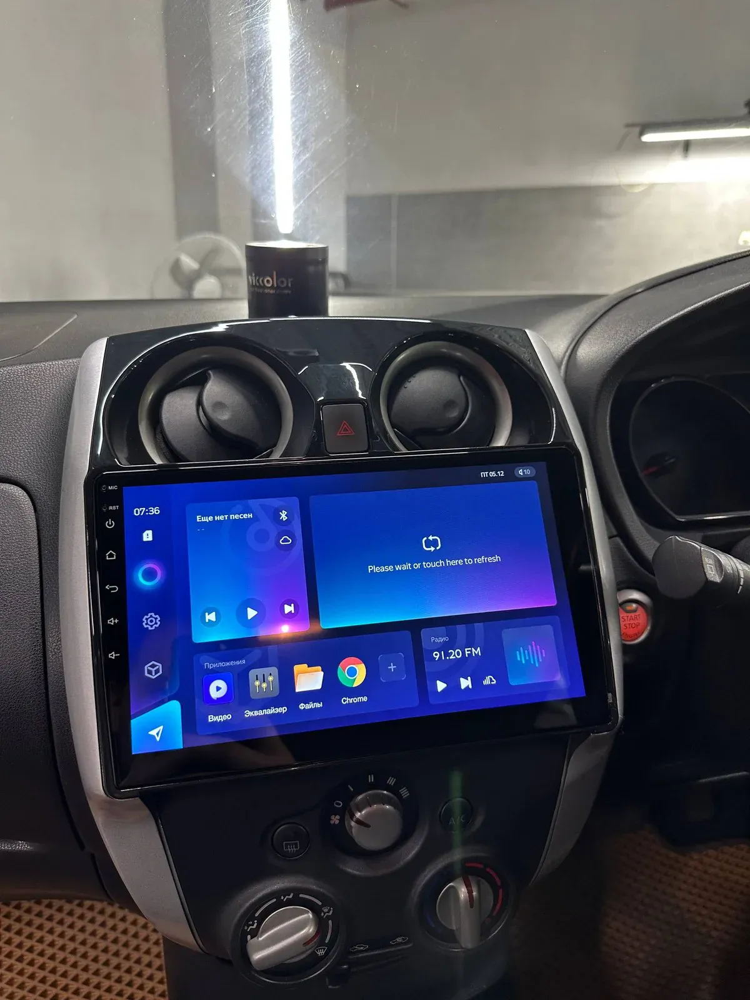

# Лучшая магнитола для Ниссан Ноут Е12: что ставить вместо штатной

Nissan Note E12 приехал к нам из Японии, и магнитола в нём до сих пор говорит по-японски.

Меню с иероглифами, в памяти радио станции 76 и 83 МГц, а любимая волна молчит. Навигатор при этом живёт в телефоне, телефон – в держателе, провод зарядки – через всю консоль.

*Note E12 2014 года после установки Teyes CC3: камера заднего хода и радио на одном экране. Работа TEYES Sibir.*

## Коротко: что ставить на Note E12

Лучшее, что можно сделать с мультимедиа Note E12 сегодня, – Android-магнитола Teyes в штатную рамку. Экран встаёт под круглые дефлекторы и кнопку аварийки, климат остаётся своим блоком снизу.

В каталоге TEYES Sibir под Note 2 E12 2012–2021 есть Teyes CC3L за 28 700 ₽ и Teyes CC4 Pro за 56 170 ₽. Это цены на сайте 18.11.2026 со скидкой за наличный расчёт, установка головного устройства – от 4 500 ₽. Мы ставили на Note E12 и CC3L, и CC3 – обе работы на фото в статье.

## Какой у вас Note: почти всегда японский

Второй Note начали продавать в Японии 3 сентября 2012 года, в Европе – летом 2013-го. В Россию это поколение официально не привозили: Nissan прекратил поставки Note в 2014 году и второго поколения у дилеров не ждали. Поэтому Note E12 в Новосибирске – почти всегда машина из Японии с правым рулём.

- **Моторы** – трёхцилиндровый 1.2, в том числе с нагнетателем.
- **e-Power** – с 2 ноября 2016 года в Японии: бензиновый мотор крутит генератор, колёса вращает электромотор. Тогда же Note получил руль с плоским низом.
- **Конец выпуска** – декабрь 2020 года, когда в Японии начали продавать следующий Note, E13.

Магнитола Teyes под E12 одна на все годы с 2012 по 2021. Обычный Note у вас или e-Power, на подбор рамки это не влияет.

## Что стояло в машине с завода

**Навигация.** Японские комплектации часто брали с «пакетом для установки оригинальной навигации Nissan», а саму навигацию ставил дилер. Такой блок мы и сняли с Note 2014 года: экран Nissan, меню на японском.

**Круговой обзор.** В топовой версии MEDALIST он стоял с 2012 года, с декабря 2013-го – с распознаванием движущихся предметов.

**Климат.** На одних версиях автоматический, на других ручной. На двух наших работах оба варианта: на Note 2014 года – круглый блок с кнопкой AUTO, на Note 2016 года – три ручки.

*Тот же Note до установки: штатная японская магнитола, в памяти станции 76–90 МГц.*

## Что раздражает владельцев в 2026 году

**Японское меню и карты.** Штатная навигация ведёт по картам Японии и говорит по-японски. Для Новосибирска это экран, который проще выключить.

**Радио.** FM в Японии сейчас 76–95 МГц, до 2011 года было 76–90, наш эфир – 87,5–108 МГц. Магнитола из Японии рассчитана на свой диапазон – на фото выше видно, какие станции в ней сохранены. Конвертер, который ставят импортёры, весь наш диапазон не перекрывает.

**Задний ход.** На обеих наших работах по Note владельцы заказывали камеру заднего хода.

**Звук.** На Note 2016 года заодно заменили задние динамики на коаксиальные 16,5 см.

## Три пути и какой выбрать

**Оставить штатную и ездить с телефоном.** Бесплатно, но держатель и провод остаются с вами.

**Русифицировать японский блок.** Если перевод для вашего блока есть, меню станет русским. Карты Японии и японский диапазон радио останутся.

**Поставить Teyes в штатную рамку.** Наши карты и станции, интернет по SIM-карте, CarPlay и Android Auto, камера на том же экране. Этот путь закрывает все пункты из списка выше.

## Какую Teyes ставить на Note E12

**Teyes CC3L** – 28 700 ₽: память 4/32 ГБ, экран IPS 1280×720, 8 ядер, слот под SIM-карту с 4G, Wi-Fi, процессор звука DSP, CarPlay и Android Auto, GPS и ГЛОНАСС, вход камеры AHD 1080p.

**Teyes CC4 Pro** – старшая модель: 56 170 ₽ с памятью 8/128 ГБ, 65 400 ₽ с памятью 12/256 ГБ. На карточке сказано: рамка и проводка в эту цену не входят, их считаем отдельно.

**CC3 2K 13 дюймов.** У Teyes есть рамка под Note E12 и для большого экрана с кнопками. На сайте этого комплекта с ценой нет, считаем по фото панели.

*Note 2016 года с Teyes CC3L: аварийка и дефлекторы над экраном, климат под ним. Работа TEYES Sibir, сентябрь 2026.*

## Что останется от штатного

- **Климат.** Ручной или автоматический, блок остаётся на своём месте под экраном.
- **Дефлекторы и аварийка.** Над экраном, как были.
- **Камера.** Новая камера заднего хода выводит картинку на экран Teyes.
- **Кнопки на руле.** Есть не у всех Note: на нашем 2014 года руль без кнопок. Если у вашей машины они есть, Teyes CC3L их поддерживает.
- **Панель.** Экран встаёт в штатное место, панель не пилят.

## Наши работы по Note E12

**Note 2014 года, Teyes CC3, камера заднего хода и видеорегистратор.** Сняли японскую магнитолу Nissan, поставили Teyes в штатное место. На экране теперь камера заднего хода, наше радио и приложения – фото в начале статьи.

**Note 2016 года, Teyes CC3L, камера, динамики и питание регистратора.** Сделали в сентябре 2026 года. Teyes CC3L встал между дефлекторами и ручками климата, камера заднего хода – над номером. В задних дверях теперь коаксиальные динамики 16,5 см на проставках, к зеркалу выведен кабель питания для видеорегистратора.

Страниц этих работ на сайте пока нет. Все варианты для Note – русификация, замена магнитолы, что сохранится – собраны на одной странице: [магнитола и мультимедиа Nissan Note](https://teyes-sibir.ru/multimedia_teyes/nissan/note?utm_source=dzen&utm_medium=article&utm_campaign=note_e12_multimedia&utm_content=model_page). Комплекты с ценой – в каталоге: [Teyes CC3L под Note E12](https://teyes-sibir.ru/store/catalog/nissan/tproduct/800470729012-shtatnaya-magnitola-teyes-cc3l-nissan-no?utm_source=dzen&utm_medium=article&utm_campaign=note_e12_multimedia&utm_content=catalog_cc3l) и [Teyes CC4 Pro под Note E12](https://teyes-sibir.ru/store/catalog/nissan/tproduct/859382200712-shtatnaya-magnitola-teyes-cc4-pro-nissan?utm_source=dzen&utm_medium=article&utm_campaign=note_e12_multimedia&utm_content=catalog_cc4_pro).

TEYES Sibir, официальный установочный центр Teyes в Новосибирске: Сухарная 35 корпус 13, пн–пт с 11:00 до 19:00.

<!--
ИСТОЧНИКИ ФАКТОВ (для Артёма, в статью не выводить)
1. Продажи в Японии с 03.09.2012, Европа – лето 2013 (Женева 2013), производство в Японии до конца 2020, E13 – продажи с 23.12.2020; моторы HR12DE и HR12DDR (1.2, три цилиндра, нагнетатель): https://en.wikipedia.org/wiki/Nissan_Note (Second generation E12) и https://ja.wikipedia.org/wiki/日産・ノート, прочитано 18.11.2026.
2. e-POWER – 02.11.2016 (последовательный гибрид: бензиновый генератор, электромотор на колёса); обновление 11.2016 – «下部をフラットにしたD型3本スポークステアリング» (руль с плоским низом); «日産オリジナルナビ取付パッケージ» в спецверсиях (V セレクション 2016, 2019 – вместе с кнопками на руле); круговой обзор штатно у MEDALIST с 09.2012, с 25.12.2013 – с распознаванием движущихся предметов; автоматический климат на части версий: https://ja.wikipedia.org/wiki/日産・ノート_E12, прочитано 18.11.2026.
3. Note в Россию: «Компактвэн больше не будет продаваться на российском рынке – появления второго поколения модели не ожидается», «поставки которой в Россию прекращены по решению японской корпорации»: https://www.kolesa.ru/news/nissan-note-pokidaet-rossiiskii-rinok-2014-06-25 (25.06.2014), прочитано 18.11.2026. «Почти всегда из Японии с правым рулём» – вывод из этого, не статистика.
4. FM Японии 76–95 МГц, до 24.07.2011 – 76–90 МГц; конвертер импортёров не перекрывает весь диапазон: https://en.wikipedia.org/wiki/FM_broadcast_band (Japanese bandplan), 18.11.2026. Станции 76.0 / 78.0 / 83.0 / 88.0 / 90.0 МГц и японское меню – на фото до установки (работа №283).
5. Каталог (Tilda Store API storepartuid=695041796932, recid=899096317 и карточки в браузере, 18.11.2026): «Штатная магнитола Teyes CC3L Nissan Note 2 E12 2012 - 2021» – «Цена указана со скидкой за наличный расчет: 28 700 ₽» (базовая цена в API 17 500 ₽, посетитель видит 28 700 ₽ – цену варианта 4+32Gb), https://teyes-sibir.ru/store/catalog/nissan/tproduct/800470729012-shtatnaya-magnitola-teyes-cc3l-nissan-no; характеристики CC3L – с карточки. «Штатная магнитола Teyes CC4 Pro Nissan Note 2 E12 2012 - 2021» – 56 170 ₽ (8+128G), 65 400 ₽ (12+256G), «Рамка и проводка для подключения к авто не входят в стоимость данной магнитолы», https://teyes-sibir.ru/store/catalog/nissan/tproduct/859382200712-shtatnaya-magnitola-teyes-cc4-pro-nissan. Вторая карточка CC4 Pro (839351576062) – те же цены, но её title «Teyes CC4 Pro для Nissan Note E11 2005–2013» – в статью не взята. Установка в опциях карточек: CC3L «от 3500 руб.», CC4 Pro «от 4500 руб.».
6. Установка головного устройства «от 4500 руб»: https://teyes-sibir.ru/services/installation_teyes, 18.11.2026.
7. Рамка под CC3 2K 13″ с кнопками для Note E12 (артикул 2291CC36-2K-13-But): ~/Documents/Teyes-контент/материалы/подбор-мультимедиа/Nissan-Note/КАРТОЧКА.md (tver.teyes.com.ru/category/note/, срез 23.09.2026). Одна сборка (код 2291) на 2012–2021 – там же; «на подбор рамки e-Power не влияет» – вывод из единого кода, см. proverit.md.
8. Работа №283 (Case Studio №86): Nissan Note 2014, «CC3, задняя камера, видеорегистратор» – ~/Sites/teyes-case-studio/data/cs.sqlite3, таблица works, id 86; фото – data/disk/0086_Nissan_Note_2014/оригиналы 001 и 002, обрезаны по панель (за стеклом были чужие номера и сотрудник). Руль без кнопок, климат с кнопкой AUTO – на фото. Страницы на сайте нет.
9. Работа №314: Nissan Note 2016, 24.09.2026, Teyes CC3L, камера заднего хода над номером, коаксиальные задние динамики 16,5 см на проставках, кабель питания регистратора к зеркалу, климат – ручки: ~/Sites/teyes-keysy/out/314/keys.json, фото out/314/foto/. Страницы на сайте нет. Кнопки руля CC3L – характеристика «Клавиши руля: короткое нажатие + длительное нажатие» на карточке.
10. Адрес и часы: шапка teyes-sibir.ru, 18.11.2026.
11. Спрос: ../syrye/spros-modeli.txt и ../syrye/ws-raw/ (XMLRiver, НСК=65, РФ=225, 17–18.11.2026).
-->
