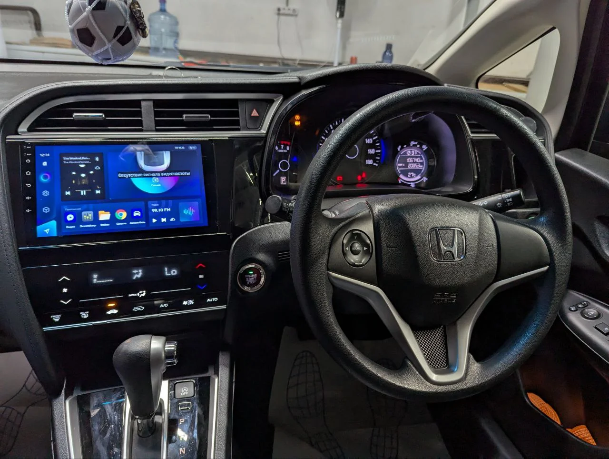
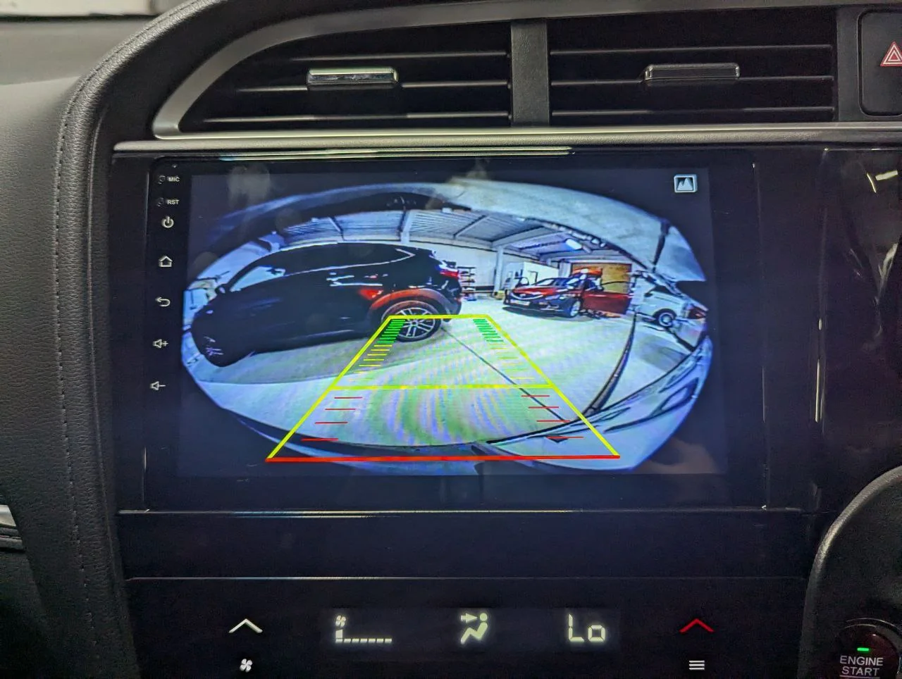

# Лучшая магнитола для Хонда Шаттл: что ставить вместо японской штатной

Honda Shuttle возит семью и багаж, а магнитола в нём до сих пор говорит по-японски.

Меню иероглифами, карта Японии, радио, которое не ловит часть новосибирских станций. Навигатор в итоге живёт в телефоне, а телефон – в руке на светофоре.

*Honda Shuttle после установки Teyes CC3L: экран в штатной рамке, панель климата под ним работает как раньше. Работа TEYES Sibir.*

## Коротко: что ставить на Shuttle

Лучшее решение по мультимедиа для Shuttle сегодня – Android-магнитола Teyes в штатную рамку. Экран встаёт на место японского блока, сенсорная панель климата остаётся под ним, штатную камеру заднего вида можно сохранить – мы так и сделали на машине с фото.

В каталоге TEYES Sibir под Shuttle 2015–2020 стоят Teyes CC3L за 28 800 ₽ и CC4 Pro за 62 790 ₽ – цены на сайте 18.11.2026, при оплате наличными, установка отдельно, от 4 500 ₽.

## Какой у вас Shuttle

Shuttle продавали в Японии с 15 мая 2015 года, выпуск закончили в августе 2022-го. Машину делали для японского рынка, поэтому все Shuttle у нас – праворульные, привезённые из Японии.

- **GK8 и GK9** – бензин 1.5, передний и полный привод.
- **GP7 и GP8** – гибрид 1.5 i-DCD, передний и полный привод.
- **Версии 2015 года:** G, HYBRID, HYBRID X, HYBRID Z.
- **Май 2019-го** – обновление: новые передок и корма, другие сиденья, правки в салоне.

До весны 2015 года похожий универсал назывался Fit Shuttle – у него другая панель, и рамка от него на Shuttle не подойдёт.

## Что стояло в машине с завода

Honda продавала Shuttle без магнитолы в базе: даже крышку на пустое место под неё ставил дилер за доплату. Динамиков в базовой машине два.

**Заводская опция – навигация Honda Internavi.** Сенсорный экран, как у смартфона, по дизайну собран в одно целое с панелью климата. Вторая опция – пакет для установки навигации. С любой из них динамиков становится четыре.

**Дилерские системы.** Без заводской опции машину комплектовал дилер: у Honda для этого есть фирменные магнитолы и навигация Gathers от Honda Access.

**С сентября 2017 года** Honda Sensing стала штатной на всех версиях, а навигация научилась CarPlay и Android Auto.

## Что раздражает владельцев в 2026 году

**Японское радио.** FM в Японии – от 76 до 95 МГц, наш диапазон – до 108 МГц. Всё, что выше 95, японский приёмник не ловит.

**Японские карты и меню.** Навигация ведёт по Японии, подсказки и настройки – на японском.

**Два динамика.** Если машина пришла в простой версии без навигации, динамиков в ней всего два.

**Телефон вместо навигатора.** Отсюда держатель на панели, провод через консоль и звонки через динамик телефона.

**CarPlay в японской навигации.** Если у вашей машины фирменная навигация после сентября 2017 года, телефон к ней подключится. Меню, радио и встроенные карты при этом останутся японскими.

## Три пути и какой выбрать

**Русифицировать штатный блок.** Если перевод для вашей системы есть, меню станет русским. Карты останутся японскими, а радио – в японском диапазоне.

**Ездить с телефоном.** Бесплатно, но держатель и провод остаются с вами.

**Поставить Android-магнитолу Teyes в штатную рамку.** Наши карты и станции, интернет по SIM-карте, CarPlay и Android Auto на понятном меню. Этот путь закрывает все пункты выше.

## Какую Teyes ставить на Shuttle

**Teyes CC3L** – память 4/32 ГБ, экран IPS 1280×720, 8 ядер, слот под SIM-карту с 4G, Wi-Fi, процессор звука DSP, CarPlay и Android Auto, GPS и ГЛОНАСС, вход камеры AHD 1080p. 28 800 ₽ на 18.11.2026. Её мы поставили на Shuttle с фото.

**Teyes CC4 Pro для правого руля** – память 8/128 ГБ, экран QLED 2000×1200. 62 790 ₽, версия 12/256 ГБ – 64 850 ₽. Рамка и проводка к машине в эту цену не входят.

Обе карточки подписаны «2015–2020». Если ваш Shuttle 2021–2022 года, рамку подберём по фото центральной панели.

## Что останется от штатного

- **Климат.** Сенсорная панель под экраном работает со своих кнопок – на фото выше.
- **Камера заднего вида.** На нашей работе штатную камеру сохранили: при включении задней передачи картинка выходит на большой экран.
- **Кнопки на руле.** Если они у вас есть, магнитола понимает короткое и долгое нажатие.
- **Звук.** У CC3L эквалайзер на 36 полос и процессор DSP: даже два штатных динамика настроите под себя. Выходы RCA на 5.1 оставляют место для усилителя и сабвуфера, если решите добавить их позже.
- **Отделка салона.** Экран встаёт в штатное место, панель не пилят.

*Тот же Shuttle: штатная камера показывает на экране Teyes CC3L.*

## Наши работы по Shuttle

**Honda Shuttle, Teyes CC3L и штатная камера.** Владелец приехал обновить японскую мультимедиа. Поставили CC3L, камеру адаптировали к новой магнитоле, в машине появились Яндекс Навигатор, 2ГИС, музыка и онлайн-радио. [Смотреть работу на сайте](https://teyes-sibir.ru/honda_shuttle_teyes_cc3l?utm_source=dzen&utm_medium=article&utm_campaign=shuttle_multimedia&utm_content=work_cc3l)

Все варианты для Shuttle – замена магнитолы, русификация, камеры – собраны на одной странице: [магнитола и мультимедиа Honda Shuttle](https://teyes-sibir.ru/multimedia_teyes/honda/honda_shuttle?utm_source=dzen&utm_medium=article&utm_campaign=shuttle_multimedia&utm_content=model_page). Комплект CC3L с ценой – [в каталоге](https://teyes-sibir.ru/store/catalog/honda/tproduct/284706611092-shtatnaya-magnitola-teyes-cc3l-honda-shu?utm_source=dzen&utm_medium=article&utm_campaign=shuttle_multimedia&utm_content=catalog_cc3l), старшая [CC4 Pro для правого руля – там же](https://teyes-sibir.ru/store/catalog/honda/tproduct/763973967622-shtatnaya-magnitola-teyes-cc4-pro-honda?utm_source=dzen&utm_medium=article&utm_campaign=shuttle_multimedia&utm_content=catalog_cc4pro).

При покупке мультимедиа Teyes – камера заднего вида в подарок или скидка 1 000 ₽ на широкоугольную. Назовите менеджеру промокод САЙТ.

TEYES Sibir, официальный установочный центр Teyes в Новосибирске: Сухарная 35 корпус 13, пн–пт с 11:00 до 19:00.

<!--
ИСТОЧНИКИ ФАКТОВ (для Артёма, в статью не выводить)
1. Продажи с 15.05.2015, производство до конца августа 2022, регистрация остатков до 10.11.2022; GK8/GK9 – бензин 1 496 см³ L15B с непосредственным впрыском, GP7/GP8 – гибрид 1 496 см³ SPORT HYBRID i-DCD, FF и 4WD; 14.09.2017 – Honda SENSING на всех версиях, навигация с CarPlay и Android Auto («ナビゲーションには「CarPlay」及び「Android Auto」に対応した»); 10.05.2019 – новые передний и задний дизайн, сиденья, интерьер; предшественник – Fit Shuttle: https://ja.wikipedia.org/wiki/ホンダ・シャトル, прочитано 18.11.2026.
2. Версии G / HYBRID / HYBRID X / HYBRID Z, типы DBA-GK8 (G FF), DBA-GK9 (G 4WD), DAA-GP7 (FF), DAA-GP8 (4WD); «オーディオホールリッドはディーラーオプション» (крышка проёма под аудио – дилерская опция); заводские опции «Honda インターナビ＋リンクアップフリー＋ETC車載器» и «ナビ装着用スペシャルパッケージ»; число динамиков – 2, «※3 「Honda インターナビ」または「ナビ装着用スペシャルパッケージ」を装着した場合、「4スピーカー」となります»; Internavi – «静電式タッチパネルを採用し、スマートフォンのような直感的な操作が可能です。エアコンスイッチパネルとの一体デザイン»: Honda Factbook SHUTTLE 2015.05, https://www.honda.co.jp/factbook/auto/SHUTTLE/201505/SHUTTLE_201505.pdf (стр. 14, 23–24), 18.11.2026. «Без магнитолы в базе» – вывод из того, что крышка аудиопроёма продаётся дилером, а аудио нет в стандартном оснащении; прямой фразы «オーディオレス» в факбуке нет.
3. Gathers – бренд Honda Access: «Gathers（ギャザズ） - カーオーディオ、カーナビゲーション（OEM）»: https://ja.wikipedia.org/wiki/ホンダアクセス, 18.11.2026.
4. Только Япония: заголовок источника в en-вики «Honda Shuttle Revealed: Japan-only Jazz Wagon» (https://en.wikipedia.org/wiki/Honda_Shuttle, 18.11.2026); карточки Teyes под Shuttle 2 – только «Right hand drive» (каталог teyes-sibir.ru и карточка подбора ~/Documents/Teyes-контент/материалы/подбор-мультимедиа/Honda-Shuttle/КАРТОЧКА.md).
5. Fit Shuttle – последняя версия «2013年8月発表 2015年3月終了モデル»: https://www.honda.co.jp/auto-archive/fitshuttle/2015/webcatalog/type/detail/ (в выдаче поиска 18.11.2026). Другая панель – в каталоге Teyes отдельные товары под Fit 2 (GE) и Shuttle 2.
6. FM в Японии 76–95 МГц после 2011 года, наш 87,5–108 МГц: https://en.wikipedia.org/wiki/FM_broadcast_band (Japanese bandplan), 18.11.2026.
7. Teyes CC3L Honda Shuttle 2 2015 - 2020: на странице в Chrome «Цена указана со скидкой за наличный расчет: 28 800 ₽» (вариант 4+32Gb; в Tilda API поле price = 17 500); IPS 1280х720, 4G, DSP AKM AK7604VQ, GPS + Бэйдоу + ГЛОНАСС, AHD 1920*1080, клавиши руля – короткое + длительное нажатие, эквалайзер 36 полос, RCA 5.1; «Установка (оплачивается отдельно, от 3500 руб.)»: https://teyes-sibir.ru/store/catalog/honda/tproduct/284706611092-shtatnaya-magnitola-teyes-cc3l-honda-shu (200/200), 18.11.2026.
8. Teyes CC4 Pro Honda Shuttle 2 [Right hand drive] 2015-2020: 8+128G – 62 790 ₽, 12+256G – 64 850 ₽; «Рамка и проводка для подключения к авто не входят в стоимость данной магнитолы»; QLED 2000x1200; установка от 4500 руб.: https://teyes-sibir.ru/store/catalog/honda/tproduct/763973967622-shtatnaya-magnitola-teyes-cc4-pro-honda (200/200), 18.11.2026. Каталог Honda: storepartuid=120641066642, recid=898985488, 183 товара, других под Shuttle нет.
9. Установка «от 4500 руб», акция и промокод САЙТ: https://teyes-sibir.ru/services/installation_teyes (200), 18.11.2026.
10. Работа: «штатная мультимедиа на японском языке и ограниченный функционал», «Решение – установка мультимедиа Teyes CC3L», «штатная камера заднего вида была сохранена и адаптирована», «корректную работу при включении задней передачи», «вывод изображения на большой экран», «Яндекс Навигатор, 2ГИС, Google Maps, музыка… онлайн-радио»: https://teyes-sibir.ru/honda_shuttle_teyes_cc3l (200/200), 18.11.2026. Фото honda-shuttle-teyes-cc3l-panel.webp и -kamera.webp – с этой страницы (static.tildacdn.com/tild3538-…/telegram-cloud-photo.jpg и tild3735-…/telegram-cloud-photo.jpg), они же в фотобанке «42_Honda Shuttle» (работа №54). По фото – второе поколение: правый руль, сенсорная панель климата, кнопка ENGINE START, панель как у Shuttle 2015+.
11. Вторая страница https://teyes-sibir.ru/work/honda/honda_shuttle (200/200): «установили мультимедиа TEYES CC3L и подключили камеру заднего вида», «Июль 2025 года»; реальных фото на ней нет, только сгенерированная обложка – в статью не взята.
12. Адрес и часы: шапка teyes-sibir.ru, 18.11.2026.
13. Спрос: ~/Sites/razbory/teyes-materialy-336d9d32/dzen-2/syrye/spros-modeli.txt (XMLRiver, НСК=65, РФ=225, 17–18.11.2026).
-->
