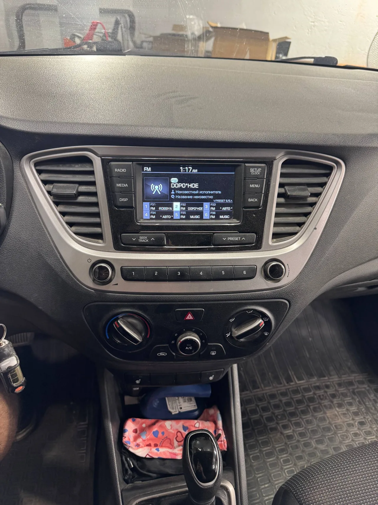
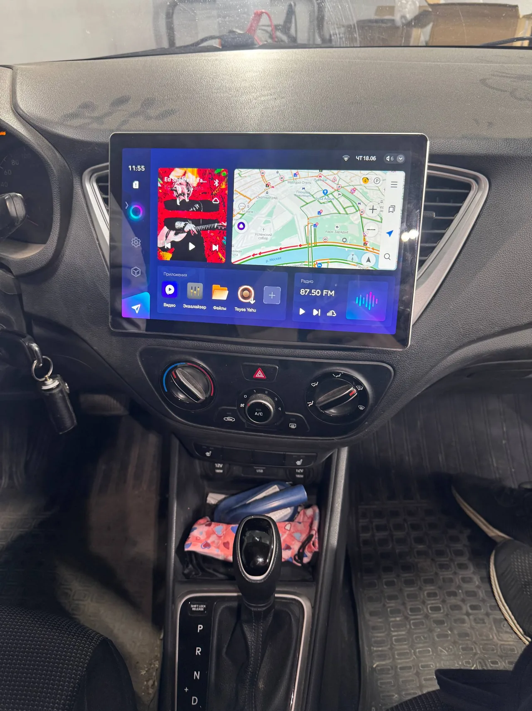
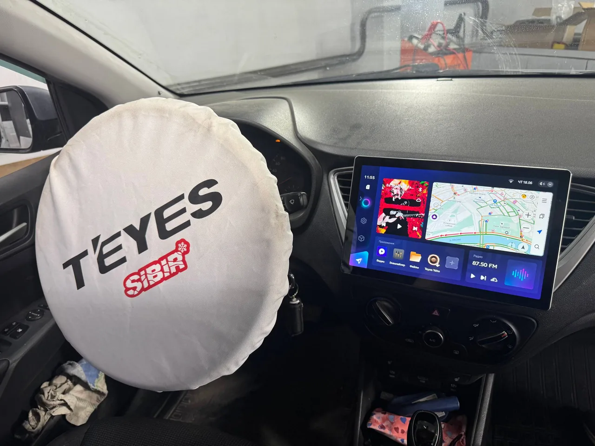

# Лучшая магнитола для Хендай Солярис 2: что ставить вместо штатной в 2026 году

Hyundai Solaris второго поколения ездит без капризов, а штатная магнитола в нём – радио, флешка и шесть кнопок памяти.

Навигатор – в телефоне на присоске, телефон – на проводе через весь салон. Пробки смотрите на светофоре, наклонившись к стеклу.

*До: штатная магнитола Solaris с небольшим дисплеем. Работа TEYES Sibir, июнь 2026.*

*После: Teyes CC3 2K с экраном 11 дюймов, климат под ним на своих ручках.*

## Коротко: что ставить на Solaris 2

Лучшее решение для мультимедиа второго Solaris – Android-магнитола Teyes в штатную рамку. Экран встаёт на место старой магнитолы между дефлекторами, климат остаётся на своих ручках, кнопки на руле подключаются к новой магнитоле.

В каталоге TEYES Sibir под Solaris 2 2017–2020 годов Teyes CC3L стоит 28 800 ₽ – цена на сайте 18.11.2026, при оплате наличными, установка отдельно, от 4 500 ₽. Мы ставили на Solaris и Teyes CC3 2K с экраном 11 дюймов – она на фото выше.

## Какой у вас Solaris: до 2020 года или после

Второй Solaris начали собирать в Санкт-Петербурге в феврале 2017 года, в салоны он пришёл в конце февраля. В феврале 2020 года там же запустили обновлённую версию. Завод выпускал Solaris до 2022 года.

- **Моторы:** 1.4 на 100 л. с. и 1.6 на 123 л. с., механика или автомат, обе коробки шестиступенчатые.
- **Комплектации:** Active, Active Plus, Comfort, Elegance.

Solaris – имя для России. В других странах этот седан продавали как Hyundai Accent. Первый Solaris 2010–2016 годов – другая панель, под него в каталоге отдельные комплекты.

## Что стояло в машине с завода

**2017–2020 годы.**
- **Active** – только подготовка под аудиосистему.
- **Active Plus** – аудиосистема с USB, AUX и кнопками на руле.
- **Comfort** – плюс Bluetooth и громкая связь.
- **Elegance** – мультимедиа с сенсорным экраном 7 дюймов, Apple CarPlay и Android Auto, навигация с пробками.

Камера заднего вида с разметкой, которая поворачивает за рулём, шла за доплату.

**После обновления 2020 года.** В комплектации Comfort появилась мультимедиа с сенсорным экраном 8 дюймов, CarPlay, Android Auto и «Яндекс.Авто» с навигатором и Алисой.

На нашей машине стояла магнитола с небольшим цветным дисплеем, кнопками RADIO, MEDIA, DISP и шестью кнопками памяти станций.

## Что раздражает владельцев в 2026 году

**Нет навигатора.** У младших комплектаций карт в машине нет. Телефон висит на присоске и закрывает кусок дороги.

**Мелкий экран.** На дисплее штатной магнитолы помещаются станция и список из шести кнопок. Карту на нём не открыть.

**Парковка задом.** Камера была опцией. Если у вашей машины её нет, задний бампер вы видите только в зеркалах.

**Провода.** Зарядка, AUX, держатель – всё живёт на тоннеле между сиденьями.

## Три пути и какой выбрать

**Ездить с телефоном.** Бесплатно, присоска и провод остаются.

**Купить держатель получше и камеру отдельно.** Камере нужен экран, и им снова становится телефон или отдельный монитор.

**Поставить Android-магнитолу Teyes в штатную рамку.** Большой экран вместо старой магнитолы, Яндекс Навигатор, интернет по SIM-карте, CarPlay и Android Auto, камера заднего вида на том же экране. Этот путь закрывает все пункты из списка выше.

## Какую Teyes ставить на Solaris 2

Цены каталога TEYES Sibir на 18.11.2026, со скидкой за наличный расчёт:

- **Teyes CC3L** – 28 800 ₽ для машин 2017–2020 годов и 30 100 ₽ для 2020–2021: память 4/32 ГБ, экран IPS 1280×720, 8 ядер, SIM-карта с 4G, Wi-Fi, процессор звука DSP, CarPlay и Android Auto, вход камеры AHD 1080p.
- **Teyes CC4 12.3"** – от 53 350 ₽: горизонтальный экран QLED 1920×720, 6/64 ГБ. Версия с круговым обзором 360 – от 63 530 ₽.
- **Teyes CC4 Pro** – от 61 360 ₽: 8/128 ГБ.

Комплект CC4 12.3" под Solaris 2 бывает двух типов: тип A – для машины без штатной камеры, тип B – для машины со штатной камерой. Есть ли у вас камера и какой год, видно по фото панели.

При покупке мультимедиа Teyes камера заднего вида в подарок или скидка 1 000 ₽ на широкоугольную камеру, промокод САЙТ.

## Что останется от штатного

- **Климат.** Ручки температуры, обдува и кнопка A/C под экраном работают как раньше, на нашей работе – на фото выше.
- **Аварийка.** Кнопка остаётся на своём месте над климатом.
- **Кнопки на руле.** Если они есть у вашей машины, подключаются к новой магнитоле.
- **Штатная камера.** Если у вашей машины она есть, под неё в каталоге отдельный тип комплекта CC4 12.3".
- **Отделка салона.** Экран встаёт в штатное место между дефлекторами, панель не пилят.

*Тот же Solaris с места водителя: экран вписан в панель, на руле чехол TEYES Sibir на время работы.*

## Наша работа по Solaris

**Hyundai Solaris, Teyes CC3 2K с экраном 11 дюймов, июнь 2026.** До установки в машине стояла штатная магнитола с небольшим дисплеем и кнопками RADIO, MEDIA, DISP. После – экран 11 дюймов между дефлекторами: на главном экране карта с пробками, музыка и радио. Блок климата и аварийка под экраном остались прежними.

Все варианты для Solaris – замена магнитолы, камеры, что проверить до заказа – собраны на одной странице: [магнитола и мультимедиа Hyundai Solaris](https://teyes-sibir.ru/multimedia_teyes/hyundai/solaris?utm_source=dzen&utm_medium=article&utm_campaign=solaris2_multimedia&utm_content=model_page). Комплект CC3L под Solaris 2 2017–2020 с ценой – [в каталоге](https://teyes-sibir.ru/store/catalog/hyundai/tproduct/830684924182-shtatnaya-magnitola-teyes-cc3l-a-hyundai?utm_source=dzen&utm_medium=article&utm_campaign=solaris2_multimedia&utm_content=catalog_cc3l), CC4 с экраном 12,3 дюйма – [тоже в каталоге](https://teyes-sibir.ru/store/catalog/hyundai/tproduct/137651560483-shtatnaya-magnitola-teyes-cc4-123-hyunda?utm_source=dzen&utm_medium=article&utm_campaign=solaris2_multimedia&utm_content=catalog_cc4).

TEYES Sibir, официальный установочный центр Teyes в Новосибирске: Сухарная 35 корпус 13, пн–пт с 11:00 до 19:00.

<!--
ИСТОЧНИКИ ФАКТОВ (для Артёма, в статью не выводить)
1. Серийное производство второго поколения – начало февраля 2017, поставки в салоны – конец февраля 2017; завод в Санкт-Петербурге; моторы Kappa 1.4 G4LC 99,7 л. с. и Gamma 1.6 G4FG 123 л. с.; 6-ст. МКПП и АКПП; комплектации Active, Active Plus, Comfort, Elegance; Solaris – локализованная версия Hyundai Accent: https://ru.wikipedia.org/wiki/Hyundai_Solaris (раздел «Второе поколение»), прочитано 18.11.2026. В тексте «100 л. с.» – округление 99,7.
2. Оснащение по комплектациям 2017: Active – «аудиоподготовка»; Active Plus – «аудиосистема с кнопками управления на руле, разъёмами USB и AUX»; Comfort – Bluetooth (ru wiki: «Bluetooth с функцией "громкая связь"»); Elegance – «навигационную систему с информацией о дорожных заторах», «мультимедийную систему с семидюймовым тачскрином», «поддержкой Apple CarPlay и Android Auto»; камера заднего вида с динамической разметкой – опция: https://www.kolesa.ru/news/novyj-hyundai-solaris-komplektatsii-i-ofitsialnye-foto (06.02.2017), прочитано 18.11.2026.
3. Обновлённый Solaris, 21.02.2020: выпуск стартовал в Санкт-Петербурге; «восьмидюймовый дисплей мультимедийного комплекса», в Comfort – «информационно-развлекательный комплекс с восьмидюймовым сенсорным дисплеем», Apple CarPlay и Android Auto, «Яндекс.Авто» с навигатором и Алисой: https://www.autonews.ru/news/5e4fee629a7947ee31030ce5 (21.02.2020), прочитано 18.11.2026.
4. Завод Hyundai Motor Manufacturing Rus выпускал Solaris 2011–2022; продан 27.09.2023: https://en.wikipedia.org/wiki/Hyundai_Motor_Manufacturing_Rus, 18.11.2026.
5. Работа №238: «Hyundai Solaris, Установка мультимедиа Teyes cc3 2K 11 дюймов», дата 06.26, года машины в записи нет: ~/Sites/teyes-keysy/data/reestr.json (id 238), фото – папка «227_Hyundai Solaris» выгрузки Telegram (копии в dzen-2/syrye/ref/). Страницы на сайте нет. Что видно на фото: штатная магнитола с цветным дисплеем, кнопки RADIO, MEDIA, DISP, SETUP, MENU, BACK, PRESET 1–6; после – Teyes с картой, музыкой, радио 87.50 FM; климат на ручках, A/C, аварийка; АКПП.
6. Цены (Tilda Store API storepartuid=972816037622, recid=898988773, 18.11.2026; видимая цена CC3L A сверена в браузере – 28 800 ₽): CC3L A и CC3L B Hyundai Solaris 2 2017-2020 – 28 800 ₽ (4+32), «Установка (оплачивается отдельно, от 3500 руб.)», характеристики 8 ядер, IPS 1280х720, Wi-Fi + 4G, DSP AKM AK7604VQ, CarPlay и Android auto, AHD 1920*1080 – https://teyes-sibir.ru/store/catalog/hyundai/tproduct/830684924182-shtatnaya-magnitola-teyes-cc3l-a-hyundai ; CC3L Solaris 2 II 2020-2021 – 30 100 ₽; CC4 12.3" Solaris 2 (2017-2020) Тип-A – 53 350 ₽ (6+64, «Обычная»), «360» – 63 530 ₽, «Тип-A – Серая, авто без штатной камеры; Тип-B – Серая, авто со штатной камерой», Тип-B – 53 550 ₽ – https://teyes-sibir.ru/store/catalog/hyundai/tproduct/137651560483-shtatnaya-magnitola-teyes-cc4-123-hyunda ; CC4 Pro Solaris 2 [F1] 2017-2020 – 61 360 ₽ (8+128), 2020-2021 – 62 290 ₽. Пометка: «Цена указана со скидкой за наличный расчет». Teyes CC3 2K под Solaris 2 в каталоге нет (173 товара раздела Hyundai).
7. Акция с промокодом САЙТ: https://teyes-sibir.ru/services/installation_teyes, 18.11.2026 (там же установка головного устройства от 4500 руб).
8. Адрес и часы: шапка teyes-sibir.ru, 18.11.2026.
9. Спрос: ~/Sites/razbory/teyes-materialy-336d9d32/dzen-2/syrye/spros-modeli.txt (XMLRiver, НСК=65, РФ=225, 17–18.11.2026).
-->
