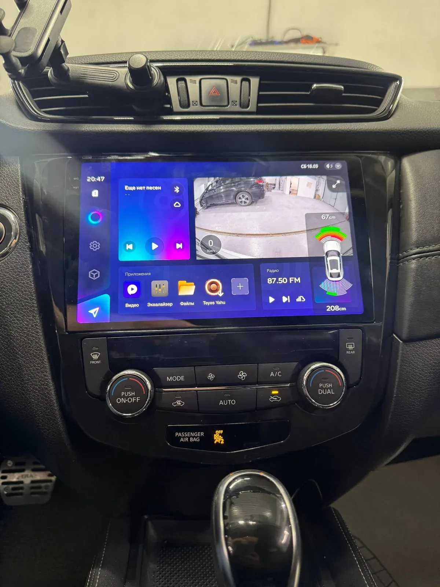
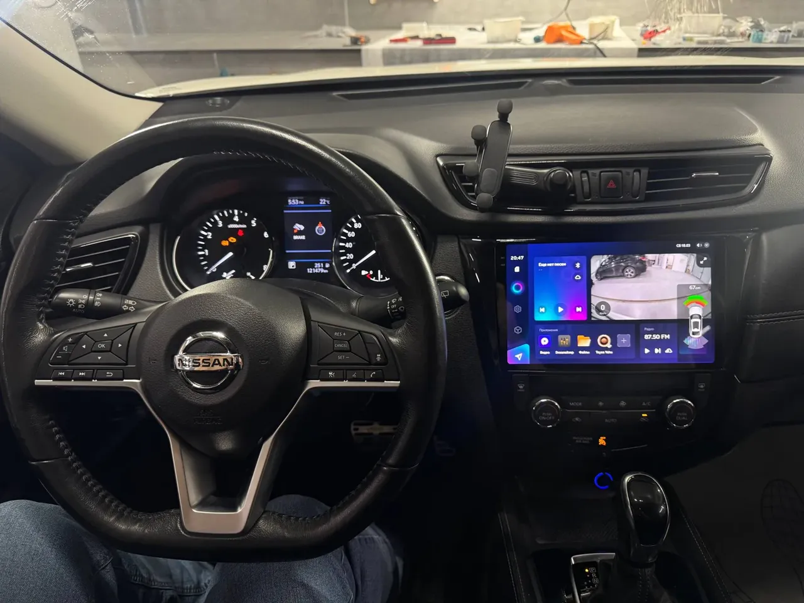
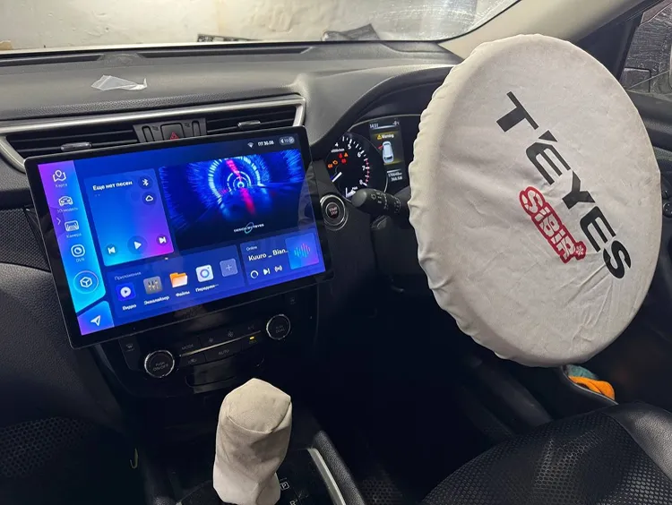

# Лучшая магнитола для Ниссан Х-Трейл Т32: что ставить вместо штатной

Nissan X-Trail T32 ещё долго будет возить семью, а мультимедиа в нём устарела раньше кузова.

Держатель телефона на дефлекторе, провод зарядки через консоль, навигатор в ладони на светофоре. А если машина из Японии, к этому добавляются японское меню и радио, которое ловит не весь наш эфир.

*X-Trail T32 2019 года после установки Teyes CC3 2K: камера, радио и схема парктроников на одном экране. Работа TEYES Sibir, октябрь 2026.*

## Коротко: что ставить на X-Trail T32

Лучшее, что можно сделать с мультимедиа T32 сегодня, – Android-магнитола Teyes в штатную рамку. Экран встаёт на место старого блока между дефлекторами и климатом, климат остаётся на своих кнопках, кнопки на руле продолжают работать.

В каталоге TEYES Sibir под X-Trail 3 2013–2022 стоит Teyes CC3L в четырёх вариантах рамки – от 26 800 до 30 100 ₽. Это цены на сайте 18.11.2026 со скидкой за наличный расчёт, установка головного устройства – от 4 500 ₽. Мы ставили на T32 и старшие модели: CC3 2K, в том числе с экраном 13 дюймов, и CC4 Pro.

## Какой у вас X-Trail: Россия или Япония

Третье поколение показали в 2013 году во Франкфурте. В Японии его начали продавать в декабре 2013-го, в Европе – летом 2014-го. С этого поколения X-Trail и американский Nissan Rogue – одна и та же машина.

- **Российские машины** собирали в Санкт-Петербурге: сборка стартовала 9 декабря 2014 года, продажи – в марте 2015-го. Моторы – бензин 2.0 (144 л. с.) и 2.5 (171 л. с.), дизель 1.6 (130 л. с.). Руль левый.
- **Обновлённый X-Trail** в Петербурге выпускают с 29 октября 2018 года. Изнутри его узнаете по рулю со скошенным низом – как на фото ниже.
- **Японские машины** – с правым рулём. В Японии обновление вышло в июне 2017 года, а с мая 2015-го там продавали и гибрид.

У предыдущего X-Trail T31 другая панель: серебристая консоль и три круглые ручки климата под экраном. Если у вас такая, вам нужен другой комплект.

## Что стояло в машине с завода

**Россия, 2015 год.** Комплектации XE, SE, SE+, LE и LE+. В базовой – аудиосистема с четырьмя динамиками, в топовой – NissanConnect 2.0 с экраном 7 дюймов и система кругового обзора.

**Россия после обновления 2018 года.** Новый блок мультимедиа, навигация с интерфейсом «как в мобильных приложениях». Машину предлагали и со встроенным Яндекс.Авто: навигатор, музыка, погода.

**Япония.** Навигацию NissanConnect с 2015 года ставили за доплату на заводе, после обновления 2017 года в описании модели уже дилерская навигация. Круговой обзор с распознаванием движущихся предметов шёл опцией.

## Что раздражает владельцев в 2026 году

**Простая магнитола.** В базовых машинах карт на экране нет, навигатор живёт в телефоне. Отсюда держатель на дефлекторе и провод через салон.

**Японская машина.** Меню и навигация на японском, карты – японские. FM в Японии сейчас 76–95 МГц, до 2011 года было 76–90, наш эфир – 87,5–108 МГц. Штатный приёмник рассчитан на свой диапазон. Импортёры ставят конвертер, но весь наш диапазон он не перекрывает.

**Парковка.** Владелец X-Trail 2019 года заказал у нас всё сразу: магнитолу, переднюю и заднюю камеры и восемь парктроников. Картинка и схема датчиков теперь на одном экране.

## Три пути и какой выбрать

**Оставить штатную и ездить с телефоном.** Бесплатно, но держатель и провод остаются с вами.

**Русифицировать японский блок.** Если перевод для вашего блока есть, меню станет русским. Карты Японии и японский диапазон радио никуда не денутся.

**Поставить Teyes в штатную рамку.** Наши карты и станции, интернет по SIM-карте, CarPlay и Android Auto, камеры и парктроники на одном экране. Этот путь закрывает все пункты из списка выше.

## Какую Teyes ставить на X-Trail T32

**Teyes CC3L** – то, что есть в каталоге под T32 с ценой: память 4/32 ГБ, экран IPS 1280×720, 8 ядер, слот под SIM-карту с 4G, Wi-Fi, процессор звука DSP, CarPlay и Android Auto, GPS и ГЛОНАСС, вход камеры AHD 1080p.

Цены на 18.11.2026: AB F1 – 26 800 ₽, AB F2 – 28 300 ₽, C F1 – 28 600 ₽, C F2 – 30 100 ₽. Буквы – под штатную панель: AB для машин с магнитолой без экрана или с маленьким экраном, C – для машин со штатным экраном 7 дюймов. Какая рамка и проводка нужны вашей машине, скажем по фото центральной панели.

**CC3 2K и CC4 Pro.** Их мы тоже ставили на T32, CC3 2K – и с экраном 13 дюймов. В каталоге под T32 этих комплектов с ценой нет, считаем по фото панели.

## Что останется от штатного

- **Кнопки на руле.** На нашей работе с CC3 2K 13 дюймов сохранились кнопки руля и вывод служебной информации.
- **Климат.** Работает своим блоком под экраном, как раньше.
- **Камеры и парктроники.** Новые камеры и схема датчиков выходят на экран Teyes.
- **Круговой обзор.** Если он у вашей машины есть, скажите сразу: от него зависят комплект и настройка.
- **Панель.** Экран встаёт в штатное место, панель не пилят.

*Тот же X-Trail 2019 года с места водителя: руль со скошенным низом, значит, машина после обновления.*

## Наши работы по X-Trail T32

**X-Trail 2019 года, Teyes CC3 2K, две камеры и восемь парктроников.** Экран встал над штатным блоком климата. На рабочем столе Teyes – окно камеры, радио и схема парктроников с расстоянием до препятствия в сантиметрах. Страницы этой работы на сайте пока нет, фото – выше.

**X-Trail T32 с правым рулём, Teyes CC3 2K 13 дюймов.** Работа заняла один день, экран встал в штатное место, кнопки на руле сохранились. [Смотреть работу на сайте](https://teyes-sibir.ru/teyes_cc3_2k_13_nissan_x-trail?utm_source=dzen&utm_medium=article&utm_campaign=xtrail_t32_multimedia&utm_content=work_cc3_2k_13)

*X-Trail T32 с правым рулём и Teyes CC3 2K 13 дюймов. Работа TEYES Sibir.*

**X-Trail T32, Teyes CC4 Pro.** Старшая модель Teyes с более мощным процессором, большой экран в штатной рамке. [Смотреть работу на сайте](https://teyes-sibir.ru/teyes_cc4_pro_nissan_x_trail?utm_source=dzen&utm_medium=article&utm_campaign=xtrail_t32_multimedia&utm_content=work_cc4_pro)

Все варианты для X-Trail по поколениям и рынкам – на одной странице: [магнитола и мультимедиа Nissan X-Trail](https://teyes-sibir.ru/multimedia_teyes/nissan/x-trail?utm_source=dzen&utm_medium=article&utm_campaign=xtrail_t32_multimedia&utm_content=model_page). Комплект CC3L под X-Trail 3 с ценой – [в каталоге](https://teyes-sibir.ru/store/catalog/nissan/tproduct/579795795672-shtatnaya-magnitola-teyes-cc3l-ab-f1-nis?utm_source=dzen&utm_medium=article&utm_campaign=xtrail_t32_multimedia&utm_content=catalog_cc3l).

TEYES Sibir, официальный установочный центр Teyes в Новосибирске: Сухарная 35 корпус 13, пн–пт с 11:00 до 19:00.

<!--
ИСТОЧНИКИ ФАКТОВ (для Артёма, в статью не выводить)
1. Показ во Франкфурте 2013, продажи в Японии с декабря 2013 (en: 11.12.2013, ja: 16.12.2013 – поэтому в тексте только «в декабре»), Европа – июль 2014, X-Trail = Rogue с третьего поколения, обновление 2017: https://en.wikipedia.org/wiki/Nissan_X-Trail (раздел Third generation T32), прочитано 18.11.2026.
2. Сборка T32 в Санкт-Петербурге с 9 декабря 2014: https://www.kolesa.ru/news/na-peterburgskom-zavode-nissan-startovalo-proizvodstvo-novogo-xtrail-2014-12-09 и https://www.zr.ru/content/articles/745463-nissan-zapustil-sborku-novogo-x-trail-v-rossii/ (поиск 18.11.2026); старт продаж в марте 2015: https://www.kolesa.ru/news/startovali-rossijskie-prodazhi-novogo-nissan-xtrail-2015-03-02 (18.11.2026). В en-вики в таблице «Russia 2018–2022» – это обновлённая версия, расхождение снято источниками 2014 года.
3. Комплектации XE/SE/SE+/LE/LE+, моторы 2.0 144 л. с., 2.5 171 л. с., дизель 1.6 130 л. с., «аудиосистема с четырьмя динамиками» в базе, «Nissan Connect 2.0 с дисплеем диагональю семь дюймов» и «система кругового обзора» в топе: https://www.kolesa.ru/news/nissan-rasskazal-o-cenah-i-komplektacijah-novogo-xtrail-dlja-rossii-2015-01-26 (26.01.2015), прочитано 18.11.2026.
4. Обновлённый X-Trail: серийный выпуск в Петербурге – новость 29.10.2018, новый руль со скошенным нижним сегментом, новый блок мультимедиа, навигация «приблизили к мобильным приложениям», встроенный «Яндекс.Авто» (навигатор, музыка, погода): https://www.autonews.ru/amp/news/5bd6dd3e9a79474e1aa3e16c, прочитано 18.11.2026. Дата 29 октября 2018 – там же и https://ru.wikipedia.org/wiki/Nissan_X-Trail (18.11.2026).
5. Япония: обновление 08.06.2017 с новым рулём, гибрид – продажи с 13.05.2015, NissanConnect-навигация как заводская опция (2015), дилерская навигация в описании 2017, круговой обзор с распознаванием движущихся предметов: https://ja.wikipedia.org/wiki/日産・エクストレイル (раздел 3代目 T32型), прочитано 18.11.2026.
6. FM Японии 76–95 МГц, до 24.07.2011 – 76–90 МГц; машины из Японии с приёмником под японский диапазон, импортёры ставят конвертер, он не перекрывает весь международный диапазон: https://en.wikipedia.org/wiki/FM_broadcast_band (Japanese bandplan), 18.11.2026.
7. Каталог: Tilda Store API storepartuid=695041796932, recid=899096317 (18.11.2026) – под X-Trail 3 2013-2022 только CC3L AB F1 / AB F2 / C F1 / C F2. Базовая цена товара в API 17 500 ₽, но на карточке посетитель видит цену варианта 4+32Gb (проверено в браузере 18.11.2026): AB F1 – «Цена указана со скидкой за наличный расчет: 26 800 ₽, За безналичный расчет: 28 700 ₽»; AB F2 – 28 300 ₽; C F1 – 28 600 ₽ (безнал 30 500 ₽); C F2 – 30 100 ₽. Карточки: …/579795795672-shtatnaya-magnitola-teyes-cc3l-ab-f1-nis, …/604163887112-…-ab-f2-nis, …/365204367812-…-c-f1-niss, …/398784631422-…-c-f2-niss. Характеристики CC3L – с карточки AB F1 (4+32, IPS 1280х720, 8 ядер, Wi-Fi + 4G, DSP AKM AK7604VQ, CarPlay и Android Auto, GPS + Бэйдоу + ГЛОНАСС, AHD 1920*1080). На карточках в опциях «Установка (оплачивается отдельно, от 3500 руб.)».
8. Установка головного устройства «от 4500 руб», акция «камера заднего вида в подарок, либо скидка -1000₽ на широкоугольную камеру, промокод САЙТ»: https://teyes-sibir.ru/services/installation_teyes, 18.11.2026.
9. AB / C: тип AB – «если штатная магнитола без экрана» или с экраном 5.0″, тип C – штатный экран 7.0″: ~/Documents/Teyes-контент/материалы/подбор-мультимедиа/Nissan-X-Trail/КАРТОЧКА.md (teyes.com.ru и teyes-russia, 21.09.2026). Что значат F1/F2 у T32 – на карточке сайта не объяснено, в тексте не расшифровано.
10. Работа №343: X-Trail 2019, Teyes CC3 2K, передняя и задняя камеры, 8 парктроников, 17.10.2026, фото с закрытыми номерами: ~/Sites/teyes-keysy/out/343/keys.json и out/343/foto/. Руль со скошенным низом – видно на фото. Страницы на сайте нет.
11. CC3 2K 13″ на X-Trail: «установлена за 1 день», «в штатное место», «Сохранились: кнопки на руле, корректная работа электроники, отображение служебной информации», «Без повреждений панели»: https://teyes-sibir.ru/teyes_cc3_2k_13_nissan_x-trail (200, 18.11.2026). Поколение на странице не названо; по фото – панель T32, правый руль.
12. CC4 Pro на X-Trail: «одно из самых мощных Android головных устройств компании Teyes», «большой сенсорный экран», «быстрый процессор»: https://teyes-sibir.ru/teyes_cc4_pro_nissan_x_trail (200, 18.11.2026). Поколение не названо; по фото – панель T32 (дефлекторы с аварийкой посередине, климат с двумя ручками).
13. Адрес и часы: шапка teyes-sibir.ru, 18.11.2026.
14. Спрос: ../syrye/spros-modeli.txt и ../syrye/ws-raw/ (XMLRiver, НСК=65, РФ=225, 17–18.11.2026).
-->
