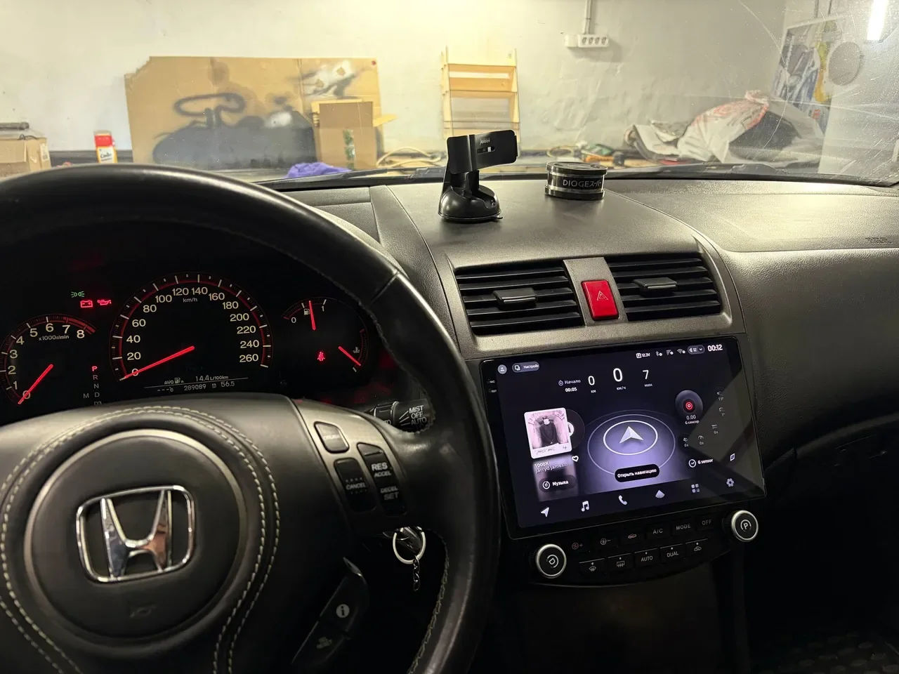
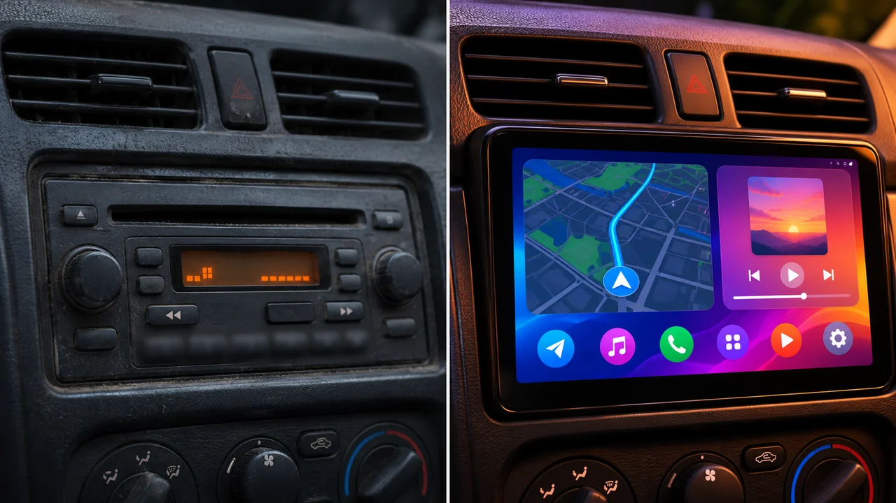
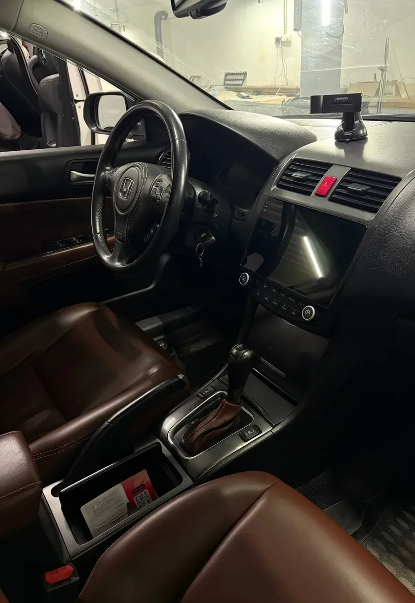
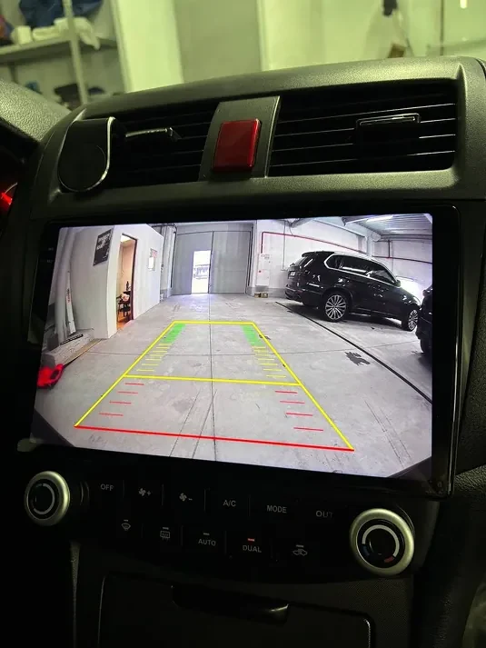

# Лучшая магнитола для Honda Accord 7: что ставить вместо штатной в 2026 году

Honda Accord 7 до сих пор едет так, что продавать жалко, а штатная магнитола в нём осталась в нулевых.

Телефон на присоске, провод зарядки через весь салон, навигатор в ладони на светофоре. А если машина из Японии, то и радио ловит не всё: японские приёмники тех лет рассчитаны на свой диапазон FM, а наш эфир идёт выше.

*Accord 7 2007 года после установки Teyes CC4. Работа TEYES Sibir, сентябрь 2026.*

## Коротко: что ставить на Accord 7

Лучшее, что можно сделать с мультимедиа Accord 7 сегодня, – Android-магнитола в штатную рамку. Экран встаёт на место старой магнитолы под дефлекторы, климат остаётся на своих кнопках, кнопки на руле продолжают работать.

В каталоге TEYES Sibir под Accord 7 2002–2008 стоит Teyes CC3L за 30 400 ₽ – цена на сайте 17.11.2026, при оплате наличными, установка отдельно, от 3 500 ₽. Мы ставили на Accord 7 и старшую CC4 – она на фото выше.

Русифицировать японский блок можно не всегда, и даже удачный перевод меню не добавит ни Яндекс Навигатора, ни наших станций. Ниже – почему.

## Какой у вас Accord 7: Япония, Европа или Euro R

Седьмой Accord для Японии и Европы выпускали с октября 2002 по ноябрь 2008 года. В 2006 модельном году машину обновили: новые фары и бамперы.

- **Седан CL7** – мотор 2.0, **CL8** – 2.0 с полным приводом, **CL9** – 2.4.
- **Универсал** – CM1, CM2, CM3.
- **Дизель 2.2** (CN1, CN2) продавали только в Европе.
- **Euro R** – только для Японии: 2.0 на 220 л. с. при 8 000 об/мин, шестиступенчатая механика, кресла Recaro.

В США под именем Accord продавали другую, более крупную машину, а этот Accord там назывался Acura TSX. Поэтому рамка от американского Accord на ваш не встанет.

## Что стояло в машине с завода

**Японские машины.** Кнопки мультимедиа на руле были во всех комплектациях. За доплату ставили навигацию Honda InterNavi на DVD с сенсорным экраном 7 дюймов и аудиосистему с CD-чейнджером на 6 дисков и 8 динамиками. После обновления 2006 года InterNavi перешла с DVD на жёсткий диск.

**Европейские машины.** В базе – 6 динамиков, в версиях Executive – 8. Навигация InterNavi на DVD шла штатно только на 2.4 Executive. CD-чейнджер на 8 дисков и громкую связь по Bluetooth продавали как дополнительное оборудование.

Ни в одной комплектации нет CarPlay, Android Auto и интернета в машине.

## Что раздражает владельцев в 2026 году

**Японское радио.** Диапазон FM в Японии до 2011 года был 76–90 МГц, наш – 87,5–108 МГц. Магнитола японского Accord рассчитана на свой эфир. Импортёры ставят на такие машины конвертер диапазона, но частота на экране после него не совпадает с настоящей.

**Японская навигация.** InterNavi ведёт по картам Японии и говорит по-японски. Для Новосибирска это просто экран с меню, которое не прочитать.

**Европейская навигация.** Карты на DVD – ровно того года, когда записан диск, а CD-чейнджер в 2026 году нужен разве что ради коллекции дисков.

**Телефон вместо навигатора.** Отсюда присоска на стекле, провод через салон и звонки через динамик телефона.

**Парковка задом.** На двух наших работах по Accord камеру заднего вида ставили новую – с линиями, которые поворачивают вслед за рулём.

## Три пути и какой выбрать

**Русифицировать штатный блок.** Если перевод для вашей магнитолы есть, меню станет русским. Карты останутся японскими, приложений не прибавится, приёмник продолжит ловить свой диапазон.

**Оставить как есть и ездить с телефоном.** Бесплатно, но присоска и провод остаются с вами.

**Поставить Android-магнитолу Teyes в штатную рамку.** Новый экран вместо старого блока, наши карты и станции, интернет по SIM-карте, CarPlay и Android Auto. Этот путь закрывает все пункты из списка выше.

*Иллюстрация. Слева – магнитола начала 2000-х, справа – Android-мультимедиа.*

## Какую Teyes ставить на Accord 7

**Teyes CC3L** – то, что есть в каталоге TEYES Sibir под Accord 7: память 4/32 ГБ, экран IPS 1280×720, 8 ядер, слот под SIM-карту с 4G, Wi-Fi, процессор звука DSP, CarPlay и Android Auto, GPS и ГЛОНАСС, вход камеры AHD 1080p. Цена – 30 400 ₽ на 17.11.2026.

**Teyes CC4 и старше.** У Teyes под Accord 7 есть рамки для CC4L, CC4 и CC4 Pro, в том числе с экранами 11 и 13 дюймов. На сайте эти комплекты под Accord 7 без цены – считаем по фото панели. CC4 мы ставили на Accord 7 2007 года.

Какая рамка подойдёт, видно по фото центральной панели: рынок и комплектация меняют проём.

## Что останется от штатного

- **Кнопки на руле.** Подключаются к новой магнитоле, на нашей работе с CC3 2K они сохранились.
- **Климат.** Работает со своих кнопок под экраном, как раньше.
- **Камера.** Новая камера заднего вида показывает на экране линии, которые изгибаются вслед за поворотом руля.
- **Отделка салона.** Экран встаёт в штатное место, панель не пилят.

*Тот же Accord 7: экран вписан в штатную панель.*

## Наши работы по Accord

**Accord 7 2007 года, Teyes CC4.** Экран встал на место штатной магнитолы, аварийка и дефлекторы над ним на своих местах, климат под экраном – на фото выше.

**Honda Accord, Teyes CC3 2K и новая камера.** Работа заняла один день, кнопки руля сохранились, линии парковки на экране поворачивают вслед за рулём. [Смотреть работу на сайте](https://teyes-sibir.ru/teyes_cc3_2k_honda_accord?utm_source=dzen&utm_medium=article&utm_campaign=accord7_multimedia&utm_content=work_cc3_2k)

*Honda Accord с Teyes CC3 2K и новой камерой. Работа TEYES Sibir.*

**Accord 8, Teyes LUX ONE 12 дюймов.** Это уже следующее поколение: большой экран в редкой рамке сверху панели, на экран выведены кнопки руля, открытые двери и климат. [Смотреть работу на сайте](https://teyes-sibir.ru/honda_accord_8_teyes_lux_one_12?utm_source=dzen&utm_medium=article&utm_campaign=accord7_multimedia&utm_content=work_lux_one)

Все варианты для Accord – русификация, замена магнитолы, что сохранится по рынкам – собраны на одной странице: [магнитола и русификация Honda Accord](https://teyes-sibir.ru/multimedia_teyes/honda/accord?utm_source=dzen&utm_medium=article&utm_campaign=accord7_multimedia&utm_content=model_page). Комплект CC3L под Accord 7 с ценой – [в каталоге](https://teyes-sibir.ru/store/catalog/honda/tproduct/953284757452-shtatnaya-magnitola-teyes-cc3l-honda-acc?utm_source=dzen&utm_medium=article&utm_campaign=accord7_multimedia&utm_content=catalog_cc3l).

TEYES Sibir, официальный установочный центр Teyes в Новосибирске: Сухарная 35 корпус 13, пн–пт с 11:00 до 19:00.

<!--
ИСТОЧНИКИ ФАКТОВ (для Артёма, в статью не выводить)
1. Годы октябрь 2002 – ноябрь 2008, обновление 2006 МГ (фары, бамперы), кузова CL7/CL8/CL9, CM1–CM3, CN1/CN2 только Европа, Euro R только Япония – 220 PS при 8000 об/мин, 6МКПП, Recaro; кнопки мультимедиа на руле во всех японских комплектациях; опции Японии – InterNavi DVD с сенсорным экраном 7", аудио с 6CD и 8 динамиками; 2006 – InterNavi на HDD; Европа – 6 динамиков, Executive – 8, InterNavi DVD штатно только 2.4 Executive, опции – 8CD-чейнджер и Bluetooth громкая связь; в США и Канаде – Acura TSX: https://en.wikipedia.org/wiki/Honda_Accord_(Japan_and_Europe_seventh_generation) (раздел Europe/UK, Japan, Engines; ссылки там на брошюры Honda UK 2005/2006 и honda.co.jp auto-archive), прочитано 17.11.2026. Камера заднего вида в списках оснащения статьи не упомянута.
2. FM в Японии 76–90 МГц до расширения после отключения аналогового ТВ 24.07.2011 (сейчас 76–95), машины из Японии – приёмник под японский диапазон, импортёры ставят конвертер, частота на экране неверная: https://en.wikipedia.org/wiki/FM_broadcast_band (раздел Japanese bandplan), 17.11.2026. Наш диапазон 87,5–108 МГц – там же (ITU регион 1).
3. Teyes CC3L Honda Accord 7 2002–2008: 30 400 ₽ «Цена указана со скидкой за наличный расчет», «Установка (оплачивается отдельно, от 3500 руб.)», характеристики 4+32Gb, IPS 1280х720, 8 ядер, Wi-Fi + 4G, DSP AKM AK7604VQ, CarPlay и Android Auto, GPS + ГЛОНАСС, AHD 1920×1080 вход камеры: https://teyes-sibir.ru/store/catalog/honda/tproduct/953284757452-shtatnaya-magnitola-teyes-cc3l-honda-acc – страница в Chrome и Tilda Store API, 17.11.2026. Других комплектов под Accord 7 в каталоге сайта нет (183 товара раздела Honda, API 17.11.2026).
4. Рамки Teyes под Accord 7 для CC4L/CC4/CC4 Pro, экраны 11" и 13": ~/Documents/Teyes-контент/материалы/подбор-мультимедиа/Honda-Accord/КАРТОЧКА.md (teyes.com.ru, сборка 1315, статус «только каталог», 23.09.2026).
5. Работа CC4 на Accord 7 2007: Case Studio №279 (диск 0090_Honda_Accord_7_2007), 02.09.2026, фото honda-accord-7-teyes-cc4-*.webp; на сайте не опубликована.
6. CC3 2K + новая камера, «Работа заняла 1 день», «Сохранились: кнопки на руле», динамические линии: https://teyes-sibir.ru/teyes_cc3_2k_honda_accord (200, 17.11.2026). Поколение на странице не названо.
7. LUX ONE 12″ на Accord 8, редкая рамка в верхней части панели, CAN: кнопки руля, двери, климат; новая камера: https://teyes-sibir.ru/honda_accord_8_teyes_lux_one_12 (200, 17.11.2026).
8. Адрес и часы: шапка teyes-sibir.ru, 17.11.2026.
9. Спрос: ~/Sites/razbory/teyes-materialy-336d9d32/dzen-accord7/ws-raw/ (XMLRiver wordstat/new, НСК=65, РФ=225, 17.11.2026, 40 запросов ≈ 1 ₽).
-->
