# Постинг TEYES: всё за ночь 17–18.11 – статьи, ВК, карты, Дзен

17.11.2026, третья доработка. Статья про Accord теперь в том же стиле, что кейс BMW, с четырьмя призывами. Добавлена библиотека из 20 призывов и 8 новых вариантов картинки ВК. Ничего не опубликовано.

## Ночь 17–18.11: что готово

**Всё, что ты дал вечером, готово текстом и в вёрстке, ничего не опубликовано. Картинки для статей с малым числом фото ещё дорисовываются, эту страницу дополню.**

1. **Статьи-кейсы на сайт – 234 готовы, ошибок 0.** В первой волне 185 статей по записям мастеров. Во второй 49: это работы без записи, которые я нашёл в фотобанке. 4 работы остались без фото, 5 оказались дублями. Все статьи – на [странице проверки](https://tema-mail.github.io/teyes-keysy-proverka/), подробности в разделе 13.
2. **ВК – 10 постов №241–251, по 3 обложки** (раздел 10). №242 пропустил: у неё один кадр, на «до/после» не хватает.
3. **Карты – 11 новостей с 18.11 по 03.12** (раздел 11): 6 для Google и 5 для Яндекса, каждая – реальная работа. Первая (Google, Hilux) стоит на сегодня.
4. **Дзен – 6 статей «лучшая магнитола для <модель>» и 3 карусели** (раздел 12). Модели взяты под спрос, по каждой есть наша работа. Обложки «год VS 2026» и все карточки я посмотрел сам.

**Что нужно от тебя по ночной работе (кроме старого списка ниже):**
- Где показывать статьи до сайта: пока они лежат в открытом временном репо. После выкладки на сайт я его удалю.
- Дубли: объединить №274→337, №270 и №271→273, №254→338?
- №308: на фото Qashqai J11, а статья про X-Trail 2017 – чья это машина?
- Цена CC3L в каталоге: 17 500 ₽, а на карточке 26 800–30 100 ₽. Установка где-то «от 3 500», где-то «от 4 500». В статьях Дзена стоит 4 500.
- Карты: сигнализации без кадров брелока или блока (CX-5, Creta, Roomy) и абзац про чужой монтаж в Camry – оставить?

**Смета ночи:** Вордстат через XMLRiver – около 14 ₽. Тексты писала подписка Claude, картинки – подписка Codex.

---

## Что выбрать тебе (с 17.11)

0. **10 постов ВК (разделы 9 и 9а):** вариант баннера В1–В4 и какой из трёх видов обложки берём в ленту – или чередуем.

1. **Призывы:** какие из 20 оставляем – раздел 3. После этого закрепим правило для статей и кейсов.
2. **ВК, картинка 2:** один из 8 вариантов «экран под вопросом» – раздел 4. Картинка 1 – сумерки или день.
3. **Подписывать ли в ВК, что «штатная» картинка сгенерирована.**

Уже решено тобой 17.11: обложка Дзена – «2003 VS 2026» (стоит в статье); ВК картинка 1 – вариант 1-б с реальной погодой; стиль статей – единый с кейсом.

## Нужно уточнить – факты

- **Фото менеджера в призыве:** на фото точно Алексей?
- **BMW X5 №360:** в записи мастера CC3 12″, в каталоге для E70 такой нет – ставили CC4? Камера заднего вида заводская или наша?
- **Автозапуск:** на странице сигнализаций три цены – 12 000, 9 000, 1 500. В карусели 12 000 – подтверди.
- **Accord:** CC4 под Accord 7 (работа №279) в каталоге без цены – добавить?
- **Подпись «Артём Галимов»** в кейсе и блоге – подтверди.

---

## 1. Сайт – SEO-кейс: BMW X5 E70, Teyes 12″

**[Открыть как на площадке →](vid/keys-bmw/)**

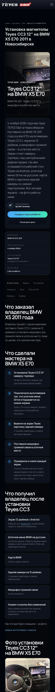

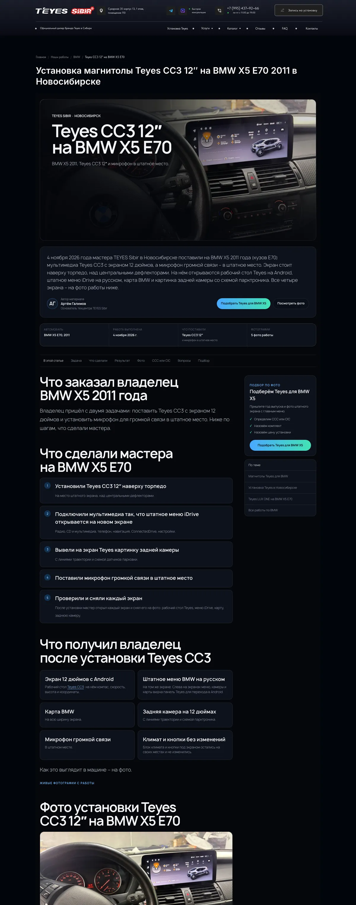

#### Текст кейса, мета и разметка


**Адрес:** `https://teyes-sibir.ru/work/bmw/ustanovka-teyes-cc3-bmw-x5-e70-novosibirsk`
**Title (52 знака):** Магнитола Teyes CC3 12″ на BMW X5 E70 в Новосибирске
**Description (144 знака):** BMW X5 2011 (E70): поставили Teyes CC3 12″ и микрофон в штатное место. На экране – Android, меню iDrive, навигация и задняя камера. Фото работы.
**H1:** Установка магнитолы Teyes CC3 12″ на BMW X5 E70 2011 в Новосибирске
**Хлебные крошки:** Главная / Наши работы / BMW / Teyes CC3 12″ на BMW X5 E70
**Автор:** Артём Галимов, основатель техцентра TEYES Sibir

---

**Первый абзац – ответ:**
4 ноября 2026 года мастера TEYES Sibir в Новосибирске поставили на BMW X5 2011 года (кузов E70) мультимедиа Teyes CC3 с экраном 12 дюймов, а микрофон громкой связи – в штатное место. Экран стоит наверху торпедо, над центральными дефлекторами. На нём открываются рабочий стол Teyes на Android, штатное меню iDrive на русском, карта BMW и картинка задней камеры со схемой парктроника. Все четыре экрана – на фото работы ниже.

Кнопка: **Подобрать Teyes для BMW X5** → форма заявки

---

**H2: Что заказал владелец BMW X5 2011 года**

Владелец пришёл с двумя задачами: поставить Teyes CC3 с экраном 12 дюймов и установить микрофон для громкой связи в штатное место. Ниже по шагам, что сделали мастера.

**H2: Что сделали мастера на BMW X5 E70**

- Установили Teyes CC3 12″ наверху торпедо, на место штатного экрана, над центральными дефлекторами.
- Подключили мультимедиа так, что штатное меню iDrive открывается на новом экране: радио, CD и мультимедиа, телефон, навигация, ConnectedDrive, настройки.
- Вывели на экран Teyes картинку задней камеры с линиями траектории и схемой датчиков парковки.
- Поставили микрофон громкой связи в штатное место.
- После установки мастер открыл каждый экран и снял его на фото: рабочий стол Teyes, меню iDrive, карту, заднюю камеру.

**H2: Что получил владелец после установки Teyes CC3**

- Экран 12 дюймов с Android и рабочим столом Teyes: на нём компас, скорость, высота и координаты.
- Штатное меню BMW на русском – на том же экране. Слева на экранах меню, камеры и карты видна панель Teyes для перехода в Android.
- Карту BMW на всю ширину экрана.
- Заднюю камеру с линиями траектории и схемой парктроника на 12 дюймах.
- Микрофон громкой связи в штатном месте.
- Блок климата и кнопки под экраном остались на своих местах и не изменились.

Как это выглядит в машине – на фото.

**H2: Фото установки Teyes CC3 12″ на BMW X5 E70**


*Вид с места водителя: экран Teyes CC3 12″ стоит наверху торпедо, на нём рабочий стол Teyes.*

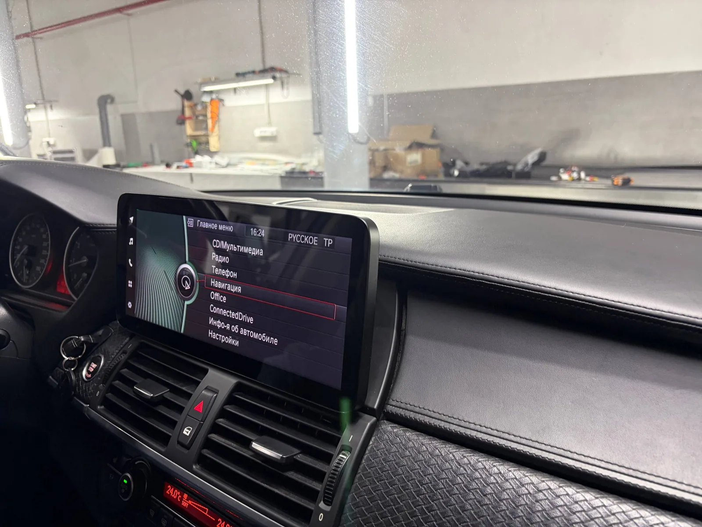
*Главное меню iDrive на новом экране: радио, телефон, навигация, ConnectedDrive, информация об автомобиле, настройки.*

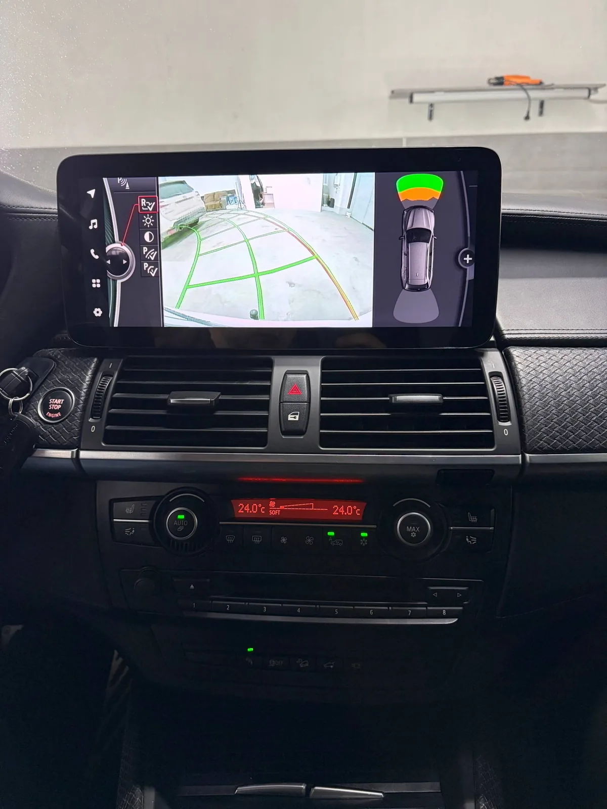
*Картинка задней камеры с линиями траектории, справа – схема датчиков парковки.*


*Карта с Новосибирском на всю ширину экрана, слева панель Teyes.*

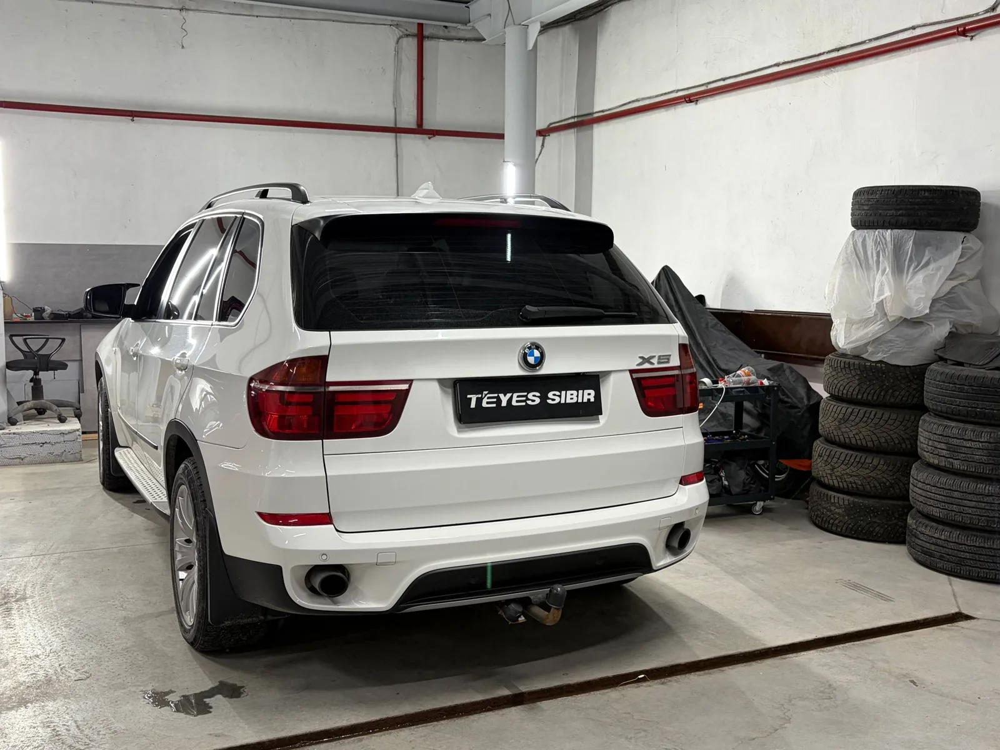
*BMW X5 в установочном центре TEYES Sibir на Сухарной.*

Перед заказом такой установки на свой X5 полезно знать одну вещь про комплекты.

**H2: Что важно знать про магнитолу на BMW X5 E70**

В каталоге TEYES Sibir комплекты Teyes для BMW X5 E70 2006–2014 годов идут в двух исполнениях: под штатную систему CCC и под CIC. Цена и состав у них разные, поэтому мастер сначала определяет систему в вашей машине.

Проще всего прислать фото штатного экрана с открытым главным меню. На этом X5 2011 года меню – вертикальный список «Радио, Телефон, Навигация, Office, ConnectedDrive», как на фото выше.

Ещё одна работа на этом кузове – [Teyes LUX ONE на BMW X5 E70](https://teyes-sibir.ru/teyes_lux_one_bmw_x5_e70).

**H2: Вопросы о Teyes на BMW X5 E70**

**Можно ли поставить Teyes на BMW X5 E70 и оставить штатное меню iDrive?**
Да. На этом BMW X5 2011 года штатное меню iDrive на русском открывается на экране Teyes CC3 12″: радио, телефон, навигация, настройки. Какие функции сохранятся на вашей машине, мастер скажет до установки по системе CCC или CIC и выбранному комплекту.

**Куда ставят микрофон Teyes на BMW X5 E70?**
В этой работе мастер поставил микрофон громкой связи в штатное место BMW. Место согласуем до установки.

**Какой комплект Teyes нужен для BMW X5 E70: CCC или CIC?**
В каталоге TEYES Sibir комплекты для X5 E70 2006–2014 годов идут в двух исполнениях: под штатную систему CCC и под CIC. Пришлите фото штатного экрана с главным меню, и мастер определит, какое исполнение подойдёт.

**Сколько стоит установка магнитолы на BMW X5 E70?**
Установка головного устройства в TEYES Sibir стоит от 4 500 ₽. Teyes CC3 12″ для X5 E70 в каталоге сайта сейчас нет, цену комплекта назовёт менеджер. Для сравнения в каталоге: Teyes CC4 12.3″ для X5 E70 с системой CIC – от 51 190 ₽, CC4 Pro 12.3″ – от 72 040 ₽. Цены на 17.11.2026.

**H2: Подберём Teyes для вашего BMW X5 E70**

Пришлите год выпуска и фото штатного экрана с главным меню. Мастер определит CCC или CIC, назовёт комплект и цену установки. Адрес: Новосибирск, Сухарная, 35 к13, 1 этаж, помещение 110, пн–пт с 11:00 до 19:00.

Кнопка: **Узнать цену для своего X5** → форма заявки

**Перелинковка на странице:**
- [Магнитолы Teyes для BMW](https://teyes-sibir.ru/store/catalog/bmw) – в «Что получил» (слово «Teyes CC3») и в «Что важно знать» (слово «каталоге»)
- [Установка Teyes в Новосибирске](https://teyes-sibir.ru/services/installation_teyes) – в FAQ о цене (слово «от 4 500 ₽»)
- [Teyes LUX ONE на BMW X5 E70](https://teyes-sibir.ru/teyes_lux_one_bmw_x5_e70) – в «Что важно знать»
- [Все работы по BMW](https://teyes-sibir.ru/work/bmw) – в хлебных крошках

**Разметка JSON-LD** (Article + Service + AutomotiveBusiness + FAQPage + BreadcrumbList):

```json
{
  "@context": "https://schema.org",
  "@graph": [
    {
      "@type": "Article",
      "@id": "https://teyes-sibir.ru/work/bmw/ustanovka-teyes-cc3-bmw-x5-e70-novosibirsk#article",
      "headline": "Установка магнитолы Teyes CC3 12″ на BMW X5 E70 2011 в Новосибирске",
      "description": "BMW X5 2011 (E70): поставили Teyes CC3 12″ и микрофон в штатное место. На экране – Android, меню iDrive, навигация и задняя камера. Фото работы.",
      "mainEntityOfPage": "https://teyes-sibir.ru/work/bmw/ustanovka-teyes-cc3-bmw-x5-e70-novosibirsk",
      "datePublished": "2026-11-17",
      "dateModified": "2026-11-17",
      "inLanguage": "ru",
      "author": {
        "@type": "Person",
        "name": "Артём Галимов",
        "jobTitle": "Основатель техцентра TEYES Sibir"
      },
      "publisher": {
        "@id": "https://teyes-sibir.ru/#org"
      },
      "image": [
        "https://teyes-sibir.ru/work/bmw/ustanovka-teyes-cc3-bmw-x5-e70-novosibirsk/bmw-x5-e70-teyes-cc3-salon.webp",
        "https://teyes-sibir.ru/work/bmw/ustanovka-teyes-cc3-bmw-x5-e70-novosibirsk/bmw-x5-e70-teyes-cc3-menyu-idrive.webp",
        "https://teyes-sibir.ru/work/bmw/ustanovka-teyes-cc3-bmw-x5-e70-novosibirsk/bmw-x5-e70-teyes-cc3-kamera-zadnego-vida.webp",
        "https://teyes-sibir.ru/work/bmw/ustanovka-teyes-cc3-bmw-x5-e70-novosibirsk/bmw-x5-e70-teyes-cc3-navigaciya.webp",
        "https://teyes-sibir.ru/work/bmw/ustanovka-teyes-cc3-bmw-x5-e70-novosibirsk/bmw-x5-e70-teyes-sibir-vid-szadi.webp"
      ],
      "about": {
        "@id": "https://teyes-sibir.ru/work/bmw/ustanovka-teyes-cc3-bmw-x5-e70-novosibirsk#service"
      }
    },
    {
      "@type": "Service",
      "@id": "https://teyes-sibir.ru/work/bmw/ustanovka-teyes-cc3-bmw-x5-e70-novosibirsk#service",
      "name": "Установка магнитолы Teyes на BMW X5 E70",
      "serviceType": "Установка мультимедиа Teyes",
      "provider": {
        "@id": "https://teyes-sibir.ru/#org"
      },
      "areaServed": {
        "@type": "City",
        "name": "Новосибирск"
      },
      "url": "https://teyes-sibir.ru/services/installation_teyes",
      "offers": {
        "@type": "Offer",
        "priceCurrency": "RUB",
        "price": "4500",
        "description": "Установка головного устройства, цена от",
        "url": "https://teyes-sibir.ru/services/installation_teyes"
      }
    },
    {
      "@type": "AutomotiveBusiness",
      "@id": "https://teyes-sibir.ru/#org",
      "name": "TEYES Sibir",
      "url": "https://teyes-sibir.ru/",
      "telephone": "+7 995 437-92-66",
      "address": {
        "@type": "PostalAddress",
        "streetAddress": "ул. Сухарная, 35 к13, 1 этаж, помещение 110",
        "addressLocality": "Новосибирск",
        "addressCountry": "RU"
      },
      "openingHours": "Mo-Fr 11:00-19:00"
    },
    {
      "@type": "FAQPage",
      "@id": "https://teyes-sibir.ru/work/bmw/ustanovka-teyes-cc3-bmw-x5-e70-novosibirsk#faq",
      "mainEntity": [
        {
          "@type": "Question",
          "name": "Можно ли поставить Teyes на BMW X5 E70 и оставить штатное меню iDrive?",
          "acceptedAnswer": {
            "@type": "Answer",
            "text": "Да. На этом BMW X5 2011 года штатное меню iDrive на русском открывается на экране Teyes CC3 12″: радио, телефон, навигация, настройки. Какие функции сохранятся на вашей машине, мастер скажет до установки по системе CCC или CIC и выбранному комплекту."
          }
        },
        {
          "@type": "Question",
          "name": "Куда ставят микрофон Teyes на BMW X5 E70?",
          "acceptedAnswer": {
            "@type": "Answer",
            "text": "В этой работе мастер поставил микрофон громкой связи в штатное место BMW. Место согласуем до установки."
          }
        },
        {
          "@type": "Question",
          "name": "Какой комплект Teyes нужен для BMW X5 E70: CCC или CIC?",
          "acceptedAnswer": {
            "@type": "Answer",
            "text": "В каталоге TEYES Sibir комплекты для X5 E70 2006–2014 годов идут в двух исполнениях: под штатную систему CCC и под CIC. Пришлите фото штатного экрана с главным меню, и мастер определит, какое исполнение подойдёт."
          }
        },
        {
          "@type": "Question",
          "name": "Сколько стоит установка магнитолы на BMW X5 E70?",
          "acceptedAnswer": {
            "@type": "Answer",
            "text": "Установка головного устройства в TEYES Sibir стоит от 4 500 ₽. Teyes CC3 12″ для X5 E70 в каталоге сайта сейчас нет, цену комплекта назовёт менеджер. Для сравнения в каталоге: Teyes CC4 12.3″ для X5 E70 с системой CIC – от 51 190 ₽, CC4 Pro 12.3″ – от 72 040 ₽. Цены на 17.11.2026."
          }
        }
      ]
    },
    {
      "@type": "BreadcrumbList",
      "itemListElement": [
        {
          "@type": "ListItem",
          "position": 1,
          "name": "Главная",
          "item": "https://teyes-sibir.ru/"
        },
        {
          "@type": "ListItem",
          "position": 2,
          "name": "Наши работы",
          "item": "https://teyes-sibir.ru/work"
        },
        {
          "@type": "ListItem",
          "position": 3,
          "name": "BMW",
          "item": "https://teyes-sibir.ru/work/bmw"
        },
        {
          "@type": "ListItem",
          "position": 4,
          "name": "Teyes CC3 12″ на BMW X5 E70",
          "item": "https://teyes-sibir.ru/work/bmw/ustanovka-teyes-cc3-bmw-x5-e70-novosibirsk"
        }
      ]
    }
  ]
}
```

**Почему так.** Спрос по Вордстату (XMLRiver, 17.11.2026): «магнитола бмв х5 е70» – 341 в месяц по России и 9 по Новосибирску, «teyes bmw x5 e70» – 43, «замена магнитолы бмв х5 е70» – 27. Поэтому в title стоят «магнитола», «Teyes», «BMW X5 E70» и город, а модель CC3 отделяет кейс от готовой страницы про LUX ONE на том же кузове, чтобы они не делили один запрос. Каждый блок отвечает на вопрос, который вызывает предыдущий: что заказали → что сделали → что получил → покажите → а мне что подойдёт → сколько стоит → как записаться. Надзаголовков нет, H2 – с ключом или прямым утверждением. Шаблонных шагов «работу выполнили аккуратно», как в образце Camry, и чужой модели в тексте (у Camry там «Прадо 150») нет.

**Проверено:** title 52 знака, description 144 знака (подсчёт кодом); JSON-LD разобран `json.loads` без ошибок; длинного тире нет нигде в файле (grep); цены взяты с живых страниц: установка – teyes-sibir.ru/services/installation_teyes, комплекты X5 E70 – API магазина Тильды для /store/catalog/bmw; все ссылки отвечают 200. Смета Вордстата: 17 запросов ≈ 0,43 ₽.


---

## 2. Сайт – блог: магнитола на Honda Accord (в стиле кейса, 4 призыва)

**[Открыть как на площадке →](vid/blog-accord/)**

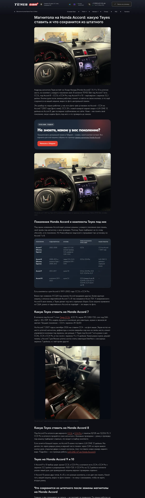

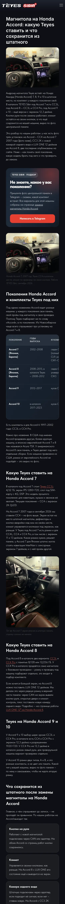

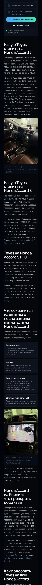

Призывы в статье: CTA-01 в начале (холодный), CTA-02 после таблицы поколений (тёплый), CTA-03 с менеджером перед вопросами (горячий), CTA-20 – липкая полоса на телефоне.

#### Текст статьи

#### Статья блога сайта

**Мета**

| Поле | Значение |
|---|---|
| Адрес | /blog/honda-accord-teyes-headunit |
| Title (59) | Android-магнитола на Honda Accord 7–10: какую Teyes ставить |
| Description (154) | Какая Teyes встаёт на Honda Accord 7, 8, 9 и 10, что остаётся от штатной магнитолы и что прислать для подбора. По каталогу и нашим работам в Новосибирске. |
| H1 | Магнитола на Honda Accord: какую Teyes ставить и что сохранится из штатного |
| Главный запрос | андроид магнитола хонда аккорд |
| Соседние | установка андроид магнитолы хонда аккорд 8; установка магнитолы аккорд 8; установка магнитолы хонда аккорд 7; магнитола аккорд |
| Ведёт на | /multimedia_teyes/honda/accord (страница модели) и /services/installation_teyes |
| Автор | Артём Галимов, основатель техцентра TEYES Sibir |
| Картинки | `honda-accord-7-teyes-cc4-panel.webp` (обложка и в тексте), `honda-accord-7-teyes-cc4-salon.webp`, `honda-accord-teyes-cc3-2k-kamera.webp` – все с наших работ, номеров в кадре нет |

---

# Магнитола на Honda Accord: какую Teyes ставить и что сохранится из штатного

Андроид магнитола Teyes встаёт на Хонда Аккорд (Honda Accord) 7, 8, 9 и 10 в штатное место, но комплект у каждого поколения свой. В каталоге TEYES Sibir под Accord 7 есть CC3L, под Accord 8 – CC3L и CC4 Pro, под Accord 9 и 10 – ещё версии с экраном 12,3 дюйма. Кнопки руля после замены работают, климат остаётся на своих кнопках, а что ещё сохранится на вашей машине, видно по фото центральной панели.

Это разбор по нашим работам: у нас есть фото трёх установок на Accord – CC4 на Accord 7 2007 года (фото ниже), CC3 2K с новой камерой заднего вида и LUX ONE 12 дюймов на Accord 8, две последние опубликованы на сайте. Ниже – как понять своё поколение, какую модель брать под него и что проверить до заказа.

> **Не знаете, какое у вас поколение?** Пришлите фото центральной панели в [Telegram](https://t.me/teyesnsk) – скажем, какой комплект встанет. Все варианты для этой машины собраны на странице [замена магнитолы Honda Accord](https://teyes-sibir.ru/multimedia_teyes/honda/accord).

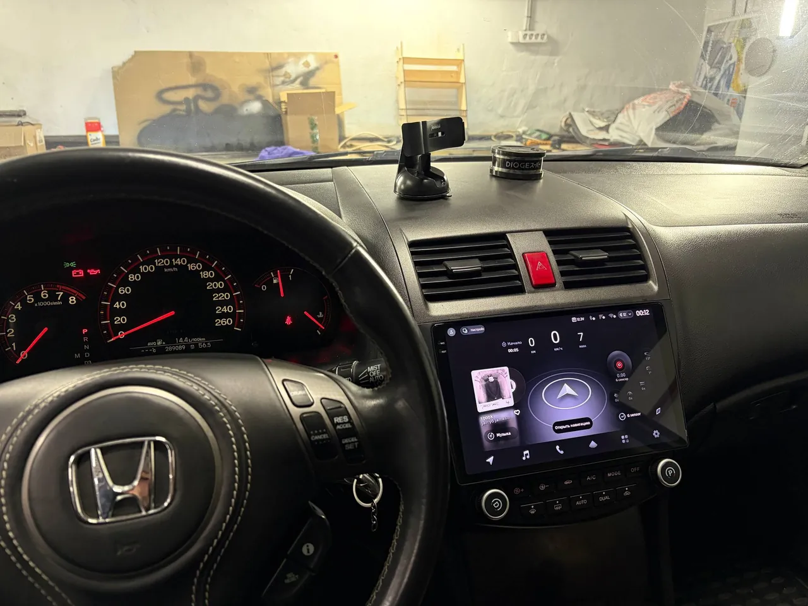
*Honda Accord 7, 2007 год: Teyes CC4 в штатном месте, климат по-прежнему на своих кнопках. Работа TEYES Sibir, сентябрь 2026.*

#### Поколения Honda Accord и комплекты Teyes под них

Под одним названием Accord ездят разные машины: у каждого поколения своя панель, свой проём под магнитолу и своя проводка. Поэтому Teyes подбирают не по слову «Accord», а по поколению. Из Новосибирска чаще всего спрашивают про установку на Accord 7 и 8.

| Поколение | Годы выпуска | Кузова | Teyes в каталоге TEYES Sibir | Наши работы |
|---|---|---|---|---|
| Accord 7 (Япония, Европа) | 2002–2008 | седан CL7, CL8 (полный привод), CL9; универсал CM1–CM3 | CC3L | CC4 на Accord 7 2007 года |
| Accord 8 (Япония, Европа) | 2008–2015, в каталоге Teyes – 2008–2012 | седан CU1–CU3; универсал CW1–CW3 | CC3L, CC4 Pro | LUX ONE 12 дюймов в отдельной рамке |
| Accord 9 | 2012–2017 | кузов CR | CC3L, CC4 Pro, CC4 12,3", CC4 Pro 12,3" | – |
| Accord 10 | в каталоге 2017–2023 | кузов CV | CC3L (рамка A или B), CC4 Pro, CC4 12,3" и CC4 Pro 12,3" (тип A или B) | – |

Есть комплекты и для Accord 6 1997–2002 года: CC3L и CC4 Pro.

Важно про название. В США под именем Accord продавали другую, более крупную машину, а японско-европейский Accord 7 и 8 там назывался Acura TSX. У американского Accord 8 своя панель, и Teyes делает под него отдельные сборки. Если машина привезена из США, рамка от европейского Accord не подойдёт – это видно по фото.

#### Какую Teyes ставить на Honda Accord 7

В каталоге под Accord 7 стоит [Teyes CC3L](https://teyes-sibir.ru/store/catalog/honda/tproduct/953284757452-shtatnaya-magnitola-teyes-cc3l-honda-acc): 4/32 ГБ, экран IPS 1280×720, слот под SIM-карту с 4G, DSP. Это модель прошлого поколения: для навигации, музыки и звонков её хватает. Текущее поколение – CC4 с экраном 2K QLED.

На Accord 7 2007 года в сентябре 2026 мы ставили CC4 – на фото выше. Экран встал на место штатной магнитолы, дефлекторы и кнопка аварийки над ним на своём месте, климат управляется кнопками под экраном, как раньше. У Teyes под Accord 7 есть рамки и для CC4L, CC4 и CC4 Pro, в том числе с экраном 11 и 13 дюймов. Какая рамка нужна, решает панель: у Accord 7 для Японии штатно могла стоять навигация InterNavi с сенсорным экраном 7 дюймов, и с ней проём другой.

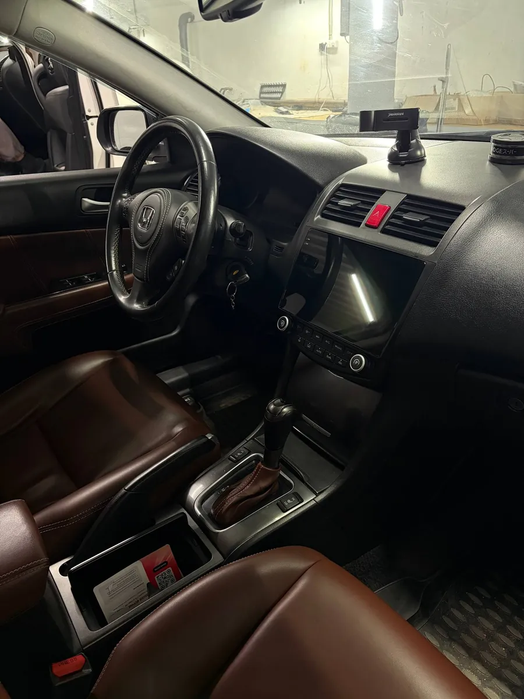
*Тот же Accord 7: экран вписан в штатную панель, отделку салона не меняли.*

#### Какую Teyes ставить на Honda Accord 8

Под Accord 8 в каталоге два варианта: [CC3L](https://teyes-sibir.ru/store/catalog/honda/tproduct/260083445302-shtatnaya-magnitola-teyes-cc3l-honda-acc) и [CC4 Pro](https://teyes-sibir.ru/store/catalog/honda/tproduct/253096628232-shtatnaya-magnitola-teyes-cc4-pro-honda) с памятью 8/128 или 12/256 ГБ. У CC4 Pro в каталоге продаётся сама магнитола с базовыми проводами – рамку и проводку под машину подбирают отдельно, это входит в подбор комплекта.

Если хочется большой экран, на Accord 8 можно поставить LUX ONE 12 дюймов. Мы делали это через редкую рамку в верхней части панели: через CAN на экран вывели кнопки руля, открытые двери и климат-контроль, плюс поставили новую камеру заднего вида. Подробно – на странице работы [LUX ONE 12″ на Honda Accord 8](https://teyes-sibir.ru/honda_accord_8_teyes_lux_one_12).

#### Teyes на Honda Accord 9 и 10

У Accord 9 и 10 выбор шире: кроме CC3L и CC4 Pro, в каталоге есть CC4 и CC4 Pro с экраном 12,3 дюйма и разрешением 1920×720. У CC4 Pro на 12,3 дюйма в каталоге указан левый руль: для праворульной машины вариант проверяем отдельно.

У Accord 10 рамки двух типов, A и B, и это разные комплекты, а не цвет или память. Какой тип у вашей машины, видно по фото панели – по нему и заказываем, чтобы не ждать вторую рамку.

#### Что сохранится из штатного после замены магнитолы на Honda Accord

Главное, о чём спрашивают до записи, – не пропадёт ли привычное. По нашим работам на Accord выходит так:

- **Кнопки на руле.** Работают с новой магнитолой: подключаем через CAN или адаптер. На обоих Accord со страниц работ кнопки сохранились.
- **Климат.** Управляется своими кнопками, как раньше. На Accord 8 с LUX ONE его состояние ещё и выводится на экран.
- **Камера заднего вида.** Штатную подключаем через адаптер, если подходит её сигнал; если нет – ставим новую. На Accord с CC3 2K поставили новую камеру с линиями, которые изгибаются при повороте руля.
- **Штатный усилитель и USB.** Проверяем по комплектации до заказа: от этого зависит, какие переходники нужны.


*Honda Accord с Teyes CC3 2K и новой камерой заднего вида. Работа TEYES Sibir.*

Что даёт сама магнитола: Яндекс Навигатор и 2ГИС, музыку по Bluetooth и через интернет SIM-карты, беспроводные CarPlay и Android Auto на CC4 и CC4 Pro.

#### Honda Accord из Японии: что проверить до заказа

Праворульный Accord из Японии отличается от европейского не только рулём. В комплектации могла стоять штатная навигация с экраном, а не простая магнитола, и тогда рамка нужна под другой проём. Японское меню, карты Японии и японский FM-диапазон уходят вместе со штатной магнитолой – новая Teyes ловит наши станции и ведёт по нашим картам.

Если вы ещё думаете, не перевести ли японскую магнитолу на русский, сначала сравните: перевод меню не ускоряет старое устройство и не всегда даёт поставить нужные приложения. Об этом – на странице [русификации и замены на Honda Accord](https://teyes-sibir.ru/multimedia_teyes/honda/accord).

#### Как подобрать Teyes на ваш Honda Accord

Подбор начинается с фото, а не с названия модели. Пришлите в Telegram одним сообщением:

1. Центральную панель прямо, при включённом зажигании.
2. Панель приборов при включённом зажигании – по ней видно рынок.
3. Руль с кнопками.
4. Год выпуска и, если знаете, номер кузова.
5. Есть ли камера заднего вида и шильдик аудиосистемы на дверях.

По фото определим поколение и рынок, проверим рамку и разъёмы, скажем, что сохранится из штатного, и назовём состав комплекта. Сама установка на Accord с CC3 2K заняла у нас один день. Приезжайте: Новосибирск, Сухарная 35 корпус 13, пн–пт с 11:00 до 19:00 – покажем экраны вживую и сравним модели. Цены комплектов – в [каталоге Teyes для Honda](https://teyes-sibir.ru/store/catalog/honda).

> **Подберём Teyes под ваш Accord по одному фото панели.** [Написать в Telegram](https://t.me/teyesnsk) · +7 (995) 437-92-66 · [Установка Teyes в TEYES Sibir](https://teyes-sibir.ru/services/installation_teyes)

#### Вопросы об установке Teyes на Honda Accord

##### Какую магнитолу Teyes поставить на Honda Accord 8?
В каталоге под Accord 8 есть CC3L и CC4 Pro. CC4 Pro – старшая модель с памятью 8/128 или 12/256 ГБ, к ней подбирают рамку и проводку под машину. Если нужен экран побольше, на Accord 8 встаёт LUX ONE 12 дюймов в отдельной рамке – мы такое делали.

##### Сохранятся ли кнопки на руле Accord после замены магнитолы?
Да, кнопки руля подключаются к Teyes через CAN или адаптер. На обоих Accord, которые есть у нас на сайте, они работают. Какой адаптер нужен вашей машине, видно по фото руля и году.

##### Можно ли оставить штатную камеру заднего вида?
Можно, если её сигнал подходит к Teyes – тогда подключаем через адаптер. Если не подходит или камеры нет, ставим новую, как на Accord с CC3 2K.

##### Подойдёт ли рамка от европейского Accord на Accord из США?
Нет. Американский Accord 7 и 8 – другая машина с другой панелью, под американский Accord 8 у Teyes отдельные сборки. Пришлите фото панели, и мы скажем, какая рамка ваша.

##### Что прислать для подбора Teyes на Accord?
Фото центральной панели и приборов при включённом зажигании, руль, год выпуска и есть ли камера заднего вида. По этому определяем поколение, рынок и состав комплекта до заказа.

#### Каталог и работы по Honda Accord

- [Замена магнитолы и русификация Honda Accord](https://teyes-sibir.ru/multimedia_teyes/honda/accord)
- [Каталог Teyes для Honda](https://teyes-sibir.ru/store/catalog/honda)
- [Teyes CC3L для Honda Accord 7](https://teyes-sibir.ru/store/catalog/honda/tproduct/953284757452-shtatnaya-magnitola-teyes-cc3l-honda-acc)
- [Teyes CC4 Pro для Honda Accord 8](https://teyes-sibir.ru/store/catalog/honda/tproduct/253096628232-shtatnaya-magnitola-teyes-cc4-pro-honda)
- [Работа: Teyes CC3 2K и камера на Honda Accord](https://teyes-sibir.ru/teyes_cc3_2k_honda_accord)
- [Работа: Teyes LUX ONE 12″ на Honda Accord 8](https://teyes-sibir.ru/honda_accord_8_teyes_lux_one_12)
- [Установка Teyes в Новосибирске](https://teyes-sibir.ru/services/installation_teyes)
- [Сигнализация StarLine с автозапуском – можно в тот же визит](https://teyes-sibir.ru/services/alarm_installation)
- [Все статьи блога](https://teyes-sibir.ru/blog)

*Автор: Артём Галимов, основатель техцентра TEYES Sibir.*

<!--
ИСТОЧНИКИ ФАКТОВ (под статьёй, на сайт не выводить)
- Поколения, годы, кузова Accord 7: https://en.wikipedia.org/wiki/Honda_Accord_(Japan_and_Europe_seventh_generation) – «October 2002 – November 2008», седан CL7, CL8 (AWD), CL9, универсал CM1–CM3; в США и Канаде – Acura TSX; в Японии опция InterNavi DVD с сенсорным экраном 7".
- Accord 8: https://en.wikipedia.org/wiki/Honda_Accord_(Japan_and_Europe_eighth_generation) – производство 2008–2015, CU1–CU3 / CW1–CW3, в Северной Америке – Acura TSX второго поколения.
- Два размера Accord 8 («маленький» Европа и Япония, «большой» США, Канада, Китай): https://ru.wikipedia.org/wiki/Honda_Accord
- Accord 9: https://en.wikipedia.org/wiki/Honda_Accord_(ninth_generation) – август 2012–2017 (Северная Америка), коды CR1–CR7.
- Accord 10, CV, годы; все комплекты, память, экраны 12,3" 1920×720, «руль: Левый», «рамка и проводка не входят» (CC4 Pro): каталог teyes-sibir.ru/store/catalog/honda, Tilda Store API, снято 17.11.2026.
- Рамки CC4L/CC4/CC4 Pro и экраны 11/13" под Accord 7, отдельные сборки Teyes под Accord 8 USA: карточка ~/Documents/Teyes-контент/материалы/подбор-мультимедиа/Honda-Accord/КАРТОЧКА.md (teyes.com.ru, статус «только каталог», 23.09.2026).
- CC3L – прошлое поколение: ~/Documents/Teyes-контент/материалы/TEYES_SIBIR_КОМПАНИЯ.md, раздел 4.
- Работа CC4 на Accord 7 2007: Case Studio, работа №279 (диск 0090_Honda_Accord_7_2007), 02.09.2026, на сайте не опубликована.
- Работа CC3 2K + новая камера, кнопки руля сохранились, «работа заняла 1 день»: https://teyes-sibir.ru/teyes_cc3_2k_honda_accord
- Работа LUX ONE 12″ на Accord 8, редкая рамка сверху, CAN: кнопки руля, двери, климат; новая камера: https://teyes-sibir.ru/honda_accord_8_teyes_lux_one_12
- Камера штатная через адаптер или новая, усилитель и USB – по проверке: https://teyes-sibir.ru/multimedia_teyes/honda/accord
- Что прислать для подбора: МЕТОДИЧКА_ПОДБОР_TEYES.md, §2.2.
- Адрес, часы, телефон, Telegram: подвал teyes-sibir.ru и TEYES_SIBIR_КОМПАНИЯ.md.
- Коды ответа всех ссылок статьи – 200 (curl, 17.11.2026).
-->

```json
[
  {
    "@context": "https://schema.org",
    "@type": "Article",
    "headline": "Магнитола на Honda Accord: какую Teyes ставить и что сохранится из штатного",
    "description": "Какая Teyes встаёт на Honda Accord 7, 8, 9 и 10, что остаётся от штатной магнитолы и что прислать для подбора. По каталогу и нашим работам в Новосибирске.",
    "image": "https://static.tildacdn.com/tild6165-3664-4664-a339-636363313766/Jfp-FNaEZ-kqA3g19C0W.png",
    "datePublished": "2026-11-17",
    "dateModified": "2026-11-17",
    "inLanguage": "ru",
    "mainEntityOfPage": "https://teyes-sibir.ru/blog/honda-accord-teyes-headunit",
    "author": {
      "@type": "Person",
      "name": "Артём Галимов",
      "jobTitle": "основатель техцентра TEYES Sibir"
    },
    "publisher": {
      "@type": "Organization",
      "name": "TEYES Sibir",
      "url": "https://teyes-sibir.ru",
      "telephone": "+7 995 437-92-66",
      "address": {
        "@type": "PostalAddress",
        "streetAddress": "ул. Сухарная, 35, корпус 13, помещение 110",
        "addressLocality": "Новосибирск",
        "postalCode": "630001",
        "addressCountry": "RU"
      }
    },
    "about": {
      "@type": "Car",
      "name": "Honda Accord",
      "brand": { "@type": "Brand", "name": "Honda" }
    }
  },
  {
    "@context": "https://schema.org",
    "@type": "FAQPage",
    "mainEntity": [
      {
        "@type": "Question",
        "name": "Какую магнитолу Teyes поставить на Honda Accord 8?",
        "acceptedAnswer": { "@type": "Answer", "text": "В каталоге под Accord 8 есть CC3L и CC4 Pro. CC4 Pro – старшая модель с памятью 8/128 или 12/256 ГБ, к ней подбирают рамку и проводку под машину. Если нужен экран побольше, на Accord 8 встаёт LUX ONE 12 дюймов в отдельной рамке – мы такое делали." }
      },
      {
        "@type": "Question",
        "name": "Сохранятся ли кнопки на руле Accord после замены магнитолы?",
        "acceptedAnswer": { "@type": "Answer", "text": "Да, кнопки руля подключаются к Teyes через CAN или адаптер. На обоих Accord, которые есть у нас на сайте, они работают. Какой адаптер нужен вашей машине, видно по фото руля и году." }
      },
      {
        "@type": "Question",
        "name": "Можно ли оставить штатную камеру заднего вида?",
        "acceptedAnswer": { "@type": "Answer", "text": "Можно, если её сигнал подходит к Teyes – тогда подключаем через адаптер. Если не подходит или камеры нет, ставим новую, как на Accord с CC3 2K." }
      },
      {
        "@type": "Question",
        "name": "Подойдёт ли рамка от европейского Accord на Accord из США?",
        "acceptedAnswer": { "@type": "Answer", "text": "Нет. Американский Accord 7 и 8 – другая машина с другой панелью, под американский Accord 8 у Teyes отдельные сборки. Пришлите фото панели, и мы скажем, какая рамка ваша." }
      },
      {
        "@type": "Question",
        "name": "Что прислать для подбора Teyes на Accord?",
        "acceptedAnswer": { "@type": "Answer", "text": "Фото центральной панели и приборов при включённом зажигании, руль, год выпуска и есть ли камера заднего вида. По этому определяем поколение, рынок и состав комплекта до заказа." }
      }
    ]
  },
  {
    "@context": "https://schema.org",
    "@type": "BreadcrumbList",
    "itemListElement": [
      { "@type": "ListItem", "position": 1, "name": "Главная", "item": "https://teyes-sibir.ru/" },
      { "@type": "ListItem", "position": 2, "name": "Блог", "item": "https://teyes-sibir.ru/blog" },
      { "@type": "ListItem", "position": 3, "name": "Магнитола на Honda Accord: какую Teyes ставить", "item": "https://teyes-sibir.ru/blog/honda-accord-teyes-headunit" }
    ]
  }
]
```

**Почему так.** Спрос: «магнитола аккорд» Новосибирск ≥188 / Россия ≥4 122 и «магнитола honda accord» ≥7 / ≥267 в месяц (Wordstat через XMLRiver, широкое соответствие, 17.11.2026, `spros-wordstat-2026-11-17.csv`); хвосты по поколениям в Новосибирске – «хонда аккорд установка андроид магнитолы» 19, «установка магнитолы аккорд 8» 19, «установка андроид магнитолы хонда аккорд 8» 10, «установка магнитолы хонда аккорд 7» 5 (Wordstat, 11.11.2026, deford-poteri `установка_магнитолы.json`). По Новосибирску сильнее Accord только Freed (≥305) и Fit (≥204) – по ним уже есть статьи на Дзене и реальных фото больше; Accord оставил, потому что материала нет ни на одной площадке, есть 5 заездов (лист 24.07.2026), 3 наши работы и спрос, расписанный по поколениям. Ford Focus и Lada сильнее, но решение «берём ли массовые марки» за Артёмом. Главный запрос взят «андроид магнитола хонда аккорд» с разбором по поколениям, чтобы не спорить со страницей модели за «магнитола honda accord».

**Что проверить Артёму**
1. Каннибализация: страница /multimedia_teyes/honda/accord держит «магнитола honda accord», но поколений не разбирает. Статья или переписать этим текстом саму страницу модели – решение за тобой.
2. Под Accord 7 в каталоге только CC3L (прошлое поколение), а мы ставили CC4 (работа №279, 02.09.2026). Добавить CC4 под Accord 7 в каталог и опубликовать работу №279 – тогда в статью встанет ссылка на неё.
3. «Установка за 1 день» взята со страницы работы CC3 2K. Гарантий в тексте нет: на страницах работ стоят «2 года на оборудование и пожизненная на работы», в базе компании это под вопросом.
4. Подпись автора и `author` в JSON-LD стоят, а внедрять подпись ты велел по отдельному слову (01.11.2026) – подтверди. Article.image сейчас указывает на фото камеры с CDN Тильды: после загрузки поменять на `honda-accord-7-teyes-cc4-panel.webp`, а `datePublished` – на дату выхода.

---


---

## 3. Призывы

#### 20 призывов для статей и кейсов

**[Открыть библиотеку призывов →](vid/cta/)** – 20 свёрстанных блоков в стиле кейса BMW: 5 холодных, 8 тёплых, 7 горячих. Наверху фильтр по теплоте.

Правило расстановки: в статье минимум три разных – холодный в начале, тёплый в середине, горячий в конце, плюс липкая полоса на телефоне. Каждая кнопка ведёт туда, куда написано; при клике в Telegram уходит готовое сообщение с номером призыва и названием страницы – так видно, какой призыв дал заявку.

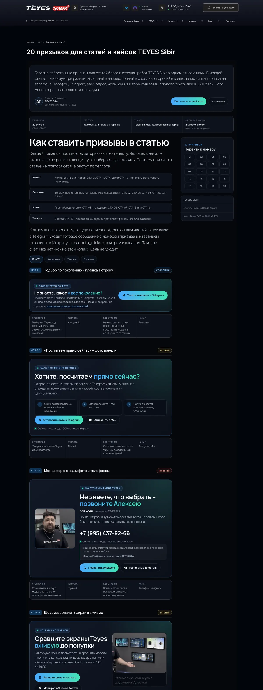

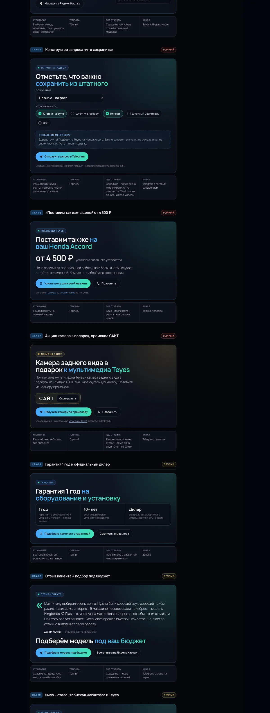

| № | Призыв | Аудитория | Теплота | Где ставить | Канал |
|---|---|---|---|---|---|
| CTA-01 | Подбор по поколению – плашка в строку | Выбирает Teyes под свою машину, но не знает поколение, рамку и комплект | холодный | Начало статьи, сразу после вступления. Подставить модель и ссылку на её страницу | Telegram |
| CTA-02 | «Посчитаем прямо сейчас» – фото панели | Уже решил ставить Teyes и выбирает, где | тёплый | Середина статьи – после таблицы поколений или списка моделей | Telegram, Max |
| CTA-03 | Менеджер с живым фото и телефоном | Сомневается, какую модель взять, хочет поговорить с человеком | горячий | Конец статьи перед вопросами; в кейсе – после результата | Телефон, Telegram |
| CTA-04 | Шоурум: сравнить экраны вживую | Выбирает между моделями, хочет увидеть экран до покупки | тёплый | Середина или конец статей-сравнений моделей | Заявка, Яндекс Карты |
| CTA-05 | Конструктор запроса «что сохранить» | Решил брать Teyes, боится потерять кнопки руля, камеру, климат | горячий | Середина – после блока «что сохранится из штатного». Свой список поколений под модель | Telegram с готовым сообщением |
| CTA-06 | «Поставим так же» с ценой от 4 500 ₽ | Увидел работу на похожей машине | горячий | Кейс – после фото и результата; рядом с ценой | Заявка, телефон |
| CTA-07 | Акция: камера в подарок, промокод САЙТ | Решил брать, выбирает, где выгоднее | горячий | Рядом с ценой, конец статьи. Только пока акция стоит на сайте | Telegram, телефон |
| CTA-08 | Гарантия 1 год и официальный дилер | Боится за качество установки и за штатное | тёплый | После блока о рисках или «что сохранится» | Заявка |
| CTA-09 | Отзыв клиента + подбор под бюджет | Сравнивает цены, хочет недорого и без ошибки | тёплый | Середина – после сравнения моделей | Telegram, отзывы на картах |
| CTA-10 | Было – стало: японская магнитола и Teyes | Владелец праворульного японца со штатной японской магнитолой | тёплый | Статьи про японские авто, середина | Telegram |
| CTA-11 | Русификация или замена – плашка | Хочет перевести японскую магнитолу на русский (вход через русификацию) | холодный | Начало статей про русификацию; блок «из Японии» в статьях моделей | Telegram |
| CTA-12 | Русификация китайского автомобиля | Владелец китайской машины со штатной мультимедиа на китайском | холодный | Статьи про китайские авто, начало или середина | Telegram |
| CTA-13 | Комплекты для автосервисов | Партнёр, установщик, малый опт | холодный | Конец статьи, страница комплектов, кейсы с редкой рамкой | Телефон, Telegram |
| CTA-14 | Магнитола в подарок – плашка | Покупает в подарок мужу, отцу, к празднику | холодный | Сезонные статьи (Новый год, 23 февраля), конец | Telegram |
| CTA-15 | Оплата частями | Решил брать, но упирается в бюджет | горячий | Рядом с ценой, после цен в каталоге или статье | Заявка, каталог |
| CTA-16 | Адрес и карта «Приезжайте» | Готов ехать, ищет адрес и часы | горячий | Конец статьи и кейса, вместо общего блока контактов | Яндекс Карты, 2ГИС, телефон |
| CTA-17 | Все каналы плитками | Хочет связаться, но не звонить | тёплый | Конец статьи, страница «Контакты» | Telegram, Max, телефон, заявка |
| CTA-18 | Выездная установка – плашка | Занят или далеко от Сухарной | тёплый | Конец статьи или кейса, страницы установки | Телефон |
| CTA-19 | Сигнализация в тот же визит | Уже ставит Teyes; зимой – допродажа автозапуска | тёплый | Конец статьи про магнитолу, кейсы с ноября по март | Заявка, страница сигнализаций |
| CTA-20 | Липкая полоса на телефоне | Все, кто дочитал первый экран | горячий | Низ экрана на телефоне после 500 px прокрутки, на всех статьях и кейсах; прячется у финального блока | Telegram, телефон |

- Телефон, Telegram, Max, адрес, часы, акция «камера в подарок / −1 000 ₽ по промокоду САЙТ», гарантия 1 год и «установка от 4 500 ₽» взяты с живого сайта 17.11.2026. WhatsApp на сайте нет – не ставил. Срока ответа «за N минут» на сайте нет – не обещал.
- Проверено программой: на телефоне ни один блок не выходит за экран, пустых ссылок нет (74 ссылки), картинки загружаются.

#### Что нужно от тебя по призывам

1. **Фото менеджера (CTA-03):** стоит настоящее фото из Case Studio – человек в футболке TEYES SIBIR у стены шоурума, подписан «Алексей, менеджер». Подтверди, что это Алексей, или дай другое фото.
2. **Партнёры и опт (CTA-13):** условий на сайте нет – призыв без обещаний. Есть условия – скажи.
3. **Подарок (CTA-14):** подарочного сертификата на сайте нет – призыв ведёт только на подбор.
4. Какие из 20 оставляем – после этого закрепим правило для статей и кейсов.


---

## 4. ВК – пост-кейс BMW X5

**[Открыть как на площадке →](vid/vk/)**

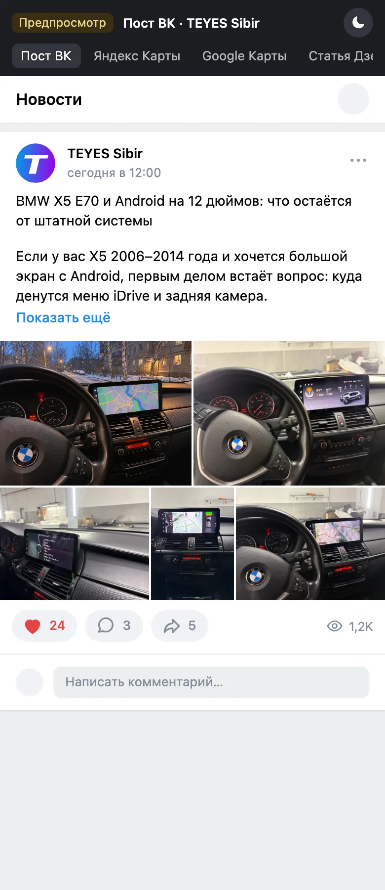

#### Пост ВК: варианты картинок (вторая итерация)

##### Картинка 1 – штатная система, вариант 1-б с реальной погодой Новосибирска

Погода 17.11.2026 около 12:45 НСК: −2 °C, пасмурно, сухо, снега нет (wttr.in, Open-Meteo, METAR Толмачёво). На картинках двор без снега, на приборке −2,0 °C, штатный экран BMW в нише.

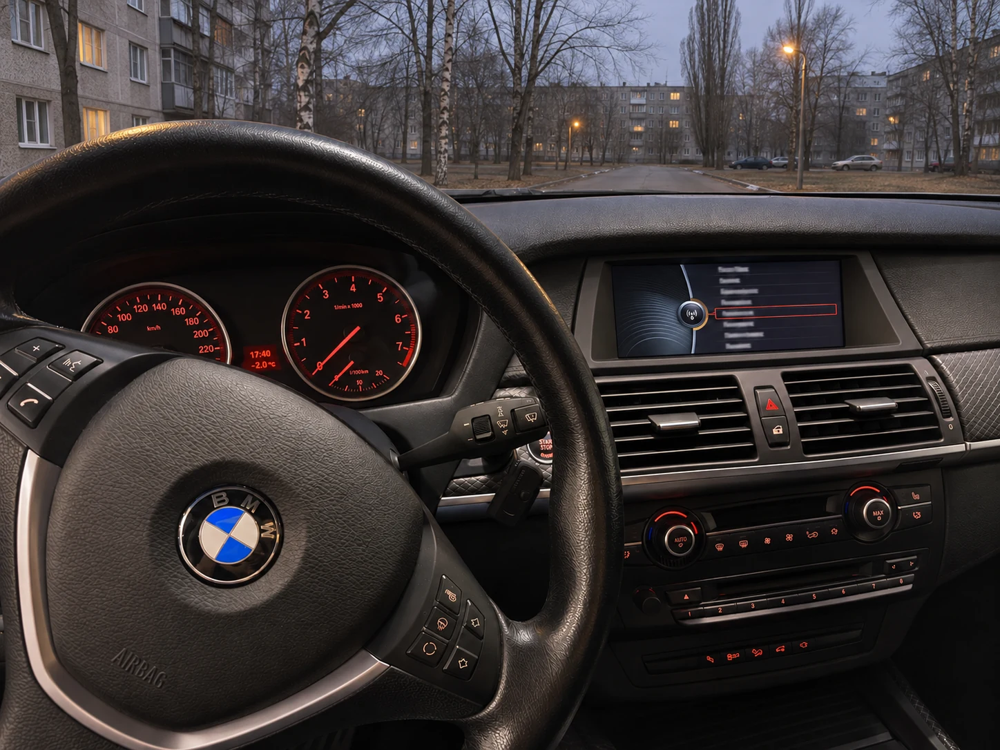
**1-НСК-а** – сумерки, 17:40, фонари.

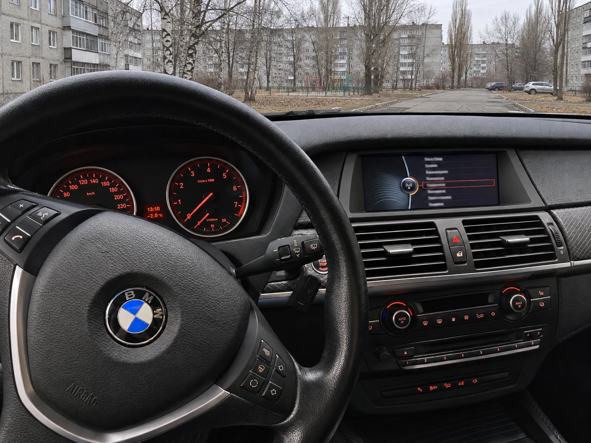
**1-НСК-б** – пасмурный день, 13:10.

##### Картинка 2 – экран под вопросом, 8 разных вариантов

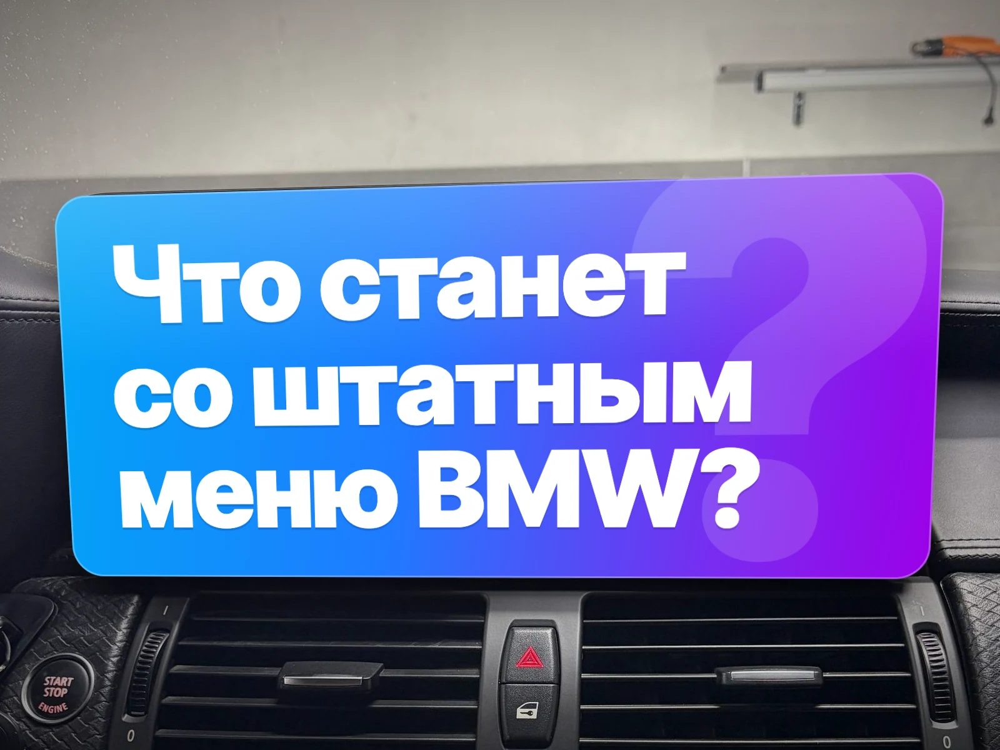
**А** – сильная: яркая плашка TEYES во всю ширину экрана.

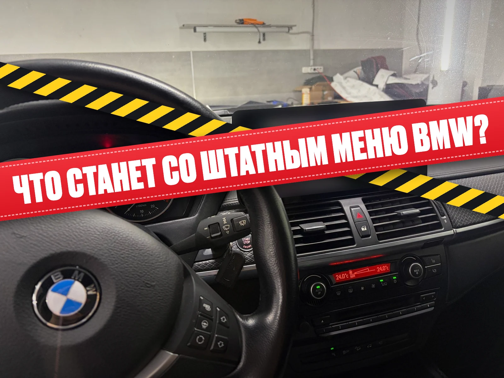
**Б** – сильная: красная лента наискось, как пломба.

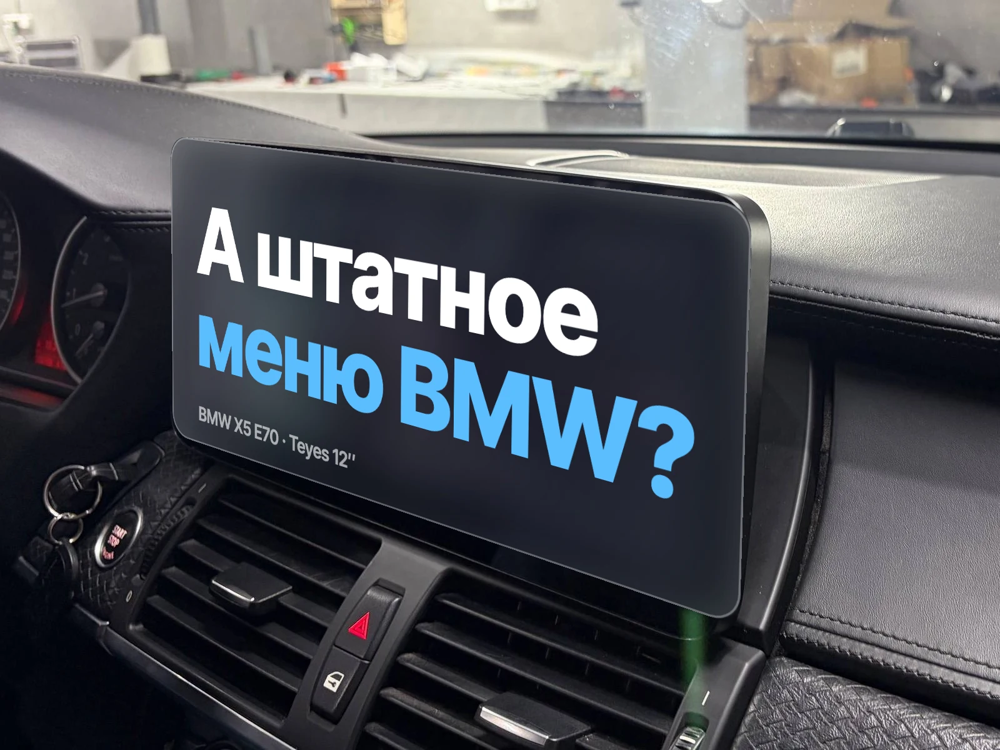
**В** – чисто закрывает мультимедиа: экран «зашторен» по контуру, короткий текст «А штатное меню BMW?».

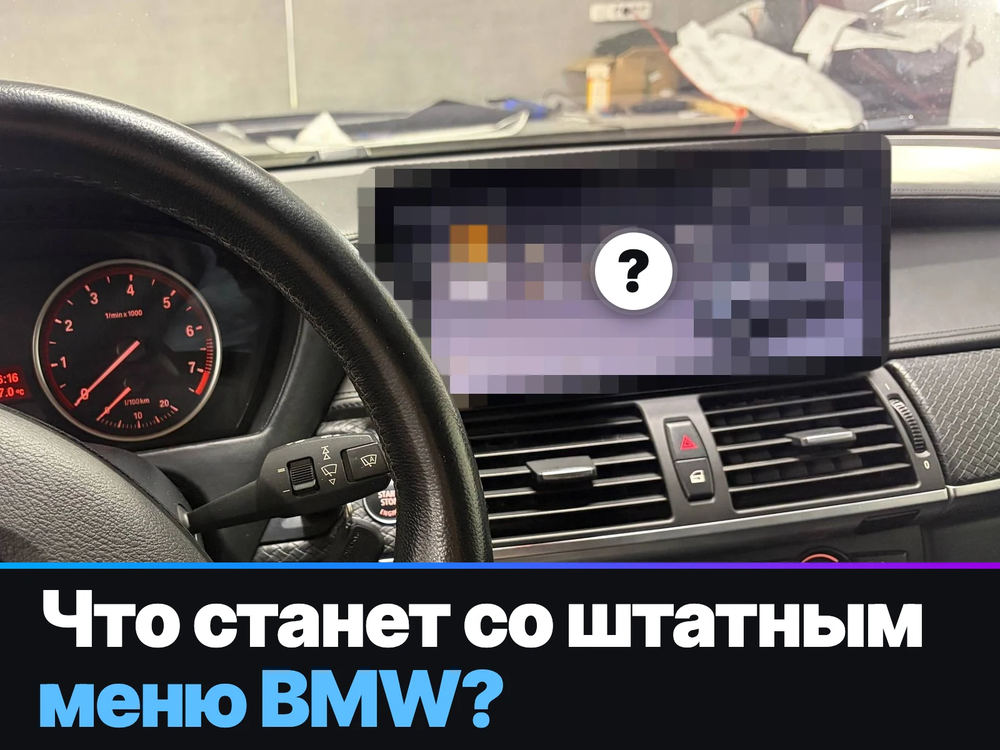
**Г** – чисто закрывает: экран в пикселях, вопрос – полосой под кадром.

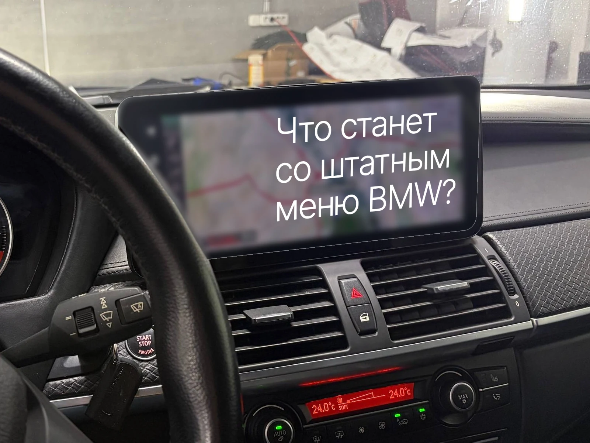
**Д** – слабая: полупрозрачное стекло, тонкий текст, экран угадывается.

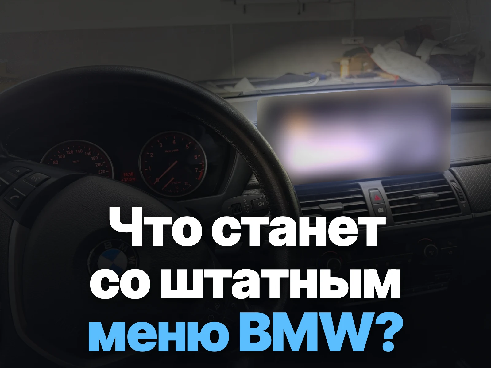
**Е** – без плашки: крупный текст поверх затемнённого кадра, экран размыт.

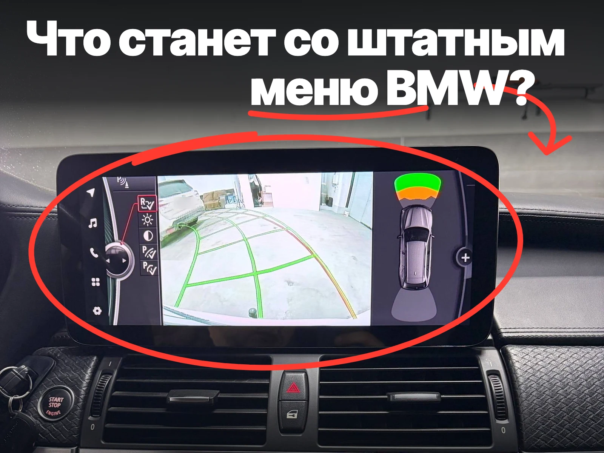
**Ж** – без плашки: текст сверху, обводка маркером. Экран здесь НЕ закрыт – ответ виден сразу; это вариант-«ответ», а не интрига.

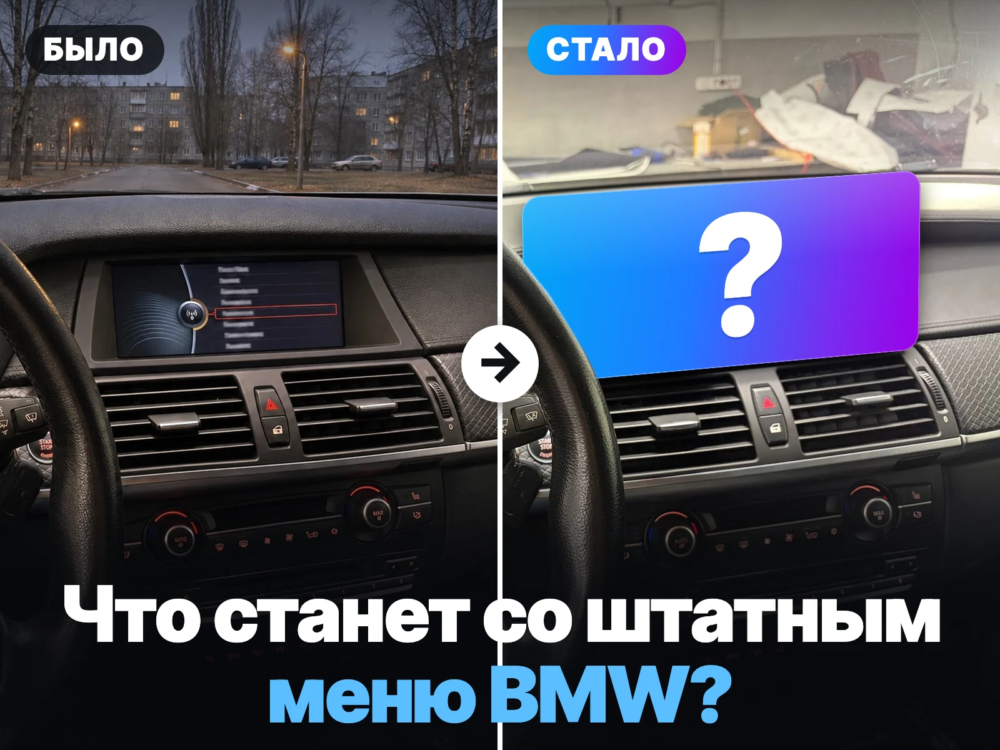
**З** – «было → стало?»: слева штатный экран, справа закрытый Teyes.

- Моё мнение: сильнее всего В (выглядит как настоящая шторка на экране, текст самый крупный) и З (сразу рассказывает историю «было – стало»). В макете ленты ВК сейчас стоят 1-НСК-а + В.
- Тексты рисует скрипт, не нейросеть. Картинки 1 сгенерированы от реальных кадров этой машины – реши, подписывать ли это в посте.

Прошлая итерация (4 «штатных» и 6 плашек) лежит в папке vk-varianty: 1-shtatnaya-a…d, 2-plashka-a…f.


#### Текст поста


**Картинки в порядке карусели:**
1.  – сгенерирована от реального кадра работы
2. 
3. 
4. 
5. 

**Текст:**

> BMW X5 E70 и Android на 12 дюймов: что остаётся от штатной системы
>
> Если у вас X5 2006–2014 года и хочется большой экран с Android, первым делом встаёт вопрос: куда денутся меню iDrive и задняя камера.
>
> В начале ноября такой X5 2011 года был у нас. Мастера поставили Teyes CC3 с экраном 12 дюймов наверху торпедо, над дефлекторами, а микрофон громкой связи – в штатное место. Блок климата и кнопки под экраном остались как были.
>
> Что теперь у владельца на одном экране:
> – рабочий стол Teyes на Android;
> – штатное меню iDrive на русском: радио, телефон, навигация, настройки;
> – карта BMW на всю ширину;
> – задняя камера с линиями траектории и схемой парктроника.
>
> Для X5 E70 комплекты Teyes делают под штатную систему CCC и под CIC. Хотите так же – напишите в сообщения сообщества год машины и пришлите фото штатного экрана с главным меню. По фото определим систему и подберём комплект.
>
> Магнитолы Teyes для BMW: https://teyes-sibir.ru/store/catalog/bmw?utm_source=vk&utm_medium=social&utm_campaign=keys&utm_content=360_bmw_x5
>
> TEYES Sibir, Новосибирск, Сухарная, 35 к13

**Почему так.** Пост начинается с ситуации читателя с таким же X5, а не с рассказа о себе; обещания – только то, что видно на фото. Следующий шаг один – сообщение в сообщество с фото экрана: без этого фото комплект не подобрать. Ссылка ведёт в каталог BMW, потому что страницы кейса ещё нет: когда кейс выйдет, адрес заменить на него, метку оставить.

**Картинка.** Codex imagegen (модель Sol, бесплатно) с первой попытки сделал её от реального кадра с картой (`telegram_3135`): тот же руль, приборка, экран и климат, за стеклом зимний вечерний двор. На картинке нет текста и людей, номера у дальних машин не читаются. Я посмотрел её глазами. Исходник лежит в `~/.cache/teyes-keys/gen/`.


---

## 5. Яндекс Карты – новость

**[Открыть как на площадке →](vid/yandex-karty/)**

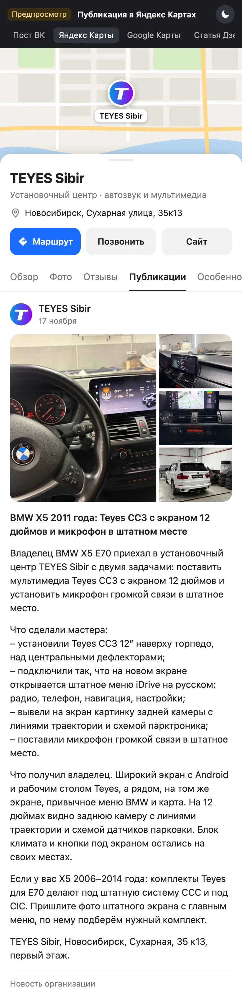


**Фото (4):** keys/bmw-x5-e70-teyes-cc3-salon.webp, keys/bmw-x5-e70-teyes-cc3-menyu-idrive.webp, keys/bmw-x5-e70-teyes-cc3-kamera-zadnego-vida.webp, keys/bmw-x5-e70-teyes-sibir-vid-szadi.webp

**Текст (1 115 знаков):**

> BMW X5 2011 года: Teyes CC3 с экраном 12 дюймов и микрофон в штатном месте
>
> Владелец BMW X5 E70 приехал в установочный центр TEYES Sibir с двумя задачами: поставить мультимедиа Teyes CC3 с экраном 12 дюймов и установить микрофон громкой связи в штатное место.
>
> Что сделали мастера:
> – установили Teyes CC3 12″ наверху торпедо, над центральными дефлекторами;
> – подключили так, что на новом экране открывается штатное меню iDrive на русском: радио, телефон, навигация, настройки;
> – вывели на экран картинку задней камеры с линиями траектории и схемой парктроника;
> – поставили микрофон громкой связи в штатное место.
>
> Что получил владелец. Широкий экран с Android и рабочим столом Teyes, а рядом, на том же экране, привычное меню BMW и карта. На 12 дюймах видно заднюю камеру с линиями траектории и схемой датчиков парковки. Блок климата и кнопки под экраном остались на своих местах.
>
> Если у вас X5 2006–2014 года: комплекты Teyes для E70 делают под штатную систему CCC и под CIC. Пришлите фото штатного экрана с главным меню, по нему подберём нужный комплект.
>
> TEYES Sibir, Новосибирск, Сухарная, 35 к13, первый этаж.

**Почему так.** Около 1 100 знаков – в коридоре 500–1 000 из скилла с небольшим запасом, на телефоне читается без «ещё». Четвёртым фото поставил машину в нашем цехе: карточке на Картах нужна привязка к месту. Телефона, ссылок, слов капсом от 6 букв, «до/после» и длинного тире нет – проверил кодом по запретам скилла yandex-karty-novosti.


---

## 6. Google Карты – новость

**[Открыть как на площадке →](vid/google-karty/)**

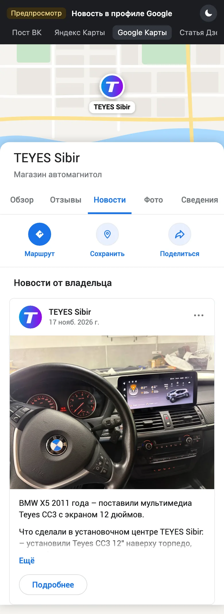


**Фото:** keys/bmw-x5-e70-teyes-cc3-salon.webp (для окна Google – JPEG той же картинки, `~/.cache/teyes-keys/google-foto.jpg`)
**Кнопка:** «Подробнее» → `https://teyes-sibir.ru/store/catalog/bmw?utm_source=google_maps&utm_medium=organic&utm_campaign=gbp_news&utm_content=360_bmw_x5`

**Текст (642 знака):**

> BMW X5 2011 года – поставили мультимедиа Teyes CC3 с экраном 12 дюймов.
>
> Что сделали в установочном центре TEYES Sibir:
> – установили Teyes CC3 12″ наверху торпедо, над дефлекторами;
> – микрофон громкой связи поставили в штатное место;
> – вывели на новый экран штатное меню iDrive и картинку задней камеры с парктроником.
>
> Блок климата и кнопки под экраном остались на своих местах. На одном экране теперь открываются и Android, и меню BMW.
>
> Комплекты Teyes для BMW X5 E70 делают под штатную систему CCC и под CIC, поэтому подбираем по фото штатного экрана. Приезжайте на Сухарную, 35 к13 в Новосибирске или смотрите магнитолы для BMW по кнопке.

**Почему так.** Порядок как у вышедшей новости про Duster: машина и год → что сделали списком → что получил → куда приехать или нажать. Размер экрана есть в записи мастера («12 дюймов»), поэтому его можно писать. Цены и сроков в тексте нет. Кнопка ведёт в каталог BMW, ближайшую живую страницу.

**Проверено:** `proverit(текст, google-foto.jpg, 'LEARN_MORE', ссылка)` вернул `[]`; ссылка кнопки отвечает 200.


---

## 7. Дзен – статья: лучшая магнитола для Honda Accord 7

**[Открыть статью как в Дзене →](vid/dzen-accord7/)** · **[Три обложки в ленте →](vid/dzen-accord7/lenta.html)**

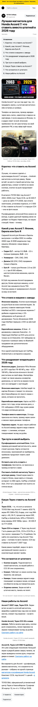

#### Статья Дзена: Лучшая магнитола для Honda Accord 7: что ставить вместо штатной в 2026 году

**Обложка выбрана Артёмом 17.11: вариант 2 – «2003 VS 2026».** Стоит в статье.


**Свёрстанный вид:** [статья в читалке Дзена](vid/dzen-accord7/index.html) · [карточка в ленте с тремя обложками](vid/dzen-accord7/lenta.html) · текст и источники – `dzen-accord7/statya.md`. Не опубликовано.

**Обложки** – генерация Codex (бесплатно), надписи рисует скрипт, номеров и лиц нет.

| Вариант 1 – салон ночью (основной) | Вариант 2 – 2003 VS 2026 | Вариант 3 – Accord 7 зимой |
|---|---|---|
| 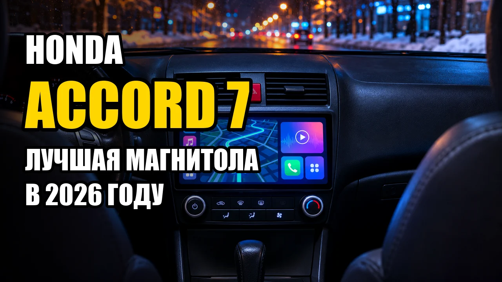 | 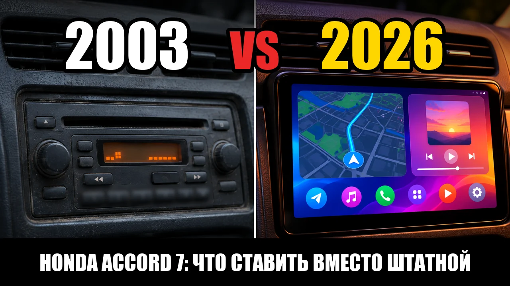 | 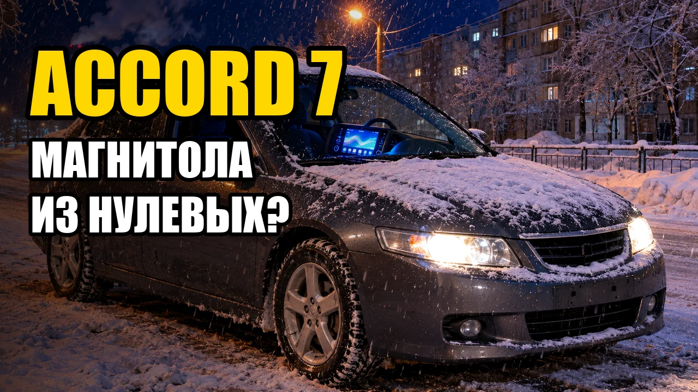 |

**Заголовки, из которых выбирал** (спрос – Wordstat через XMLRiver, Новосибирск / Россия, 17.11.2026)

| # | Заголовок | Под какой спрос |
|---|---|---|
| 1 ✓ | Лучшая магнитола для Honda Accord 7: что ставить вместо штатной в 2026 году | «магнитола аккорд 7» 70 / 1 578, «магнитола хонда аккорд 7» 27 / 1 025, «штатная магнитола аккорд 7» 25 / 298 |
| 2 | Honda Accord 7 из Японии: радио ловит не всё. Что ставить вместо штатной | японский FM 76–90 МГц; спрос на «радио» и «японец» по Accord 7 – 0 строк |
| 3 | Honda Accord 7: русифицировать японскую магнитолу или менять на Android? | формат Wildlander (37% дочитали), но «аккорд 7 русификация» – 0 строк |
| 4 | Accord 7 – легенда, а магнитола в нём из нулевых | ловит «хонда аккорд 7» 2 946 / 54 888 (вся аудитория модели), но слова «магнитола» в поиске нет |

**Почему так.** Заголовок держит запрос «магнитола аккорд 7» и формат канала «лучшая магнитола для <модель>» («Лучшая Android-магнитола для Toyota Corolla Cross» – 6 513 показов, 27 переходов на сайт, студия 05.11.2026), а хук несут обложки: Дзен показывает карточку картинкой, поиск ловит слова. Структуру взял у двух лучших статей канала – RAV4 (24 762 показа, 43 перехода) и Wildlander (37% дочитали): сцена в 2 строки, сразу ответ, поколения и рынки, что болит, что сохранится, работы и ссылки. По блогу сайта статья не повторяется: там все поколения, здесь только Accord 7 – комплектации Японии и Европы, японское радио, три пути. Спрос в сырье – `dzen-accord7/ws-raw/` (40 запросов ≈ 1 ₽).

**Что проверить Артёму**
1. Обложки нарисованы нейросетью, а правило агента Дзена (06.11) говорит: машину и панель с нашей работой генерировать нельзя, только сцену. Ты в задании просил генерацию – в тексте фото только настоящие (работа №279 и CC3 2K), обложка не выдаёт себя за нашу работу. Выбери вариант или скажи «на обложку реальное фото».
2. Цена: CC3L под Accord 7 – 30 400 ₽ «со скидкой за наличный расчёт», установка от 3 500 ₽ (сайт, 17.11.2026). Других комплектов под Accord 7 с ценой в каталоге нет; CC4, которую мы ставили, без цены – в статье «считаем по фото панели». Добавить CC4 под Accord 7 в каталог?
3. Работа №279 (CC4 на Accord 7 2007) на сайте не опубликована – ссылки на неё нет, только фото. На странице CC3 2K поколение не названо; по панели (аварийка между дефлекторами, климат с двумя ручками) похоже на Accord 7 – если так, подпиши на сайте, и в статье напишем «Accord 7».
4. «Лучшая» в заголовке – о магнитоле для модели, формат канала, а не превосходство компании; красный список по статье чистый. Публикует только Артём.


---

## 8. Дзен – карусель «−30, 7:40. А она молчит»

**[Открыть как на площадке →](vid/dzen-karusel/)**

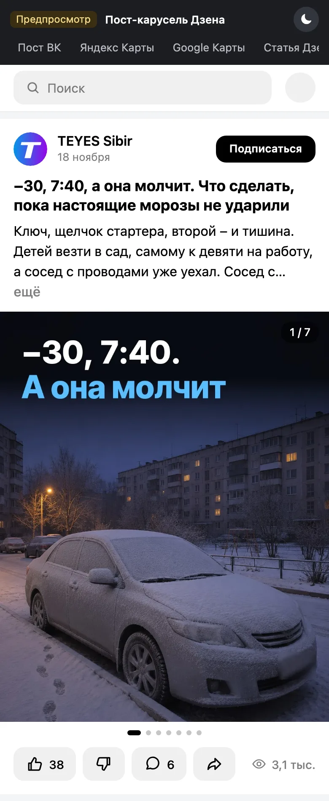

#### Карусель Дзена: «−30, а она молчит» – автозапуск до морозов

Пост-карусель для канала dzen.ru/teyes_sibir, 7 карточек 1080×1350 (4:5) WebP, ссылка в тексте ведёт на страницу установки сигнализации. Не опубликовано. По плану – ср 18.11.2026.

##### Карточки по порядку

1. Обложка – ситуация: «−30, 7:40. А она молчит»


2. Боль: «Ключ, щелчок – и тишина»


3. Объяснение одним слайдом: почему мороз глушит машину

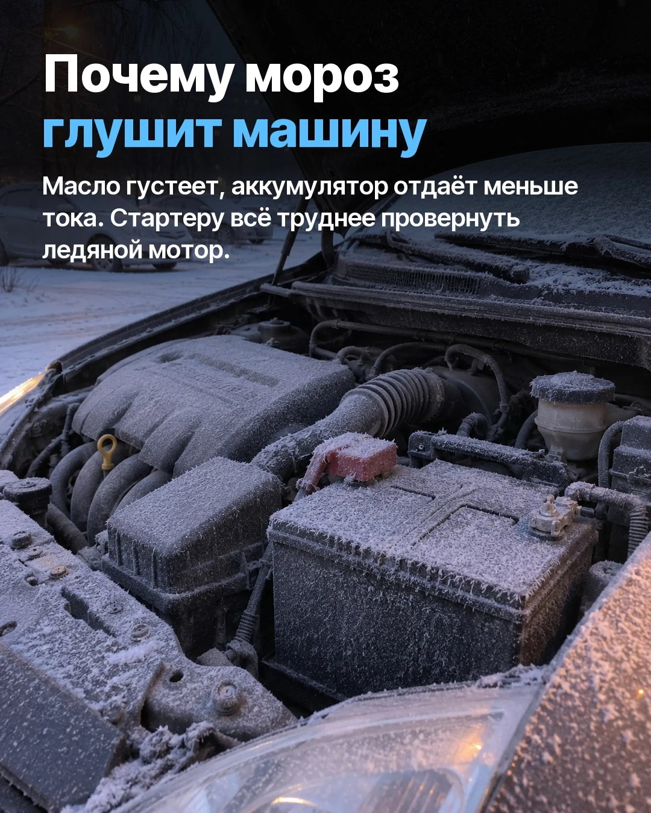

4. Что будет, если не решить: провода, такси, «буду позже»


5. Как решаем – товар прямо: сигнализация с автозапуском

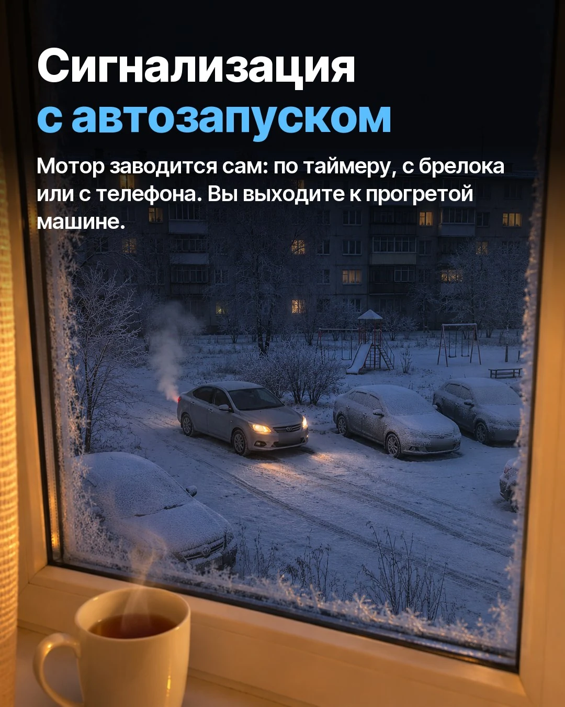

6. Цена и наша работа: StarLine и Pandora, установка от 12 000 ₽, StarLine S96 v2 на Toyota Raize


7. Призыв: «Поставьте до −30»

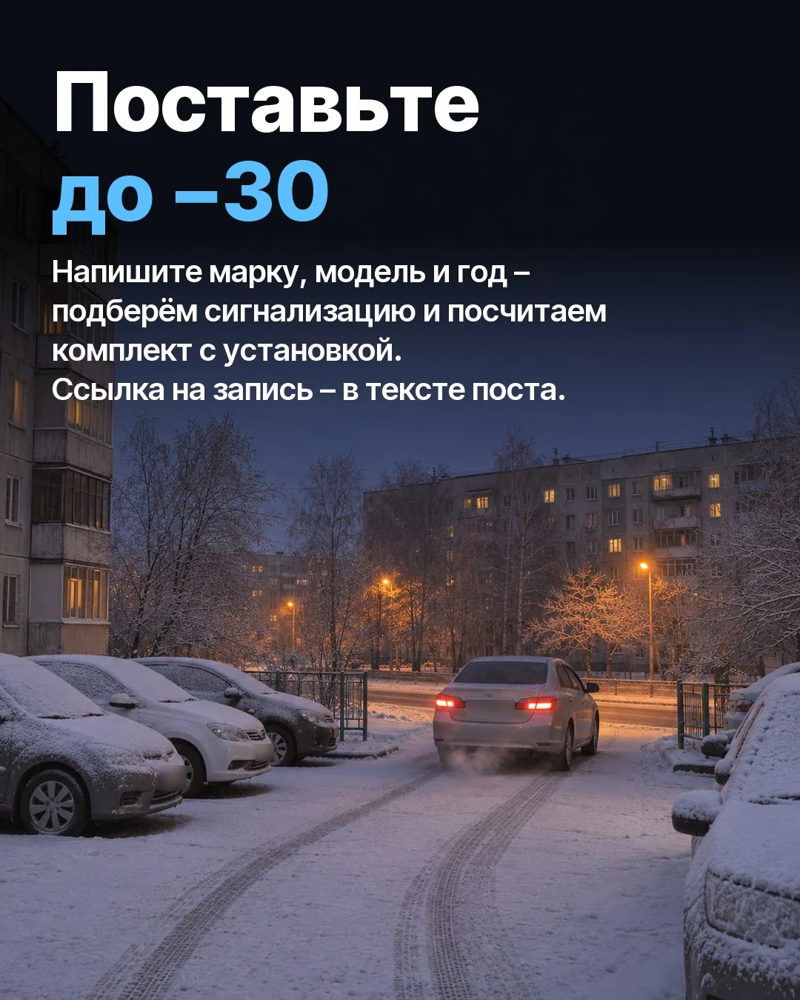

JPG-копии тех же карточек лежат в `karusel/jpg/` – на случай, если загрузчик Дзена не примет WebP: в справке форматы не названы.

##### Первая строка (она же заголовок поста)

**−30, 7:40, а она молчит. Что сделать, пока настоящие морозы не ударили**

##### Текст поста целиком (2102 знаков из 4 096)

> −30, 7:40, а она молчит. Что сделать, пока настоящие морозы не ударили
>
> Ключ, щелчок стартера, второй – и тишина. Детей везти в сад, самому к девяти на работу, а сосед с проводами уже уехал. Сосед с проводами – лучший друг в декабре, но дружить с ним каждое утро до марта не хочется.
>
> Почему так. На морозе масло густеет, а аккумулятор отдаёт меньше тока. Стартеру всё труднее провернуть ледяной мотор. Чем дольше машина стоит во дворе на холоде, тем тяжелее ей утром.
>
> Что проверить до морозов:
> 1. Аккумулятор. Попросите в сервисе проверить его под нагрузкой: напряжение «на глаз» ничего не скажет.
> 2. Клеммы. Окислы и слабый контакт съедают ток, которого на морозе и так мало.
> 3. Масло. Первое число в маркировке (0W, 5W) – про холодный пуск: чем оно меньше, тем жиже масло на морозе.
> 4. Незамерзайка и щётки. Залить зимнюю жидкость до первых −20, а не в день, когда стекло уже замёрзло.
> 5. Автозапуск. Если машина ночует во дворе, а не в тёплом гараже, это главный пункт списка.
>
> Как работает автозапуск. Сигнализация сама заводит мотор: по таймеру, с брелока или с телефона. Вы допиваете чай, смотрите в окно – машина уже работает. Выходите к прогретому мотору и тёплому салону, а не скребёте лёд в ледяной машине. Можно добавить подогрев водительского сиденья и блокировку руля.
>
> Кому это нужно:
> – тем, кто утром везёт детей и не может опоздать;
> – тем, кто бережёт мотор и не хочет трогаться на ледяном;
> – тем, кому надоело 15 минут сидеть в холодном салоне, пока оттает стекло.
>
> Что у нас. TEYES Sibir в Новосибирске ставит сигнализации StarLine и Pandora с автозапуском. Подбор оборудования – бесплатно, монтаж скрытый, без следов, гарантия 12 месяцев на установку. Установка сигнализации с автозапуском – от 12 000 ₽, работа – 4–6 часов. Точную цену комплекта «сигнализация + установка» посчитаем под вашу машину и бюджет.
>
> На карусели – наша работа: StarLine S96 v2 на Toyota Raize.
>
> Посчитать комплект и записаться – [на странице установки сигнализации](https://teyes-sibir.ru/services/alarm_installation?utm_source=dzen&utm_medium=post&utm_campaign=moroz_avtozapusk). Напишите марку, модель и год – подберём, что поставить, пока не ударило −30.
>
> TEYES Sibir: Новосибирск, Сухарная 35 к13, пн–пт 11:00–19:00.

##### Ссылка

Одна, встроенная: выделить слова «на странице установки сигнализации» и вставить адрес. На карточках ссылок нет.

`https://teyes-sibir.ru/services/alarm_installation?utm_source=dzen&utm_medium=post&utm_campaign=moroz_avtozapusk`

Адрес отвечает 200 (проверено curl 17.11.2026).

##### Почему так

- **Спрос:** «не заводится машина» – 2 049 в месяц по Новосибирску и 132 887 по России; «сигнализация с автозапуском» – 2 507 / 115 287 (Wordstat через XMLRiver, 17.11.2026, план `teyes-posting-363c9fe4/dannye/dzen.md`). Тема из широкого спроса, товар появляется на 5-й карточке.
- **Факты только с живой страницы** teyes-sibir.ru/services/alarm_installation (снята 17.11.2026): StarLine и Pandora, автозапуск по таймеру, управление со смартфона, бесплатный подбор, монтаж без следов, гарантия 12 месяцев на установку, 4–6 часов работы, опции подогрев сиденья и блокировка руля, «Сигнализация с автозапуском – от 12 000 руб» в таблице «Стоимость установки сигнализации».
- **Картинки:** 6 сцен нарисовал Codex imagegen (бесплатно) – двор Новосибирска в ноябре, тонкий снег и иней, как в прогнозе на 18.11 (−6…+2, пасмурно, open-meteo); машины массовые, не Lada, без лиц; номера размыты по рамке. Карточка 6 – реальное фото работы с сайта (Toyota Raize, StarLine S96 v2, табличка TEYES SIBIR вместо номера). Текст на карточках рисует скрипт `redakciya/scripts/karusel.py`, не нейросеть. Формат 4:5 – справка Дзена размер не задаёт (до 10 картинок, до 30 МБ, первая – обложка, кадрирование в редакторе).

##### Что проверить Артёму

1. **Цена.** На странице две цены автозапуска: в таблице «Стоимость установки» – от 12 000 руб, во вкладках «Сигнализации с автозапуском» – от 9 000 р, а в копии вкладок для телефона – от 1 500 р (похоже на ошибку копирования). В карусели и посте – 12 000 ₽. Какая верная? 1 500 на сайте стоит поправить.
2. **Фото Raize:** это наша работа и на ней стоял автозапуск? Подпись «наша работа: StarLine S96 v2 на Toyota Raize».
3. **Метка:** по правилу «скрытая UTM» для чужой площадки чище адрес `/go/dzen-moroz/` с 301 на страницу с меткой – если Тильда даст сделать редирект. Сейчас метка в адресе, но в посте адрес спрятан под словами, читатель его не видит.
4. **Выкладка:** публикуете вы; первый пост канала – заодно тест, кликается ли встроенная ссылка в ленте и доходит ли метка до Метрики (считать по utm_campaign=moroz_avtozapusk и рефереру dzen.ru).


---

## 9. ВК – 10 постов по следующим кейсам (№231–240), по 3 обложки

**[Открыть 10 постов лентой ВК →](vk-posty/)**

Последний кейс в ВК – УАЗ Профи (23.10) = работа №230, поэтому взяты №231–240 подряд. У каждого поста три обложки: 1 – карточка в твоём формате, 2 – живая ситуация, 3 – машина в нашем сервисе.

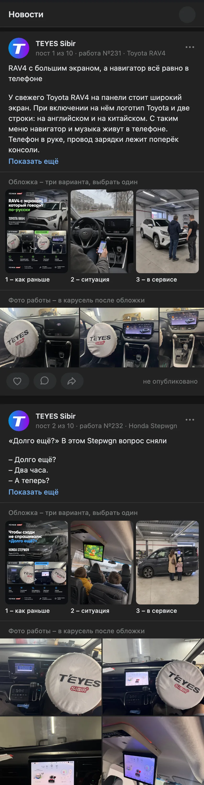

#### 10 постов ВК: следующие кейсы

Последний пост в сообществе – УАЗ Профи (23.10), это работа №230; перед ним Honda Fit – №229. Посты идут по порядку номеров, поэтому взяты следующие десять: №231–240. Ничего не опубликовано.

Смотреть лентой: [vk-posty/index.html](vk-posty/index.html)

| № поста | Работа | Машина | Что сделали | Заголовок поста |
|---|---|---|---|---|
| 1 | №231 | Toyota RAV4 | Teyes LUXONE вместо штатного экрана | RAV4 с большим экраном, а навигатор всё равно в телефоне |
| 2 | №232 | Honda Stepwgn | Teyes CC4 Pro и подключение потолочного монитора | «Долго ещё?» В этом Stepwgn вопрос сняли |
| 3 | №233 | Honda WR-V | Teyes CC3L | Honda WR-V: навигатор переехал из подстаканника на панель |
| 4 | №234 | Honda CR-V | Teyes CC2 Plus, штатные функции сохранены | Honda CR-V: поставили Teyes, штатное осталось на месте |
| 5 | №235 | Honda Freed | Teyes CC4 и видеорегистратор | Спор на перекрёстке: прав тот, у кого запись |
| 6 | №236 | Toyota Wish | Teyes CC4 и StarLine S96 GSM GPS | Мороз за окном. Машина уже греется, а вы ещё с кофе |
| 7 | №237 | Hyundai H-1 | Teyes CC4 | Hyundai H-1: задний ход без «выйди, посмотри» |
| 8 | №238 | Hyundai Solaris | Teyes CC3 2K, экран 11 дюймов | Solaris: три признака, что магнитолу пора менять |
| 9 | №239 | Toyota Highlander | Teyes CC4 Pro, цифровой регистратор, камера заднего вида, парктроники на 8 датчиков, цифровой микрофон | Toyota Highlander: во двор – по приборам |
| 10 | №240 | Suzuki Jimny | Teyes CC4, динамики в передние двери, камеры спереди и сзади, регистратор, микрофон, розетка-прикуриватель | Suzuki Jimny: чтобы музыку было слышно и на трассе |

##### Пост 1. Toyota RAV4 (работа №231)

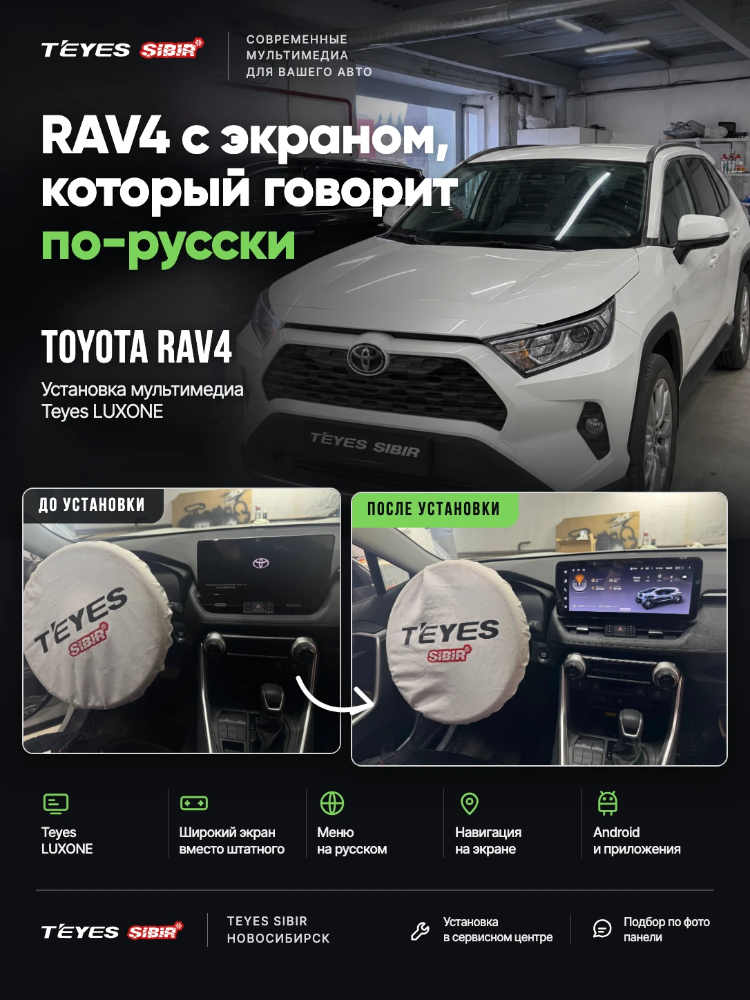
**1 – как раньше**

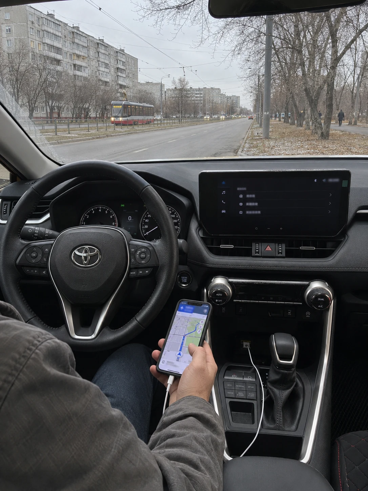
**2 – ситуация**

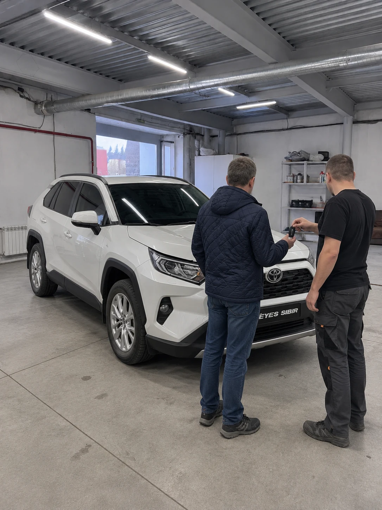
**3 – в сервисе**

**RAV4 с большим экраном, а навигатор всё равно в телефоне**

У свежего Toyota RAV4 на панели стоит широкий экран. При включении на нём логотип Toyota и две строки: на английском и на китайском. С таким меню навигатор и музыка живут в телефоне. Телефон в руке, провод зарядки лежит поперёк консоли.

С этим RAV4 сделали так: сняли заводской экран и на его место поставили Teyes LUXONE. Он встал туда же, над дефлекторами. Климат, кнопки и селектор под ним остались как были.

Что теперь на экране:
– меню на русском;
– компас, скорость и время поездки на главном экране;
– навигация и музыка рядом, на одной широкой панели.

Телефон лежит в кармане.

Хотите так же на своём RAV4 – напишите в сообщения сообщества: vk.me/teyes.magnitola. Пришлите год машины и фото панели с включённым экраном. По фото подберём комплект под вашу комплектацию.

Магнитолы Teyes для Toyota: https://teyes-sibir.ru/store/catalog/toyota?utm_source=vk&utm_medium=social&utm_campaign=keys&utm_content=231_toyota_rav4

TEYES Sibir, Новосибирск, Сухарная, 35 к13

##### Пост 2. Honda Stepwgn (работа №232)

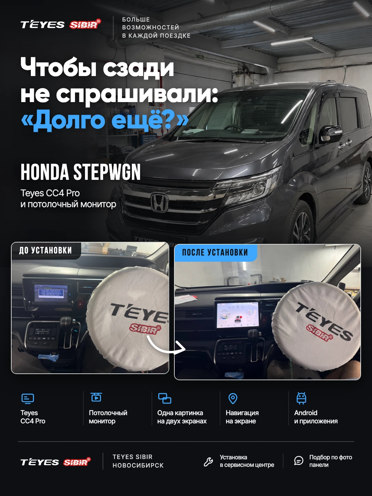
**1 – как раньше**

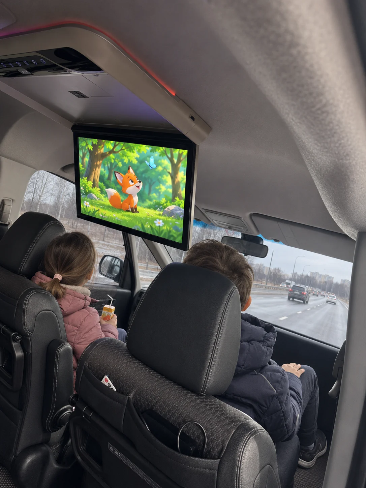
**2 – ситуация**

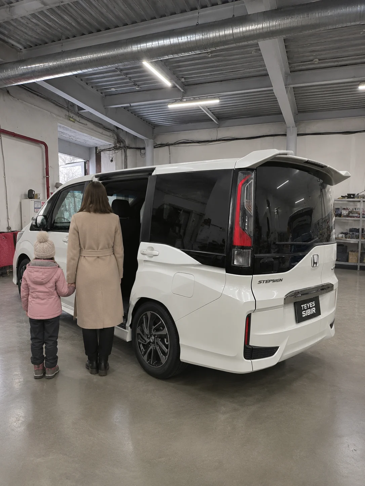
**3 – в сервисе**

**«Долго ещё?» В этом Stepwgn вопрос сняли**

– Долго ещё?
– Два часа.
– А теперь?

Кто возил детей дальше дачи, знает этот разговор наизусть. Один телефон на двоих спасает минут на двадцать. Потом начинается делёж.

Honda Stepwgn приехал к нам с потолочным монитором и японской магнитолой Gathers с меню на английском. Мастера поставили вместо неё Teyes CC4 Pro и подключили к ней потолочный монитор.

Теперь всё, что включено на переднем экране, идёт и на потолок. На последнем фото оба экрана показывают одну картинку. Включили мультфильм спереди – его смотрит весь салон.

А вы чем занимаете детей в дороге дольше часа?

Хотите так же в своём минивэне – напишите в сообщения сообщества: vk.me/teyes.magnitola. Нужны марка, модель, год и два фото: панель и потолочный монитор, если он уже стоит.

Потолочные мониторы, установка и подключение: https://teyes-sibir.ru/services/ceiling-monitors?utm_source=vk&utm_medium=social&utm_campaign=keys&utm_content=232_honda_stepwgn

TEYES Sibir, Новосибирск, Сухарная, 35 к13

##### Пост 3. Honda WR-V (работа №233)

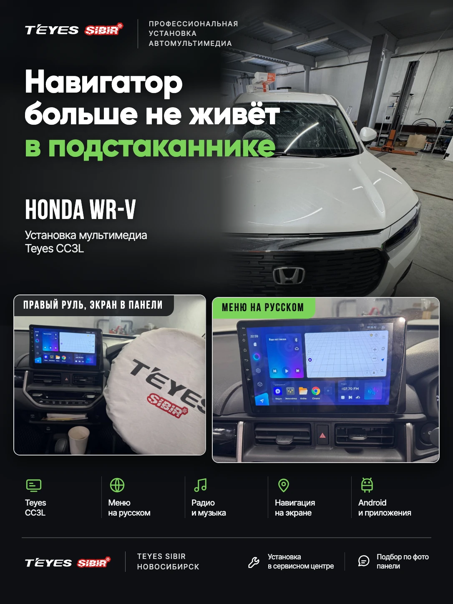
**1 – как раньше**

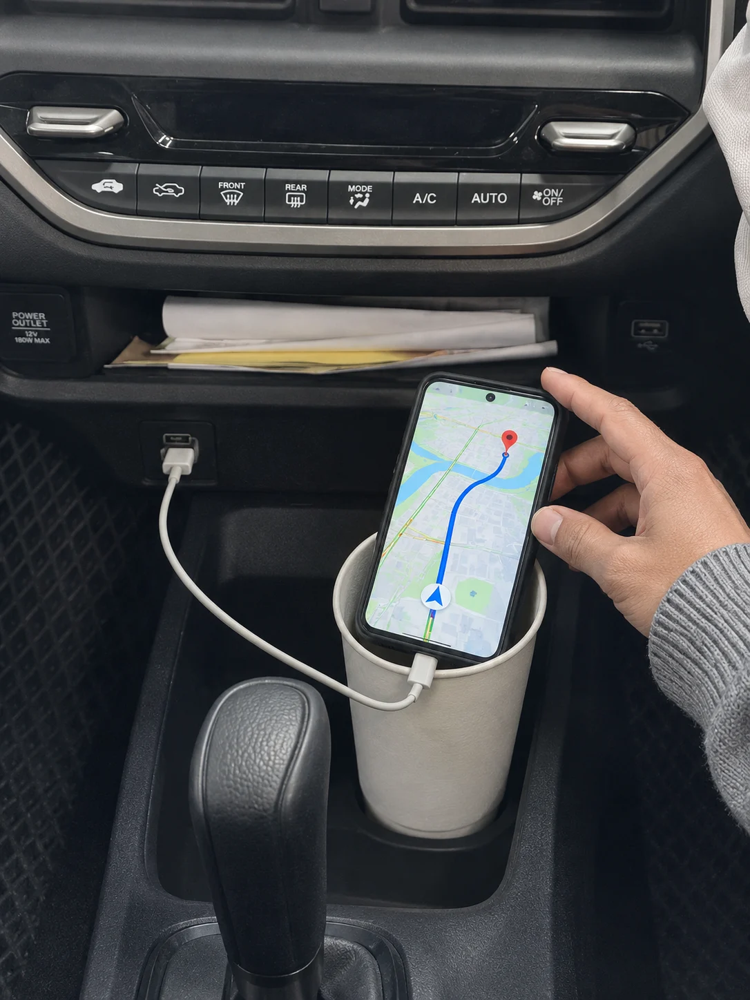
**2 – ситуация**

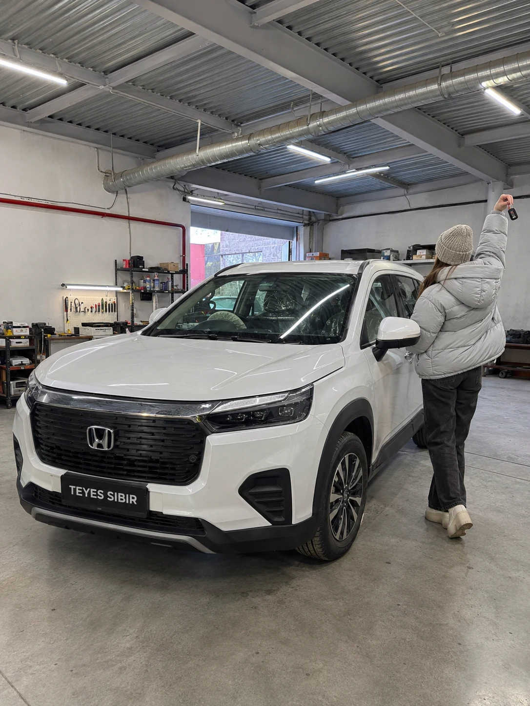
**3 – в сервисе**

**Honda WR-V: навигатор переехал из подстаканника на панель**

Знакомая картина: маршрут построен, телефон лежит в подстаканнике. Чтобы увидеть следующий поворот, надо опустить глаза ниже руля. На светофоре телефон съезжает набок, на лежачем полицейском падает экраном вниз.

На этой Honda WR-V с правым рулём вопрос закрыли одной установкой. В панель поставили Teyes CC3L. Экран стоит над дефлекторами, на уровне глаз.

Что видно на фото после установки:
– меню на русском;
– карта занимает половину главного экрана;
– рядом радио, музыка и приложения.

Подстаканник вернулся к прямой работе. На фото в нём стаканчик.

Хотите так же – напишите в сообщения сообщества: vk.me/teyes.magnitola. Пришлите марку, модель, год и фото панели. Для праворульных Honda скажите ещё, что стоит сейчас: штатная магнитола или заглушка.

Магнитолы Teyes для Honda: https://teyes-sibir.ru/store/catalog/honda?utm_source=vk&utm_medium=social&utm_campaign=keys&utm_content=233_honda_wr-v

TEYES Sibir, Новосибирск, Сухарная, 35 к13

##### Пост 4. Honda CR-V (работа №234)

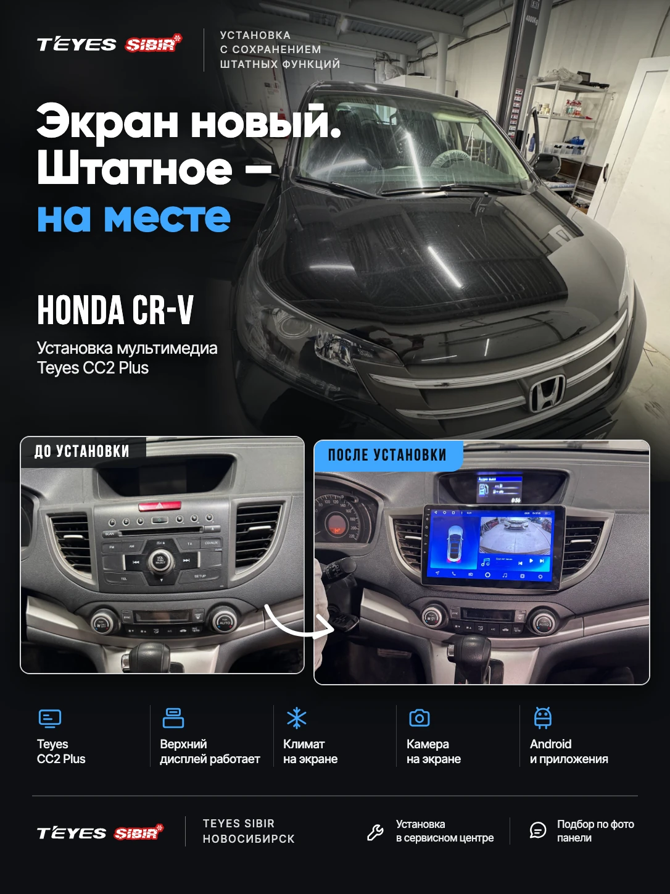
**1 – как раньше**

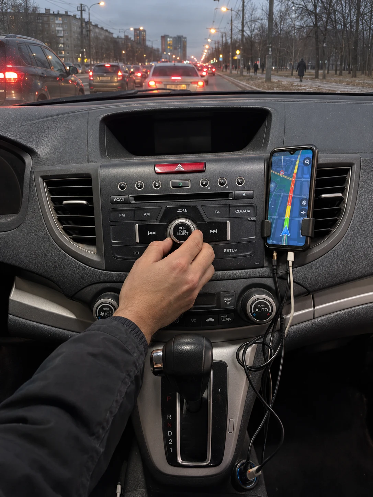
**2 – ситуация**

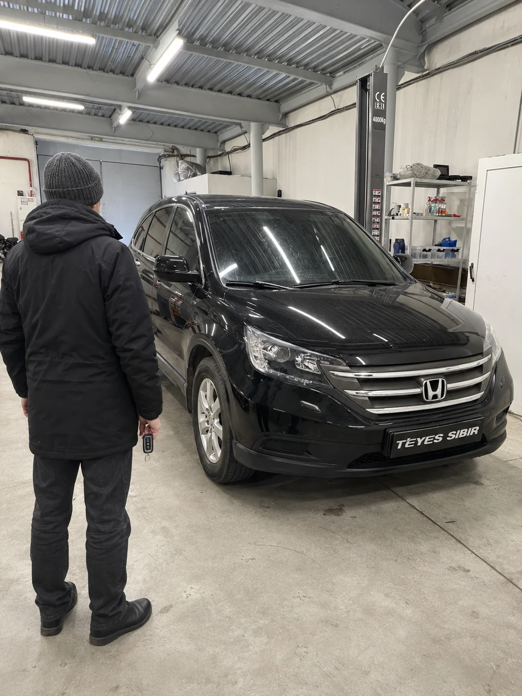
**3 – в сервисе**

**Honda CR-V: поставили Teyes, штатное осталось на месте**

«Поставлю большой экран – и отвалится верхний дисплей, камера, климат». С этой мыслью владельцы CR-V годами ездят с кнопочной магнитолой.

Эта CR-V приехала к нам именно такой: кнопки, ручка громкости, слот под диск. Мастера поставили Teyes CC2 Plus и сохранили штатные функции.

Что работает после установки, видно на фото:
– верхний дисплей в козырьке панели светится и показывает часы;
– строка климата выводится на экран Teyes;
– на том же экране картинка с камеры и схема машины.

Блок климата и рычаг коробки под экраном никто не трогал.

А вы чего боитесь лишиться при замене магнитолы?

Напишите в сообщения сообщества: vk.me/teyes.magnitola. Пришлите год CR-V и фото панели. Скажем, что сохранится на вашей комплектации и какой комплект под неё нужен.

Магнитолы Teyes для Honda: https://teyes-sibir.ru/store/catalog/honda?utm_source=vk&utm_medium=social&utm_campaign=keys&utm_content=234_honda_cr-v

TEYES Sibir, Новосибирск, Сухарная, 35 к13

##### Пост 5. Honda Freed (работа №235)

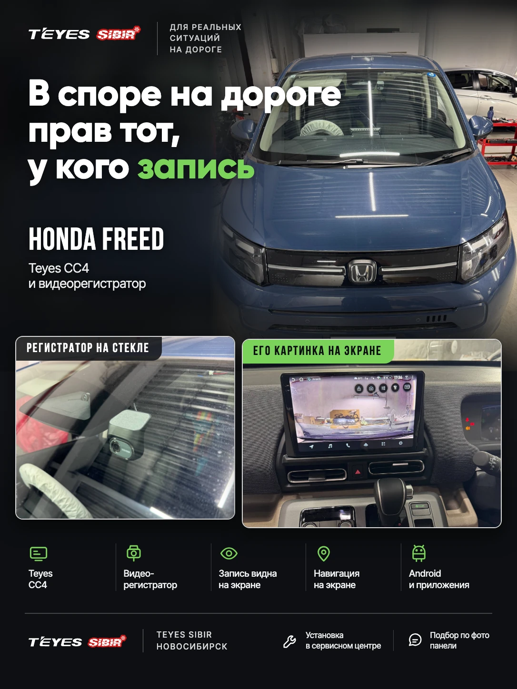
**1 – как раньше**

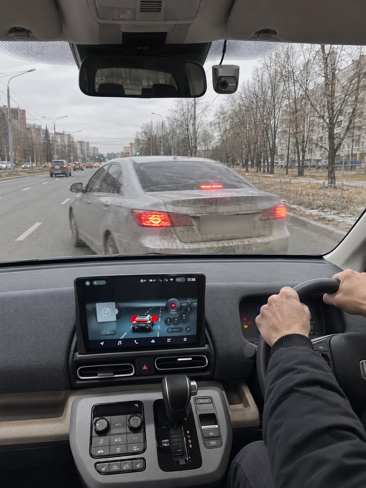
**2 – ситуация**

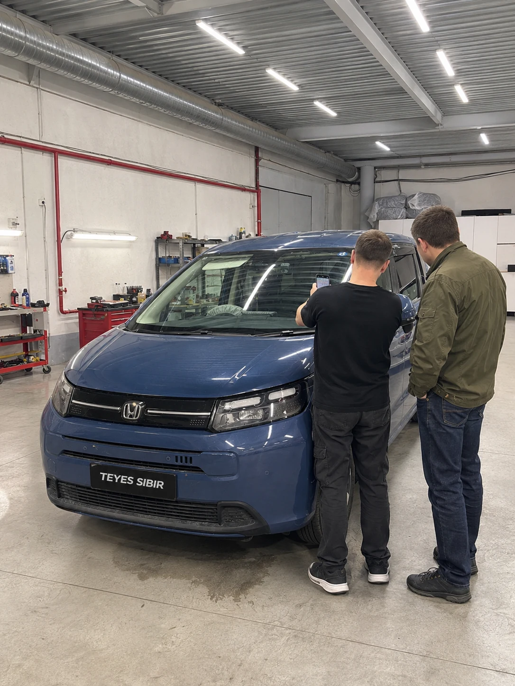
**3 – в сервисе**

**Спор на перекрёстке: прав тот, у кого запись**

Вас подрезали. Вы затормозили, сзади не успели. Дальше ваше слово против чужого. Свидетели разъехались, камера на столбе смотрит в другую сторону.

В этой Honda Freed к такому разговору готовы заранее. Мастера поставили мультимедиа Teyes CC4 и видеорегистратор.

Как это устроено:
– камера регистратора приклеена к лобовому стеклу у зеркала, из-за руля её почти не видно;
– картинка с неё открывается на экране магнитолы. На фото экран показывает бокс, снятый через лобовое;
– тот же экран в обычном режиме – навигация и музыка.

Регистратор был у вас в машине, когда он понадобился? Расскажите в комментариях.

Хотите регистратор, который работает вместе с магнитолой, – напишите в сообщения сообщества: vk.me/teyes.magnitola. Нужны марка, модель и год машины.

Установка видеорегистраторов: https://teyes-sibir.ru/services/dashcam?utm_source=vk&utm_medium=social&utm_campaign=keys&utm_content=235_honda_freed

TEYES Sibir, Новосибирск, Сухарная, 35 к13

##### Пост 6. Toyota Wish (работа №236)

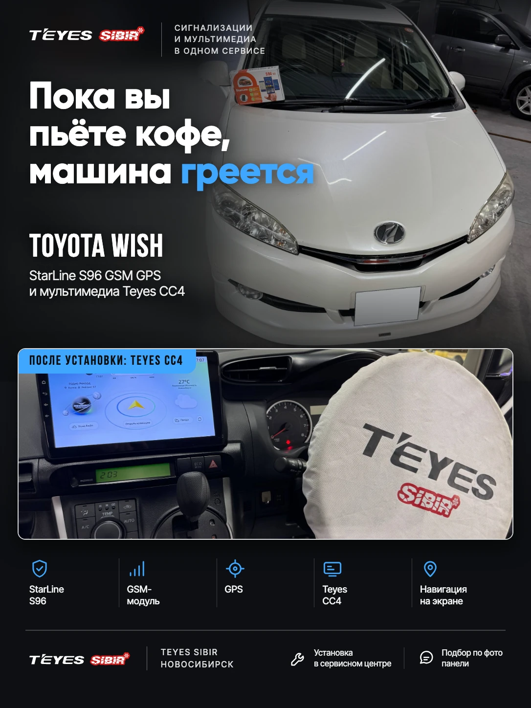
**1 – как раньше**


**2 – ситуация**


**3 – в сервисе**

**Мороз за окном. Машина уже греется, а вы ещё с кофе**

7:10. На улице темно и мороз. Вы на кухне, кофе только налит.
7:11. Берёте телефон и нажимаете запуск.
7:25. Садитесь в тёплый салон.

Так выглядит утро с сигнализацией StarLine S96 с GSM и GPS. Двигатель запускается с телефона. Где стоит машина, видно на карте в том же приложении.

На эту Toyota Wish мы поставили StarLine S96 GSM GPS вместе с мультимедиа Teyes CC4. На первом фото коробка от сигнализации стоит на капоте. На втором – новый экран в панели: радио, погода и кнопка навигации.

Зима в Новосибирске длинная. Скоро её первые минус тридцать.

А вы как греете машину: выходите заводить или запускаете из дома?

Напишите в сообщения сообщества: vk.me/teyes.magnitola. Нужны марка, модель, год и как заводится машина: ключом или кнопкой. Подберём комплект.

Сигнализации StarLine с установкой: https://teyes-sibir.ru/services/starline?utm_source=vk&utm_medium=social&utm_campaign=keys&utm_content=236_toyota_wish

TEYES Sibir, Новосибирск, Сухарная, 35 к13

##### Пост 7. Hyundai H-1 (работа №237)


**1 – как раньше**


**2 – ситуация**


**3 – в сервисе**

**Hyundai H-1: задний ход без «выйди, посмотри»**

У водителя микроавтобуса есть ритуал. Перед тем как сдать назад во дворе, он просит пассажира: «Выйди, посмотри». Пассажира нет – выходит сам.

Причина простая. Заднее стекло у H-1 высокое. Столбик, бордюр и детский самокат стоят ниже него.

В этом H-1 ритуал отменили. Мастера поставили Teyes CC4, и камера заднего вида теперь показывает на большом экране. Поверх картинки – линии: жёлтая зона, за ней красная. На фото экран показывает пол бокса за машиной.

В остальное время на экране навигация, радио и музыка.

Кто у вас выходит смотреть: жена, сын или вы сами?

Напишите в сообщения сообщества: vk.me/teyes.magnitola. Пришлите марку, модель, год и фото панели. Скажите, есть ли уже камера сзади.

Магнитолы Teyes для Hyundai: https://teyes-sibir.ru/store/catalog/hyundai?utm_source=vk&utm_medium=social&utm_campaign=keys&utm_content=237_hyundai_h-1

TEYES Sibir, Новосибирск, Сухарная, 35 к13

##### Пост 8. Hyundai Solaris (работа №238)


**1 – как раньше**


**2 – ситуация**


**3 – в сервисе**

**Solaris: три признака, что магнитолу пора менять**

1. Держатель на присоске отваливается на первой кочке. Зимой – ещё на парковке.
2. Провод зарядки висит поперёк рычага коробки.
3. На штатном экране помещается название радиостанции. Больше ничего.

Третий пункт виден на фото «до»: у этого Hyundai Solaris стояла штатная магнитола с маленьким дисплеем и кнопками.

Мастера поставили вместо неё Teyes CC3 2K с экраном 11 дюймов. На фото «после» на нём сразу два окна: карта с пробками и плеер с музыкой. Блок печки под экраном остался штатным.

Навигатор теперь на панели. Присоска уехала в бардачок.

Сколько раз ваш телефон падал под педали?

Хотите так же – напишите в сообщения сообщества: vk.me/teyes.magnitola. Пришлите год Solaris и фото панели. Подберём экран под вашу машину.

Магнитолы Teyes для Hyundai: https://teyes-sibir.ru/store/catalog/hyundai?utm_source=vk&utm_medium=social&utm_campaign=keys&utm_content=238_hyundai_solaris

TEYES Sibir, Новосибирск, Сухарная, 35 к13

##### Пост 9. Toyota Highlander (работа №239)


**1 – как раньше**


**2 – ситуация**


**3 – в сервисе**

**Toyota Highlander: во двор – по приборам**

Highlander в старом дворе – отдельный вид спорта. Слева чужое зеркало. Сзади столбик ниже стекла. Спереди бордюр под длинным капотом.

Владелец этого Highlander решил вопрос за один заезд. Список работ:
– мультимедиа Teyes CC4 Pro;
– камера заднего вида;
– парктроники: 8 датчиков, спереди и сзади;
– цифровой видеорегистратор;
– цифровой микрофон.

На фото видно, куда всё встало. Камера сидит в накладке крышки багажника над номером. Датчики парктроника – в заднем бампере. Регистратор спрятан за зеркалом заднего вида.

Теперь машину ставят по картинке и по звуку.

А ваш парктроник пищит по делу или по любому поводу?

Напишите в сообщения сообщества: vk.me/teyes.magnitola. Пришлите марку, модель, год и список того, что хотите поставить. Соберём комплект.

Магнитолы Teyes для Toyota: https://teyes-sibir.ru/store/catalog/toyota?utm_source=vk&utm_medium=social&utm_campaign=keys&utm_content=239_toyota_highlander

TEYES Sibir, Новосибирск, Сухарная, 35 к13

##### Пост 10. Suzuki Jimny (работа №240)


**1 – как раньше**


**2 – ситуация**


**3 – в сервисе**

**Suzuki Jimny: чтобы музыку было слышно и на трассе**

Jimny берут за характер. За звук его не берут: кузов квадратный, на трассе шумно, а штатный динамик в двери маленький. Он есть на фото «до».

С этого Jimny сняли обшивки и поставили в передние двери новые динамики на проставочных кольцах.

В тот же заезд сделали остальное из списка владельца:
– мультимедиа Teyes CC4;
– камеры спереди и сзади. Для передней снимали бампер, это тоже есть на фото;
– видеорегистратор;
– микрофон;
– розетка-прикуриватель.

Проводку вели вдоль штатных жгутов. Как она лежит в двери и за боковой обшивкой, видно в карусели.

Хотите звук в свою машину – напишите в сообщения сообщества: vk.me/teyes.magnitola. Нужны марка, модель, год и одно пожелание: больше баса, чище голос или просто громче.

Установка автозвука: https://teyes-sibir.ru/services/installing_car_audio?utm_source=vk&utm_medium=social&utm_campaign=keys&utm_content=240_suzuki_jimny

TEYES Sibir, Новосибирск, Сухарная, 35 к13

##### Что проверить Артёму

**Какие работы взяты.** №231–240 подряд, пропусков нет: у каждой от 2 фото и есть кадр «после» без госномера. Дальше будет сложнее: у №241 (Prado 150) в базе нет папки, а с №242 фото в папках Telegram сдвинуты на одну работу (в папке «Nissan Qashqai» лежит Prado, в «Honda Vezel» – Kia). Перед следующей десяткой это надо разобрать.

**Откуда фото.** На сервере в `uploads` лежат только работы №357–368. Исходники №231–240 взяты из выгрузки Telegram на маке («КЕЙСЫ ТГ»). Просмотрены глазами все 47 кадров десяти работ.

**Обложка 1 – где не чистое «до / после».**
- Сгенерированных кадров «до» нет ни одного: все кадры в рамках – реальные фото работы.
- У пяти работ «до» не снимали: WR-V, Freed, Wish, H-1, Highlander. Какая магнитола стояла, в записи нет, рисовать её – значит выдумать. Поэтому там два реальных кадра работы с подписями, как на вашей карточке Honda Fit (у Wish – один широкий). Скажете «дорисуй штатную» – сделаю, но это будет догадка.
- Jimny: «до» – дверь с маленьким штатным динамиком, «после» – с новым на кольце. Что динамик на первом кадре штатный, читается по фото – подтвердите.

**Обложка 1 – где машина крупно нарисована.** Внешних фото нет у RAV4, Stepwgn, Solaris и Jimny: машина в боксе сгенерирована по реальным кадрам бокса. Цвет: RAV4 и Solaris – белые (виден край двери), Jimny – жёлто-зелёный как на фото, у Stepwgn цвет кузова на фото не виден – взят тёмно-серый. У остальных шести – настоящее фото.

**Обложки 2 и 3 – сгенерированы все 20.** Люди на них вымышленные, все со спины, лиц нет. Обложка 3 собрана по реальным кадрам нашего бокса и этой машины; табличку TEYES SIBIR на месте номера рисовала нейросеть. Заголовков на обложках 2 и 3 нет – наложу скриптом, если нужно.

**Брак и переделки.** 29 картинок, просмотрены все. Переделаны 5: RAV4 в сервисе – дважды (сначала вышел гибрид с мордой H-1, потом руль справа), CR-V в сервисе (два руля), Solaris в сервисе (морда H-1), Jimny у реки (вышел пятидверный).

**Госномера.** Закрыты ровно по рамке на 7 реальных кадрах (WR-V – 2, Freed – 2, Wish – 1, H-1 – 2), вместе с рекламными рамками чужих автосалонов. На сценах 5 и 9 грязная табличка дополнительно размыта.

**Что убрано из фото.** Кадр «до» Stepwgn крупным планом: в глянце магнитолы отражается лицо мастера. С фото WR-V спереди обрезан сотрудник слева.

**Факты под ваше «да».**
- Wish: в посте «двигатель запускается с телефона». В записи мастера – «StarLine S96 GSM GPS», слова «автозапуск» там нет.
- CR-V: «штатные функции сохранены» – из названия папки мастера и фото (горит верхний дисплей, на экране климат и камера).
- RAV4: «строки на английском и китайском» – с фото штатного экрана.
- H-1: камеру заднего вида на экране видно на фото; ставили её мы или она была – в записи нет, в посте не утверждаю.
- Jimny: сторона руля по фото не видна, на сценах руль слева.
- WR-V: на фото на крыше стоят коробки StarLine, в записи сигнализации нет – в посте её нет.
- Solaris «после»: на экране карта Москвы и обложка альбома – так снял мастер, кадр не правил.

**Ссылки.** Все 10 адресов с метками отвечают 200 (проверено 17.11). Stepwgn ведёт на потолочные мониторы, Freed – на регистраторы, Wish – на StarLine, Jimny – на автозвук, остальные – в каталог марки.

**Пересборка.** `python3 teksty.py && python3 kartochka.py && python3 stranitsa.py` в папке `vk-posty`; данные – `posty.py`.


---

## 9а. Обложки ВК после правок (17.11, ночь)

**Сцены (обложки 2 и 3), все 20 после ревизии.** Из 20 забраковано и переделано 10: дорисованные панель и руль (RAV4), выдуманный перед салона и отражение лица (Stepwgn), короткий кузов (Stepwgn), панель не как у WR-V, вывернутая рука девушки (WR-V), рукопожатие правой с левой (CR-V), дверь на задних петлях (H-1, Solaris), чужая решётка (Solaris), мастер без головы и руль слева (Jimny). Панели теперь только с реальных кадров работы, кузова – по фото этого поколения. Все 20 я посмотрел сам.


**Баннеры (обложка 1) – 4 варианта, на трёх постах для примера.** Убраны нижняя плашка, ряд преимуществ и строка у логотипа; «до/после» мельче или одним кадром. В1 – фото «после» во весь кадр и «до» вставкой в углу; В2 – машина крупно и узкая полоса «до → после»; В3 – заголовок и один кадр «после»; В4 – разрез по диагонали «до | после». Выбери вариант – применю ко всем 10 постам.


---

## 10. ВК – 10 постов по следующим кейсам (№241–251)

Следующие десять работ после №231–240. №242 (Nissan Qashqai J10) пропущена: в папке работы (по фотобанку – «231_Kia optima») один кадр: экран TeyesOS, справа сотрудник с лицом; кадра «до» нет, на баннер «до/после» и четыре варианта не хватает, поэтому десятой взята №251. Ничего не опубликовано.

Смотреть лентой: [vk-posty-2/index.html](vk-posty-2/index.html) · все баннеры: [list-bannery.webp](vk-posty-2/list-bannery.webp) · все сцены: [list-sceny.webp](vk-posty-2/list-sceny.webp)

| № поста | Работа | Машина | Что сделали | Заголовок поста |
|---|---|---|---|---|
| 1 | №241 | Toyota Land Cruiser Prado 150 | Teyes CC4 Pro вместо штатного экрана | Prado 150: маленький экран в нише сменили на Teyes CC4 Pro |
| 2 | №243 | Kia K5 (Optima) | Teyes CC3 2K | Kia K5 из Кореи: навигатор с кнопками на корейском сменили на Teyes |
| 3 | №244 | Honda Vezel | Teyes CC2 Plus | Honda Vezel 2026 с правым рулём: Teyes CC2 Plus на место штатного блока |
| 4 | №245 | Nissan Juke | штатный круговой обзор на Teyes CC3 2K | Nissan Juke: магнитолу сменили, штатный круговой обзор остался |
| 5 | №246 | Honda CR-V | врезной микрофон в потолок | «Вас не слышно, вы в бочке?» Микрофон в CR-V перенесли в потолок |
| 6 | №247 | Toyota Highlander | Teyes CC4 Pro, цифровой микрофон, регистратор, задняя камера | Toyota Highlander: экран, камера, регистратор и микрофон за один заезд |
| 7 | №248 | Toyota Prius | Teyes CC2 7 дюймов, нестандартная установка | Toyota Prius 20: климат на штатном экране, Teyes – под ним |
| 8 | №249 | Hyundai Creta | Teyes CC2, камера заднего вида, регистратор | Hyundai Creta: назад – по картинке, вперёд – с записью |
| 9 | №250 | Toyota RAV4 | Teyes LUXONE | Toyota RAV4: штатный навигатор сменили на широкий Teyes LUXONE |
| 10 | №251 | Subaru Outback | Teyes CC4L | Subaru Outback: вместо экрана с ладонь – Teyes CC4L |

### Пост 1. Toyota Land Cruiser Prado 150 (работа №241)


**Обложка 1, В1 – «после» во весь кадр**


**Обложка 1, В2 – машина или панель крупно**


**Обложка 1, В3 – заголовок и кадр**


**Обложка 1, В4 – разрез по диагонали**


**Обложка 2 – ситуация**


**Обложка 3 – в сервисе**

**Prado 150: маленький экран в нише сменили на Teyes CC4 Pro**

Prado 150 берут, чтобы ехать туда, где кончается асфальт. А штатный экран у него тонет в нише: вокруг рамка с кнопками, сам дисплей размером с ладонь. Он есть на фото «до». Карта в итоге живёт в телефоне, а телефон на кочке съезжает под ноги.

С этого Prado мастера сняли штатное головное устройство и поставили Teyes CC4 Pro. Новый экран занял нишу целиком, от дефлекторов до блока климата. Климат, кнопки MTS и CRAWL и шайба выбора режима под ним остались штатными.

Что на главном экране после установки:
– меню на русском;
– радио, время в пути и пройденные километры;
– виджет G-сенсора;
– внизу навигация, музыка и телефон.

Куда вы чаще ездите на Prado: на дачу или туда, где без полного привода никак?

Хотите так же – напишите в сообщения сообщества: vk.me/teyes.magnitola. Пришлите год Prado и фото панели – подберём комплект.

Магнитолы Teyes для Toyota: https://teyes-sibir.ru/store/catalog/toyota?utm_source=vk&utm_medium=social&utm_campaign=keys&utm_content=241_toyota_prado_150

TEYES Sibir, Новосибирск, Сухарная, 35 к13

### Пост 2. Kia K5 (Optima) (работа №243)


**Обложка 1, В1 – «после» во весь кадр**


**Обложка 1, В2 – машина или панель крупно**


**Обложка 1, В3 – заголовок и кадр**


**Обложка 1, В4 – разрез по диагонали**


**Обложка 2 – ситуация**


**Обложка 3 – в сервисе**

**Kia K5 из Кореи: навигатор с кнопками на корейском сменили на Teyes**

Kia K5 с родной корейской эмблемой – это Optima из Кореи. С эмблемой приезжает и штатная магнитола для корейского рынка.

На фото «до» она крупно. Кнопка DMB – это корейское цифровое телевидение. Кнопки навигатора подписаны по-корейски: «текущее место», «пункт назначения», «меню навигации».

В эту K5 мастера поставили Teyes CC3 2K. Экран встал на место штатного, между дефлекторами, и вышел заметно больше. Ряд кнопок под ним, аварийка и климат остались на местах – это видно на фото «после».

Что меняется для владельца:
– меню магнитолы на русском;
– карта на большом экране, а не в телефоне;
– корейские кнопки навигатора больше не нужны.

Машина из Кореи или Японии с меню на чужом языке? Напишите в сообщения сообщества: vk.me/teyes.magnitola. Пришлите марку, модель, год и фото панели – скажем, какой комплект встанет в вашу рамку.

Магнитолы Teyes для Kia: https://teyes-sibir.ru/store/catalog/kia?utm_source=vk&utm_medium=social&utm_campaign=keys&utm_content=243_kia_k5

TEYES Sibir, Новосибирск, Сухарная, 35 к13

### Пост 3. Honda Vezel (работа №244)


**Обложка 1, В1 – «после» во весь кадр**


**Обложка 1, В2 – машина или панель крупно**


**Обложка 1, В3 – заголовок и кадр**


**Обложка 1, В4 – разрез по диагонали**


**Обложка 2 – ситуация**


**Обложка 3 – в сервисе**

**Honda Vezel 2026 с правым рулём: Teyes CC2 Plus на место штатного блока**

Новый Vezel пригнали из Японии. Руль справа, в приборке надписи на японском – одну видно на фото «после».

На фото «до» – штатный блок на верху панели: чёрное стекло в рамке над аварийкой, на нём ничего не горит.

Мастера поставили на это место Teyes CC2 Plus. Экран стоит там же, где штатный, на уровне глаз. Аварийка и блок климата с тремя ручками под ним не изменились.

Что на экране после установки:
– слева машина сверху;
– справа картинка с камеры;
– под ней плеер с песней и обложкой альбома;
– внизу кнопки навигации, телефона и музыки.

Пригнали машину из Японии или Кореи? Напишите в сообщения сообщества: vk.me/teyes.magnitola. Пришлите марку, модель, год и фото панели – скажем, что можно поставить и что сохранится из штатного.

Магнитолы Teyes для Honda: https://teyes-sibir.ru/store/catalog/honda?utm_source=vk&utm_medium=social&utm_campaign=keys&utm_content=244_honda_vezel

TEYES Sibir, Новосибирск, Сухарная, 35 к13

### Пост 4. Nissan Juke (работа №245)


**Обложка 1, В1 – «после» во весь кадр**


**Обложка 1, В2 – машина или панель крупно**


**Обложка 1, В3 – заголовок и кадр**


**Обложка 1, В4 – разрез по диагонали**


**Обложка 2 – ситуация**


**Обложка 3 – в сервисе**

**Nissan Juke: магнитолу сменили, штатный круговой обзор остался**

Владельцы японских Juke с круговым обзором часто откладывают замену магнитолы: поставишь новый экран – и камеры по кругу пропадут.

В этом Juke мастера поставили Teyes CC3 2K и вывели на него штатный круговой обзор.

Что видно на фото после установки:
– на первом кадре главный экран Teyes: музыка, карта, приложения;
– на втором слева машина сверху с камерами по кругу, справа задняя камера с зелёной, жёлтой и красной линиями;
– горит значок MOD – штатная функция Nissan, она следит за движением вокруг машины;
– внизу японская строка предупреждения: её рисует штатный блок камер.

Боитесь потерять камеры по кругу? Напишите в сообщения сообщества: vk.me/teyes.magnitola. Пришлите марку, модель, год и фото экрана с камерами – скажем, получится ли сохранить обзор.

Магнитолы Teyes для Nissan: https://teyes-sibir.ru/store/catalog/nissan?utm_source=vk&utm_medium=social&utm_campaign=keys&utm_content=245_nissan_juke

TEYES Sibir, Новосибирск, Сухарная, 35 к13

### Пост 5. Honda CR-V (работа №246)


**Обложка 1, В1 – «после» во весь кадр**


**Обложка 1, В2 – машина или панель крупно**


**Обложка 1, В3 – заголовок и кадр**


**Обложка 1, В4 – разрез по диагонали**


**Обложка 2 – ситуация**


**Обложка 3 – в сервисе**

**«Вас не слышно, вы в бочке?» Микрофон в CR-V перенесли в потолок**

– Алло, ты где? Тебя не слышно.
– Еду, говорю по громкой.
– Перезвони, когда остановишься.

Знакомо, если микрофон громкой связи висит на проводе у руля или прячется в панели: собеседник слышит печку, дворники и шины.

В этой Honda CR-V мастера врезали микрофон в обшивку потолка. Он стоит над водительской дверью, рядом с козырьком, у головы водителя. Снаружи только круглая решётка размером с монету, проводов не видно. Крупно – на втором фото.

Зачем именно потолок:
– до рта водителя ближе, чем от панели;
– на микрофон не дует печка;
– его не закрывают руки и телефон.

А вам по громкой связи часто говорят «плохо слышно»?

Напишите в сообщения сообщества: vk.me/teyes.magnitola. Пришлите марку, модель, год и что стоит сейчас: штатная магнитола или Teyes. Скажем, куда поставить микрофон.

Установка Teyes и оборудования к ней: https://teyes-sibir.ru/services/installation_teyes?utm_source=vk&utm_medium=social&utm_campaign=keys&utm_content=246_honda_cr-v

TEYES Sibir, Новосибирск, Сухарная, 35 к13

### Пост 6. Toyota Highlander (работа №247)


**Обложка 1, В1 – «после» во весь кадр**


**Обложка 1, В2 – машина или панель крупно**


**Обложка 1, В3 – заголовок и кадр**


**Обложка 1, В4 – разрез по диагонали**


**Обложка 2 – ситуация**


**Обложка 3 – в сервисе**

**Toyota Highlander: экран, камера, регистратор и микрофон за один заезд**

Highlander приехал со штатной магнитолой Toyota: экран с логотипом и кнопки по бокам – на фото «до».

Владелец заказал сразу четыре работы:
– мультимедиа Teyes CC4 Pro;
– камеру заднего вида;
– видеорегистратор;
– цифровой микрофон.

Куда всё встало, видно на фото. Teyes – на месте штатного экрана, климат под ним штатный. Камера заднего вида – в хромированной планке под эмблемой Toyota на двери багажника. Регистратор спрятан за зеркалом заднего вида.

Почему всё сразу: камера, регистратор и микрофон подключаются к магнитоле, и панель разбирают один раз.

Что у вас в машине уже стоит, а чего не хватает?

Хотите так же – напишите в сообщения сообщества: vk.me/teyes.magnitola. Пришлите марку, модель, год и список того, что хотите поставить, – соберём комплект.

Установка видеорегистраторов: https://teyes-sibir.ru/services/dashcam?utm_source=vk&utm_medium=social&utm_campaign=keys&utm_content=247_toyota_highlander

TEYES Sibir, Новосибирск, Сухарная, 35 к13

### Пост 7. Toyota Prius (работа №248)


**Обложка 1, В1 – «после» во весь кадр**


**Обложка 1, В2 – машина или панель крупно**


**Обложка 1, В3 – заголовок и кадр**


**Обложка 1, В4 – разрез по диагонали**


**Обложка 2 – ситуация**


**Обложка 3 – в сервисе**

**Toyota Prius 20: климат на штатном экране, Teyes – под ним**

У Prius второго поколения есть подвох. Верхний штатный экран – это не только расход. С него управляют климатом: температура, обдув, кондиционер. Снимешь экран – потеряешь управление печкой с панели.

На фото «до» видно, как это устроено: сверху экран с монитором энергии, под ним штатная магнитола с кнопками и щелью для диска.

Мастера сделали нестандартную установку. Верхний экран оставили – на втором кадре он крупно, с меню кондиционера. Штатную магнитолу под ним заменили на Teyes CC2 с экраном 7 дюймов.

Что получилось:
– климатом управляют, как раньше, через штатный экран;
– на Teyes музыка, радио и карта;
– часы и аварийка между экранами остались на своих местах.

Сколько уже прошёл ваш Prius?

Напишите в сообщения сообщества: vk.me/teyes.magnitola. Пришлите год и фото панели – скажем, как поставить Teyes и не потерять штатное.

Магнитолы Teyes для Toyota: https://teyes-sibir.ru/store/catalog/toyota?utm_source=vk&utm_medium=social&utm_campaign=keys&utm_content=248_toyota_prius

TEYES Sibir, Новосибирск, Сухарная, 35 к13

### Пост 8. Hyundai Creta (работа №249)


**Обложка 1, В1 – «после» во весь кадр**


**Обложка 1, В2 – машина или панель крупно**


**Обложка 1, В3 – заголовок и кадр**


**Обложка 1, В4 – разрез по диагонали**


**Обложка 2 – ситуация**


**Обложка 3 – в сервисе**

**Hyundai Creta: назад – по картинке, вперёд – с записью**

Парковка у супермаркета, вечер, снег. Сдаёте назад, а за машиной идёт человек с тележкой. В зеркала его не видно.

На этой Hyundai Creta такое закрыли за один заезд. Список работ мастера:
– мультимедиа Teyes CC2;
– камера заднего вида;
– видеорегистратор.

На фото на экране Teyes слева машина сверху, справа картинка с камеры: пол бокса и машина напротив. Регистратор стоит за зеркалом заднего вида – его видно снаружи через лобовое.

Камера помогает сдавать назад. Регистратор пишет то, что впереди: зацепят на парковке – запись покажет, как было.

А вы паркуетесь задом или передом?

Хотите так же – напишите в сообщения сообщества: vk.me/teyes.magnitola. Пришлите марку, модель, год и что уже стоит – подберём магнитолу, камеру и регистратор, которые работают вместе.

Магнитолы Teyes для Hyundai: https://teyes-sibir.ru/store/catalog/hyundai?utm_source=vk&utm_medium=social&utm_campaign=keys&utm_content=249_hyundai_creta

TEYES Sibir, Новосибирск, Сухарная, 35 к13

### Пост 9. Toyota RAV4 (работа №250)


**Обложка 1, В1 – «после» во весь кадр**


**Обложка 1, В2 – машина или панель крупно**


**Обложка 1, В3 – заголовок и кадр**


**Обложка 1, В4 – разрез по диагонали**


**Обложка 2 – ситуация**


**Обложка 3 – в сервисе**

**Toyota RAV4: штатный навигатор сменили на широкий Teyes LUXONE**

На фото «до» штатный навигатор RAV4: небольшой экран в рамке с кнопками и оранжевая карта. Чтобы её разглядеть, водитель опускает глаза под дефлекторы.

С этого RAV4 мастера сняли штатный блок и поставили Teyes LUXONE. Широкий экран встал на верх панели, над дефлекторами. Под ним дефлекторы и кнопки HOME, MODE, PHONE, NAVI, RADIO. Климат с тремя ручками и оранжевые часы – штатные.

Что на экране после установки:
– меню на русском;
– компас, высота, широта и долгота;
– время в пути, скорость и километры;
– слева кнопки навигации, музыки и телефона.

Экран стоит выше, чем стоял штатный. Карту видно краем глаза, не отрываясь от дороги.

Сколько лет вашему RAV4 и что в нём стоит сейчас?

Напишите в сообщения сообщества: vk.me/teyes.magnitola. Пришлите год и фото панели – подберём экран и рамку.

Магнитолы Teyes для Toyota: https://teyes-sibir.ru/store/catalog/toyota?utm_source=vk&utm_medium=social&utm_campaign=keys&utm_content=250_toyota_rav4

TEYES Sibir, Новосибирск, Сухарная, 35 к13

### Пост 10. Subaru Outback (работа №251)


**Обложка 1, В1 – «после» во весь кадр**


**Обложка 1, В2 – машина или панель крупно**


**Обложка 1, В3 – заголовок и кадр**


**Обложка 1, В4 – разрез по диагонали**


**Обложка 2 – ситуация**


**Обложка 3 – в сервисе**

**Subaru Outback: вместо экрана с ладонь – Teyes CC4L**

Outback четвёртого поколения – машина для дальней дороги: на дачу, на базу, на рыбалку. А в панели у него магнитола с маленьким экраном, слотом для диска и рядом кнопок – она на фото «до».

В этот Outback мастера поставили Teyes CC4L. Экран встал на место штатной магнитолы и занял всю ширину между дефлекторами. На фото «после» он только включился: идёт загрузка с надписью TEYES.

Что видно на фото:
– под экраном открытая ниша – в неё можно положить телефон;
– блок климата с красными кнопками под нишей остался штатным;
– кнопка запуска двигателя и селектор коробки не тронуты.

Карта и музыка теперь в центре панели, а не в руке.

Куда вы ездите на своём Outback дальше всего?

Хотите так же – напишите в сообщения сообщества: vk.me/teyes.magnitola. Пришлите год и фото панели – подберём комплект.

Магнитолы Teyes для Subaru: https://teyes-sibir.ru/store/catalog/subaru?utm_source=vk&utm_medium=social&utm_campaign=keys&utm_content=251_subaru_outback

TEYES Sibir, Новосибирск, Сухарная, 35 к13

### Что проверить Артёму

**Какие работы взяты.** №241, 243–251. №242 (Nissan Qashqai J10) пропущена: в её папке один кадр – экран TeyesOS, справа сотрудник с лицом, кадра «до» нет. На четыре варианта баннера одного кадра мало, поэтому десятой взята №251.

**Откуда фото.** Фотобанк, разобранный 17.11 (`teyes-keysy/docs/fotobank.md`): сдвиг папок 230–234 учтён. №241 Prado – папка «230_Nissan qashqai j10», №243 K5 – «232_Honda vezel 2026», №244 Vezel – «233_Nissan juke», №245 Juke – первые два кадра «234_CRV», №246 CR-V – последние три. Кадры взяты из копии выгрузки Telegram на маке, файлы те же, что на Диске (md5 сверены при разборе фотобанка). Просмотрены глазами все 32 кадра десяти работ и кадр №242.

**Баннеры (обложка 1).** У каждого поста четыре варианта В1–В4 – выбирайте один на всю десятку. Кадры только реальные, машины не нарисованы. Где «до» не снимали (Juke, CR-V, Creta), вместо «до → после» два кадра работы с подписями: «меню Teyes / круговой обзор», «салон / микрофон», «регистратор / камера на экране».

**Сцены (обложки 2 и 3).** 20 картинок Codex, все от реальных кадров или по референсу этого кузова. Панель и салон взяты только с реального кадра работы (K5, Vezel, CR-V, Prius, RAV4). Кузова без своего внешнего фото (Prado, K5, Vezel, Juke, CR-V, Prius, RAV4, Outback) нарисованы по фото того же кузова и года с Wikimedia Commons. Цвет кузова этих восьми машин по фото работы не виден, кроме белых Vezel и Juke: Prado и Outback – чёрные, K5 – белый, CR-V и RAV4 – тёмно-серые, Prius – серебристый. Это догадка: скажете цвет – перерисую. Забраковано 3 из 20 (три руки у мастера, неверные «переводы» на экране телефона, полка над крышей читалась как предмет на крыше) – все переделаны с первого раза; ещё на одной размыт номер чужой машины. Проверка каждой картинки – `reviziya-2.md`.

**Госномера и люди на реальных фото.** Номера закрыты по рамке на 7 кадрах: Vezel – 3 (чужие машины в боксе), Juke – 2, Creta – 2. На фото Highlander спереди размыто лицо сотрудника на заднем плане, на фото Creta спереди – водитель соседней машины. У кадра Highlander сзади обрезан низ: в лаке отражался человек. У Vezel обрезан низ трёх кадров: на полу пакет с логотипом политической партии.

**Факты под ваше «да».**
- №246: в записи мастера «Toyota CR-V», на фото руль Honda – в посте Honda CR-V.
- №244 Vezel: «2026 год» – из названия папки мастера. На фото «до» штатный блок выключен, что на нём было – не знаю, в посте только «чёрное стекло, ничего не горит».
- №244 Vezel: на экране после установки картинка с камеры. Ставили ли камеру мы, в записи нет – в посте не утверждаю.
- №243 K5: перевод корейских кнопок («текущее место», «пункт назначения», «меню навигации») – мой, по надписям на фото. «Меню на русском» – по умолчанию у Teyes, на фото «после» экран выключен.
- №245 Juke: «MOD следит за движением вокруг машины» – это штатная функция Nissan, значок есть на фото.
- №247 Highlander: «камера, регистратор и микрофон подключаются к магнитоле, панель разбирают один раз» – объяснение, не из записи мастера.
- №248 Prius: «с верхнего экрана управляют климатом» – так устроен Prius 20, на фото экран с меню кондиционера.
- №250 RAV4: ряд кнопок HOME, MODE, PHONE, NAVI, RADIO под новым экраном – с фото; штатные это кнопки или часть рамки, не утверждаю.

**Ссылки.** Все 10 адресов с метками отвечают 200 (проверено 18.11). CR-V ведёт на «Установку Teyes» (страницы про микрофон нет), Highlander – на регистраторы, остальные – в каталог марки (Toyota, Kia, Honda, Nissan, Hyundai, Subaru).

**Пересборка.** В папке `vk-posty-2`: `python3 teksty.py && python3 bannery.py && python3 sobrat.py && python3 stranitsa.py && python3 snimki.py`; данные – `posty.py`; реальные кадры с закрытыми номерами – `~/.cache/teyes-vk-posty/prep2.py`; задания картинок – `~/.cache/teyes-vk-posty/jobs2.py`.

---

## 11. Карты – 11 новостей на 18.11–03.12

11 новостей готовы к выкладке, ничего не опубликовано: Google Карты – 6 (18, 21, 24, 27, 30.11, 03.12), Яндекс Карты – 5 (19, 22, 25, 28.11, 01.12). Каждая – реальная работа мастеров с фото без номеров; в Google и Яндексе разные машины, услуги идут по кругу: мультимедиа, сигнализация, автозвук. Все 6 текстов Google прошли `proverit()` без замечаний, 5 текстов Яндекса – проверку по правилам завода (капс, «до/после», телефоны, ссылки, длина 500–1000). Все ссылки отвечают 200. [Вид как на площадке](karty-2/index.html).

| Дата | Канал | Работа | Первая строка | Ссылка |
|---|---|---|---|---|
| 18.11 | Google Карты | №368 Toyota Hilux 2019 (мультимедиа) | Toyota Hilux 2019 года – поставили мультимедиа Teyes CC4, камеру заднего вида, видеорегистратор и микрофон. | [/multimedia_teyes/toyota/hilux](https://teyes-sibir.ru/multimedia_teyes/toyota/hilux?utm_source=google_maps&utm_medium=organic&utm_campaign=gbp_news&utm_content=368_toyota_hilux) – кнопка «Подробнее» |
| 19.11 | Яндекс Карты | №359 Toyota Camry 2016 (сигнализация) | Toyota Camry 2016 года: сняли старую Pandora и поставили StarLine S96 | [/services/starline](https://teyes-sibir.ru/services/starline?utm_source=yandex_maps&utm_medium=organic&utm_campaign=yabiz_news&utm_content=359_toyota_camry) – кнопки нет, ссылка про запас |
| 21.11 | Google Карты | №328 Lada Niva Urban 2026 (автозвук) | Lada Niva Urban 2026 года – поставили компонентную акустику Black Hydra и сделали шумоизоляцию дверей. | [/services/installing_car_audio](https://teyes-sibir.ru/services/installing_car_audio?utm_source=google_maps&utm_medium=organic&utm_campaign=gbp_news&utm_content=328_lada_niva_urban) – кнопка «Подробнее» |
| 22.11 | Яндекс Карты | №354 Suzuki Grand Vitara 2008 (мультимедиа + сигнализация) | Suzuki Grand Vitara 2008 года: Teyes CC4, круговой обзор 360 и StarLine E97 | [/multimedia_teyes/suzuki/grand-vitara](https://teyes-sibir.ru/multimedia_teyes/suzuki/grand-vitara?utm_source=yandex_maps&utm_medium=organic&utm_campaign=yabiz_news&utm_content=354_suzuki_grand_vitara) – кнопки нет, ссылка про запас |
| 24.11 | Google Карты | №356 Mazda CX-5 2026 (сигнализация) | Mazda CX-5 2026 года – установили охранно-телематический комплекс StarLine E97. | [/services/starline](https://teyes-sibir.ru/services/starline?utm_source=google_maps&utm_medium=organic&utm_campaign=gbp_news&utm_content=356_mazda_cx5) – кнопка «Подробнее» |
| 25.11 | Яндекс Карты | №316 Honda CR-V 2012 (автозвук + мультимедиа) | Honda CR-V 2012 года: Teyes CC3 2K, микрофон и новые динамики в передних дверях | [/multimedia_teyes/honda/cr-v](https://teyes-sibir.ru/multimedia_teyes/honda/cr-v?utm_source=yandex_maps&utm_medium=organic&utm_campaign=yabiz_news&utm_content=316_honda_cr_v) – кнопки нет, ссылка про запас |
| 27.11 | Google Карты | №361 Subaru Forester 2022 (мультимедиа) | Subaru Forester 2022 года – поставили мультимедиа Teyes CC4 и микрофон громкой связи в штатное место. | [/multimedia_teyes/subaru/forester](https://teyes-sibir.ru/multimedia_teyes/subaru/forester?utm_source=google_maps&utm_medium=organic&utm_campaign=gbp_news&utm_content=361_subaru_forester) – кнопка «Подробнее» |
| 28.11 | Яндекс Карты | №362 Hyundai Creta 2023 (сигнализация) | Hyundai Creta 2023 года: поставили StarLine S97 | [/services/starline](https://teyes-sibir.ru/services/starline?utm_source=yandex_maps&utm_medium=organic&utm_campaign=yabiz_news&utm_content=362_hyundai_creta) – кнопки нет, ссылка про запас |
| 30.11 | Google Карты | №314 Nissan Note 2016 (автозвук) | Nissan Note 2016 года – заменили задние динамики, поставили мультимедиа Teyes CC3L и камеру заднего хода. | [/services/installing_car_audio](https://teyes-sibir.ru/services/installing_car_audio?utm_source=google_maps&utm_medium=organic&utm_campaign=gbp_news&utm_content=314_nissan_note) – кнопка «Подробнее» |
| 01.12 | Яндекс Карты | №346 Subaru Levorg 2018 (мультимедиа) | Subaru Levorg 2018 года: широкий экран Teyes CC4 Pro 12 дюймов и камера заднего вида | [/multimedia_teyes/subaru/levorg](https://teyes-sibir.ru/multimedia_teyes/subaru/levorg?utm_source=yandex_maps&utm_medium=organic&utm_campaign=yabiz_news&utm_content=346_subaru_levorg) – кнопки нет, ссылка про запас |
| 03.12 | Google Карты | №363 Toyota Roomy 2019 (сигнализация) | Toyota Roomy 2019 года – установили охранный комплекс StarLine S96. | [/services/starline](https://teyes-sibir.ru/services/starline?utm_source=google_maps&utm_medium=organic&utm_campaign=gbp_news&utm_content=363_toyota_roomy) – кнопка «Подробнее» |

### Что проверить Артёму

- **Можно ли без «да».** По решению 16.11 карты выкладываем без «да». Если хочешь сначала посмотреть – открой вид на площадке и напиши, что убрать; иначе выкладываем по датам.
- **Сигнализации – фото только «машина + коробка».** У №356 Mazda CX-5, №362 Creta, №363 Roomy нет кадров блока, брелока или приложения. Если у мастеров есть такие кадры – пришли, поставлю вместо коробки.
- **Автозапуск.** Ни в одной записи по сигнализациям не сказано, ставили ли автозапуск, – в текстах его нет как факта, только «подберём».
- **№359 Camry – чужой монтаж.** В тексте есть «под панелью нашли скрутки на изоленте, блок висел на проводах» – по кадру «Так было до нас». Сам кадр с надписями в новость не взят (Яндекс режет «до/после»). Если не хочешь ругать прежний монтаж – уберу абзац.
- **Марки по фото.** Black Hydra (№328 Niva, №316 CR-V) и версия StarLine S96 V2 (№359, №363) взяты с надписей на фото, в записях мастеров их нет.
- **№354 Grand Vitara – обзор 360.** На фото видны две камеры под зеркалами; что поставлен полный комплект из четырёх камер – не подтверждено, в тексте только «камеры кругового обзора».
- **№368 Hilux.** Регистратор на фото не виден, камера в ручке борта – новая или штатная, в записи не сказано; в тексте «поставили», как в записи мастера.
- **Яндекс Карты TEYES в заводе не настроены** (нет настройки yandex_karty у сайта 3). Строку TEYES с карточкой 103758102748 и графиком в скилл yandex-karty-novosti я вписал 17.11. Окно Chrome должно быть на переднем плане, иначе вкладка Яндекса замерзает (16.11).
- **Google: подтверждение личности** (плашка Verification required, висит с 16.11) – если не пройдено, выкладка может встать.

---

## 12. Дзен – 6 статей «лучшая магнитола» и 3 карусели

Черновики на 18.11.2026 для dzen.ru/teyes_sibir, ничего не опубликовано. Статьи сделаны в формате принятого Accord 7: «лучшая магнитола для <модель>», одна модель – одно поколение, обложка «год VS 2026». Карусели повторяют формат «−30, 7:40». Спрос – Wordstat через XMLRiver, НСК / Россия, 17–18.11.2026. Цены – с teyes-sibir.ru, как их видит покупатель на карточке 18.11.2026. Все 21 ссылка статей и 3 ссылки постов отвечают 200 (curl, 18.11.2026).

### Статьи

| Материал | Главный запрос | Спрос НСК / РФ | Наши работы | Вид |
|---|---|---|---|---|
| Лучшая магнитола для Ниссан Х-Трейл Т32: что ставить вместо штатной | магнитола ниссан х трейл | 66 / 4 028 (+ «х трейл т32» ≥3 / ≥1 327) | 3, две со ссылкой | [читалка](dzen-2/vid/xtrail-t32/index.html) · [лента](dzen-2/vid/xtrail-t32/lenta.html) |
| Лучшая магнитола для Ниссан Ноут Е12: что ставить вместо штатной | магнитола ниссан ноут | 106 / 2 902 (+ «ноут е12» ≥12 / ≥391) | 2, без страниц на сайте | [читалка](dzen-2/vid/note-e12/index.html) · [лента](dzen-2/vid/note-e12/lenta.html) |
| Лучшая магнитола для Ленд Крузер 200: что ставить вместо штатной в 2026 году | магнитола ленд крузер 200 | 24 / 1 117 | 4, две со ссылкой | [читалка](dzen-2/vid/lc200/index.html) · [лента](dzen-2/vid/lc200/lenta.html) |
| Лучшая магнитола для Хендай Солярис 2: что ставить вместо штатной в 2026 году | магнитола хендай солярис | 68 / 8 578 (+ «солярис 2» 27 / 3 784) | 1 с фото «до/после», без страницы | [читалка](dzen-2/vid/solaris-2/index.html) · [лента](dzen-2/vid/solaris-2/lenta.html) |
| Лучшая магнитола для Ниссан Жук: что ставить вместо штатной в 2026 году | магнитола ниссан жук | 56 / 2 431 | 2, без страниц | [читалка](dzen-2/vid/juke-f15/index.html) · [лента](dzen-2/vid/juke-f15/lenta.html) |
| Лучшая магнитола для Хонда Шаттл: что ставить вместо японской штатной | магнитола хонда шаттл | 46 / 928 | 1 со ссылкой | [читалка](dzen-2/vid/shuttle/index.html) · [лента](dzen-2/vid/shuttle/lenta.html) |

Три варианта заголовка с выбором – в `zagolovki.md` в папке каждой статьи. Тексты 830–970 слов, факты о машинах – с источниками и датой в комментарии в конце `statya.md` (в статью не выводятся). Красный список – 0 нарушений у всех шести.

Модели выбраны так: самый большой спрос среди моделей без статей на канале, плюс наша реальная работа по этому поколению. Не взяты: VW Touareg (86 / 4 391) – ни одной нашей работы; Honda Civic – наша работа на Civic 10, а у «магнитола цивик 10» спрос около нуля (≥18 по РФ); Lada, Ford Focus, Skoda – ждут твоего решения по массовым машинам (из плана 17.11).

### Обложки

Генерация Codex по референсу этого поколения: штатная панель – наше фото «до» (Note, LC 200, Solaris) или Wikimedia Commons (X-Trail T32, Juke, Shuttle), новая магнитола – по нашему фото работы. Надписи рисует скрипт `syrye/oblozhka.py`. Каждую смотрел в полном размере: панель того поколения, дефлекторы и климат на месте, руля в кадре VS нет, номеров и надписей нейросети нет.


### Карусели

| Карусель | Спрос НСК / РФ | Ссылка поста | Вид |
|---|---|---|---|
| «Пригнал из Китая. А всё в иероглифах» – 7 карточек | «авто из китая» 2 173 / 119 828; «русификация китайских автомобилей» 75 / 2 408 | /services/russification_of_cars, utm_campaign=kitay_rusifikaciya | [листать](dzen-2/vid/karusel-kitay/index.html) |
| «Сдавал задом к сугробу. Сугроб победил» – 7 карточек | «камера заднего вида» 4 464 / 299 567 | /services/camera360, utm_campaign=sugrob_kamera | [листать](dzen-2/vid/karusel-sugrob/index.html) |
| «Поворот. Телефон – под педали» – 7 карточек | «андроид магнитола» 6 898 / 452 820; «carplay» 1 683 / 112 537 | /services/installation_teyes, utm_campaign=prisoska_teyes | [листать](dzen-2/vid/karusel-prisoska/index.html) |

Текст поста – `post.txt` в папке карусели (1 600–2 100 знаков из 4 096), ссылка встроена в слова в конце поста, на карточках ссылок нет. Факты – только со страниц сайта 18.11.2026. Карточка с ценой – наша реальная работа (Haval H9, Nissan X-Trail, Hyundai Solaris), остальные сцены – Codex, текст на карточках рисует `redakciya/scripts/karusel.py`, JPG-копии – в `jpg/`.


Снимки видов на телефоне (390) и на компьютере (1440) лежат рядом с каждым видом: `dzen-2/vid/<материал>/snimok-*.webp`. Все просмотрены, горизонтальной прокрутки нет.

Третья карусель заменена: вместо «Поменял АКБ – магнитола просит код» сделал «Телефон на присоске». Про коды и блокировку штатных магнитол на сайте нет ни строчки, а факты для карусели – только с живого сайта. Спрос у «присоски» в сотни раз шире: 452 820 против 647 по РФ.

### Что проверить Артёму

1. **Цена CC3L в каталоге.** В Tilda Store у CC3L записано 17 500 ₽, а на карточке покупатель видит 26 800–30 100 ₽: это цена варианта 4+32. В статьях – цены с карточки. Если где-то выгружается поле price (фид, листинг), там цена ниже настоящей.
2. **Установка: от 3 500 или от 4 500 ₽.** На карточках магнитол «от 3500», на странице услуги «от 4500». Во всех шести статьях – 4 500 ₽.
3. **Работы без страниц на сайте:** Note №283 и №314, Juke №265 и №245, Solaris №238, LC 200 №325 и №338, X-Trail №343. В статьях только фото и описание, без ссылок. Опубликуешь – добавлю ссылки.
4. **Страницы работ с ошибкой в поколении:** `/nissan_x_trail_t32_teyes_cc3_2k` названа T32, а на фото T31; `/teyes_cc3_2k_nissan_x_trail` – на фото T30. У `/work/nissan/...` (кейсы 139 и 146) не грузятся фото: сервер cases.сеоконтентзавод.рф отказывает в соединении. Shuttle – две страницы на одну работу (`/honda_shuttle_teyes_cc3l` и `/work/honda/honda_shuttle`).
5. **Каталог.** Под LC 200 2015–2021 нет ни одного комплекта (все – 2007–2015). Под Solaris 2 нет CC3 2K, которую мы ставили. У второй карточки CC4 Pro под Note в заголовке страницы стоит E11 2005–2013.
6. **Обложки нарисованы нейросетью.** На них нет нашей работы, и они не выдаются за неё. Панель каждого поколения нарисована по реальному фото. Основная – «год VS 2026», как ты выбрал на Accord. Если какая-то не та, запасная лежит рядом.
7. Подробности по каждой статье – в `proverit.md` в её папке. Публикуешь только ты.

Смета: Wordstat через XMLRiver – 92 обращения ≈ 2,30 ₽. Картинки – Codex по подписке, бесплатно. Ночью упёрся в лимит Codex: дождался сброса в 04:58 и дорисовал.

---

## 13. Статьи-кейсы на сайт – все работы, которых нет на сайте

**234 статьи готовы к твоей проверке, ни одна не опубликована.** Смотреть их тут: [tema-mail.github.io/teyes-keysy-proverka](https://tema-mail.github.io/teyes-keysy-proverka/). В каждой статье внизу есть блок «Что проверить владельцу».

| Что | Сколько |
|---|---|
| Готово по записям мастеров (№171–368) | 185 |
| Готово второй волной: работы без записи мастера, найдены в фотобанке (номера 1171–1288, 2751, 2856) | 49 |
| Нет фото ни в Telegram, ни на Диске – №199, 226, 259, 260 | 4 |
| Дубли – №274→337, №270 и №271→273, №254→338 | 5 |

**Как написаны:**
- **SEO, AEO и GEO.** В каждой статье есть запрос со спросом по Новосибирску, ответ в первом абзаце, FAQ, разметка, перелинковка на каталог и услугу. Вордстат снят через XMLRiver: 474 обращения, около 12 ₽.
- **Свой угол, когда страница модели уже есть.** Если на сайте уже есть страница этой модели с тем же устройством, запрос меняется на «штатная магнитола / установка магнитолы / андроид магнитола + модель» или на камеру, 360, парктроники, регистратор. Так сделано у 7 работ. «Замена штатной магнитолы X» почти не ищут, поэтому этот запрос не брали.
- **Год и кузов.** Если в записи их нет, они определены по фото. Где по фото не определились – статья написана без года и кузова.
- **Вторая волна.** Работы без записи описаны только по тому, что видно на фото. Что было непонятно, вынесено в замечания к статье: например, у 1174 магнитола NO NAME, поэтому Teyes там не назван.
- **Призывы** везде из общей библиотеки (раздел 3). Поменяешь призыв – он сменится во всех статьях сразу.
- **Чужой монтаж** отмечен на фото с блоком «часто исправляем ошибки за другими, поэтому цену до рубля заранее не называем». Блок стоит у №359 (Camry, скрутки под панелью) и №319 (Wish, куча старых проводов). Все прежние 43 статьи я пересмотрел по кадрам: в остальных чужой работы на фото нет.

**Иллюстрации там, где фото мало (2 и меньше).** Сцены по твоему списку: приёмка в боксе (владелец и мастер со спины, TEYES SIBIR на спине), довольный владелец уезжает, жизненная ситуация. Для мультимедиа ещё «до»: штатная магнитола этого поколения. Как делаю:
- Рисую только от реального кадра этой машины. Экран Teyes нейросеть не рисует: туда вклеивается снимок реального экрана этой работы.
- Лиц нет, номера пустые. Подпись каждой картинки начинается со слова «Иллюстрация:», в разметку и og:image такие картинки не попадают.
- «До» не делаю для японского рынка: там штатной магнитолы нет, ставили дилерскую на выбор. Приёмку и выезд не рисую, если нет ни одного кадра машины снаружи: цвет и кузов пришлось бы выдумывать.
- Ночью упёрся в лимит Codex, после сброса в 04:58 генерация продолжилась. Работ с малым числом фото – 69, к утру готова часть, остальное дорисовывается. Каждую сцену смотрю в полном размере, брак перерисовываю до 3 раз, потом сцену не ставлю.

**Ждёт тебя по статьям:**
1. Где показывать статьи до выкладки: открыть репо, взять тариф с закрытыми Pages или поднять стенд на нашем сервере. Сейчас они лежат во временном открытом репо, после выкладки на сайт я его удалю.
2. Дубли – объединять?
3. №308: на кадре спереди Qashqai J11, а в записи X-Trail 2017.
4. Тонкие статьи про сигнализации: оставить отдельными страницами или собрать в одну по марке?
5. Адреса статей: английские слова или как у старых страниц.

---

## Что проверить – кейс BMW, ВК, карты


1. **Teyes CC3 12″ для X5 E70 в каталоге сайта нет**, там только CC4 12.3″ и CC4 Pro 12.3″. Модель в записи верная? Если ставили CC4, поправить везде, и тогда цену можно писать из каталога.
2. **Кузов E70 и система CIC** выведены из года (2011) и вида меню на фото, в записи мастера этого нет.
3. **Задняя камера:** на фото она в интерфейсе штатной системы со схемой парктроника. Камера заводская или её ставили мы? Если ставили – это отдельная работа, её надо добавить в тексты.
4. **Карта на фото 4** – штатная навигация BMW (так я её подписал) или приложение на Teyes?
5. **Кнопки руля, штатный звук, контроллер iDrive** не упомянуты ни в записи, ни на фото – я про них не писал. Если работают, можно добавить строку.
6. **Где именно штатное место микрофона** – в записи этого нет, в текстах написано без места.
7. **Ссылки ВК и Google ведут в каталог BMW**, пока страницы кейса нет. После выхода кейса заменить адрес, метки оставить. Адреса картинок в JSON-LD заменить на адреса из Тильды после загрузки; дату `datePublished` поставить по дню выхода.
8. **Автор Артём Галимов** стоит в странице и в разметке, как на живом кейсе Camry. По памяти автора внедряют только по отдельному слову – подтвердить.


## Что раскрыть

- Почему для кейса взял BMW X5.
- Как эти форматы встанут в недельный ритм завода.
