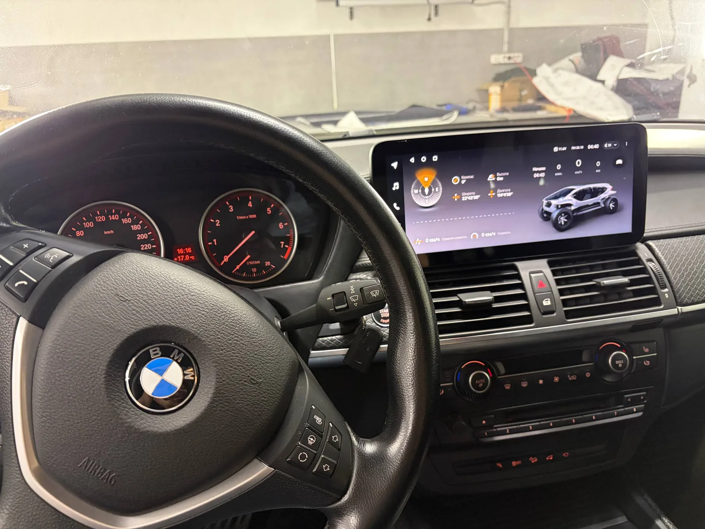
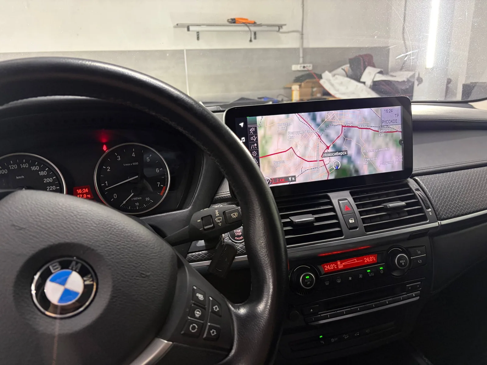
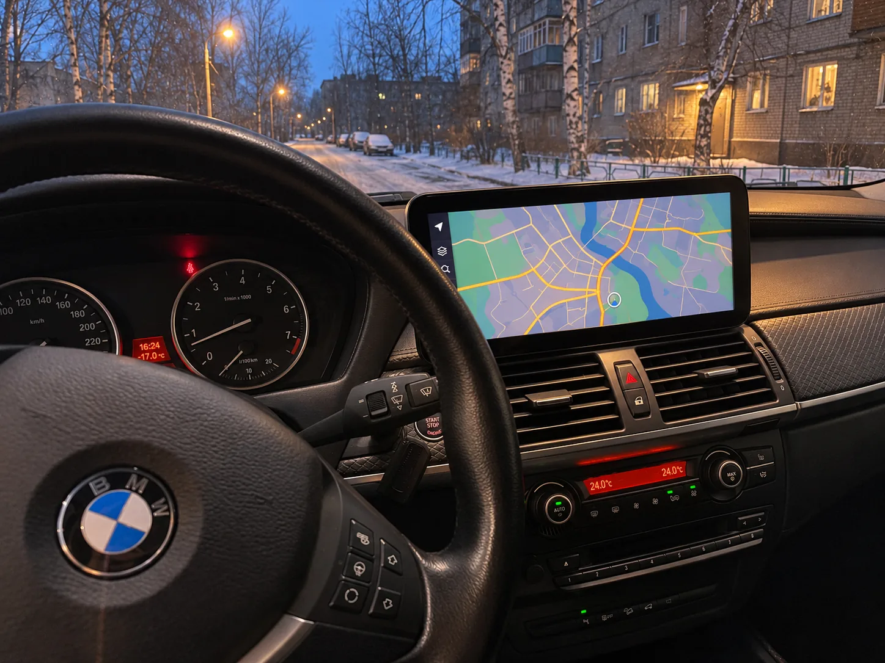
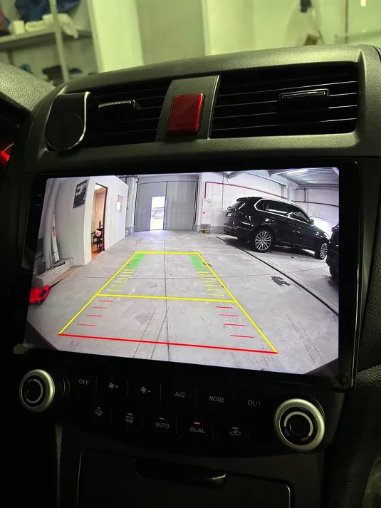
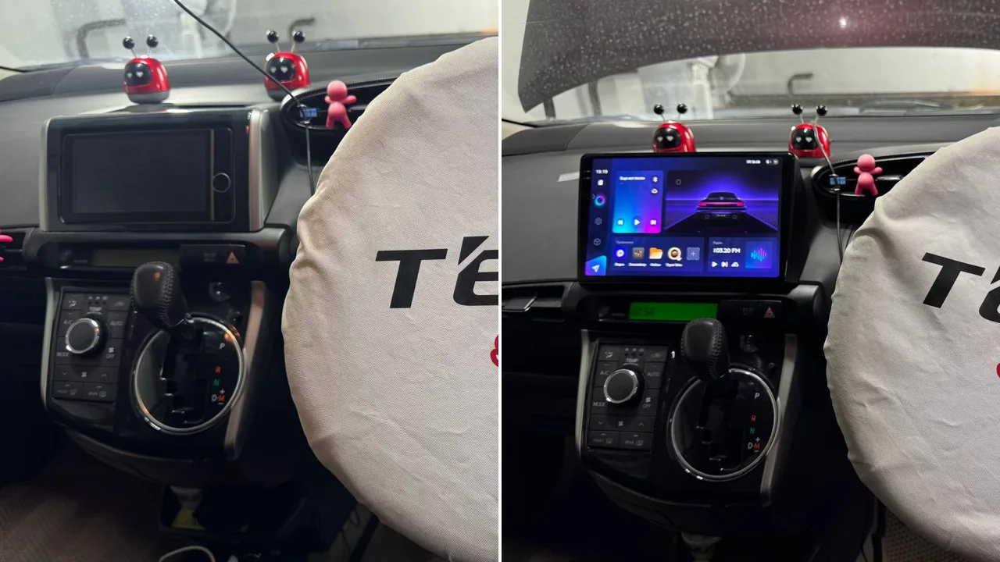
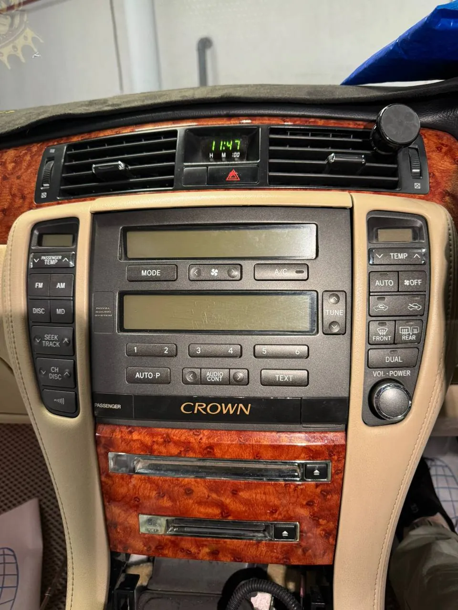
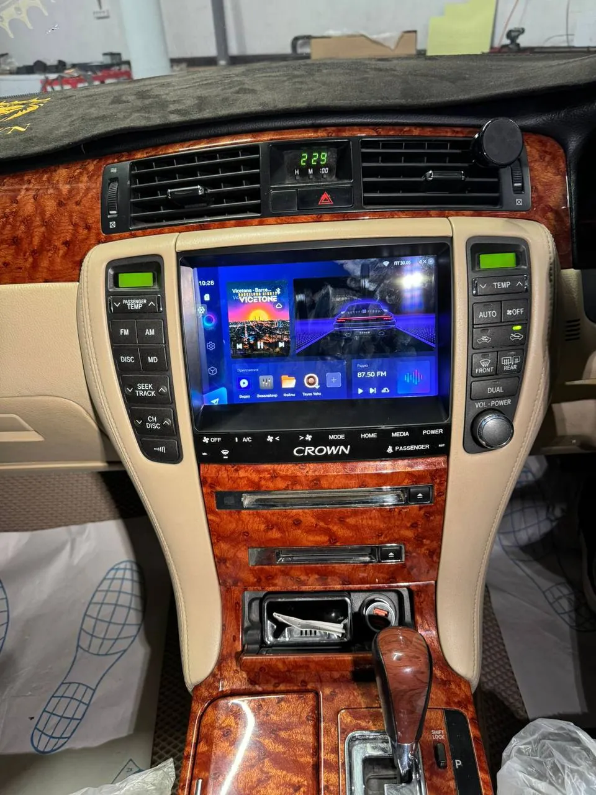
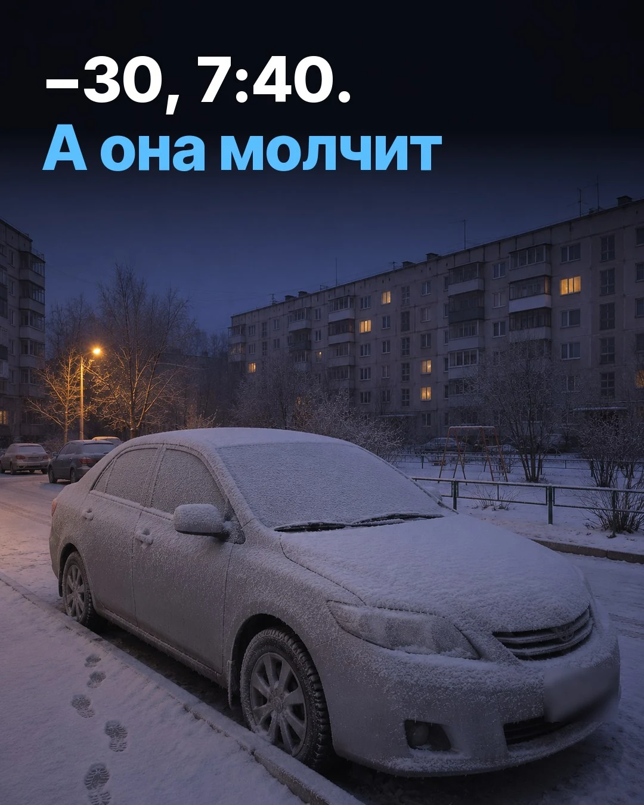
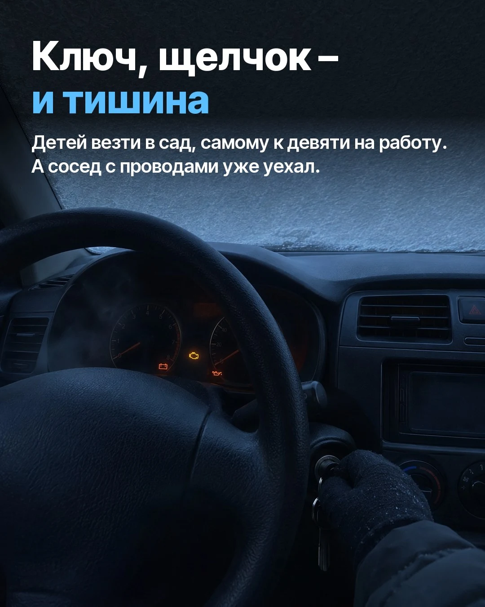
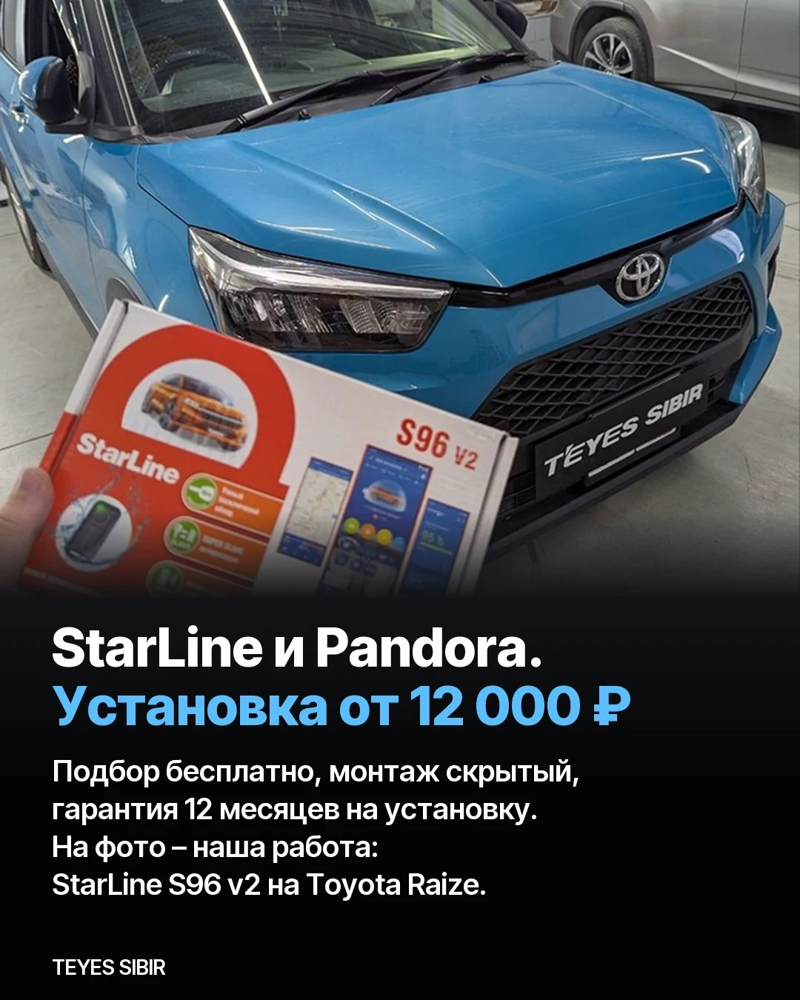

# Постинг TEYES: 7 готовых материалов для разбора – кейс, блог, ВК, Яндекс и Google Карты, Дзен, карусель

17.11.2026. Всё сделано полностью и не опубликовано. Факты – из записи мастеров, фото и живого сайта; цен и сроков, которых нет на сайте, нет. Под каждым материалом – почему так и что проверить.

## Что внутри

| Канал | Материал | Основа |
|---|---|---|
| Сайт – кейс | SEO-кейс BMW X5 E70, Teyes 12″ | живая работа №360, 5 фото без номеров |
| ВК | пост-кейс + 4 фото + 1 генерация от реального кадра | та же работа |
| Яндекс Карты | новость, 1 115 знаков, 4 фото | та же работа |
| Google Карты | новость, 642 знака, проверка кодом – 0 ошибок | та же работа |
| Сайт – блог | «Магнитола на Honda Accord» – ~1 400 слов, таблица поколений, FAQ, разметка | спрос 195 НСК / 4 389 РФ, 3 наши работы по Accord |
| Дзен – статья | «Японская магнитола: русифицировать или менять на Teyes?» | спрос сильнее всего в Новосибирске, формат-вопрос работал на канале |
| Дзен – карусель | «−30, 7:40. А она молчит» – 7 карточек + пост | «не заводится машина» 2 049 НСК / 132 887 РФ |

## Нужно от тебя – главное

1. **BMW X5 №360:** в записи мастера CC3 12″, а в каталоге для E70 такой нет – ставили CC4? Камера заднего вида – заводская или наша? Карта на фото – штатная BMW или приложение на Teyes?
2. **Автозапуск – три цены на странице сигнализаций:** 12 000 в таблице, 9 000 во вкладке, 1 500 в мобильной вкладке (похоже на ошибку). В карусели стоит 12 000 – подтверди. И что на Raize (карточка 6) – наша работа с автозапуском.
3. **Accord:** переписать этим текстом страницу модели /multimedia_teyes/honda/accord вместо отдельной статьи? В каталоге под Accord 7 только CC3L, а мастера ставили CC4 – добавить и выложить работу №279.
4. **Японские магнитолы:** русифицируем сами? Страница русификации – только про китайцев, поэтому ссылка из Дзена ведёт на установку Teyes.
5. **Подпись «Артём Галимов»** в кейсе и блоге – подтверди.
6. **Генерация в ВК:** картинка сгенерирована от кадра этой работы (зимний двор за стеклом) – ставим как есть или с пометкой.

---

## Живой кейс №360 – BMW X5 2011, Teyes CC3 12″ и микрофон в штатное место

Запись мастера от 04.11.2026: «BMW X5, 2011, CC3 12 дюймов, микрофон в штатное место». Пять фото «после», все без госномера: сзади на машине табличка TEYES SIBIR, а номер чужой машины на экране камеры я закрыл ровно по рамке. №361 Subaru отпал: три кадра, на одном виден номер, на кадре камеры стоит человек. У №358 Prado на двух кадрах из шести номер крупным планом, «после» только два.



### 1. SEO-кейс для сайта

**Адрес:** `https://teyes-sibir.ru/work/bmw/ustanovka-teyes-cc3-bmw-x5-e70-novosibirsk`
**Title (52 знака):** Магнитола Teyes CC3 12″ на BMW X5 E70 в Новосибирске
**Description (144 знака):** BMW X5 2011 (E70): поставили Teyes CC3 12″ и микрофон в штатное место. На экране – Android, меню iDrive, навигация и задняя камера. Фото работы.
**H1:** Установка магнитолы Teyes CC3 12″ на BMW X5 E70 2011 в Новосибирске
**Хлебные крошки:** Главная / Наши работы / BMW / Teyes CC3 12″ на BMW X5 E70
**Автор:** Артём Галимов, основатель техцентра TEYES Sibir

---

**Первый абзац – ответ:**
4 ноября 2026 года мастера TEYES Sibir в Новосибирске поставили на BMW X5 2011 года (кузов E70) мультимедиа Teyes CC3 с экраном 12 дюймов, а микрофон громкой связи – в штатное место. Экран стоит наверху торпедо, над центральными дефлекторами. На нём открываются рабочий стол Teyes на Android, штатное меню iDrive на русском, карта BMW и картинка задней камеры со схемой парктроника. Все четыре экрана – на фото работы ниже.

Кнопка: **Подобрать Teyes для BMW X5** → форма заявки

---

**H2: Что заказал владелец BMW X5 2011 года**

Владелец пришёл с двумя задачами: поставить Teyes CC3 с экраном 12 дюймов и установить микрофон для громкой связи в штатное место. Ниже по шагам, что сделали мастера.

**H2: Что сделали мастера на BMW X5 E70**

- Установили Teyes CC3 12″ наверху торпедо, на место штатного экрана, над центральными дефлекторами.
- Подключили мультимедиа так, что штатное меню iDrive открывается на новом экране: радио, CD и мультимедиа, телефон, навигация, ConnectedDrive, настройки.
- Вывели на экран Teyes картинку задней камеры с линиями траектории и схемой датчиков парковки.
- Поставили микрофон громкой связи в штатное место.
- После установки мастер открыл каждый экран и снял его на фото: рабочий стол Teyes, меню iDrive, карту, заднюю камеру.

**H2: Что получил владелец после установки Teyes CC3**

- Экран 12 дюймов с Android и рабочим столом Teyes: на нём компас, скорость, высота и координаты.
- Штатное меню BMW на русском – на том же экране. Слева на экранах меню, камеры и карты видна панель Teyes для перехода в Android.
- Карту BMW на всю ширину экрана.
- Заднюю камеру с линиями траектории и схемой парктроника на 12 дюймах.
- Микрофон громкой связи в штатном месте.
- Блок климата и кнопки под экраном остались на своих местах и не изменились.

Как это выглядит в машине – на фото.

**H2: Фото установки Teyes CC3 12″ на BMW X5 E70**


*Вид с места водителя: экран Teyes CC3 12″ стоит наверху торпедо, на нём рабочий стол Teyes.*


*Главное меню iDrive на новом экране: радио, телефон, навигация, ConnectedDrive, информация об автомобиле, настройки.*


*Картинка задней камеры с линиями траектории, справа – схема датчиков парковки.*


*Карта с Новосибирском на всю ширину экрана, слева панель Teyes.*


*BMW X5 в установочном центре TEYES Sibir на Сухарной.*

Перед заказом такой установки на свой X5 полезно знать одну вещь про комплекты.

**H2: Что важно знать про магнитолу на BMW X5 E70**

В каталоге TEYES Sibir комплекты Teyes для BMW X5 E70 2006–2014 годов идут в двух исполнениях: под штатную систему CCC и под CIC. Цена и состав у них разные, поэтому мастер сначала определяет систему в вашей машине.

Проще всего прислать фото штатного экрана с открытым главным меню. На этом X5 2011 года меню – вертикальный список «Радио, Телефон, Навигация, Office, ConnectedDrive», как на фото выше.

Ещё одна работа на этом кузове – [Teyes LUX ONE на BMW X5 E70](https://teyes-sibir.ru/teyes_lux_one_bmw_x5_e70).

**H2: Вопросы о Teyes на BMW X5 E70**

**Можно ли поставить Teyes на BMW X5 E70 и оставить штатное меню iDrive?**
Да. На этом BMW X5 2011 года штатное меню iDrive на русском открывается на экране Teyes CC3 12″: радио, телефон, навигация, настройки. Какие функции сохранятся на вашей машине, мастер скажет до установки по системе CCC или CIC и выбранному комплекту.

**Куда ставят микрофон Teyes на BMW X5 E70?**
В этой работе мастер поставил микрофон громкой связи в штатное место BMW. Место согласуем до установки.

**Какой комплект Teyes нужен для BMW X5 E70: CCC или CIC?**
В каталоге TEYES Sibir комплекты для X5 E70 2006–2014 годов идут в двух исполнениях: под штатную систему CCC и под CIC. Пришлите фото штатного экрана с главным меню, и мастер определит, какое исполнение подойдёт.

**Сколько стоит установка магнитолы на BMW X5 E70?**
Установка головного устройства в TEYES Sibir стоит от 4 500 ₽. Teyes CC3 12″ для X5 E70 в каталоге сайта сейчас нет, цену комплекта назовёт менеджер. Для сравнения в каталоге: Teyes CC4 12.3″ для X5 E70 с системой CIC – от 51 190 ₽, CC4 Pro 12.3″ – от 72 040 ₽. Цены на 17.11.2026.

**H2: Подберём Teyes для вашего BMW X5 E70**

Пришлите год выпуска и фото штатного экрана с главным меню. Мастер определит CCC или CIC, назовёт комплект и цену установки. Адрес: Новосибирск, Сухарная, 35 к13, 1 этаж, помещение 110, пн–пт с 11:00 до 19:00.

Кнопка: **Узнать цену для своего X5** → форма заявки

**Перелинковка на странице:**
- [Магнитолы Teyes для BMW](https://teyes-sibir.ru/store/catalog/bmw) – в «Что получил» (слово «Teyes CC3») и в «Что важно знать» (слово «каталоге»)
- [Установка Teyes в Новосибирске](https://teyes-sibir.ru/services/installation_teyes) – в FAQ о цене (слово «от 4 500 ₽»)
- [Teyes LUX ONE на BMW X5 E70](https://teyes-sibir.ru/teyes_lux_one_bmw_x5_e70) – в «Что важно знать»
- [Все работы по BMW](https://teyes-sibir.ru/work/bmw) – в хлебных крошках

**Разметка JSON-LD** (Article + Service + AutomotiveBusiness + FAQPage + BreadcrumbList):

```json
{
  "@context": "https://schema.org",
  "@graph": [
    {
      "@type": "Article",
      "@id": "https://teyes-sibir.ru/work/bmw/ustanovka-teyes-cc3-bmw-x5-e70-novosibirsk#article",
      "headline": "Установка магнитолы Teyes CC3 12″ на BMW X5 E70 2011 в Новосибирске",
      "description": "BMW X5 2011 (E70): поставили Teyes CC3 12″ и микрофон в штатное место. На экране – Android, меню iDrive, навигация и задняя камера. Фото работы.",
      "mainEntityOfPage": "https://teyes-sibir.ru/work/bmw/ustanovka-teyes-cc3-bmw-x5-e70-novosibirsk",
      "datePublished": "2026-11-17",
      "dateModified": "2026-11-17",
      "inLanguage": "ru",
      "author": {
        "@type": "Person",
        "name": "Артём Галимов",
        "jobTitle": "Основатель техцентра TEYES Sibir"
      },
      "publisher": {
        "@id": "https://teyes-sibir.ru/#org"
      },
      "image": [
        "https://teyes-sibir.ru/work/bmw/ustanovka-teyes-cc3-bmw-x5-e70-novosibirsk/bmw-x5-e70-teyes-cc3-salon.webp",
        "https://teyes-sibir.ru/work/bmw/ustanovka-teyes-cc3-bmw-x5-e70-novosibirsk/bmw-x5-e70-teyes-cc3-menyu-idrive.webp",
        "https://teyes-sibir.ru/work/bmw/ustanovka-teyes-cc3-bmw-x5-e70-novosibirsk/bmw-x5-e70-teyes-cc3-kamera-zadnego-vida.webp",
        "https://teyes-sibir.ru/work/bmw/ustanovka-teyes-cc3-bmw-x5-e70-novosibirsk/bmw-x5-e70-teyes-cc3-navigaciya.webp",
        "https://teyes-sibir.ru/work/bmw/ustanovka-teyes-cc3-bmw-x5-e70-novosibirsk/bmw-x5-e70-teyes-sibir-vid-szadi.webp"
      ],
      "about": {
        "@id": "https://teyes-sibir.ru/work/bmw/ustanovka-teyes-cc3-bmw-x5-e70-novosibirsk#service"
      }
    },
    {
      "@type": "Service",
      "@id": "https://teyes-sibir.ru/work/bmw/ustanovka-teyes-cc3-bmw-x5-e70-novosibirsk#service",
      "name": "Установка магнитолы Teyes на BMW X5 E70",
      "serviceType": "Установка мультимедиа Teyes",
      "provider": {
        "@id": "https://teyes-sibir.ru/#org"
      },
      "areaServed": {
        "@type": "City",
        "name": "Новосибирск"
      },
      "url": "https://teyes-sibir.ru/services/installation_teyes",
      "offers": {
        "@type": "Offer",
        "priceCurrency": "RUB",
        "price": "4500",
        "description": "Установка головного устройства, цена от",
        "url": "https://teyes-sibir.ru/services/installation_teyes"
      }
    },
    {
      "@type": "AutomotiveBusiness",
      "@id": "https://teyes-sibir.ru/#org",
      "name": "TEYES Sibir",
      "url": "https://teyes-sibir.ru/",
      "telephone": "+7 995 437-92-66",
      "address": {
        "@type": "PostalAddress",
        "streetAddress": "ул. Сухарная, 35 к13, 1 этаж, помещение 110",
        "addressLocality": "Новосибирск",
        "addressCountry": "RU"
      },
      "openingHours": "Mo-Fr 11:00-19:00"
    },
    {
      "@type": "FAQPage",
      "@id": "https://teyes-sibir.ru/work/bmw/ustanovka-teyes-cc3-bmw-x5-e70-novosibirsk#faq",
      "mainEntity": [
        {
          "@type": "Question",
          "name": "Можно ли поставить Teyes на BMW X5 E70 и оставить штатное меню iDrive?",
          "acceptedAnswer": {
            "@type": "Answer",
            "text": "Да. На этом BMW X5 2011 года штатное меню iDrive на русском открывается на экране Teyes CC3 12″: радио, телефон, навигация, настройки. Какие функции сохранятся на вашей машине, мастер скажет до установки по системе CCC или CIC и выбранному комплекту."
          }
        },
        {
          "@type": "Question",
          "name": "Куда ставят микрофон Teyes на BMW X5 E70?",
          "acceptedAnswer": {
            "@type": "Answer",
            "text": "В этой работе мастер поставил микрофон громкой связи в штатное место BMW. Место согласуем до установки."
          }
        },
        {
          "@type": "Question",
          "name": "Какой комплект Teyes нужен для BMW X5 E70: CCC или CIC?",
          "acceptedAnswer": {
            "@type": "Answer",
            "text": "В каталоге TEYES Sibir комплекты для X5 E70 2006–2014 годов идут в двух исполнениях: под штатную систему CCC и под CIC. Пришлите фото штатного экрана с главным меню, и мастер определит, какое исполнение подойдёт."
          }
        },
        {
          "@type": "Question",
          "name": "Сколько стоит установка магнитолы на BMW X5 E70?",
          "acceptedAnswer": {
            "@type": "Answer",
            "text": "Установка головного устройства в TEYES Sibir стоит от 4 500 ₽. Teyes CC3 12″ для X5 E70 в каталоге сайта сейчас нет, цену комплекта назовёт менеджер. Для сравнения в каталоге: Teyes CC4 12.3″ для X5 E70 с системой CIC – от 51 190 ₽, CC4 Pro 12.3″ – от 72 040 ₽. Цены на 17.11.2026."
          }
        }
      ]
    },
    {
      "@type": "BreadcrumbList",
      "itemListElement": [
        {
          "@type": "ListItem",
          "position": 1,
          "name": "Главная",
          "item": "https://teyes-sibir.ru/"
        },
        {
          "@type": "ListItem",
          "position": 2,
          "name": "Наши работы",
          "item": "https://teyes-sibir.ru/work"
        },
        {
          "@type": "ListItem",
          "position": 3,
          "name": "BMW",
          "item": "https://teyes-sibir.ru/work/bmw"
        },
        {
          "@type": "ListItem",
          "position": 4,
          "name": "Teyes CC3 12″ на BMW X5 E70",
          "item": "https://teyes-sibir.ru/work/bmw/ustanovka-teyes-cc3-bmw-x5-e70-novosibirsk"
        }
      ]
    }
  ]
}
```

**Почему так.** Спрос по Вордстату (XMLRiver, 17.11.2026): «магнитола бмв х5 е70» – 341 в месяц по России и 9 по Новосибирску, «teyes bmw x5 e70» – 43, «замена магнитолы бмв х5 е70» – 27. Поэтому в title стоят «магнитола», «Teyes», «BMW X5 E70» и город, а модель CC3 отделяет кейс от готовой страницы про LUX ONE на том же кузове, чтобы они не делили один запрос. Каждый блок отвечает на вопрос, который вызывает предыдущий: что заказали → что сделали → что получил → покажите → а мне что подойдёт → сколько стоит → как записаться. Надзаголовков нет, H2 – с ключом или прямым утверждением. Шаблонных шагов «работу выполнили аккуратно», как в образце Camry, и чужой модели в тексте (у Camry там «Прадо 150») нет.

**Проверено:** title 52 знака, description 144 знака (подсчёт кодом); JSON-LD разобран `json.loads` без ошибок; длинного тире нет нигде в файле (grep); цены взяты с живых страниц: установка – teyes-sibir.ru/services/installation_teyes, комплекты X5 E70 – API магазина Тильды для /store/catalog/bmw; все ссылки отвечают 200. Смета Вордстата: 17 запросов ≈ 0,43 ₽.

### 2. Пост ВК (vk.com/teyes.magnitola)

**Картинки в порядке карусели:**
1.  – сгенерирована от реального кадра работы
2. 
3. 
4. 
5. 

**Текст:**

> BMW X5 E70 и Android на 12 дюймов: что остаётся от штатной системы
>
> Если у вас X5 2006–2014 года и хочется большой экран с Android, первым делом встаёт вопрос: куда денутся меню iDrive и задняя камера.
>
> В начале ноября такой X5 2011 года был у нас. Мастера поставили Teyes CC3 с экраном 12 дюймов наверху торпедо, над дефлекторами, а микрофон громкой связи – в штатное место. Блок климата и кнопки под экраном остались как были.
>
> Что теперь у владельца на одном экране:
> – рабочий стол Teyes на Android;
> – штатное меню iDrive на русском: радио, телефон, навигация, настройки;
> – карта BMW на всю ширину;
> – задняя камера с линиями траектории и схемой парктроника.
>
> Для X5 E70 комплекты Teyes делают под штатную систему CCC и под CIC. Хотите так же – напишите в сообщения сообщества год машины и пришлите фото штатного экрана с главным меню. По фото определим систему и подберём комплект.
>
> Магнитолы Teyes для BMW: https://teyes-sibir.ru/store/catalog/bmw?utm_source=vk&utm_medium=social&utm_campaign=keys&utm_content=360_bmw_x5
>
> TEYES Sibir, Новосибирск, Сухарная, 35 к13

**Почему так.** Пост начинается с ситуации читателя с таким же X5, а не с рассказа о себе; обещания – только то, что видно на фото. Следующий шаг один – сообщение в сообщество с фото экрана: без этого фото комплект не подобрать. Ссылка ведёт в каталог BMW, потому что страницы кейса ещё нет: когда кейс выйдет, адрес заменить на него, метку оставить.

**Картинка.** Codex imagegen (модель Sol, бесплатно) с первой попытки сделал её от реального кадра с картой (`telegram_3135`): тот же руль, приборка, экран и климат, за стеклом зимний вечерний двор. На картинке нет текста и людей, номера у дальних машин не читаются. Я посмотрел её глазами. Исходник лежит в `~/.cache/teyes-keys/gen/`.

### 3. Новость Яндекс Карт

**Фото (4):** keys/bmw-x5-e70-teyes-cc3-salon.webp, keys/bmw-x5-e70-teyes-cc3-menyu-idrive.webp, keys/bmw-x5-e70-teyes-cc3-kamera-zadnego-vida.webp, keys/bmw-x5-e70-teyes-sibir-vid-szadi.webp

**Текст (1 115 знаков):**

> BMW X5 2011 года: Teyes CC3 с экраном 12 дюймов и микрофон в штатном месте
>
> Владелец BMW X5 E70 приехал в установочный центр TEYES Sibir с двумя задачами: поставить мультимедиа Teyes CC3 с экраном 12 дюймов и установить микрофон громкой связи в штатное место.
>
> Что сделали мастера:
> – установили Teyes CC3 12″ наверху торпедо, над центральными дефлекторами;
> – подключили так, что на новом экране открывается штатное меню iDrive на русском: радио, телефон, навигация, настройки;
> – вывели на экран картинку задней камеры с линиями траектории и схемой парктроника;
> – поставили микрофон громкой связи в штатное место.
>
> Что получил владелец. Широкий экран с Android и рабочим столом Teyes, а рядом, на том же экране, привычное меню BMW и карта. На 12 дюймах видно заднюю камеру с линиями траектории и схемой датчиков парковки. Блок климата и кнопки под экраном остались на своих местах.
>
> Если у вас X5 2006–2014 года: комплекты Teyes для E70 делают под штатную систему CCC и под CIC. Пришлите фото штатного экрана с главным меню, по нему подберём нужный комплект.
>
> TEYES Sibir, Новосибирск, Сухарная, 35 к13, первый этаж.

**Почему так.** Около 1 100 знаков – в коридоре 500–1 000 из скилла с небольшим запасом, на телефоне читается без «ещё». Четвёртым фото поставил машину в нашем цехе: карточке на Картах нужна привязка к месту. Телефона, ссылок, слов капсом от 6 букв, «до/после» и длинного тире нет – проверил кодом по запретам скилла yandex-karty-novosti.

### 4. Новость Google Карт

**Фото:** keys/bmw-x5-e70-teyes-cc3-salon.webp (для окна Google – JPEG той же картинки, `~/.cache/teyes-keys/google-foto.jpg`)
**Кнопка:** «Подробнее» → `https://teyes-sibir.ru/store/catalog/bmw?utm_source=google_maps&utm_medium=organic&utm_campaign=gbp_news&utm_content=360_bmw_x5`

**Текст (642 знака):**

> BMW X5 2011 года – поставили мультимедиа Teyes CC3 с экраном 12 дюймов.
>
> Что сделали в установочном центре TEYES Sibir:
> – установили Teyes CC3 12″ наверху торпедо, над дефлекторами;
> – микрофон громкой связи поставили в штатное место;
> – вывели на новый экран штатное меню iDrive и картинку задней камеры с парктроником.
>
> Блок климата и кнопки под экраном остались на своих местах. На одном экране теперь открываются и Android, и меню BMW.
>
> Комплекты Teyes для BMW X5 E70 делают под штатную систему CCC и под CIC, поэтому подбираем по фото штатного экрана. Приезжайте на Сухарную, 35 к13 в Новосибирске или смотрите магнитолы для BMW по кнопке.

**Почему так.** Порядок как у вышедшей новости про Duster: машина и год → что сделали списком → что получил → куда приехать или нажать. Размер экрана есть в записи мастера («12 дюймов»), поэтому его можно писать. Цены и сроков в тексте нет. Кнопка ведёт в каталог BMW, ближайшую живую страницу.

**Проверено:** `proverit(текст, google-foto.jpg, 'LEARN_MORE', ссылка)` вернул `[]`; ссылка кнопки отвечает 200.

### Что проверить Артёму

1. **Teyes CC3 12″ для X5 E70 в каталоге сайта нет**, там только CC4 12.3″ и CC4 Pro 12.3″. Модель в записи верная? Если ставили CC4, поправить везде, и тогда цену можно писать из каталога.
2. **Кузов E70 и система CIC** выведены из года (2011) и вида меню на фото, в записи мастера этого нет.
3. **Задняя камера:** на фото она в интерфейсе штатной системы со схемой парктроника. Камера заводская или её ставили мы? Если ставили – это отдельная работа, её надо добавить в тексты.
4. **Карта на фото 4** – штатная навигация BMW (так я её подписал) или приложение на Teyes?
5. **Кнопки руля, штатный звук, контроллер iDrive** не упомянуты ни в записи, ни на фото – я про них не писал. Если работают, можно добавить строку.
6. **Где именно штатное место микрофона** – в записи этого нет, в текстах написано без места.
7. **Ссылки ВК и Google ведут в каталог BMW**, пока страницы кейса нет. После выхода кейса заменить адрес, метки оставить. Адреса картинок в JSON-LD заменить на адреса из Тильды после загрузки; дату `datePublished` поставить по дню выхода.
8. **Автор Артём Галимов** стоит в странице и в разметке, как на живом кейсе Camry. По памяти автора внедряют только по отдельному слову – подтвердить.

---

## Статья блога сайта

**Мета**

| Поле | Значение |
|---|---|
| Адрес | /blog/honda-accord-teyes-headunit |
| Title (59) | Android-магнитола на Honda Accord 7–10: какую Teyes ставить |
| Description (154) | Какая Teyes встаёт на Honda Accord 7, 8, 9 и 10, что остаётся от штатной магнитолы и что прислать для подбора. По каталогу и нашим работам в Новосибирске. |
| H1 | Магнитола на Honda Accord: какую Teyes ставить и что сохранится из штатного |
| Главный запрос | андроид магнитола хонда аккорд |
| Соседние | установка андроид магнитолы хонда аккорд 8; установка магнитолы аккорд 8; установка магнитолы хонда аккорд 7; магнитола аккорд |
| Ведёт на | /multimedia_teyes/honda/accord (страница модели) и /services/installation_teyes |
| Автор | Артём Галимов, основатель техцентра TEYES Sibir |
| Картинки | `honda-accord-7-teyes-cc4-panel.webp` (обложка и в тексте), `honda-accord-7-teyes-cc4-salon.webp`, `honda-accord-teyes-cc3-2k-kamera.webp` – все с наших работ, номеров в кадре нет |

---

# Магнитола на Honda Accord: какую Teyes ставить и что сохранится из штатного

Андроид магнитола Teyes встаёт на Хонда Аккорд (Honda Accord) 7, 8, 9 и 10 в штатное место, но комплект у каждого поколения свой. В каталоге TEYES Sibir под Accord 7 есть CC3L, под Accord 8 – CC3L и CC4 Pro, под Accord 9 и 10 – ещё версии с экраном 12,3 дюйма. Кнопки руля после замены работают, климат остаётся на своих кнопках, а что ещё сохранится на вашей машине, видно по фото центральной панели.

Это разбор по нашим работам: у нас есть фото трёх установок на Accord – CC4 на Accord 7 2007 года (фото ниже), CC3 2K с новой камерой заднего вида и LUX ONE 12 дюймов на Accord 8, две последние опубликованы на сайте. Ниже – как понять своё поколение, какую модель брать под него и что проверить до заказа.

> **Не знаете, какое у вас поколение?** Пришлите фото центральной панели в [Telegram](https://t.me/teyesnsk) – скажем, какой комплект встанет. Все варианты для этой машины собраны на странице [замена магнитолы Honda Accord](https://teyes-sibir.ru/multimedia_teyes/honda/accord).


*Honda Accord 7, 2007 год: Teyes CC4 в штатном месте, климат по-прежнему на своих кнопках. Работа TEYES Sibir, сентябрь 2026.*

## Поколения Honda Accord и комплекты Teyes под них

Под одним названием Accord ездят разные машины: у каждого поколения своя панель, свой проём под магнитолу и своя проводка. Поэтому Teyes подбирают не по слову «Accord», а по поколению. Из Новосибирска чаще всего спрашивают про установку на Accord 7 и 8.

| Поколение | Годы выпуска | Кузова | Teyes в каталоге TEYES Sibir | Наши работы |
|---|---|---|---|---|
| Accord 7 (Япония, Европа) | 2002–2008 | седан CL7, CL8 (полный привод), CL9; универсал CM1–CM3 | CC3L | CC4 на Accord 7 2007 года |
| Accord 8 (Япония, Европа) | 2008–2015, в каталоге Teyes – 2008–2012 | седан CU1–CU3; универсал CW1–CW3 | CC3L, CC4 Pro | LUX ONE 12 дюймов в отдельной рамке |
| Accord 9 | 2012–2017 | кузов CR | CC3L, CC4 Pro, CC4 12,3", CC4 Pro 12,3" | – |
| Accord 10 | в каталоге 2017–2023 | кузов CV | CC3L (рамка A или B), CC4 Pro, CC4 12,3" и CC4 Pro 12,3" (тип A или B) | – |

Есть комплекты и для Accord 6 1997–2002 года: CC3L и CC4 Pro.

Важно про название. В США под именем Accord продавали другую, более крупную машину, а японско-европейский Accord 7 и 8 там назывался Acura TSX. У американского Accord 8 своя панель, и Teyes делает под него отдельные сборки. Если машина привезена из США, рамка от европейского Accord не подойдёт – это видно по фото.

## Какую Teyes ставить на Honda Accord 7

В каталоге под Accord 7 стоит [Teyes CC3L](https://teyes-sibir.ru/store/catalog/honda/tproduct/953284757452-shtatnaya-magnitola-teyes-cc3l-honda-acc): 4/32 ГБ, экран IPS 1280×720, слот под SIM-карту с 4G, DSP. Это модель прошлого поколения: для навигации, музыки и звонков её хватает. Текущее поколение – CC4 с экраном 2K QLED.

На Accord 7 2007 года в сентябре 2026 мы ставили CC4 – на фото выше. Экран встал на место штатной магнитолы, дефлекторы и кнопка аварийки над ним на своём месте, климат управляется кнопками под экраном, как раньше. У Teyes под Accord 7 есть рамки и для CC4L, CC4 и CC4 Pro, в том числе с экраном 11 и 13 дюймов. Какая рамка нужна, решает панель: у Accord 7 для Японии штатно могла стоять навигация InterNavi с сенсорным экраном 7 дюймов, и с ней проём другой.


*Тот же Accord 7: экран вписан в штатную панель, отделку салона не меняли.*

## Какую Teyes ставить на Honda Accord 8

Под Accord 8 в каталоге два варианта: [CC3L](https://teyes-sibir.ru/store/catalog/honda/tproduct/260083445302-shtatnaya-magnitola-teyes-cc3l-honda-acc) и [CC4 Pro](https://teyes-sibir.ru/store/catalog/honda/tproduct/253096628232-shtatnaya-magnitola-teyes-cc4-pro-honda) с памятью 8/128 или 12/256 ГБ. У CC4 Pro в каталоге продаётся сама магнитола с базовыми проводами – рамку и проводку под машину подбирают отдельно, это входит в подбор комплекта.

Если хочется большой экран, на Accord 8 можно поставить LUX ONE 12 дюймов. Мы делали это через редкую рамку в верхней части панели: через CAN на экран вывели кнопки руля, открытые двери и климат-контроль, плюс поставили новую камеру заднего вида. Подробно – на странице работы [LUX ONE 12″ на Honda Accord 8](https://teyes-sibir.ru/honda_accord_8_teyes_lux_one_12).

## Teyes на Honda Accord 9 и 10

У Accord 9 и 10 выбор шире: кроме CC3L и CC4 Pro, в каталоге есть CC4 и CC4 Pro с экраном 12,3 дюйма и разрешением 1920×720. У CC4 Pro на 12,3 дюйма в каталоге указан левый руль: для праворульной машины вариант проверяем отдельно.

У Accord 10 рамки двух типов, A и B, и это разные комплекты, а не цвет или память. Какой тип у вашей машины, видно по фото панели – по нему и заказываем, чтобы не ждать вторую рамку.

## Что сохранится из штатного после замены магнитолы на Honda Accord

Главное, о чём спрашивают до записи, – не пропадёт ли привычное. По нашим работам на Accord выходит так:

- **Кнопки на руле.** Работают с новой магнитолой: подключаем через CAN или адаптер. На обоих Accord со страниц работ кнопки сохранились.
- **Климат.** Управляется своими кнопками, как раньше. На Accord 8 с LUX ONE его состояние ещё и выводится на экран.
- **Камера заднего вида.** Штатную подключаем через адаптер, если подходит её сигнал; если нет – ставим новую. На Accord с CC3 2K поставили новую камеру с линиями, которые изгибаются при повороте руля.
- **Штатный усилитель и USB.** Проверяем по комплектации до заказа: от этого зависит, какие переходники нужны.


*Honda Accord с Teyes CC3 2K и новой камерой заднего вида. Работа TEYES Sibir.*

Что даёт сама магнитола: Яндекс Навигатор и 2ГИС, музыку по Bluetooth и через интернет SIM-карты, беспроводные CarPlay и Android Auto на CC4 и CC4 Pro.

## Honda Accord из Японии: что проверить до заказа

Праворульный Accord из Японии отличается от европейского не только рулём. В комплектации могла стоять штатная навигация с экраном, а не простая магнитола, и тогда рамка нужна под другой проём. Японское меню, карты Японии и японский FM-диапазон уходят вместе со штатной магнитолой – новая Teyes ловит наши станции и ведёт по нашим картам.

Если вы ещё думаете, не перевести ли японскую магнитолу на русский, сначала сравните: перевод меню не ускоряет старое устройство и не всегда даёт поставить нужные приложения. Об этом – на странице [русификации и замены на Honda Accord](https://teyes-sibir.ru/multimedia_teyes/honda/accord).

## Как подобрать Teyes на ваш Honda Accord

Подбор начинается с фото, а не с названия модели. Пришлите в Telegram одним сообщением:

1. Центральную панель прямо, при включённом зажигании.
2. Панель приборов при включённом зажигании – по ней видно рынок.
3. Руль с кнопками.
4. Год выпуска и, если знаете, номер кузова.
5. Есть ли камера заднего вида и шильдик аудиосистемы на дверях.

По фото определим поколение и рынок, проверим рамку и разъёмы, скажем, что сохранится из штатного, и назовём состав комплекта. Сама установка на Accord с CC3 2K заняла у нас один день. Приезжайте: Новосибирск, Сухарная 35 корпус 13, пн–пт с 11:00 до 19:00 – покажем экраны вживую и сравним модели. Цены комплектов – в [каталоге Teyes для Honda](https://teyes-sibir.ru/store/catalog/honda).

> **Подберём Teyes под ваш Accord по одному фото панели.** [Написать в Telegram](https://t.me/teyesnsk) · +7 (995) 437-92-66 · [Установка Teyes в TEYES Sibir](https://teyes-sibir.ru/services/installation_teyes)

## Вопросы об установке Teyes на Honda Accord

### Какую магнитолу Teyes поставить на Honda Accord 8?
В каталоге под Accord 8 есть CC3L и CC4 Pro. CC4 Pro – старшая модель с памятью 8/128 или 12/256 ГБ, к ней подбирают рамку и проводку под машину. Если нужен экран побольше, на Accord 8 встаёт LUX ONE 12 дюймов в отдельной рамке – мы такое делали.

### Сохранятся ли кнопки на руле Accord после замены магнитолы?
Да, кнопки руля подключаются к Teyes через CAN или адаптер. На обоих Accord, которые есть у нас на сайте, они работают. Какой адаптер нужен вашей машине, видно по фото руля и году.

### Можно ли оставить штатную камеру заднего вида?
Можно, если её сигнал подходит к Teyes – тогда подключаем через адаптер. Если не подходит или камеры нет, ставим новую, как на Accord с CC3 2K.

### Подойдёт ли рамка от европейского Accord на Accord из США?
Нет. Американский Accord 7 и 8 – другая машина с другой панелью, под американский Accord 8 у Teyes отдельные сборки. Пришлите фото панели, и мы скажем, какая рамка ваша.

### Что прислать для подбора Teyes на Accord?
Фото центральной панели и приборов при включённом зажигании, руль, год выпуска и есть ли камера заднего вида. По этому определяем поколение, рынок и состав комплекта до заказа.

## Каталог и работы по Honda Accord

- [Замена магнитолы и русификация Honda Accord](https://teyes-sibir.ru/multimedia_teyes/honda/accord)
- [Каталог Teyes для Honda](https://teyes-sibir.ru/store/catalog/honda)
- [Teyes CC3L для Honda Accord 7](https://teyes-sibir.ru/store/catalog/honda/tproduct/953284757452-shtatnaya-magnitola-teyes-cc3l-honda-acc)
- [Teyes CC4 Pro для Honda Accord 8](https://teyes-sibir.ru/store/catalog/honda/tproduct/253096628232-shtatnaya-magnitola-teyes-cc4-pro-honda)
- [Работа: Teyes CC3 2K и камера на Honda Accord](https://teyes-sibir.ru/teyes_cc3_2k_honda_accord)
- [Работа: Teyes LUX ONE 12″ на Honda Accord 8](https://teyes-sibir.ru/honda_accord_8_teyes_lux_one_12)
- [Установка Teyes в Новосибирске](https://teyes-sibir.ru/services/installation_teyes)
- [Сигнализация StarLine с автозапуском – можно в тот же визит](https://teyes-sibir.ru/services/alarm_installation)
- [Все статьи блога](https://teyes-sibir.ru/blog)

*Автор: Артём Галимов, основатель техцентра TEYES Sibir.*

<!--
ИСТОЧНИКИ ФАКТОВ (под статьёй, на сайт не выводить)
- Поколения, годы, кузова Accord 7: https://en.wikipedia.org/wiki/Honda_Accord_(Japan_and_Europe_seventh_generation) – «October 2002 – November 2008», седан CL7, CL8 (AWD), CL9, универсал CM1–CM3; в США и Канаде – Acura TSX; в Японии опция InterNavi DVD с сенсорным экраном 7".
- Accord 8: https://en.wikipedia.org/wiki/Honda_Accord_(Japan_and_Europe_eighth_generation) – производство 2008–2015, CU1–CU3 / CW1–CW3, в Северной Америке – Acura TSX второго поколения.
- Два размера Accord 8 («маленький» Европа и Япония, «большой» США, Канада, Китай): https://ru.wikipedia.org/wiki/Honda_Accord
- Accord 9: https://en.wikipedia.org/wiki/Honda_Accord_(ninth_generation) – август 2012–2017 (Северная Америка), коды CR1–CR7.
- Accord 10, CV, годы; все комплекты, память, экраны 12,3" 1920×720, «руль: Левый», «рамка и проводка не входят» (CC4 Pro): каталог teyes-sibir.ru/store/catalog/honda, Tilda Store API, снято 17.11.2026.
- Рамки CC4L/CC4/CC4 Pro и экраны 11/13" под Accord 7, отдельные сборки Teyes под Accord 8 USA: карточка ~/Documents/Teyes-контент/материалы/подбор-мультимедиа/Honda-Accord/КАРТОЧКА.md (teyes.com.ru, статус «только каталог», 23.09.2026).
- CC3L – прошлое поколение: ~/Documents/Teyes-контент/материалы/TEYES_SIBIR_КОМПАНИЯ.md, раздел 4.
- Работа CC4 на Accord 7 2007: Case Studio, работа №279 (диск 0090_Honda_Accord_7_2007), 02.09.2026, на сайте не опубликована.
- Работа CC3 2K + новая камера, кнопки руля сохранились, «работа заняла 1 день»: https://teyes-sibir.ru/teyes_cc3_2k_honda_accord
- Работа LUX ONE 12″ на Accord 8, редкая рамка сверху, CAN: кнопки руля, двери, климат; новая камера: https://teyes-sibir.ru/honda_accord_8_teyes_lux_one_12
- Камера штатная через адаптер или новая, усилитель и USB – по проверке: https://teyes-sibir.ru/multimedia_teyes/honda/accord
- Что прислать для подбора: МЕТОДИЧКА_ПОДБОР_TEYES.md, §2.2.
- Адрес, часы, телефон, Telegram: подвал teyes-sibir.ru и TEYES_SIBIR_КОМПАНИЯ.md.
- Коды ответа всех ссылок статьи – 200 (curl, 17.11.2026).
-->

```json
[
  {
    "@context": "https://schema.org",
    "@type": "Article",
    "headline": "Магнитола на Honda Accord: какую Teyes ставить и что сохранится из штатного",
    "description": "Какая Teyes встаёт на Honda Accord 7, 8, 9 и 10, что остаётся от штатной магнитолы и что прислать для подбора. По каталогу и нашим работам в Новосибирске.",
    "image": "https://static.tildacdn.com/tild6165-3664-4664-a339-636363313766/Jfp-FNaEZ-kqA3g19C0W.png",
    "datePublished": "2026-11-17",
    "dateModified": "2026-11-17",
    "inLanguage": "ru",
    "mainEntityOfPage": "https://teyes-sibir.ru/blog/honda-accord-teyes-headunit",
    "author": {
      "@type": "Person",
      "name": "Артём Галимов",
      "jobTitle": "основатель техцентра TEYES Sibir"
    },
    "publisher": {
      "@type": "Organization",
      "name": "TEYES Sibir",
      "url": "https://teyes-sibir.ru",
      "telephone": "+7 995 437-92-66",
      "address": {
        "@type": "PostalAddress",
        "streetAddress": "ул. Сухарная, 35, корпус 13, помещение 110",
        "addressLocality": "Новосибирск",
        "postalCode": "630001",
        "addressCountry": "RU"
      }
    },
    "about": {
      "@type": "Car",
      "name": "Honda Accord",
      "brand": { "@type": "Brand", "name": "Honda" }
    }
  },
  {
    "@context": "https://schema.org",
    "@type": "FAQPage",
    "mainEntity": [
      {
        "@type": "Question",
        "name": "Какую магнитолу Teyes поставить на Honda Accord 8?",
        "acceptedAnswer": { "@type": "Answer", "text": "В каталоге под Accord 8 есть CC3L и CC4 Pro. CC4 Pro – старшая модель с памятью 8/128 или 12/256 ГБ, к ней подбирают рамку и проводку под машину. Если нужен экран побольше, на Accord 8 встаёт LUX ONE 12 дюймов в отдельной рамке – мы такое делали." }
      },
      {
        "@type": "Question",
        "name": "Сохранятся ли кнопки на руле Accord после замены магнитолы?",
        "acceptedAnswer": { "@type": "Answer", "text": "Да, кнопки руля подключаются к Teyes через CAN или адаптер. На обоих Accord, которые есть у нас на сайте, они работают. Какой адаптер нужен вашей машине, видно по фото руля и году." }
      },
      {
        "@type": "Question",
        "name": "Можно ли оставить штатную камеру заднего вида?",
        "acceptedAnswer": { "@type": "Answer", "text": "Можно, если её сигнал подходит к Teyes – тогда подключаем через адаптер. Если не подходит или камеры нет, ставим новую, как на Accord с CC3 2K." }
      },
      {
        "@type": "Question",
        "name": "Подойдёт ли рамка от европейского Accord на Accord из США?",
        "acceptedAnswer": { "@type": "Answer", "text": "Нет. Американский Accord 7 и 8 – другая машина с другой панелью, под американский Accord 8 у Teyes отдельные сборки. Пришлите фото панели, и мы скажем, какая рамка ваша." }
      },
      {
        "@type": "Question",
        "name": "Что прислать для подбора Teyes на Accord?",
        "acceptedAnswer": { "@type": "Answer", "text": "Фото центральной панели и приборов при включённом зажигании, руль, год выпуска и есть ли камера заднего вида. По этому определяем поколение, рынок и состав комплекта до заказа." }
      }
    ]
  },
  {
    "@context": "https://schema.org",
    "@type": "BreadcrumbList",
    "itemListElement": [
      { "@type": "ListItem", "position": 1, "name": "Главная", "item": "https://teyes-sibir.ru/" },
      { "@type": "ListItem", "position": 2, "name": "Блог", "item": "https://teyes-sibir.ru/blog" },
      { "@type": "ListItem", "position": 3, "name": "Магнитола на Honda Accord: какую Teyes ставить", "item": "https://teyes-sibir.ru/blog/honda-accord-teyes-headunit" }
    ]
  }
]
```

**Почему так.** Спрос: «магнитола аккорд» Новосибирск ≥188 / Россия ≥4 122 и «магнитола honda accord» ≥7 / ≥267 в месяц (Wordstat через XMLRiver, широкое соответствие, 17.11.2026, `spros-wordstat-2026-11-17.csv`); хвосты по поколениям в Новосибирске – «хонда аккорд установка андроид магнитолы» 19, «установка магнитолы аккорд 8» 19, «установка андроид магнитолы хонда аккорд 8» 10, «установка магнитолы хонда аккорд 7» 5 (Wordstat, 11.11.2026, deford-poteri `установка_магнитолы.json`). По Новосибирску сильнее Accord только Freed (≥305) и Fit (≥204) – по ним уже есть статьи на Дзене и реальных фото больше; Accord оставил, потому что материала нет ни на одной площадке, есть 5 заездов (лист 24.07.2026), 3 наши работы и спрос, расписанный по поколениям. Ford Focus и Lada сильнее, но решение «берём ли массовые марки» за Артёмом. Главный запрос взят «андроид магнитола хонда аккорд» с разбором по поколениям, чтобы не спорить со страницей модели за «магнитола honda accord».

**Что проверить Артёму**
1. Каннибализация: страница /multimedia_teyes/honda/accord держит «магнитола honda accord», но поколений не разбирает. Статья или переписать этим текстом саму страницу модели – решение за тобой.
2. Под Accord 7 в каталоге только CC3L (прошлое поколение), а мы ставили CC4 (работа №279, 02.09.2026). Добавить CC4 под Accord 7 в каталог и опубликовать работу №279 – тогда в статью встанет ссылка на неё.
3. «Установка за 1 день» взята со страницы работы CC3 2K. Гарантий в тексте нет: на страницах работ стоят «2 года на оборудование и пожизненная на работы», в базе компании это под вопросом.
4. Подпись автора и `author` в JSON-LD стоят, а внедрять подпись ты велел по отдельному слову (01.11.2026) – подтверди. Article.image сейчас указывает на фото камеры с CDN Тильды: после загрузки поменять на `honda-accord-7-teyes-cc4-panel.webp`, а `datePublished` – на дату выхода.

---

## Статья Дзена

**Заголовок (55):** Японская магнитола: русифицировать или менять на Teyes?

**Обложка:** `dzen-oblozhka-yaponskaya-magnitola-ili-teyes.webp`, 1280×720. Это реальные кадры нашей работы, Toyota Wish с правым рулём: слева штатная японская магнитола, справа Teyes CC3 2K, радио на 103.20 FM. Собрал из двух фото Case Studio (папка «73_Toyota wish», страница работы /teyes_cc3_2k_toyota_wish), генерации нет, номеров в кадре нет. Codex не понадобился.



**Ссылка:** https://teyes-sibir.ru/services/installation_teyes?utm_source=dzen&utm_medium=article&utm_campaign=japan-headunit-russify-or-teyes

---

# Японская магнитола: русифицировать или менять на Teyes?

Русификация переводит меню, но магнитола остаётся японской.

Знакомая картина: машину пригнали из Японии, она хорошая, а магнитола живёт своей жизнью. Меню на японском, навигатор показывает Токио, радио ловит две станции из десяти. Первая мысль – найти, кто русифицирует. В Новосибирске эту мысль думают особенно часто: почти каждый десятый запрос «русификация японских автомагнитол» в России – отсюда.

Прежде чем платить за перевод, стоит понять, что именно он меняет.

## Что остаётся японским после русификации

В запросах это обычно магнитолы Toyota с названием на NSZT, хондовские Gathers и Carrozzeria от Pioneer. Русификация меняет язык надписей. Железо внутри остаётся прежним, и вместе с ним остаются четыре японские особенности.

**Радио.** FM-диапазон в Японии – 76–95 МГц, а до 2011 года был 76–90. У нас станции вещают на 87,5–108 МГц. Японский тюнер ловит только нижний край этого списка, для остального нужен отдельный FM-конвертер. Перевод меню на это не влияет.

**Телевизор.** Японские магнитолы принимают цифровое ТВ стандарта ISDB-T. В России эфир идёт в DVB-T2. Кнопка «ТВ» на русском языке всё равно покажет пустой экран.

**Навигация.** Карты в штатном навигаторе – японские. Перевод интерфейса не добавит ни Новосибирска, ни пробок.

**Код после аккумулятора.** Штатные магнитолы Toyota защищены от кражи: отключили аккумулятор – магнитола просит код. Его ищут по номеру ERC на экране, и с русификацией эта история никуда не девается.


*Toyota Crown до замены: штатная японская аудиосистема. Фото нашей работы.*

## Когда русификации достаточно

Если экран вас устраивает, по городу вы ездите с телефоном на держателе, а мешают только непонятные надписи – перевода меню может хватить. Но тогда честно признайте, что это косметика: магнитола будет такой же медленной, как была, а приложения на неё поставить получится не всегда.

Если же вы хотите навигатор с пробками, музыку без проводов и радио со всеми станциями, разумнее сразу менять.

## Что даёт замена на Teyes

Штатную магнитолу снимают, а Teyes ставят в рамку под эту машину, поэтому панель выглядит как с завода. Дальше всё по-русски: Яндекс Навигатор, 2ГИС, музыка через интернет SIM-карты, CarPlay и Android Auto, радио на наших частотах. Кнопки на руле подключаются к новой магнитоле. Штатную камеру заднего вида подключаем через адаптер, если подходит её сигнал, иначе ставим новую.

Пример с обложки – Toyota Wish. Штатный японский экран поменяли на Teyes CC3 2K и заодно поставили круговой обзор 360° с четырьмя камерами. Работа заняла один день. Радио на снимке «после» стоит на 103.2 FM – частоте, до которой японский тюнер не доставал.


*Тот же Crown после: Teyes CC3 2K в штатной рамке, блок климата перенесли ниже.*

С Crown было сложнее: пришлось дорабатывать центральную консоль. Блок климата перенесли вниз, а Teyes вписали в штатную рамку так, что салон выглядит заводским.

## Как понять, что подойдёт вашей машине

Ответ зависит от модели и года, а не от слова «японская». Хватит одного фото: центральная панель при включённом зажигании, рядом приборка и руль. По нему видно, какая стоит магнитола, какая рамка нужна под Teyes и что сохранится из штатного – кнопки руля, камера, климат.

Если думаете, русифицировать или менять, пришлите фото панели мастерам TEYES Sibir в Новосибирске – подскажем, какой Teyes встанет в вашу машину: [установка Teyes в Новосибирске](https://teyes-sibir.ru/services/installation_teyes?utm_source=dzen&utm_medium=article&utm_campaign=japan-headunit-russify-or-teyes).

<!--
ИСТОЧНИКИ (не публиковать)
- FM в Японии 76–95 МГц, до отключения аналогового ТВ 24.07.2011 – 76–90: https://en.wikipedia.org/wiki/FM_broadcasting_in_Japan ; Европа 87,5–108 МГц: https://en.wikipedia.org/wiki/FM_broadcast_band
- ISDB-T – японский стандарт ТВ: https://en.wikipedia.org/wiki/ISDB ; в России эфир в DVB-T2: https://ru.wikipedia.org/wiki/Цифровое_телевидение_в_России
- Код после отключения питания, ERC: https://www.drom.ru/faq/toyota/prius_a/Pomogite-pozhaluysta-razblokirovat-magnitolu-NSCT-W61--nashel-ERC-kod-C1C06121B3BF8560--336702.html ; https://www.pakwheels.com/forums/t/solution-for-locked-japanese-car-multimedia-navigation-units/3017378
- Японская навигация на японском, карты не наши: TEYES_SIBIR_КОМПАНИЯ / БОЛИ_И_СКВОЗНЫЕ_МЫСЛИ.md, мысль 2.
- «Перевод меню не меняет производительность и не всегда открывает приложения»: https://teyes-sibir.ru/multimedia_teyes/honda/accord
- «Почти каждый десятый»: «русификация японских автомагнитол» НСК 66 / РФ 615 (Wordstat через XMLRiver, 17.11.2026).
- Toyota Wish: CC3 2K + 360° с четырьмя камерами, за 1 день: https://teyes-sibir.ru/teyes_cc3_2k_toyota_wish ; фото «до/после» – Case Studio, работа 93 (папка «73_Toyota wish»).
- Toyota Crown: CC3 2K, блок климата перенесли вниз, кастомная установка в штатную рамку: https://teyes-sibir.ru/cc3_2k_toyota_crown ; фото – Case Studio, работа 37 (папка «34_Toyota crown 2004»).
- Кнопки руля, камера через адаптер или новая: https://teyes-sibir.ru/multimedia_teyes/honda/accord и страницы работ.
-->

**Почему так.** Спрос в Новосибирске: «русификация японских автомагнитол» 66 / Россия 615, «русификация японской магнитолы» 21 / 439 в месяц (Wordstat через XMLRiver, 17.11.2026). Доля Новосибирска около 11% – для города с 1% населения страны это заметно выше среднего. Хвосты по Новосибирску: «русификация gathers» 46, «русификация pioneer carrozzeria» 17, «nszt w62g русификация» 7+5, «установка фм конвертера для японской магнитолы» 12 (Wordstat, 11.11.2026). Формат заголовка-вопроса «русифицировать или менять» на канале дочитывают лучше шаблона: Camry XV80 – 67% дочитываний, Wildlander – 37%, у шаблона в августе медиана 6 дочитываний (студия Дзена, 05.11.2026). Обложка «до/после» на реальной машине – по правилу «нашу работу – только реальным фото».

**Что проверить Артёму**
1. Берём ли мы русификацию японских магнитол сами? Страница /services/russification_of_cars сейчас только про китайские машины, поэтому ссылка ведёт на установку Teyes, а в тексте не сказано, что русифицируем мы.
2. В плане ноября есть статья №82 «Русифицировать японскую магнитолу или поставить Teyes» (сайт 24.11) и пересказ на Дзене 26.11 – эта статья их опережает. Пересказ №82 снять или развести по теме.
3. На обложке игрушки клиента на панели Wish и наш чехол руля TEYES SIBIR – оставляем или кадрируем?
4. utm_campaign `japan-headunit-russify-or-teyes` – завести в учёт Метрики вместе с проверкой реферера dzen.ru.

---

## Карусель Дзена: «−30, а она молчит» – автозапуск до морозов

Пост-карусель для канала dzen.ru/teyes_sibir, 7 карточек 1080×1350 (4:5) WebP, ссылка в тексте ведёт на страницу установки сигнализации. Не опубликовано. По плану – ср 18.11.2026.

### Карточки по порядку

1. Обложка – ситуация: «−30, 7:40. А она молчит»



2. Боль: «Ключ, щелчок – и тишина»



3. Объяснение одним слайдом: почему мороз глушит машину


4. Что будет, если не решить: провода, такси, «буду позже»


5. Как решаем – товар прямо: сигнализация с автозапуском


6. Цена и наша работа: StarLine и Pandora, установка от 12 000 ₽, StarLine S96 v2 на Toyota Raize



7. Призыв: «Поставьте до −30»


JPG-копии тех же карточек лежат в `karusel/jpg/` – на случай, если загрузчик Дзена не примет WebP: в справке форматы не названы.

### Первая строка (она же заголовок поста)

**−30, 7:40, а она молчит. Что сделать, пока настоящие морозы не ударили**

### Текст поста целиком (2102 знаков из 4 096)

> −30, 7:40, а она молчит. Что сделать, пока настоящие морозы не ударили
>
> Ключ, щелчок стартера, второй – и тишина. Детей везти в сад, самому к девяти на работу, а сосед с проводами уже уехал. Сосед с проводами – лучший друг в декабре, но дружить с ним каждое утро до марта не хочется.
>
> Почему так. На морозе масло густеет, а аккумулятор отдаёт меньше тока. Стартеру всё труднее провернуть ледяной мотор. Чем дольше машина стоит во дворе на холоде, тем тяжелее ей утром.
>
> Что проверить до морозов:
> 1. Аккумулятор. Попросите в сервисе проверить его под нагрузкой: напряжение «на глаз» ничего не скажет.
> 2. Клеммы. Окислы и слабый контакт съедают ток, которого на морозе и так мало.
> 3. Масло. Первое число в маркировке (0W, 5W) – про холодный пуск: чем оно меньше, тем жиже масло на морозе.
> 4. Незамерзайка и щётки. Залить зимнюю жидкость до первых −20, а не в день, когда стекло уже замёрзло.
> 5. Автозапуск. Если машина ночует во дворе, а не в тёплом гараже, это главный пункт списка.
>
> Как работает автозапуск. Сигнализация сама заводит мотор: по таймеру, с брелока или с телефона. Вы допиваете чай, смотрите в окно – машина уже работает. Выходите к прогретому мотору и тёплому салону, а не скребёте лёд в ледяной машине. Можно добавить подогрев водительского сиденья и блокировку руля.
>
> Кому это нужно:
> – тем, кто утром везёт детей и не может опоздать;
> – тем, кто бережёт мотор и не хочет трогаться на ледяном;
> – тем, кому надоело 15 минут сидеть в холодном салоне, пока оттает стекло.
>
> Что у нас. TEYES Sibir в Новосибирске ставит сигнализации StarLine и Pandora с автозапуском. Подбор оборудования – бесплатно, монтаж скрытый, без следов, гарантия 12 месяцев на установку. Установка сигнализации с автозапуском – от 12 000 ₽, работа – 4–6 часов. Точную цену комплекта «сигнализация + установка» посчитаем под вашу машину и бюджет.
>
> На карусели – наша работа: StarLine S96 v2 на Toyota Raize.
>
> Посчитать комплект и записаться – [на странице установки сигнализации](https://teyes-sibir.ru/services/alarm_installation?utm_source=dzen&utm_medium=post&utm_campaign=moroz_avtozapusk). Напишите марку, модель и год – подберём, что поставить, пока не ударило −30.
>
> TEYES Sibir: Новосибирск, Сухарная 35 к13, пн–пт 11:00–19:00.

### Ссылка

Одна, встроенная: выделить слова «на странице установки сигнализации» и вставить адрес. На карточках ссылок нет.

`https://teyes-sibir.ru/services/alarm_installation?utm_source=dzen&utm_medium=post&utm_campaign=moroz_avtozapusk`

Адрес отвечает 200 (проверено curl 17.11.2026).

### Почему так

- **Спрос:** «не заводится машина» – 2 049 в месяц по Новосибирску и 132 887 по России; «сигнализация с автозапуском» – 2 507 / 115 287 (Wordstat через XMLRiver, 17.11.2026, план `teyes-posting-363c9fe4/dannye/dzen.md`). Тема из широкого спроса, товар появляется на 5-й карточке.
- **Факты только с живой страницы** teyes-sibir.ru/services/alarm_installation (снята 17.11.2026): StarLine и Pandora, автозапуск по таймеру, управление со смартфона, бесплатный подбор, монтаж без следов, гарантия 12 месяцев на установку, 4–6 часов работы, опции подогрев сиденья и блокировка руля, «Сигнализация с автозапуском – от 12 000 руб» в таблице «Стоимость установки сигнализации».
- **Картинки:** 6 сцен нарисовал Codex imagegen (бесплатно) – двор Новосибирска в ноябре, тонкий снег и иней, как в прогнозе на 18.11 (−6…+2, пасмурно, open-meteo); машины массовые, не Lada, без лиц; номера размыты по рамке. Карточка 6 – реальное фото работы с сайта (Toyota Raize, StarLine S96 v2, табличка TEYES SIBIR вместо номера). Текст на карточках рисует скрипт `redakciya/scripts/karusel.py`, не нейросеть. Формат 4:5 – справка Дзена размер не задаёт (до 10 картинок, до 30 МБ, первая – обложка, кадрирование в редакторе).

### Что проверить Артёму

1. **Цена.** На странице две цены автозапуска: в таблице «Стоимость установки» – от 12 000 руб, во вкладках «Сигнализации с автозапуском» – от 9 000 р, а в копии вкладок для телефона – от 1 500 р (похоже на ошибку копирования). В карусели и посте – 12 000 ₽. Какая верная? 1 500 на сайте стоит поправить.
2. **Фото Raize:** это наша работа и на ней стоял автозапуск? Подпись «наша работа: StarLine S96 v2 на Toyota Raize».
3. **Метка:** по правилу «скрытая UTM» для чужой площадки чище адрес `/go/dzen-moroz/` с 301 на страницу с меткой – если Тильда даст сделать редирект. Сейчас метка в адресе, но в посте адрес спрятан под словами, читатель его не видит.
4. **Выкладка:** публикуете вы; первый пост канала – заодно тест, кликается ли встроенная ссылка в ленте и доходит ли метка до Метрики (считать по utm_campaign=moroz_avtozapusk и рефереру dzen.ru).

## Что раскрыть

- Почему для кейса выбрал BMW X5, а не Forester или Prado.
- Как это встанет в ритм завода: кто пишет и выкладывает каждую неделю.
