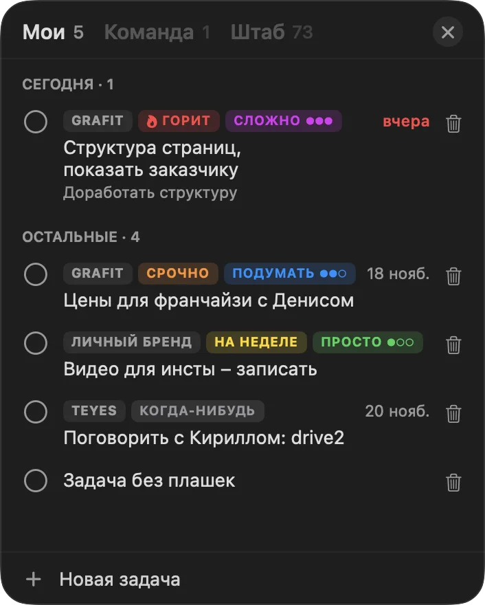
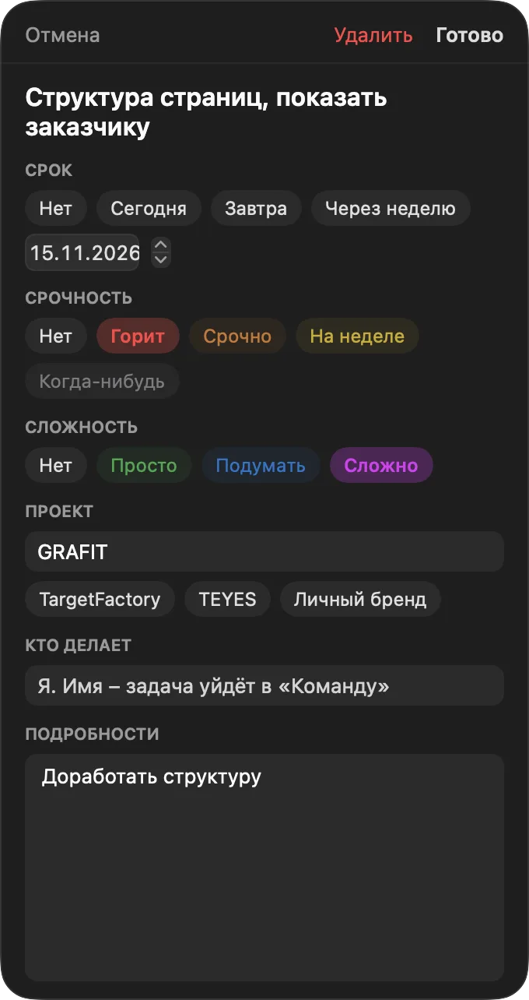

# Задачи: срочность, сложность и проект – плашками над задачей

Панель «Задачи» на маке теперь показывает над каждой задачей мелкие плашки: проект, срочность и сложность цветом. Выбирать их можно в самой панели. Ева и чаты уже могут их ставить командой; голосом через Еву – следующий шаг.

## Шкала, которую ты выбрал

| | Уровни | Цвет |
|---|---|---|
| Срочность | Горит, Срочно, На неделе, Когда-нибудь | красный, оранжевый, жёлтый, серый |
| Сложность | Просто, Подумать, Сложно | зелёный, синий, фиолетовый + точки ●○○ / ●●○ / ●●● |
| Проект | любое название | серая плашка |

Срочность – тёплые цвета, сложность – холодные, чтобы не путались.

## Как выбирать в панели

- Нажал на задачу – в окне правки три новых ряда: «Срочность», «Сложность», «Проект». Проект можно вписать или нажать один из уже встречавшихся.
- Правый клик по задаче – меню «Срочность / Сложность / Проект»: поставить или снять, не открывая задачу.
- «Горит» сама попадает в раздел «Сегодня», даже без срока. Списки идут по срочности, потом по сроку.

## Что проверено

- Тесты: хранилище 138, панель 69, окно 12 – все прошли.
- Снимки панели глазами: список, вкладка «Команда», окно правки.
- Приложение поставлено в ~/Applications, читает боевой список (18 задач).
- Коммиты: zadachi-vidzhet 44c00a5, 076070d, dcaf77d; Штаб 7f4055c (формат в шапке файла задач).

## Нужно от тебя

1. Открыть «Задачи» и поставить плашки паре задач – посмотреть, нравятся ли цвета и размер.
2. Сказать «газ» на шаг 2 – Ева в боте: понимает голосом «горит», «сложно», «проект GRAFIT» и ставит в панель.
3. Планер deford.ru/planner – третьим шагом; запись на доску только после твоего «да».

## Что раскрыть

- Как это лежит в файле: хвосты `проект:GRAFIT срочность:горит сложность:сложно` в строке задачи.
- Команда для чатов: `Zadachi --add "…" --proekt GRAFIT --srochno горит --slozhno сложно`.
