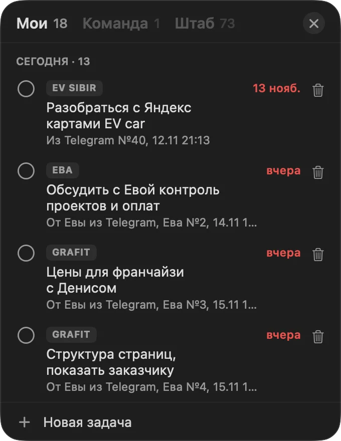

# Задачи: проекты расставлены, Ева понимает срочность и сложность голосом

Все 18 открытых задач получили плашку проекта. Ева теперь, ставя задачу в панель, кладёт туда проект, срочность и сложность – как ты их сказал. Сама панель показывает плашки над задачей и даёт выбирать их руками.

## Проекты в задачах

| Проект | Задачи |
|---|---|
| GRAFIT | цены для франчайзи, структура страниц, Минск сервис (Ирина) |
| Гром | три задачи по Тренеру и Ментору |
| Ева | контроль проектов и оплат, дубли сообщений бота |
| Нейросети | резервные копии диалогов, прогрев аккаунта |
| EV Sibir, Автобалл, TEYES, TargetFactory, Deford, SEO, Balance, Posiflora | по одной |

Приставки вроде «GRAFIT – …» и «Гром: …» из названий убрал – их показывает плашка. «Флора» записана как Posiflora: так это было в памяти. Поправь, если клиент другой.

## Как говорить Еве

Голосом или текстом, в одной фразе: «Поставь в задачи: позвонить Денису по ценам, GRAFIT, горит, просто».

- Срочность: «горит», «срочно», «на неделе», «когда-нибудь» (или «не срочно», «потом»).
- Сложность: «просто», «подумать», «сложно» (или «лёгкая», «средняя», «тяжёлая»).
- Проект: имя как на плашке. Если не назвал, но он очевиден из задачи, Ева поставит его сама. Срочность и сложность сама не выдумывает.
- В ответе Ева пишет, что поставила: «📌 В панель: … · GRAFIT · горит · просто».

## Шкала и цвета в панели

| | Уровни | Цвет |
|---|---|---|
| Срочность | Горит, Срочно, На неделе, Когда-нибудь | красный, оранжевый, жёлтый, серый |
| Сложность | Просто, Подумать, Сложно | зелёный, синий, фиолетовый + точки ●○○ / ●●○ / ●●● |
| Проект | любое имя | серая плашка |

В панели нажал на задачу – ряды «Срочность / Сложность / Проект». Правый клик по строке – то же меню без открытия. «Горит» сама попадает в «Сегодня».

## Что проверено

- Панель: тесты 138 + 69 + 12, все прошли; снимки глазами; стоит на маке, список из 18 задач читает с плашками.
- Бот Евы: 131 тест прошёл, выложен на claude-vps, служба работает. На сервере Ева уже видит в копии панели проекты задач.
- Живой разговор с Евой я не запускал: он поставил бы в твою панель настоящую задачу. Первая проверка – твоё сообщение ей.
- Коммиты: zadachi-vidzhet 44c00a5, 076070d, dcaf77d, f628f7c; Штаб 7f4055c, e437428; koordinator-bot 4ba8890.

## Нужно от тебя

1. Скажи Еве голосом одну задачу с проектом, срочностью и сложностью и посмотри, как она встала в панель.
2. Проставь срочность и сложность старым задачам – правым кликом, так быстрее всего.
3. Планер deford.ru/planner – следующим шагом; запись на доску только после твоего «да».

## Что раскрыть

- Поменять плашку у уже стоящей задачи голосом («GRAFIT цены – теперь горит»): пока не умеет, нужна очередь правок от Евы в панель.
- Формат в файле: `проект:GRAFIT срочность:горит сложность:сложно` в конце строки задачи.
