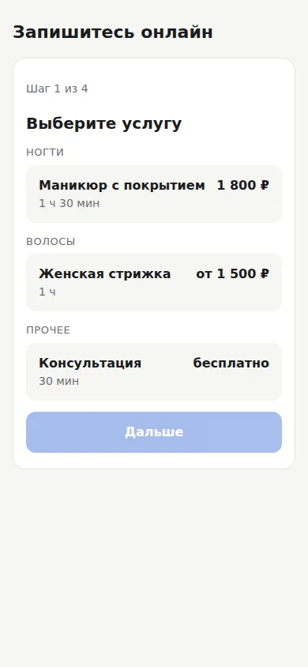
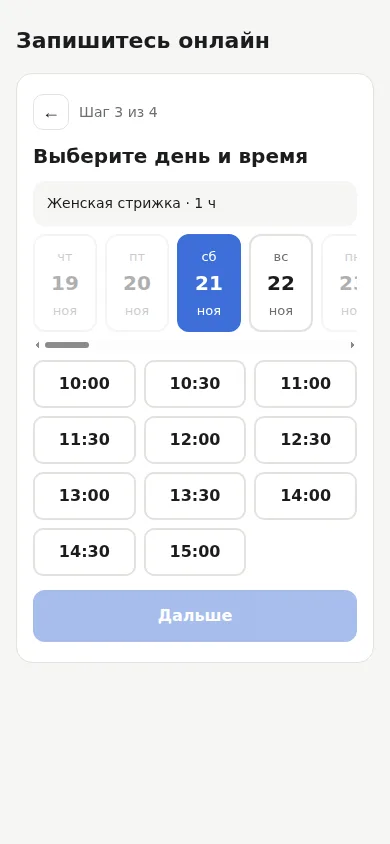
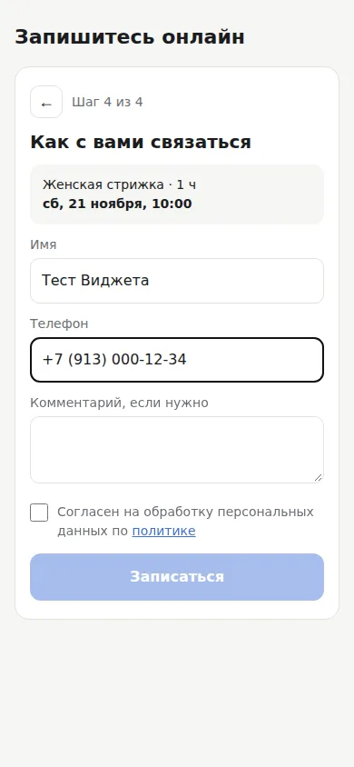
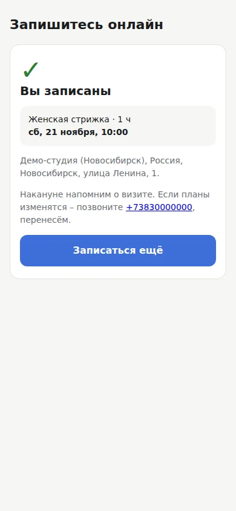
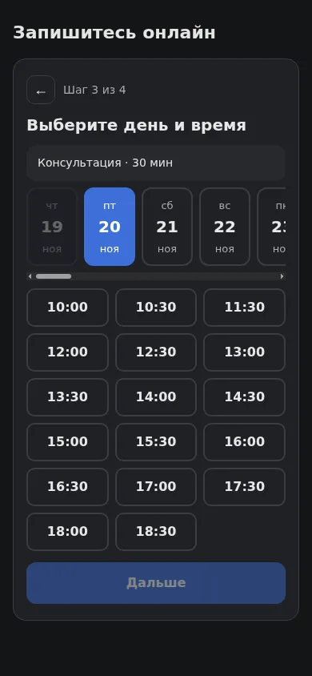

# Своя онлайн-запись в Яндекс Картах: технически можно, код готов, но Яндекс пускает только партнёра с 300+ клиентами или крупную сеть

19.11.2026 · проект `~/Sites/yandex-zapis`, репозиторий tema-mail/yandex-zapis (закрытый)

**Вывод.** Свой виджет Яндексу «отправить» нельзя: окно записи в Картах Яндекс рисует сам, одинаковое для всех. Можно другое – стать партнёром самим: поставить свой сервер записи, в который Яндекс ходит за услугами, мастерами и свободным временем. Такой сервер я написал по их спецификации, плюс наш виджет для сайтов на том же расписании. Упираемся не в код, а в допуск: по оферте партнёр – это сервис с 300+ подключёнными организациями или крупная сеть со своей CRM.

## 1. Как это работает у Яндекса: Яндекс – клиент, мы – сервер

- Человек жмёт «Записаться» в карточке на Картах → окно записи Яндекса → Яндекс спрашивает **наш** сервер: услуги, мастера, свободные даты, слоты → создаёт у нас запись.
- Вид окна в Картах настроить нельзя (так в справке Яндекса). Наш вид – только у виджета на нашем сайте.
- Протокол – 13 адресов, подпись каждого запроса ключом от Яндекса (JWT). Когда запись меняется у нас (подтвердили, перенесли, «пришёл / не пришёл»), мы сами шлём это в Яндекс, чтобы у клиента в Картах был верный статус.
- Денег Яндекс за это не берёт: «Соглашение является безденежным» (п. 13.1 оферты). Интеграция у них в среднем около месяца.

## 2. Кого пускают: здесь главное ограничение

| Требование | Откуда | Что значит для нас |
|---|---|---|
| Партнёр – сервис, где **более 300** организаций-клиентов | оферта, п. 1.1 | у нас пока столько нет |
| Или **крупная сеть** со своей CRM | инструкция для партнёров API | подходит сеть клиента (например, фитнес-сеть), а не одна точка |
| В тестовом фиде **не меньше 10** реальных организаций | инструкция | одной точкой даже тест не пройти |
| По умолчанию открыта только **красота**; авто, медицина, развлечения – через менеджера | инструкция | автосервисы TEYES и EV – только по согласованию |
| Тестовый сервер отдельно от боевого, сбои чинить за **2 рабочих дня**, иначе отключат | инструкция | держим два процесса и мониторинг |
| Яндекс может отказать или отключить по своему усмотрению | оферта, п. 5.3, 6.2, 7.2 | риск остаётся на нас |

Итог: подать заявку можно, но с честным ответом на «сколько у вас организаций». Реальные пути – (А) заявка от имени сети клиента, у которой 10+ точек; (Б) наш сервис записи как продукт для салонов и сервисов и заявка, когда наберём клиентов; (В) пока клиентам с одной точкой – обычный партнёр Яндекса (YCLIENTS, Dikidi и др.), а наш виджет – на их сайтах.

## 3. Что написано

- **Сервер по спецификации Яндекса** – все 13 адресов: фид организаций, услуги, мастера, отзывы, свободные даты, слоты, особые условия, запись (создать, посмотреть, перенести, отменить), предварительная бронь слота. Проверка подписи с защитой от подмены (телефон и компания в подписи должны совпасть с запросом).
- **Движок расписания** – шаг сетки, рабочие часы мастеров по дням, выходные, запас «не раньше чем через час», горизонт 30 дней, запрет переноса и отмены позже чем за N минут, «любой свободный мастер».
- **Наш виджет для сайтов** – одна строка вставки в Astro или Тильду, 4 шага, тёмная тема, маска телефона, пустая галочка согласия блокирует кнопку, скрытые UTM, цель Метрики только после ответа сервера.
- **Общие окна** – запись с сайта сразу пропадает в Картах и наоборот: одна база на оба входа.
- **Синхронизация в Яндекс** очередью с повторами: Яндекс недоступен – запись не теряется, повтор через 2, 4, 8… минут.
- Без внешних библиотек, один процесс на Node – ставится на любой наш сервер.

## 4. Что проверено

- **24 автотеста** зелёные. Главный – ответы сервера сверяются строго со схемами из спецификации Яндекса (лишнее поле – тоже ошибка).
- **Живой сервер:** запросы с настоящей подписью – фид, слоты в поясе Новосибирска (+07:00), запись создалась; чужая подпись – отказ 401.
- **Виджет в браузере** (claude-vps, 390 и 1440 px): прошёл запись от услуги до «Вы записаны», светлая и тёмная тема, без прокрутки вбок. Нашёл и поправил: телефон на финале был без форматирования, полоса дней в тёмной теме была белой.
- **Не проверено:** настоящий обмен с Яндексом – ключ и тестовый стенд выдаёт только их менеджер после заявки.

## Нужно от тебя

1. Выбрать путь: **А** – сеть клиента с 10+ точками (какая?), **Б** – растим свой сервис записи до заявки, **В** – пока партнёры Яндекса, наш виджет только на сайтах.
2. Если А или Б – заявку в форме Яндекса подаёшь ты (данные юрлица): forms.yandex.ru/surveys/11904974.7336a132c614bb1304259a42d96078a24f9a8775
3. Где поднять сервер (наш FirstVDS или сервер клиента) – выкладка за мной после ответа.

## Что раскрыть

- Как подключить виджет к сайту конкретного клиента и в CRM (стенд crm.stend.deford.ru).
- Какие вопросы задать менеджеру Яндекса: формат обратного вызова, статус «не пришёл», допуск автосервисов.
- Сравнение с YCLIENTS/Dikidi по цене для клиента с одной точкой.
