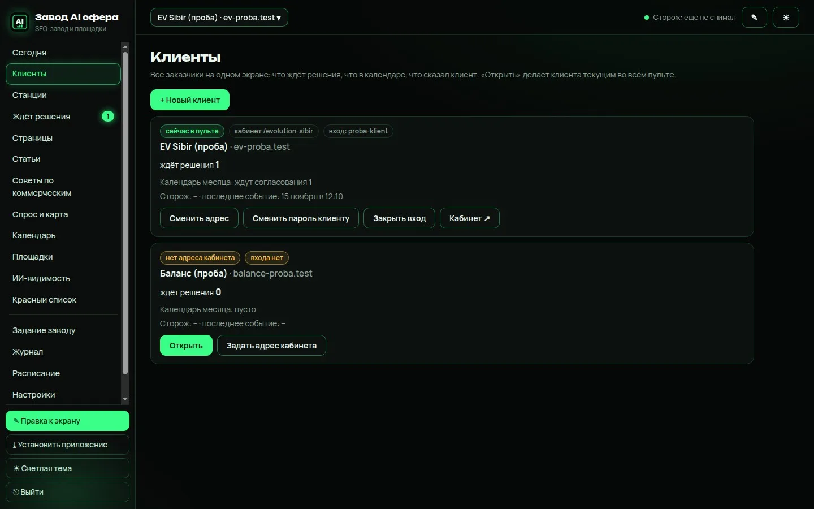
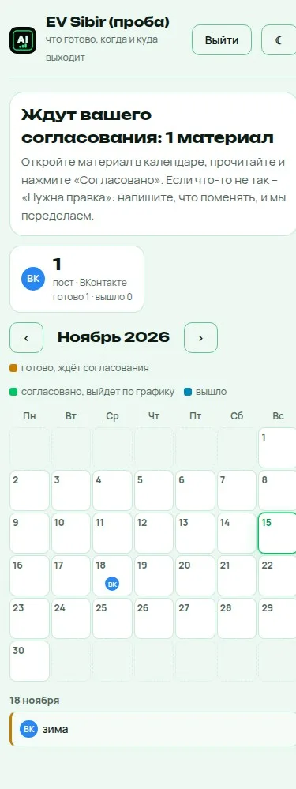

# В заводе есть раздел «Клиенты», а у EV Sibir свой кабинет с отдельным входом

Сделано, проверено и выложено 15.11.2026. Ваш адрес – zavod.сеоконтентзавод.рф, кабинет клиента – zavod.сеоконтентзавод.рф/evolution-sibir.

## Ваш пульт: все клиенты на одном экране

- Новый раздел «Клиенты» стоит вторым в меню, сразу после «Сегодня».
- По каждому клиенту видно:
  - что ждёт вашего решения;
  - что в календаре этого месяца: ждут согласования, согласовано, вышло, на правке;
  - сколько правок попросил клиент;
  - когда последний раз снимал сторож и когда было последнее событие.
- «Открыть» делает клиента текущим во всём пульте. Переключатель в шапке («EV Sibir ▾») теперь тоже работает и запоминает выбор.
- «+ Новый клиент»: название, домен и адрес кабинета. Так и заводим следующих.

## Кабинет клиента: отдельный адрес и свой вход

- Адрес – zavod.сеоконтентзавод.рф/<адрес клиента>. У EV Sibir это /evolution-sibir.
- Вход по логину и паролю, «Запомнить меня» включено сразу: вход на год.
- Клиент видит только свой сайт: календарь, готовые тексты, кнопки «Согласовано» и «Нужна правка». Выходит всё по-прежнему только после вашего «да».
- Пароль выдаёте вы в «Клиентах» кнопкой «Выдать вход». Пароль показывается один раз, с кнопкой «Скопировать». «Сменить пароль» и «Закрыть вход» выкидывают клиента из кабинета.
- Старые ссылки с токеном больше не работают.

## Что проверено

- 480 автотестов. Среди них проверка, что клиент с подложенной cookie не попадает в пульт: я убрал защиту, тест упал, вернул защиту, тест прошёл.
- Независимый ревизор кода дыр не нашёл. Его 3 мелкие находки исправлены.
- Пробная копия на сервере, в браузере на 390 и 1440 px: вход клиента, его календарь, пульт с cookie клиента показывает только вход владельца, переключение клиента, выдача пароля, без горизонтальной прокрутки.
- На боевом заводе: база перешла на схему 11, перед этим сделана копия. Кабинет EV заведён, вход выдан, вход и выход проверены через API.

## Что нашёл по пути

- **Копия базы перед выкладкой не делалась с 14.11.** Скрипт проверял файл без прав на папку. Исправлено: теперь при любой выкладке копия свежая, иначе выкладка останавливается. Урок записан, в других проектах такой ошибки нет.
- **Библиотека веб-сервера устарела**, аудит нашёл уязвимости. Опасную для завода (перегрузка подделанным запросом) закрыл на Caddy. Обновление библиотек записал в техдолг: это отдельная работа.

## Нужно от вас

1. Войдите на zavod.сеоконтентзавод.рф и откройте «Клиенты».
2. Логин и пароль кабинета EV лежат в файле ~/.config/zavod/klienty/evolution-sibir.txt. Отправлять их клиенту – ваше решение. В кабинете он сейчас увидит 4 поста на согласование.

## Что раскрыть

- Как завести следующего клиента от начала до конца.
- Что ещё показывать клиенту в кабинете, кроме календаря.
