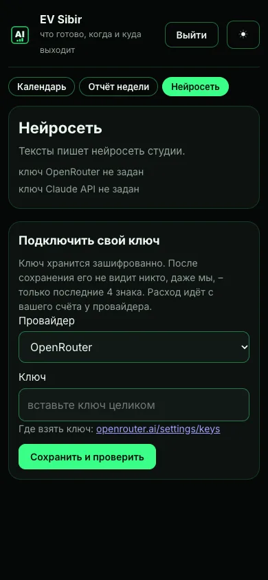
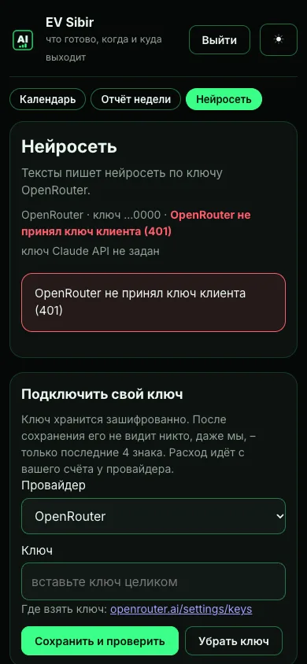
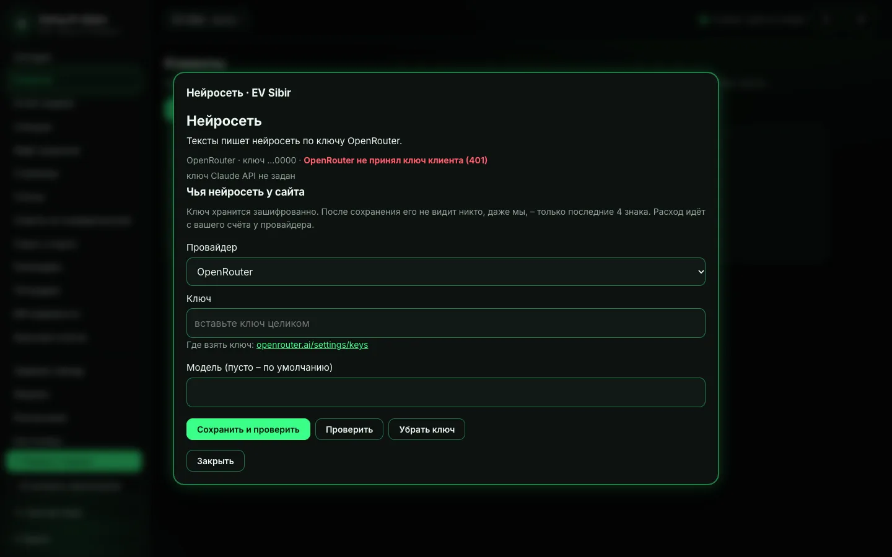

# Завод клиенту без кода: выложено

**Вывод.** Завод уже можно отдавать клиенту кабинетом. Он работает, пульт и код закрыты, а тексты клиента пишет нейросеть по его собственному ключу. От тебя нужна одна команда на сервере: мастер-ключ. Без него клиент пока не сохранит свой ключ.

Сделано 17.11.2026, выложено на zavod.сеоконтентзавод.рф и проверено снаружи.

## 1. Снаружи закрыто всё, кроме окна входа и кабинетов

- Без входа владельца `/` и `/index.html` показывают только окно входа. Скрипты экранов пульта отвечают 401.
- Ревизор нашёл обходы: `/index.html/`, `//ekrany.js`, `/%2Fekrany.js`, `/x/../ekrany.js`. Замок перенесён в саму раздачу файлов, она проверяет итоговый файл. Все обходы проверены на живом адресе: 401.
- Кабинет клиента (`/evolution-sibir`) открывается как раньше. API без входа отвечает 401.
- Код, промты станций, красный список и ключи студии к клиенту не попадают: они живут только на сервере.

## 2. Тексты клиента – на его нейросети

- У клиента в кабинете новая вкладка «Нейросеть». Он вставляет ключ **OpenRouter** или **Claude API**, завод сохраняет его и проверяет.
- Модели по умолчанию: OpenRouter – `anthropic/claude-opus-5.5`, Claude API – `claude-opus-5-5`. Модель можно сменить в пульте.
- Ключ хранится только шифром AES-GCM. После сохранения его не видит никто, только последние 4 знака. Проверено: ключа открытым текстом нет ни в базе, ни в журнале WAL, ни в копиях.
- Нет ключа, ключ не принят или кончились деньги – задача ждёт. На нашу подписку она **не переходит**.
- Если деньги клиента уже потрачены, а дальше случился сбой, задача закрывается без автоповтора, чтобы не платить дважды.
- В пульте у каждого клиента есть кнопка «Нейросеть». Там видно, чей ключ работает и в каком он состоянии, и можно вернуть клиента на нейросеть студии.







## 3. Чего нет и почему

- **Подписка Claude клиента** – не подключал. Условия Anthropic запрещают сторонним продуктам вход по подписке claude.ai без их одобрения. Замена – ключ Claude API клиента.
- **Подписка Codex клиента** – можно, но на сервере нет Codex. Это следующий шаг: Codex на сервер и вход клиента по коду из кабинета.
- **Данные для анализа** уже у нас: завод, база и расход живут на нашем сервере. Отдельный экран «сводка по всем клиентам» – следующий шаг.

## Проверено

- 581 автотест, из них 47 новых. Тест обходов краснеет, если снять замок.
- Два независимых ревизора нашли 4 дефекта, все исправлены: обход замка путём, платные повторы за счёт клиента, «работает» при отозванном ключе, зависание пульта на проверке ключа (было 3,7 с, стало 0,0 с).
- Проверка перед выкладкой: секретов нет, новые маршруты закрыты входом. `cryptography` поднята до 50.0.2 из-за уязвимостей. Старые уязвимости starlette остаются техдолгом.
- Живой адрес: владелец входит и видит пульт, база на схеме 13, службы active.

## Нужно от тебя

1. **Мастер-ключ на сервере.** Правку боевого `zavod.env` мне не дала система прав. Выполни на claude-vps:

```
sudo cp -p /opt/zavod/zavod.env /opt/zavod/zavod.env.do-master
echo "ZAVOD_MASTER_KEY=$(python3 -c 'import os,base64;print(base64.b64encode(os.urandom(32)).decode())')" | sudo tee -a /opt/zavod/zavod.env >/dev/null
sudo systemctl restart zavod-api zavod-worker
```

   Ключ никогда не меняй: им зашифрованы ключи клиентов. Сохрани копию файла в надёжное место. Потерял ключ – клиенты вводят свои ключи заново.
2. **Что дальше:** Codex клиента, экран «Настройки» клиента или сводка «данные по всем клиентам»?
3. **Главный чат завода.** Этот чат разжирел (333 тыс. на шаг), пора переезжать.

## Что раскрыть

- Как клиенту получить ключ OpenRouter и сколько он будет платить за статью.
- Как устроен вход клиента в Codex по коду из кабинета.
- Что именно мы видим по клиенту для анализа.
