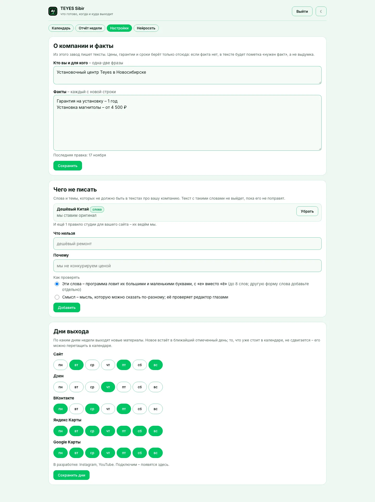
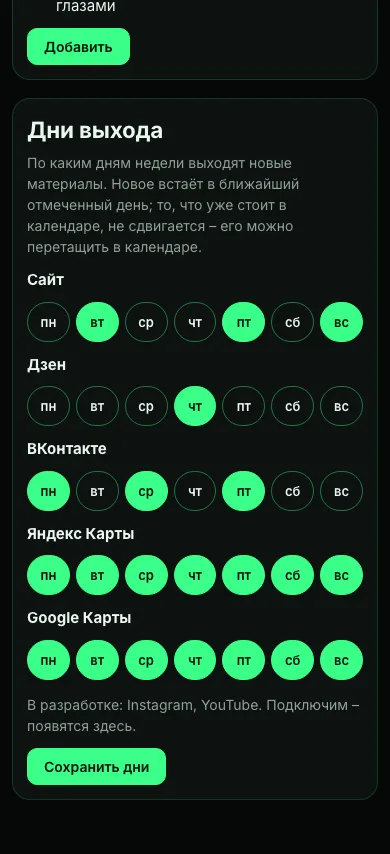

# Завод: клиент сам настраивает факты, запреты и дни выхода

Вкладка «Настройки» в кабинете клиента работает в бою с 17.11: клиент без нас правит, что о нём писать, чего не писать и по каким дням выходить. Мастер-ключ на сервере тоже стоит – клиент может сохранить свой ключ OpenRouter или Claude API.

**Нужно от тебя:** выбрать, что дальше – «Знакомство» по сайту клиента, свод данных по всем клиентам или Codex клиента (цены ниже, в «Что раскрыть»).

## Клиент правит сам три вещи, слой студии закрыт

- **О компании и факты.** «Кто вы и для кого» и факты построчно. Цены, гарантии и сроки завод берёт только отсюда; факта нет – в тексте пометка «нужен факт», а не выдумка.
- **Чего не писать.** Слова – программа ловит их большими и маленькими буквами, с «е» вместо «ё», только целые слова. Смысл – проверяет редактор глазами. Текст с запретом не выйдет. Правила студии клиент видит числом, удалить не может.
- **Дни выхода.** По каждому рабочему каналу – дни недели. Пустым канал не оставить: иначе завод понял бы это как «каждый день».
- **Закрыто:** какой канал подключён, промты, проверки, пороги, ключи студии, выкладка.

## Проверено: тесты, ревизор и живой адрес

- **Тесты:** 591 прошли, из них 10 новых – чужой сайт, повтор правила, попытка подсунуть свою регулярку, старый словарь фактов.
- **Ревизор** нашёл 5 дефектов, все исправлены до выкладки: одно слово в разном регистре давало 3 запрета; у сайта со старым именем настройки запреты не ловились в статьях; открытие вкладки само писало в базу; старый словарь фактов портился (молча выключался режим «цены не пишем»); запрос без списка фактов стирал все факты.
- **Браузер (локально):** 1440 светлая и 390 тёмная – сохранение и перезагрузка, без горизонтальной прокрутки, дни недели в один ряд на телефоне.
- **Бой, 17.11 03:40 НСК:** запись без входа – 401 на всех маршрутах; общим входом прочитаны кабинеты TEYES, Баланса, EV. Перед выкладкой – deploy-check: GO, утечек нет (gitleaks).
- **Мастер-ключ:** создан на сервере, процесс API его видит, шифр туда-обратно – да. Копии: /root/zavod-master-key.txt на сервере и ~/.config/zavod/master-key.txt на маке, оба закрыты (600). Не ротировать.

## Что выяснилось по дороге

- **Фактов нет ни у одного клиента** – 0 строк у TEYES, Баланса и EV (база, 17.11). Сейчас цены и гарантии в тексты не попадают. Заполнить можно в «Настройках» руками или станцией «Знакомство» по сайту.
- **У владельца в пульте такого экрана нет** – правишь через кабинет общим входом. Сделать в пульте – 2–3 ч.
- **Техдолг:** правка настроек владельцем (PUT /v1/sites/{sid}/settings) принимает любое поле без белого списка; starlette 0.41.3 с известными уязвимостями – в бою и раньше, эта правка его не трогала.

Код и коммиты

Репо tema-mail/zavod-ai-sfera, коммиты 7d853c0 (маршруты /v1/klient/nastroyki, engine/api_nastroyki.py), d633502 (окно web/nastroyki.js, вкладка в кабинете), cc386d6 (состояние). Затрачено ~1 ч 20 мин.

## Что раскрыть

1. Знакомство по сайту для TEYES, Баланса, EV – факты кандидатами на «да», 1–2 ч на троих (станция уже есть).
2. Свод по всем клиентам: расход, выходы, ошибки, заявки – 6–10 ч.
3. Codex клиента по подписке: вход из кабинета – 12–20 ч, риск по условиям входа.
4. Экран «Настройки» у владельца в пульте – 2–3 ч.
