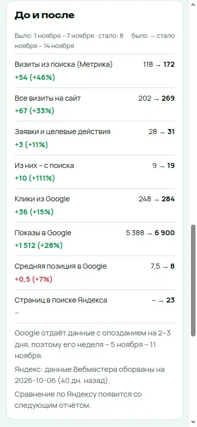
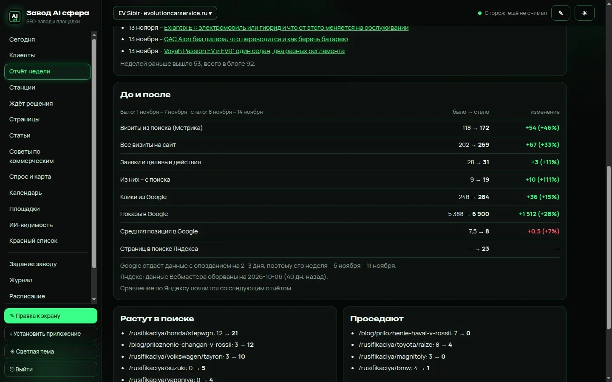

# У Evolution есть отчёт недели: в кабинете клиента и в вашем пульте, первый уже собран

Сделано, проверено и выложено 15.11.2026. Отчёт собирается сам каждый понедельник в 09:45 МСК. Баланс, как вы сказали, пока не трогал.

## Что в отчёте

- **Главное за неделю** – 5–8 фраз с цифрами: сколько вышло, что выросло, что просело, что дальше.
- **Что вышло** – каждая статья блога с датой и ссылкой, плюс посты на площадках. Статьи считаются по самому сайту, по дате публикации в разметке: статьи EV выкладывает старая автоматика, а не завод.
- **До и после** – неделя к прошлой неделе: визиты из поиска, все визиты, заявки, клики и показы Google, позиция, страниц в поиске Яндекса.
- **Растут и проседают** – страницы, где визитов из поиска стало заметно больше или меньше.
- **Куда идём** – что запланировано на следующую неделю. В вашем пульте здесь же решения, которые ждут вас, и записка советника. Клиент этого не видит.

## Первый отчёт EV: 8–14 ноября

- На сайте вышло 15 статей. Неделей раньше вышло 53: тогда была большая пачка. Всего в блоге 92 статьи.
- Визиты из поиска: 172, неделей раньше 118 (+46%).
- Заявки и целевые действия: 31, неделей раньше 28 (+11%). С поиска – 19, было 9.
- Google: 284 клика (+15%), 6 900 показов (+28%), средняя позиция 7,5 → 8.
- Больше всего выросла русификация Honda Stepwgn: 12 → 21 визит. Сильнее всего просела статья о приложении Haval: 7 → 0.
- В Яндексе 23 страницы. Вебмастер не обновляется с 06.10 из-за аварии Яндекса, сравнение появится со следующим отчётом.

## Что проверено

- 496 автотестов: границы недель, «нет данных» вместо нуля, клиенту без внутренней кухни, чужой сайт закрыт.
- Независимый ревизор нашёл 5 важных и 7 мелких проблем, все исправлены. Главные: сбой Метрики превращался в «все страницы упали до нуля», а клиенту уходили технические тексты ошибок.
- Первый отчёт собран на боевом заводе за 32 секунды. Через вход клиента EV он открывается, внутренней кухни в нём нет.
- В браузере на 390 и 1440 px, на копии с тестовыми логинами и цифрами этого отчёта.

## Что нашёл и починил по пути

- **Сторож EV сегодня в 04:01 не снял Метрику:** она ответила «запрос слишком сложный». Починил, новый прогон снял все три источника. Авария и починка ушли через бот Евы.
- **После выкладки браузер мог часами показывать старую версию окон.** Теперь сервер просит каждый раз сверять файлы.

## Нужно от вас

1. Откройте в пульте «Отчёт недели». Клиент EV видит его во вкладке «Отчёт недели» в своём кабинете.
2. Скажите, что добавить или убрать в отчёте: например, звонки, позиции по ключевым запросам или деньги на рекламу.

## Что раскрыть

- Откуда берётся каждая цифра и почему Google отстаёт на 3 дня.
- Как подключить к отчёту следующего клиента.
