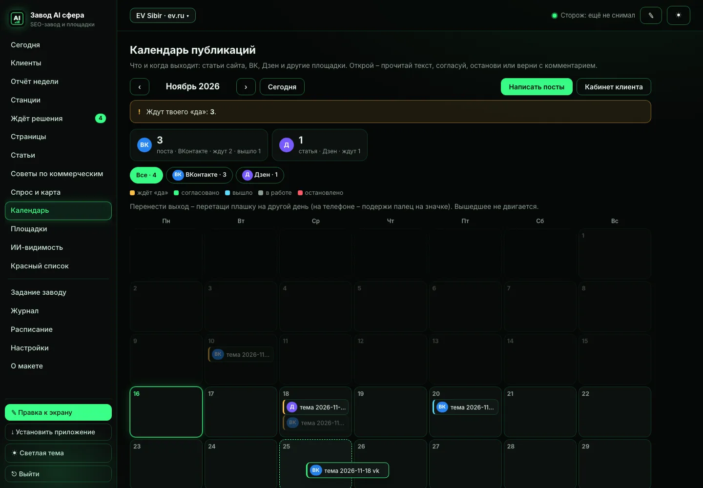
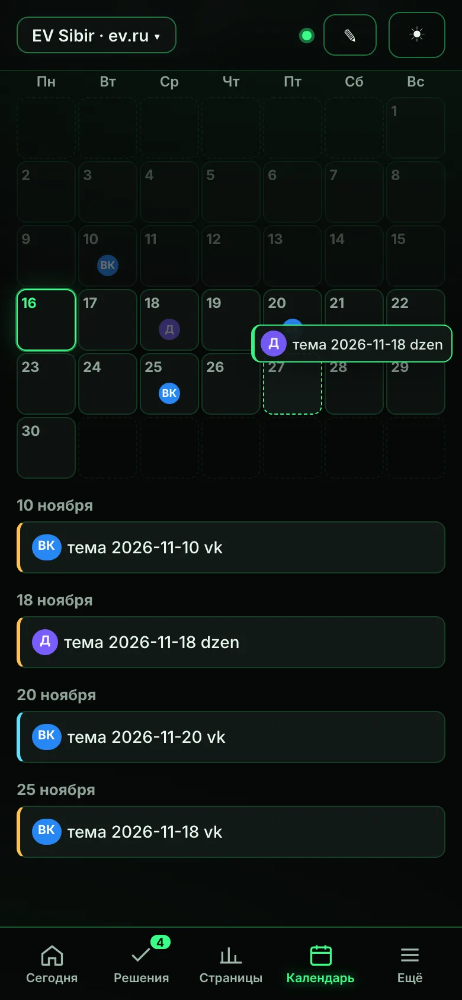

# Завод: публикацию переносят перетаскиванием плашки

**Вывод:** в календаре завода плашку публикации можно взять и бросить на другой день – мышью или пальцем. Выложено на zavod.сеоконтентзавод.рф 16.11.

## Как работает

- **Компьютер:** взял плашку, бросил на день. Целевой день – пунктиром, после отпускания «Перенесено на …». Щелчок по-прежнему открывает карточку.
- **Телефон:** подержать палец на значке 0,35 с и тянуть. Плашка идёт над пальцем, чтобы день было видно; быстрый свайп – прокрутка.
- **Нельзя:** двигать вышедшее и класть на прошедшие дни. В кабинете клиента не тянется – там только отметки.
- Перенос – тот же, что кнопка «Перенести день» в карточке: движок не менялся. На другой месяц – кнопкой.

## Что проверено

- 536 тестов прошли, новый – перетаскивание только у владельца, вышедшее не тянется, в прошлое не кладётся.
- Локальный завод с пробными постами, Chromium 1440: перенос 18→25 записан в базе; вышедшее не берётся; бросок на 12-е (прошлое) не сработал; щелчок открыл карточку.
- 390 касанием: удержание и перенос 18→27 записан, страница не уехала; свайп без удержания ничего не перенёс.
- Живой адрес: новые kanaly.js и kalendar.js отдаются, у кабинета клиента переноса нет, окно 200, API без входа 401.
- Вживую в календаре EV ничего не таскал – чтобы не двигать настоящие публикации клиента.

## Нужно от тебя

- Попробовать на своём календаре: перетащить любую плашку «ждёт да» и вернуть обратно.

## Что раскрыть

- Перенос между месяцами перетаскиванием (сейчас – кнопкой).
- Кнопка «Вернуть» в подсказке после переноса.

Коммиты 82eb1be, 89622b6 в tema-mail/zavod-ai-sfera.
