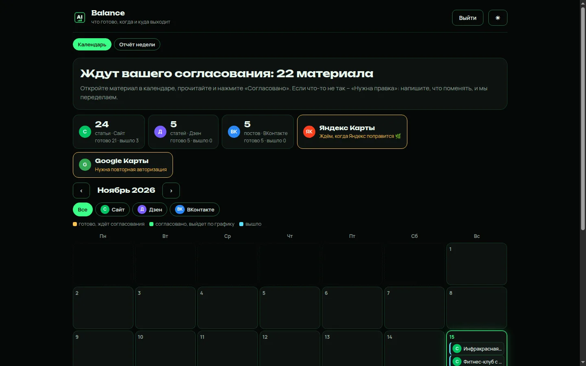
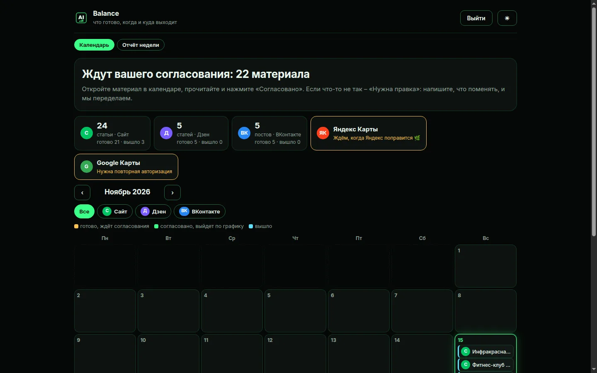

# Завод: шрифт как на EV – Inter, в пульте и у всех клиентов

Вместо широкого Unbounded в заголовках и Manrope в тексте теперь везде Inter, тот же, что на сайте и в ЛК EV.

## До и после

Было – широкие заголовки:

Стало – обычный Inter:

## Что проверено

- Заменил во всех 4 файлах окна: пульт, кабинет клиента, календарь, аналитика. Старых шрифтов в коде не осталось.
- Тесты завода прошли, выкладка на сервер: окно 200, API без входа 401.
- Живой кабинет Баланса снят после выкладки – шрифт новый. Пульт отдаёт Inter (проверил код страницы на сервере).

## Нужно от тебя

- Ничего. Если хочешь крупнее или жирнее заголовки – скажи.

## Что раскрыть

- Шрифт грузится с Google Fonts, как и раньше. На EV он лежит на своём домене – можно так же, если надо.
