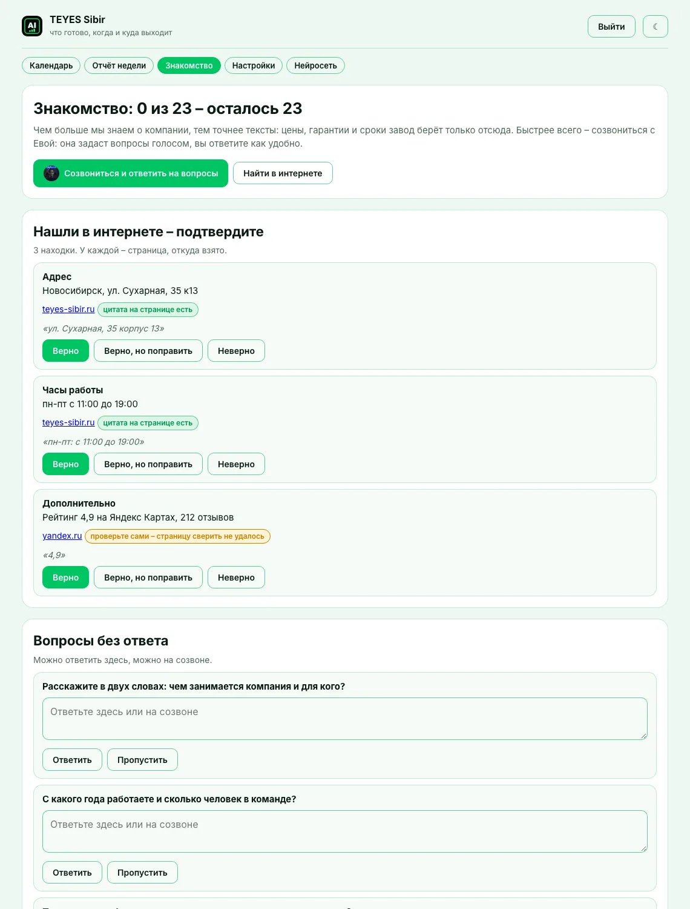
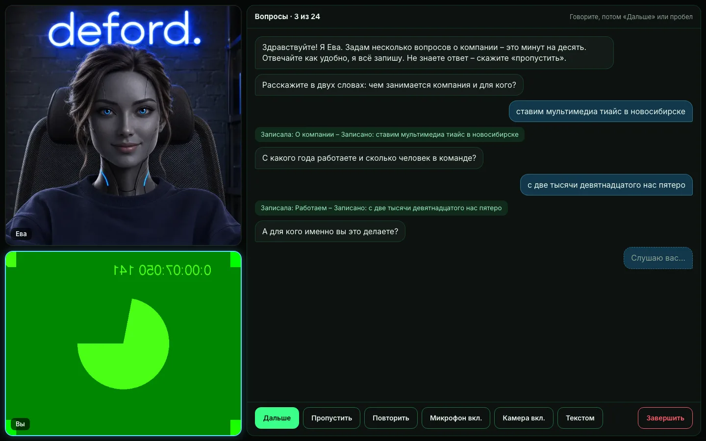
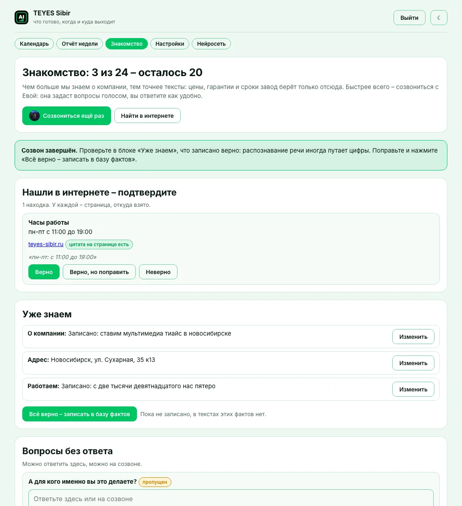
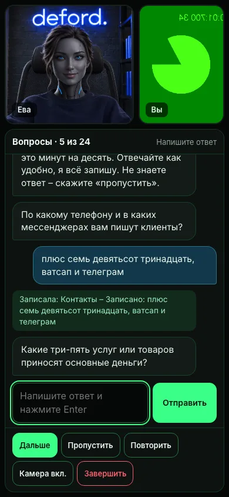

# Завод сам знакомится с клиентом: поиск в интернете и созвон с Евой

Знакомство по интернету и созвон с Евой собраны и выложены на сервер 17.11, но видны пока только тебе под входом СВЕРХ админа. Окно пересобрано по твоему выбору 1В 2Б 3Б 4Б 5Б, голос Мередит включён. Вживую с настоящим микрофоном и настоящей нейросетью созвон ещё никто не проходил: это и есть приёмка.

**Нужно от тебя, два шага:**

1. Зайти в кабинет TEYES под СВЕРХ админом → вкладка «Знакомство» → «Найти в интернете». Через две-три минуты появятся находки. То же для Баланса и EV. Сам я это запустить не смог: запись в боевую базу мне закрыта, а твой пароль я не беру.
2. Подтвердить находки карточками, потом нажать «Созвониться и ответить на вопросы» в Chrome и пройти хотя бы пять вопросов голосом.

## Что теперь умеет завод

**Анкета клиента – 22 вопроса** в семи разделах: компания, услуги и цены, гарантии и сроки, клиенты, отличия, запреты и тон, заявка. У каждого вопроса состояние: спросить, нашли в интернете, подтверждено, отвечено, неверно, пропущено.

**Поиск в интернете.** Станция завода идёт по сайту клиента, картам, 2ГИС, отзывам и соцсетям. Каждая находка приходит с адресом страницы и дословной цитатой. Код сам открывает страницу и сверяет цитату. Не сверилось – находка остаётся, но с жёлтой пометкой «проверьте сами».

**Созвон с Евой.** Окно как переписка: слева Ева и твоя камера, справа лента – вопрос, твой ответ текстом, зелёной строкой то, что Ева записала. Ева говорит голосом Мередит, ты отвечаешь голосом или текстом. Найденное в интернете подтверждаешь карточками в кабинете до созвона, на созвоне остаются только вопросы без ответа. Ответ уходит кнопкой «Дальше» или пробелом, сама Ева не перебивает.

**Уточняющие вопросы.** Ответ сохраняется сразу, следующий вопрос идёт без ожидания. Нейросеть в это время разбирает ответ: вынимает суть и, если не хватает цифры или срока, ставит уточняющий вопрос следом.

**Итог только по «да».** После созвона открывается кабинет, вкладка «Знакомство»: в блоке «Уже знаем» всё, что записано. Правишь и жмёшь «Всё верно – записать в базу фактов». Только тогда факты попадают в базу и в тексты.

**Голос.** Реплика озвучивается на сервере один раз и хранится: вопрос длиной 3 секунды готов за 1,2 секунды, повторно звучит сразу. Не ответил сервис – окно говорит голосом браузера.

## Что проверено и чем

| Что | Как проверено | Итог |
|---|---|---|
| Весь код | 678 тестов, из них 87 новых | проходят |
| Голос Мередит | настоящий вызов на сервере после выкладки | 1,2 с на вопрос, звук 3 с |
| Промт поиска | три боевые компании, настоящий Claude на сервере, 6 вызовов | 50 находок, 45 сверены кодом, выдумок не найдено |
| Созвон целиком | браузер 1440 и 390, подставные камера, распознавание, нейросеть и звук | проходит до записи фактов, ошибок страницы нет |
| Защита | независимый ревизор, свои пробы | чужой сайт недоступен ни по одному маршруту |
| Живой адрес | после выкладки | без входа 401 на всех маршрутах, окно отдаётся |

По компаниям: TEYES – 18 находок, все сверены; EV – 17, все сверены; Баланс – 15, сверены 10. Пять находок Баланса с Zoon и Яндекс Карт не сверились: эти площадки отвечают отказом на частые запросы.

Ревизор нашёл 12 дефектов, все исправлены до выкладки. Самые опасные: клиент мог наплодить десятки процессов нейросети; кривой ответ модели подтверждал всё найденное, включая то, что человек назвал неверным; второе «нет» могло лечь в базу фактов словом «нет».

## Правила, которые я заложил

**Важные – на них держится доверие к фактам. Менять только осознанно.**

| Правило | Зачем |
|---|---|
| В базу фактов – только после «Всё верно» | распознавание речи путает цифры |
| Находка – только с адресом страницы и цитатой, цитату сверяет код | иначе нейросеть выдумает |
| Непонятный ответ нейросети ничего не подтверждает | молчание не знак согласия |
| Разбор не затирает правку человека | человек главнее модели |
| Клиент видит только свой сайт | чужие данные |
| Раздел закрыт клиентам, пока ты не откроешь | клиент не должен видеть недоделанное |
| Не больше 3 разборов сразу, каждый до 90 секунд | иначе клиент может положить сервер |
| Поиск в интернете – всегда нейросеть студии | у ключа клиента нет поиска |
| Разбор ответов – на ключе клиента, если он задан; на наш не уходит | твоё правило про деньги клиента |
| Камера никуда не уходит и не пишется | это не видеозвонок |
| Озвучка – бесплатная модель; платную включать только по твоему слову | бесплатно до 30.11, потом окно само перейдёт на голос браузера |

**Неважные – значения по умолчанию, меняются одной строкой.**

| Что | Сейчас |
|---|---|
| Сами вопросы и их формулировки | 22 штуки |
| Отправка ответа | только кнопкой или пробелом |
| Найденное подтверждать | карточками в кабинете; можно пачкой или по одному на созвоне |
| Уточнений на вопрос | не больше двух |
| Поиск в интернете клиенту | раз в сутки |
| Длина одного факта | 400 знаков |
| Имя и лицо собеседника | Ева; для клиента задаётся в настройках сайта |
| Голос | Мередит; задаётся в настройках сайта |
| Слова приветствия и прощания | в коде беседы |
| Сколько ищет нейросеть | до 10 поисков и 15 страниц |

## Что не проверено и где риск

- **Живой микрофон.** Распознавание речи в твоём Chrome не проверено: в проверке стояла подставка. Из России оно ходит на серверы Google и может не ответить – тогда окно само переключится на текст.
- **Настоящий разбор ответов.** Промт разбора проверен только на подставных ответах. По правилу студии промт готов после 3–5 реальных примеров – их даст твой первый созвон.
- **Поиск через очередь завода на сервере** целиком не запускался: вызовы шли вручную той же командой.
- **«Сверено» значит «цитата есть на странице»,** а не «факт верен». Пример: год основания Баланса с чужого сайта мог оказаться годом тёзки. Поэтому подтверждаешь ты.
- **Сеть филиалов.** У Баланса поиск вернул адрес одного клуба из трёх. Нужна доработка под филиалы.
- **Озвучка после 30.11.** Бесплатная модель голоса кончается 30.11. Цену платной я не проверял.

Код, коммиты и цена

Репо tema-mail/zavod-ai-sfera, ветка main, девять коммитов 424e59d … 02c10d0.

- `engine/anketa.py` – анкета, 22 пункта, запись в настройки по «да». Миграция базы 14: три таблицы.
- `engine/znakomstvo_internet.py`, `engine/st_znakomstvo.py` – поиск в интернете и сверка цитат.
- `engine/beseda.py` – порядок вопросов, разбор ответа, итог.
- `engine/api_znakomstvo.py` – 14 маршрутов для кабинета, окна созвона и пульта.
- `engine/golos.py` – озвучка реплик и хранение звука; ключ `ZAVOD_GOLOS_KLYUCH` в окружении сервера (тот же, что у бота Евы).
- `web/znakomstvo.js` – вкладка в кабинете; `web/zvonok.html`, `web/zvonok.js` – окно созвона.
- План со всеми решениями: `docs/plan-znakomstvo.md`.

Цена одного поиска по компании: 83–133 секунды и $0,25–0,33 в пересчёте на тариф, по факту идёт по подписке студии. Созвон: один вызов нейросети на ответ, около 10 секунд в фоне.

Открыть раздел клиенту: настройка сайта `znakomstvo_klientu: true`.

## Что раскрыть

1. Как именно Ева решает, задавать ли уточняющий вопрос, и текст этого промта.
2. Какие 22 вопроса в анкете и что из них ищется в интернете.
3. Что нужно доделать для сети филиалов.
4. Как подключить настоящие «Встречи» вместо имитации и сколько это стоит.
